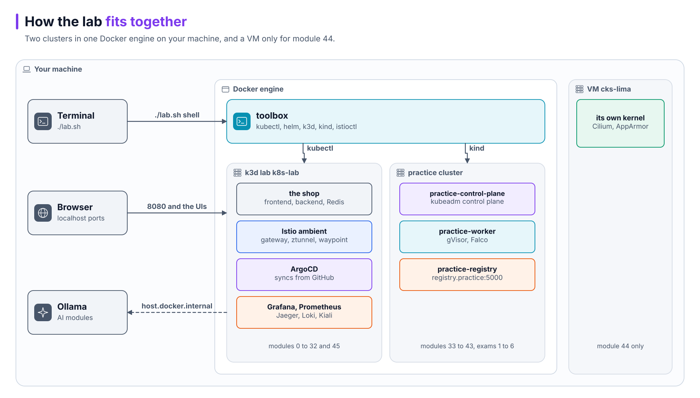
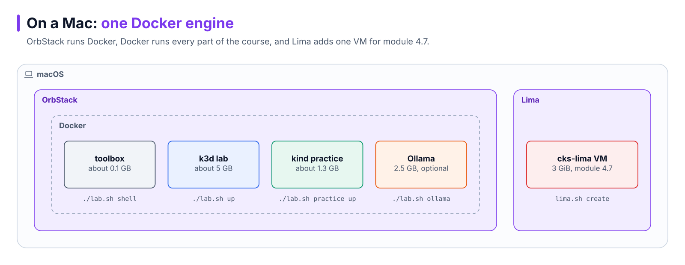
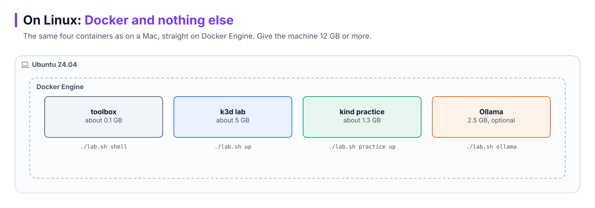
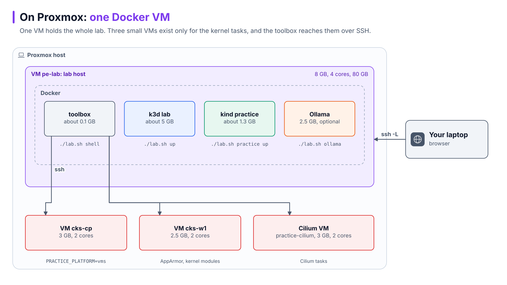
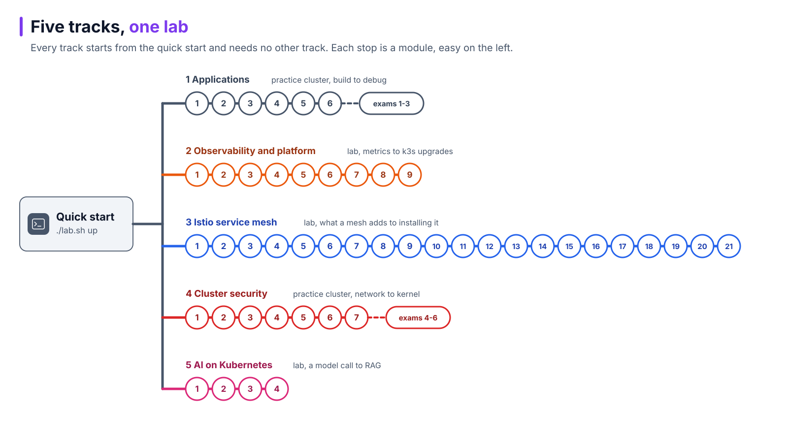

# k8s_lab_macos

A Kubernetes platform lab and a hands-on course that run on your own machine, with nothing but Docker and git. This page is the whole guide: read it once, then come back to the tables while you study.

1. [What this is](#what-this-is)
2. [Quick start](#quick-start)
3. [Logins and addresses](#logins-and-addresses)
4. [Everyday commands](#everyday-commands)
5. [The course](#the-course)
6. [Practice cluster and timed tasks](#practice-cluster-and-timed-tasks)
7. [AI models](#ai-models)
8. [Where it runs](#where-it-runs)
9. [Troubleshooting](#troubleshooting)
10. [Remove everything](#remove-everything)
11. [Reference](#reference)

## What this is

The lab is a small online shop that runs in a Kubernetes cluster on your machine, together with the tools a platform team uses every day: Istio, ArgoCD, cert-manager, Prometheus, Grafana, Jaeger, Loki, Kiali and Headlamp. You change the cluster on purpose, for example by sending 10% of the traffic to a new backend, and then watch the result in the web UIs. The course builds on it in seven tracks that each start from scratch and get harder as they go, beginning with track 0 on Docker itself, which needs no cluster at all.



| Name | What it is |
|---|---|
| The lab | The k3d cluster `k8s-lab`: one k3s node in Docker with the shop, Istio ambient mesh, ArgoCD and every UI. Tracks 2, 3, 5 and 6 run here. |
| The toolbox | A container with kubectl, helm, k3d, kind and istioctl at the tested versions, so your machine needs only Docker and git. |
| The practice cluster | Two kubeadm nodes that kind runs as containers, for the timed tasks and exams of tracks 1 and 4. |
| The VM | `cks-lima`, a Lima VM with a kernel of its own, only for module 4.7 and a few tasks of exams 5 and 6. |
| Ollama | The program on your machine that runs the language model for track 5. |

The [glossary](platform-engineering/glossary.md) explains every other term, so keep it open in a tab.

## Quick start

Your machine needs Docker and git. On a Mac, Docker comes from [OrbStack](https://orbstack.dev) with 8 GiB of memory or more, and [Where it runs](#where-it-runs) covers Linux and Proxmox.

1. Clone the repository.

   ```bash
   git clone https://github.com/miekuskamil/k8s_lab_macos.git
   cd k8s_lab_macos
   ```

2. Open a shell in the toolbox. The first time, Docker builds its image in about a minute, and then the prompt starts with `(lab)`.

   ```bash
   ./lab.sh shell
   ```

3. Build the lab. The first run downloads the images and takes about 10 minutes, and the command waits until every health check passes. Running it again is safe.

   ```bash
   ./lab.sh up
   ```

4. Open the shop at http://localhost:8080, then start [module 1.1](platform-engineering/1-applications/01-setup.md), or the first module of any [track](#the-course). New to containers? Start with track 0, [module 0.1](platform-engineering/0-docker/01-containers-and-images.md), which needs only `./lab.sh shell`.

The clusters run as containers on your Docker engine, so they keep running after you leave the shell. Every `./lab.sh` command works the same inside and outside the toolbox, except `./lab.sh task` and `./lab.sh exam` for module 4.7 and exams 5 and 6, which reach the Lima VM with `limactl` and so run in a terminal on your Mac.

### Topologies

Every part of the course runs in Docker, so the same four containers appear on each supported machine: the toolbox, the k3d lab, the kind practice cluster and, if you want it, Ollama. Pick one set. A Mac and a Proxmox host each make a complete set of their own, and the two never talk to each other.



| On a Mac | Needs |
|---|---|
| Memory | 16 GB in the Mac, with 8 GiB or more given to OrbStack, plus 3 GiB for the Lima VM in module 4.7 |
| CPU | 4 cores |
| Disk | 50 GB free |
| Software | OrbStack and git, plus Lima (`brew install lima`) for module 4.7 and Ollama for track 5 |



| On Linux | Needs |
|---|---|
| Memory | 12 GB or more |
| CPU | 4 cores |
| Disk | 50 GB free |
| Software | Ubuntu 24.04 with Docker Engine, Compose, Buildx and git, as [Linux](#linux) shows |



| On Proxmox | pe-lab, the lab host | cks-cp and cks-w1, module 4.7 | practice-cilium, the Cilium tasks of 4.7 |
|---|---|---|---|
| Memory | 8 GB minimum, 12 to 16 GB comfortable | 3 GB and 2.5 GB | 3 GB |
| CPU | 4 cores | 2 cores each | 2 cores |
| Disk | 80 GB | 30 GB each | 30 GB |
| Software | Ubuntu 24.04 with Docker and git, from `install-lab.sh` | Ubuntu 24.04, reached over SSH from the toolbox | Ubuntu 24.04 with kubeadm and Cilium, the Proxmox counterpart of the Mac's Lima VM |

`create-vms.sh course` builds `pe-lab`, and `create-vms.sh cks` builds the three small VMs, `cks-cp`, `cks-w1` and `practice-cilium`.

## Logins and addresses

The shop answers as soon as `./lab.sh up` finishes, and every other UI needs `./lab.sh ui` running in a spare terminal.

| UI | Address | User | Password |
|---|---|---|---|
| The shop | http://localhost:8080 | none | none |
| ArgoCD | http://localhost:8081 | `admin` | `k8s-lab-admin` |
| Grafana, with Prometheus, Loki and Jaeger as data sources | http://localhost:3000 | `admin` | `k8s-lab-admin` |
| Prometheus | http://localhost:9090 | none | none |
| Alertmanager | http://localhost:9093 | none | none |
| Jaeger | http://localhost:16686 | none | none |
| Kiali, the Istio console | http://localhost:20001 | none | none |
| Headlamp, a web UI for the whole cluster | http://localhost:4466 | none | none |

Module 3.10 adds HTTPS for the shop on https://localhost:8443, and the practice cluster's ingress-nginx answers on http://localhost:30080 and https://localhost:30443. Every secret is a fixed default stored in Git, so every copy of the lab behaves the same, which stays safe only because nothing listens outside your machine. Headlamp has no login and acts as `cluster-admin`, so never publish its port on a network.

| Secret | Value | Defined in |
|---|---|---|
| Grafana `admin` | `k8s-lab-admin` | `manifests/base/03-lab-credentials.yaml`, and `helm/kiali-values.yaml` for Kiali's link |
| ArgoCD `admin` | `k8s-lab-admin` | `helm/argocd-values.yaml`, as a bcrypt hash |
| Redis | `k8s-lab-redis` | `manifests/base/03-lab-credentials.yaml` |
| Gitea `lab`, module 2.6 only | `lab-gitops-pass` | the `gitea admin user create` command in [module 2.6](platform-engineering/2-observability/06-gitops-with-argocd.md) |
| Gitea `lab`, module 6.2 only | `lab-gitops-pass` | the `gitea admin user create` command in [module 6.2](platform-engineering/6-sre/02-grafana-in-depth.md) |

## Everyday commands

Run every command from the repository folder. `./lab.sh help` prints the same list.

| Command | What it does |
|---|---|
| `./lab.sh up` | Builds the lab and waits for the health checks. Use it the first time, or to repair a broken lab. |
| `./lab.sh start` | Starts the lab again after a reboot, sleep or `./lab.sh stop`. |
| `./lab.sh stop` | Stops the lab and keeps its data, to free memory. |
| `./lab.sh status` | Shows the nodes, the ArgoCD applications and every pod that is not running. |
| `./lab.sh ui` | Opens the web UIs on localhost until you press Ctrl-C. |
| `./lab.sh test` | Sends 100 requests to the shop and prints the status codes, the versions and the latency. |
| `./lab.sh test 3.4 3.5` | Runs the checks for modules 3.4 and 3.5. `./lab.sh test all` runs every lab module that is safe to repeat, in about 50 minutes. |
| `./lab.sh reset` | Removes the course exercises and restores the Git baseline. `--all` also removes the course namespaces. |
| `./lab.sh down` | Deletes the lab after it asks. |
| `./lab.sh practice up` | Builds the practice cluster, about 3 minutes the first time. `reset` builds it again, `down` deletes it. |
| `./lab.sh practice shell` | Opens a root shell on the control plane. Add `worker` for the worker node. |
| `./lab.sh task list` | Lists every timed task, such as `4.1.3`. `setup`, `check` and `solve` work on one task. |
| `./lab.sh exam setup 4` | Prepares practice exam 4 and starts its 2-hour clock. `score` and `solve` follow. |
| `./lab.sh ai` | Copies the AI settings from `lab.env` into the cluster. |
| `./lab.sh ollama` | Runs Ollama in a container, for a machine without Ollama. |
| `./lab.sh toolbox build` | Builds the toolbox image again after a change in `toolbox/`. `toolbox stop` removes its container. |

ArgoCD deploys the lab from the `main` branch on GitHub, not from your working copy. The course changes Istio resources by hand with `kubectl apply`, so ArgoCD shows `OutOfSync` until `./lab.sh reset` puts the Git baseline back.

## The course

The course has seven tracks. Each one starts on a fresh lab with no other track behind it, and its modules get harder in order, so start at the first module of the track you want and go down its table. A module id joins the track and the module, so module 3.2 is the second module of track 3. If you're new to containers, take track 0 first: it builds the Docker knowledge every other track assumes. The last column says where a module runs: *docker* needs only Docker and the toolbox, *lab* is the k3d lab, *practice* the practice cluster, *VM* the Lima VM, and *AI* means it also calls a language model.

Every module explains one problem and the design that solves it, then gives you commands with the output you should see, then questions with answers, and ends with a clean-up. Run `./lab.sh reset` after each lab module.



### 0. Docker and Compose

For anyone new to containers, and the suggested starting point: what a container is, how images, Compose, storage, networking and security work on one Docker host, down to the packets. Every module runs in the toolbox with plain `docker` and `docker compose`, has tasks, and starts clean with `./lab.sh reset docker`.

| Id | Module | You learn | Runs on |
|---|---|---|---|
| 0.1 | [Containers and images](platform-engineering/0-docker/01-containers-and-images.md) | Namespaces and cgroups seen from the Docker host, layers, PID 1 and stop signals | docker |
| 0.2 | [Building images](platform-engineering/0-docker/02-building-images.md) | Dockerfiles, the build cache, multi-stage builds, .dockerignore, tags and digests | docker |
| 0.3 | [Docker Compose](platform-engineering/0-docker/03-docker-compose.md) | Services, networks, healthchecks and start order, .env, profiles, scaling | docker |
| 0.4 | [Storage](platform-engineering/0-docker/04-storage.md) | Volumes, bind mounts and tmpfs, what survives what, owners, backups | docker |
| 0.5 | [Networking in depth](platform-engineering/0-docker/05-networking-in-depth.md) | Bridges, veth pairs, Docker's DNS, isolation, masquerade, DNAT, tcpdump and conntrack | docker |
| 0.6 | [Security](platform-engineering/0-docker/06-security.md) | Non-root, capabilities, seccomp, read-only, limits, Trivy scans, cosign, secrets | docker |
| 0.7 | [Debugging containers](platform-engineering/0-docker/07-debugging.md) | A ladder from `ps -a` to a debug container, a broken Compose project | docker |
| 0.8 | [Capstone](platform-engineering/0-docker/08-capstone.md) | A scanned, signed, hardened app with a private network, proved from outside | docker |

### 1. Applications

For anyone new to Kubernetes: how an application gets built, shipped, configured, reached and debugged, as timed tasks.

| Id | Module | You learn | Runs on |
|---|---|---|---|
| 1.1 | [Setup](platform-engineering/1-applications/01-setup.md) | Check the lab, open the UIs, build the practice cluster, run one task | lab, practice |
| 1.2 | [Building and running applications](platform-engineering/1-applications/02-building-and-running-applications.md) | Images, Jobs and CronJobs, init and sidecar containers, volumes | practice |
| 1.3 | [Deploying and updating applications](platform-engineering/1-applications/03-deploying-and-updating-applications.md) | Rolling updates and rollbacks, blue-green and canary, Helm, Kustomize | practice |
| 1.4 | [Observing and debugging applications](platform-engineering/1-applications/04-observing-and-debugging-applications.md) | Probes, logs, `kubectl top`, debugging containers without a shell | practice |
| 1.5 | [Configuration and secrets](platform-engineering/1-applications/05-configuration-and-secrets.md) | ConfigMaps and Secrets, requests and quotas, RBAC, security contexts, CRDs | practice |
| 1.6 | [Services and networking](platform-engineering/1-applications/06-services-and-networking.md) | Services, NodePorts, Ingress, NetworkPolicies | practice |
| Exams | [1](platform-engineering/1-applications/practice-exam-1.md), [2](platform-engineering/1-applications/practice-exam-2.md), [3](platform-engineering/1-applications/practice-exam-3.md) | Modules 1.2 to 1.6 against a 2-hour clock, each harder than the one before | practice |

### 2. Observability and platform

For anyone who runs apps for others: watch plain apps first, then manage the platform with GitOps and policy, then the nodes and the cluster itself.

| Id | Module | You learn | Runs on |
|---|---|---|---|
| 2.1 | [Prometheus and alerting](platform-engineering/2-observability/01-prometheus-and-alerting.md) | Metrics from a plain app, PromQL, an SLO with a burn-rate alert, Alertmanager | lab |
| 2.2 | [Grafana as code](platform-engineering/2-observability/02-grafana-as-code.md) | Dashboards from ConfigMaps, variables, Grafana-managed alerts, trace-to-logs links | lab |
| 2.3 | [Logs with Loki](platform-engineering/2-observability/03-logs-with-loki.md) | How logs reach Loki, LogQL filters, numbers and percentiles from text | lab |
| 2.4 | [OpenTelemetry Collector and Tempo](platform-engineering/2-observability/04-opentelemetry-and-tempo.md) | A Collector between apps and back ends, span metrics, TraceQL | lab |
| 2.5 | [Continuous profiling with Pyroscope](platform-engineering/2-observability/05-continuous-profiling.md) | Flame graphs, self against total time, memory allocations | lab |
| 2.6 | [GitOps with ArgoCD](platform-engineering/2-observability/06-gitops-with-argocd.md) | Your own Git server, drift and self-heal, rollbacks, sync waves, ApplicationSets | lab |
| 2.7 | [Kyverno, policy as code](platform-engineering/2-observability/07-kyverno-policy-as-code.md) | Audit then Enforce, exceptions, mutation, generated defaults | lab |
| 2.8 | [Nodes, drains and cleanup](platform-engineering/2-observability/08-nodes-and-cleanup.md) | A second node, drains under traffic, PodDisruptionBudgets | lab |
| 2.9 | [k3s certificates, backups, upgrades](platform-engineering/2-observability/09-k3s-lifecycle.md) | Certificate rotation, backup and restore, a k3s upgrade. Rebuild the lab afterwards | lab |

### 3. Istio service mesh

For anyone who runs services that talk to each other: what a mesh adds, then its features one by one, then its internals, upgrades and installs. Read [Istio in one picture](platform-engineering/start-here.md) first.

| Id | Module | You learn | Runs on |
|---|---|---|---|
| 3.1 | [What a mesh adds](platform-engineering/3-istio/01-what-a-mesh-adds.md) | istioctl and Kiali, what Kubernetes networking leaves out, ambient and sidecar | lab |
| 3.2 | [Identity and mTLS](platform-engineering/3-istio/02-identity-and-mtls.md) | Where workload identity comes from and how the tunnel works | lab |
| 3.3 | [Authorization](platform-engineering/3-istio/03-authorization.md) | Policy at layer 4 and layer 7, and why you need both | lab |
| 3.4 | [Traffic routing](platform-engineering/3-istio/04-traffic-routing.md) | Weighted and content-based routing with the Gateway API | lab |
| 3.5 | [Resilience](platform-engineering/3-istio/05-resilience.md) | Timeouts, faults, circuit breaking, rate limiting | lab |
| 3.6 | [Mesh observability](platform-engineering/3-istio/06-mesh-observability.md) | What the mesh measures by itself, sampling, access logs | lab |
| 3.7 | [Incidents](platform-engineering/3-istio/07-incidents.md) | Find and fix four broken setups without being told the cause | lab |
| 3.8 | [Command reference](platform-engineering/3-istio/08-command-reference.md) | Troubleshooting commands for the cluster and for Istio, by layer | lab |
| 3.9 | [Sidecar mode](platform-engineering/3-istio/09-sidecar-mode.md) | The classic sidecar design, side by side with ambient | lab |
| 3.10 | [TLS at the edge](platform-engineering/3-istio/10-edge-tls.md) | HTTPS on the gateway, cert-manager, redirects, renewal | lab |
| 3.11 | [Egress](platform-engineering/3-istio/11-egress.md) | ServiceEntry, TLS origination, locking a pod in | lab |
| 3.12 | [JWT](platform-engineering/3-istio/12-jwt.md) | End-user identity, rules on token claims, 401 against 403 | lab |
| 3.13 | [Outlier detection and retries](platform-engineering/3-istio/13-outlier-detection-and-retries.md) | One bad pod out of three: retries hide it, outlier detection removes it | lab |
| 3.14 | [The Istio API](platform-engineering/3-istio/14-istio-api.md) | The same ingress and canary with Gateway, VirtualService and subsets | lab |
| 3.15 | [The life of a request](platform-engineering/3-istio/15-life-of-a-request.md) | From kubectl to the scheduler and CNI, then one request hop by hop | lab |
| 3.16 | [The life of an outbound request](platform-engineering/3-istio/16-life-of-an-outbound-request.md) | One call from a pod to the internet through every layer of NAT | lab |
| 3.17 | [Sidecar mode in depth](platform-engineering/3-istio/17-sidecar-in-depth.md) | Injection webhooks, iptables capture, the Sidecar resource | lab |
| 3.18 | [Debugging Envoy](platform-engineering/3-istio/18-debugging-envoy.md) | Listeners, routes, clusters and endpoints, four break-and-fix exercises | lab |
| 3.19 | [Upgrading Istio](platform-engineering/3-istio/19-upgrading-istio.md) | A canary upgrade with revisions and rollback. Rebuild the lab afterwards | lab |
| 3.20 | [Installing Istio](platform-engineering/3-istio/20-installing-istio.md) | Install profiles, IstioOperator files, switching to ambient | its own k3d cluster |
| 3.21 | [eBPF and Cilium](platform-engineering/3-istio/21-ebpf-and-cilium.md) | The other sidecarless design, compared with ambient, in theory | none |

### 4. Cluster security

For anyone who secures clusters: harden a kubeadm cluster from the network to the kernel, as timed tasks.

| Id | Module | You learn | Runs on |
|---|---|---|---|
| 4.1 | [Setting up a secure cluster](platform-engineering/4-security/01-setting-up-a-secure-cluster.md) | Default-deny NetworkPolicies, the metadata endpoint, kube-bench, Ingress with TLS | practice |
| 4.2 | [Hardening access to the API](platform-engineering/4-security/02-hardening-access-to-the-api.md) | RBAC, service account tokens, a kubeadm upgrade, repairing the control plane | practice |
| 4.3 | [Hardening nodes](platform-engineering/4-security/03-hardening-nodes.md) | Unneeded services, NodeRestriction, sshd, credentials on disk | practice |
| 4.4 | [Hardening workloads](platform-engineering/4-security/04-hardening-workloads.md) | Pod Security Standards, Secrets encrypted at rest, gVisor | practice |
| 4.5 | [Supply chain security](platform-engineering/4-security/05-supply-chain-security.md) | Small images, scans, SBOMs, static analysis, allowed registries | practice |
| 4.6 | [Runtime security and auditing](platform-engineering/4-security/06-runtime-security-and-auditing.md) | Audit logs, Falco rules, immutable containers, seccomp | practice |
| 4.7 | [Kernel and host security](platform-engineering/4-security/07-kernel-and-host-security.md) | Cilium policies, keeping kernel modules out, WireGuard, AppArmor | VM |
| Exams | [4](platform-engineering/4-security/practice-exam-4.md), [5](platform-engineering/4-security/practice-exam-5.md), [6](platform-engineering/4-security/practice-exam-6.md) | Modules 4.1 to 4.6 against a 2-hour clock, each harder than the one before | practice, and the VM for exams 5 and 6 |

### 5. AI on Kubernetes

For anyone who runs AI features: call a model from an app, serve models in the cluster, then agents and retrieval.

| Id | Module | You learn | Runs on |
|---|---|---|---|
| 5.1 | [An LLM behind the shop](platform-engineering/5-ai/01-llm-in-the-shop.md) | A shop assistant that calls a model, tokens, GenAI traces, then the mesh around it | lab, AI |
| 5.2 | [Serving models in the cluster](platform-engineering/5-ai/02-serving-models.md) | Two small models on llama.cpp, why LLM load balancing is hard | lab, downloads about 900 MB |
| 5.3 | [AI agents and their tools](platform-engineering/5-ai/03-ai-agents.md) | kagent, MCP and A2A, policy and RBAC around agents | lab, AI |
| 5.4 | [RAG on Kubernetes](platform-engineering/5-ai/04-rag-on-kubernetes.md) | Qdrant, embeddings, ingesting the course, top-k against tokens | lab, AI |

### 6. Reliability engineering (SRE)

For anyone who keeps a service running for its users: agree on how reliable it must be, measure it, alert on what users feel, then test the plan with faults and a restore. Every module works on apps outside the mesh, runs on the lab, has tasks, and removes what it installed with `./lab.sh reset`.

| Id | Module | You learn | Runs on |
|---|---|---|---|
| 6.1 | [SLIs, SLOs and error budgets](platform-engineering/6-sre/01-slis-slos-and-error-budgets.md) | SLIs from an app's own metrics, Sloth, multi-window burn-rate alerts, the budget in minutes | lab |
| 6.2 | [Grafana in depth](platform-engineering/6-sre/02-grafana-in-depth.md) | SLO, RED and USE dashboards as code from Git through ArgoCD, chained variables, a Loki alert rule | lab |
| 6.3 | [Chaos engineering with Chaos Mesh](platform-engineering/6-sre/03-chaos-engineering.md) | Hypotheses and blast radius, pod kills, latency and a partition, watched on the SLOs | lab, adds about 150 MiB |
| 6.4 | [Backup and disaster recovery](platform-engineering/6-sre/04-backup-and-disaster-recovery.md) | Velero with an S3 store, a CloudNativePG database, a restore drill, RPO and RTO | lab, adds about 600 MiB |

Planned, not built yet: autoscaling on custom metrics, capacity and cost, an ELK-style logging comparison and a timed game day.

### Check a module

Every lab module has checks that apply its manifests, test the results and restore the baseline, so run them when a module behaves differently from its text.

```bash
./lab.sh test 3.4
./lab.sh test all
```

`./lab.sh test all` covers every lab module that is safe to repeat, and every module of track 0, which runs in the toolbox and needs no cluster. Run the others by id: 2.9, 3.19 and 3.20 upgrade the lab or build a cluster of their own, and track 5 needs a language model. Modules 3.8 and 3.21 have no checks, because one is a reference and the other is theory. [Timed tasks and exam preparation](platform-engineering/timed-tasks.md#which-modules-cover-each-exam-domain) maps the CKAD and CKS domains to modules.

## Practice cluster and timed tasks

Tracks 1 and 4 run on the practice cluster, two kubeadm nodes that kind runs next to the lab in the same Docker engine. kubeadm builds it the way teams build a cluster by hand, with the control plane as static pods, so the tasks have real manifests, a kubelet and a journal to work with.

1. Build it, and for track 1 add the application extras: podman, helm, a local registry and metrics-server.

   ```bash
   ./lab.sh practice up
   ./platform-engineering/practice/app-extras/extras.sh
   ```

2. Prepare a task. Its id is track, module and task, so `4.1.3` is task 3 of module 4.1.

   ```bash
   ./lab.sh task setup 4.1.3
   ```

3. Read the brief in the module, start a timer, and solve the task in a root shell on the node the brief names.

   ```bash
   ./lab.sh practice shell
   ```

4. Check your work, which prints PASS or FAIL for each thing the task asks, and when the time runs out, apply the reference solution.

   ```bash
   ./lab.sh task check 4.1.3
   ./lab.sh task solve 4.1.3
   ```

Every setup starts its task from scratch. Between modules, run `./platform-engineering/practice/app-extras/reset.sh` after a track 1 module, and `./lab.sh practice reset` after a track 4 module, then `extras.sh` again before track 1. The practice exams work the same way for a whole exam: each gives you 2 hours for 16 or 17 tasks worth 100 points, so aim for 80 or more.

```bash
./lab.sh exam setup 4
./lab.sh exam score 4
./lab.sh exam solve 4
```

[Timed tasks and exam preparation](platform-engineering/timed-tasks.md) has the terminal habits that save the most time, and [the practice cluster in depth](platform-engineering/practice-cluster.md) explains the nodes and the other ways to run them.

## AI models

Track 5 uses Ollama on your machine with the model `qwen2.5:3b` by default, for free and offline. Install it from [ollama.com](https://ollama.com), then pull the chat model and the embedding model that module 5.4 uses:

```bash
ollama pull qwen2.5:3b
ollama pull nomic-embed-text
```

A machine without Ollama runs it in a container with `./lab.sh ollama`, on the CPU, so answers take much longer. To use another model or a hosted provider, copy `lab.env.example` to `lab.env`, which Git ignores, set `LLM_PROVIDER`, `LLM_URL`, `LLM_MODEL` and `LLM_API_KEY` there, and run `./lab.sh ai`. Pods reach your machine as `host.docker.internal`, never as `localhost`. [Choosing the model](docs/ai-models.md) has every setting, and Claude through the Anthropic API.

## Where it runs

The lab is portable: everything it needs runs in Docker, so the same commands work on each machine below, and [Topologies](#topologies) shows what runs where.

| Machine | Status |
|---|---|
| macOS with OrbStack | The main platform. Every module and check ran here. |
| Linux with Docker Engine | Tested on Ubuntu 24.04 with Docker Engine. |
| Proxmox | The lab and the practice cluster on one Ubuntu VM, plus three small VMs for the kernel tasks. |
| Windows with WSL2 | Untested. |

### macOS with OrbStack

Give OrbStack 8 GiB of memory or more, and keep OrbStack's own Kubernetes switched off, because Istio ambient needs the k3d cluster ([why](docs/build-from-scratch.md#step-1-the-cluster)).

### Linux

Give the machine at least 12 GB of memory, because the lab needs about 8 GB and a language model adds about 2.5 GB while it answers.

1. Install Docker Engine with its Compose and Buildx plugins, add your user to the `docker` group, then log out and back in.

   ```bash
   sudo apt-get update
   sudo apt-get install -y docker.io docker-compose-v2 docker-buildx git
   sudo usermod -aG docker $USER
   ```

2. Raise the inotify limits, because the lab's many pods pass the kernel's default and then fail with "too many open files".

   ```bash
   echo -e "fs.inotify.max_user_instances=512\nfs.inotify.max_user_watches=524288" | sudo tee /etc/sysctl.d/99-k8s-lab.conf
   sudo sysctl --system
   ```

3. Follow the [quick start](#quick-start). On a remote machine, run `./lab.sh ui` in an SSH session that forwards each port in [Logins and addresses](#logins-and-addresses), for example `ssh -L 8080:localhost:8080 -L 3000:localhost:3000 <machine> k8s_lab_macos/lab.sh ui`.

#### Ollama on Linux

Plain Docker Engine has no `host.docker.internal` for pods, so track 5 needs two extra steps after `./lab.sh up`.

1. Install Ollama and make it listen on every interface, because pods reach your machine through the gateway of the k3d network.

   ```bash
   curl -fsSL https://ollama.com/install.sh | sh
   sudo mkdir -p /etc/systemd/system/ollama.service.d
   printf '[Service]\nEnvironment="OLLAMA_HOST=0.0.0.0"\n' | sudo tee /etc/systemd/system/ollama.service.d/listen.conf
   sudo systemctl daemon-reload
   sudo systemctl restart ollama
   ollama pull qwen2.5:3b
   ollama pull nomic-embed-text
   ```

2. Tell the cluster's DNS that `host.docker.internal` means that gateway, then restart it.

   ```bash
   GW=$(docker network inspect k3d-k8s-lab -f '{{(index .IPAM.Config 0).Gateway}}')
   kubectl -n kube-system create configmap coredns-custom \
     --from-literal=hostdocker.server="host.docker.internal:53 {
       hosts {
         $GW host.docker.internal
       }
     }" --dry-run=client -o yaml | kubectl apply -f -
   kubectl -n kube-system rollout restart deploy/coredns
   ```

Ollama now answers every machine on your network, so block port 11434 with a firewall, or stop it after track 5 with `sudo systemctl stop ollama`.

### Proxmox

On Proxmox the whole course runs on the host's own VMs, driven from one of them, as the [topology](#topologies) shows. One Docker VM is the intended layout: `pe-lab` is the lab host, it runs the lab and the kind practice cluster exactly as a Linux machine does, and you work in a shell on it. Three small VMs serve only module 4.7, and `pe-lab` drives them over SSH: `cks-cp` and `cks-w1` form a second practice cluster with kernels of their own for the AppArmor and kernel module tasks, and the Cilium VM `practice-cilium` holds a one-node cluster with Cilium for the Cilium tasks, as the Lima VM does on a Mac.

| VMID | Name | Address | CPU | Memory | Disk |
|---|---|---|---|---|---|
| 231 | pe-lab | 192.168.1.231 | 4 | 8 GB, 12 to 16 GB comfortable | 80 GB |
| 221 | cks-cp | 192.168.1.221 | 2 | 3 GB | 30 GB |
| 222 | cks-w1 | 192.168.1.222 | 2 | 2.5 GB | 30 GB |
| 223 | practice-cilium | 192.168.1.223 | 2 | 3 GB | 30 GB |

1. In the Proxmox shell, as root, copy [proxmox/create-vms.sh](proxmox/create-vms.sh) and an SSH public key to `/root/`, then create the VMs. The addresses, bridge and storage match one homelab, so set `NET_PREFIX`, `GATEWAY`, `BRIDGE` and `STORAGE` for yours, and run with `DRY_RUN=1` first to print every `qm` command.

   ```bash
   SSH_KEY_FILE=/root/cks_proxmox.pub ./create-vms.sh course     # pe-lab
   SSH_KEY_FILE=/root/cks_proxmox.pub ./create-vms.sh cks        # cks-cp, cks-w1 and practice-cilium
   ```

2. Log in to `pe-lab`, clone the repository and run the installer. It follows the [Linux](#linux) steps, checks the checksum of every download and builds the lab, and `--with-ollama` adds Ollama for track 5.

   ```bash
   git clone https://github.com/miekuskamil/k8s_lab_macos.git && cd k8s_lab_macos
   ./proxmox/install-lab.sh
   ```

3. Work from `./lab.sh shell` on `pe-lab` for every track, and open the UIs from your laptop through an SSH tunnel, for example `ssh -L 8080:localhost:8080 -L 3000:localhost:3000 ubuntu@192.168.1.231`, while `./lab.sh ui` runs on `pe-lab`. For the kernel tasks, put the private key for the three small VMs in `~/.ssh/cks_proxmox` on `pe-lab`, set `PRACTICE_PLATFORM=vms` in `lab.env` while you work on module 4.7, and build the clusters with `./lab.sh practice up` and `./lab.sh practice cilium up`, as [the practice cluster on Proxmox VMs](platform-engineering/practice-cluster.md#the-practice-cluster-on-proxmox-vms) shows.

`pe-lab` drives the small VMs, so it runs whenever they do, and memory decides which of them run together. `pe-lab` takes 8 GB, `cks-cp` and `cks-w1` 5.5 GB, and `practice-cilium` 3 GB. On a 16 GB host, start `cks-cp` and `cks-w1` for the AppArmor and kernel module tasks, then stop them and start `practice-cilium` for the Cilium tasks; in the test run, `pe-lab` with the two `cks` VMs left the host 1.3 GB. The setup of practice exams 5 and 6 needs all four VMs at once, about 17 GB, so it needs a bigger host. If apt hangs on first boot, change `http://` to `https://` in `/etc/apt/sources.list.d/ubuntu.sources`.

### Windows with WSL2

Nobody has tested the lab on Windows yet. The likely route is Docker Engine inside an Ubuntu distribution in WSL2, with the repository cloned inside the Linux file system and the [Linux](#linux) steps from there.

### The VM for the kernel tasks

The practice cluster's nodes share one kernel with every container on your machine, and that kernel has no AppArmor and no WireGuard module, so module 4.7 and two tasks each of exams 5 and 6 run on a VM with a kernel of its own. On a Mac, [Lima](https://lima-vm.io) runs it: `cks-lima` has Ubuntu 24.04 with AppArmor and a one-node kubeadm cluster with Cilium, in 2 CPUs and 3 GiB of memory.

```bash
brew install lima
./platform-engineering/practice/cluster/lima.sh create     # about 2 minutes, safe to run again
./platform-engineering/practice/cluster/lima.sh shell      # a root shell on the node
./platform-engineering/practice/cluster/lima.sh stop       # frees the memory; start brings it back
```

`reset` builds a fresh cluster on the same VM, and `destroy` deletes it. On [Proxmox](#proxmox) no Lima is needed, because the kernels of `cks-w1` and the Cilium VM `practice-cilium` belong to those VMs: `./lab.sh practice cilium up` builds the same one-node Cilium cluster on `practice-cilium` over SSH. [Where each task runs](platform-engineering/practice-cluster.md#where-each-task-runs) lists the host of every kernel task on a Mac and on Proxmox.

## Troubleshooting

Start with `./lab.sh status`, which shows every ArgoCD application and every pod that is not running.

| Problem | Fix |
|---|---|
| Everything broke after a reboot or sleep. | Run `./lab.sh start`. |
| `namespaces "argocd" not found`, because OrbStack switched kubectl to its own cluster. | Run `kubectl config use-context k3d-k8s-lab`. |
| `./lab.sh shell` says a UI port is already allocated. | A `./lab.sh ui` runs outside the toolbox. Stop it with Ctrl-C. |
| An application shows `OutOfSync` after an exercise. | Run `./lab.sh reset`. |
| Your exercise disappeared in the middle of a module. | A new commit on `main` made ArgoCD sync. Apply the step's manifests again. |
| Pods fail with "too many open files" on Linux. | Raise the inotify limits as [Linux](#linux) shows. |
| Track 5 gets no answer. | Check that Ollama runs and has the models with `ollama list`. |

[The troubleshooting log](docs/troubleshooting.md) records every problem found so far, each with its symptom, diagnosis and fix.

## Remove everything

```bash
./lab.sh down
./lab.sh practice down
./platform-engineering/practice/cluster/lima.sh destroy
./lab.sh toolbox stop
```

Each `down` asks first. The built images stay in Docker, so a new `./lab.sh up` takes about 2 minutes.

## Reference

| Page | What it holds |
|---|---|
| [Glossary](platform-engineering/glossary.md) | Every term in the course, in plain words |
| [Istio in one picture](platform-engineering/start-here.md) | Every Istio resource on one diagram, before track 3 |
| [Architecture](docs/architecture.md) | How a request travels, where mTLS applies, how Git changes reach the cluster |
| [How the lab was built](docs/build-from-scratch.md) | The lab rebuilt step by step, with the reason behind each choice |
| [The life of a request](docs/life-of-a-request.md) | One request through every layer, with real output |
| [Lab tour](docs/lab-guide.md) | Traffic experiments, GitOps by hand, recipes and notes for production |
| [Troubleshooting log](docs/troubleshooting.md) | Every problem found so far |
| [Choosing the model](docs/ai-models.md) | Every AI setting, other models, and Claude |
| [The practice cluster in depth](platform-engineering/practice-cluster.md) | The kind nodes, the shared kernel, and the cluster on OrbStack machines or Proxmox VMs |
| [Timed tasks and exam preparation](platform-engineering/timed-tasks.md) | Terminal habits, and the CKAD and CKS domains by module |
| [Diagrams](docs/diagrams/) | Every diagram, drawn from Python with `bbg.py` |

### Old module numbers

Earlier versions numbered the modules 0 to 45 in four levels. Track 0 is new and has no old numbers. Task ids follow the module, so old task 38.3 is now 4.1.3, and the kernel tasks 44.1 to 44.7 are now 4.7.1 to 4.7.7.

| Old | New | Old | New | Old | New | Old | New |
|---|---|---|---|---|---|---|---|
| 0 | 1.1 | 12 | 3.11 | 24 | 2.2 | 36 | 1.5 |
| 1 | 3.1 | 13 | 3.12 | 25 | 2.4 | 37 | 1.6 |
| 2 | 3.2 | 14 | 3.19 | 26 | 2.7 | 38 | 4.1 |
| 3 | 3.3 | 15 | 3.13 | 27 | 5.4 | 39 | 4.2 |
| 4 | 3.4 | 16 | 3.14 | 28 | 2.5 | 40 | 4.3 |
| 5 | 3.5 | 17 | 5.1 | 29 | 3.15 | 41 | 4.4 |
| 6 | 3.6, and logs in 2.3 | 18 | 5.2 | 30 | 3.17 | 42 | 4.5 |
| 7 | 3.9 | 19 | 5.3 | 31 | 3.18 | 43 | 4.6 |
| 8 | 3.7 | 20 | 2.8 | 32 | 3.20 | 44 | 4.7 |
| 9 | 3.8 | 21 | 2.9 | 33 | 1.2 | 45 | 3.16 |
| 10 | 3.21 | 22 | 2.6 | 34 | 1.3 | | |
| 11 | 3.10 | 23 | 2.1 | 35 | 1.4 | | |
