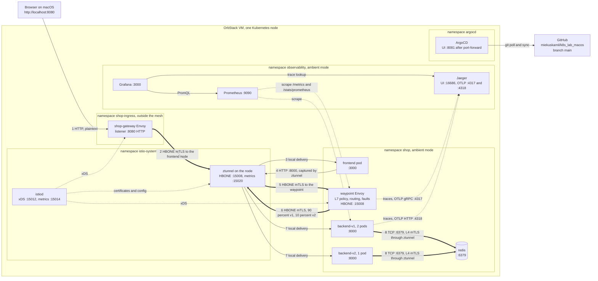
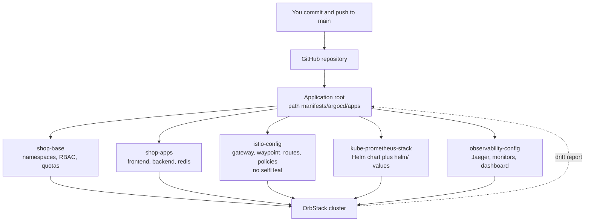

# Architecture

This document describes the system in `k8s_lab_macos`: what runs, how a request travels, where mTLS applies, and how to move the diagrams into draw.io or Excalidraw.

## Goals and constraints

- Run a realistic service mesh, GitOps pipeline and observability stack on one laptop.
- Stay inside an OrbStack VM of about 8 GiB RAM and 4 CPUs. Quotas in `manifests/base/02-quotas.yaml` enforce the budget.
- Keep every change reproducible from Git. The only imperative steps are in `scripts/provision.sh`.

## Components

| Layer | Component | Namespace | Role |
|---|---|---|---|
| Entry | Istio Gateway `shop-gateway` (Envoy) | shop-ingress | Accepts HTTP on port 8080, publishes it on `localhost:8080` through an OrbStack LoadBalancer |
| Application | `frontend` (Node.js, Express) | shop | Serves the traffic control UI, proxies `/api/*`, generates bursts |
| Application | `backend-v1` (2 pods) and `backend-v2` (1 pod), FastAPI | shop | Orders API, one image, `APP_VERSION` selects the label |
| Data | `redis` | shop | Order storage, password from a Secret |
| Mesh L4 | `ztunnel` DaemonSet, `istio-cni` DaemonSet | istio-system | mTLS, identity, L4 policy, traffic capture on every node |
| Mesh L7 | `waypoint` Gateway (Envoy) | shop | HTTP routing, fault injection, circuit breaking, L7 policy for the backend Services |
| Control plane | `istiod` | istio-system | Issues certificates, pushes config to ztunnel and Envoy |
| GitOps | ArgoCD | argocd | Syncs this repository to the cluster |
| Observability | Prometheus, Grafana, Jaeger | observability | Metrics, dashboards, traces |

## Repository layout

```text
k8s_lab_macos/
├── README.md
├── architecture.md
├── learning.md
├── apps/
│   ├── backend/
│   │   ├── Dockerfile
│   │   ├── .dockerignore
│   │   ├── main.py
│   │   └── requirements.txt
│   └── frontend/
│       ├── Dockerfile
│       ├── .dockerignore
│       ├── package.json
│       ├── package-lock.json
│       ├── server.js
│       └── public/
│           └── index.html
├── helm/
│   ├── argocd-values.yaml
│   ├── istio-base-values.yaml
│   ├── istio-cni-values.yaml
│   ├── istiod-values.yaml
│   ├── kube-prometheus-stack-values.yaml
│   └── ztunnel-values.yaml
├── manifests/
│   ├── argocd/
│   │   ├── project.yaml
│   │   ├── root-app.yaml
│   │   └── apps/
│   │       ├── istio-config.yaml
│   │       ├── kube-prometheus-stack.yaml
│   │       ├── observability-config.yaml
│   │       ├── shop-apps.yaml
│   │       └── shop-base.yaml
│   ├── base/
│   │   ├── 00-namespaces.yaml
│   │   ├── 01-rbac.yaml
│   │   └── 02-quotas.yaml
│   ├── apps/
│   │   ├── backend.yaml
│   │   ├── frontend.yaml
│   │   └── redis.yaml
│   ├── istio/
│   │   ├── backend-route.yaml
│   │   ├── gateway.yaml
│   │   ├── security.yaml
│   │   ├── telemetry.yaml
│   │   └── waypoint.yaml
│   ├── observability/
│   │   ├── grafana-dashboard.yaml
│   │   ├── jaeger.yaml
│   │   └── monitors.yaml
│   └── scenarios/
│       ├── a-canary-httproute.yaml
│       ├── b-fault-injection.yaml
│       └── c-circuit-breaker.yaml
└── scripts/
    ├── port-forward.sh
    ├── provision.sh
    ├── teardown.sh
    └── traffic-test.sh
```

`manifests/scenarios` is not synced by ArgoCD. You apply those files by hand, so the experiments never fight the GitOps controller.

## Traffic flow and mTLS boundaries

Thick arrows are mTLS tunnels (HBONE, port 15008). Thin arrows are plaintext. Dashed arrows are telemetry.



The numbered hops, in order:

1. The browser sends plaintext HTTP to `localhost:8080`. OrbStack forwards it to the `shop-gateway-istio` LoadBalancer Service.
2. The ingress gateway sits outside the mesh. Because the frontend is an ambient workload, the gateway wraps the request in an HBONE tunnel and authenticates with the gateway identity.
3. ztunnel on the node terminates the tunnel and hands the request to the frontend pod. The check for `PeerAuthentication STRICT` happens here.
4. The frontend calls `http://backend.shop.svc.cluster.local:8000`. The CNI redirect sends that connection to ztunnel.
5. The `backend` Service carries `istio.io/use-waypoint: waypoint`, so ztunnel opens an HBONE tunnel to the waypoint and not to a backend pod.
6. The waypoint terminates mTLS, evaluates `AuthorizationPolicy backend-allow-frontend`, applies the HTTPRoute or VirtualService, injects faults, enforces the connection pool, picks a backend, and opens a new HBONE tunnel.
7. ztunnel on the destination node delivers the request to a backend pod over plaintext on the node.
8. The backend connects to Redis. ztunnel upgrades that TCP stream to mTLS and enforces `AuthorizationPolicy redis-allow-backend` using the backend service account identity.

Redis and the frontend have no waypoint, so their traffic stays on the cheaper L4 path.

### mTLS boundaries

| Hop | Encrypted | Peer identity checked |
|---|---|---|
| Browser to gateway | No | None |
| Gateway to frontend | Yes, HBONE | `shop-ingress` gateway service account |
| Frontend to waypoint | Yes, HBONE | `ns/shop/sa/frontend` |
| Waypoint to backend | Yes, HBONE | `ns/shop/sa/waypoint` |
| Backend to Redis | Yes, HBONE | `ns/shop/sa/backend` |
| Pod to local ztunnel | No, stays inside the node | Node-local only |
| Prometheus to pods | Yes, both namespaces are ambient | `ns/observability/sa/kube-prometheus-stack-prometheus` |

Between a pod and the ztunnel on its own node, traffic is plaintext. That hop never leaves the node network namespace boundary of the VM, which is the trust model Istio ambient uses.

## GitOps flow



`provision.sh` installs Istio and ArgoCD itself because both must exist before ArgoCD can sync anything that depends on them. After that, Git is the source of truth for everything in `manifests/`.

## Resource budget

| Namespace | CPU requests | Memory requests | Memory limits |
|---|---|---|---|
| shop | 2 cores max | 2 GiB max | 3 GiB max |
| shop-ingress | 500m max | 512 MiB max | 1 GiB max |
| observability | 1500m max | 2.5 GiB max | 6 GiB max |
| istio-system | no quota | about 400 MiB in practice | set in `helm/*.yaml` |
| argocd | no quota | about 600 MiB in practice | set in `helm/argocd-values.yaml` |

A LimitRange in each quota-controlled namespace gives containers default requests and limits, because a quota rejects pods that declare none.

## Secrets

- `shop/redis-auth` and `observability/grafana-admin` are created by `provision.sh` with `openssl rand`. They are not in Git.
- ArgoCD reads the initial admin password from `argocd/argocd-initial-admin-secret`.
- For a shared environment, replace this with External Secrets Operator or Sealed Secrets. See `learning.md`.

## Import and export with draw.io or Excalidraw

### draw.io (diagrams.net)

Import the Mermaid diagram:

1. Copy the contents of a `mermaid` block above, without the code fence.
2. Open https://app.diagrams.net or the desktop app and create a blank diagram.
3. Choose Arrange, Insert, Advanced, Mermaid.
4. Paste the text and select Insert. draw.io converts the diagram into editable shapes.
5. Move shapes, restyle the mTLS edges, and add the draw.io network icons from the shape library on the left.

Export:

1. File, Export as, then PNG, SVG or PDF. Tick "Include a copy of my diagram" on PNG and SVG so you can reopen the file later.
2. File, Save as, then `.drawio` to keep the editable source. Commit it under `docs/` if you want it versioned.
3. Round trip back to Mermaid is not supported. Keep the Mermaid text in this file as the source of truth for structure.

### Excalidraw

Import the Mermaid diagram:

1. Open https://excalidraw.com.
2. Select the library icon, or press `/`, and choose Mermaid to Excalidraw. In the menu this entry is under More tools.
3. Paste the Mermaid text. The preview updates as you type.
4. Select Insert. The diagram appears as hand-drawn shapes you can edit.

Export:

1. Menu, Export image, then PNG or SVG. Enable "Embed scene" to keep the file editable.
2. Menu, Save to, then `.excalidraw` for the editable source.
3. To share a read-only link, use Menu, Shareable link.

### Command line rendering

```bash
npm install --global @mermaid-js/mermaid-cli
mmdc -i architecture.md -o docs/architecture.svg
```

`mmdc` renders every Mermaid block in a Markdown file and writes one SVG per block with a numeric suffix.

## Known limits

- OrbStack runs one node, so cross-node HBONE traffic and ztunnel failover are not exercised.
- The waypoint does not accept `EnvoyFilter`, so global rate limiting needs an external rate limit service. The lab limits rate inside the backend.
- Istio VirtualService support on waypoints and the exact metric labels vary between Istio releases. After changing `ISTIO_VERSION`, re-check Scenario B and the dashboard queries.
