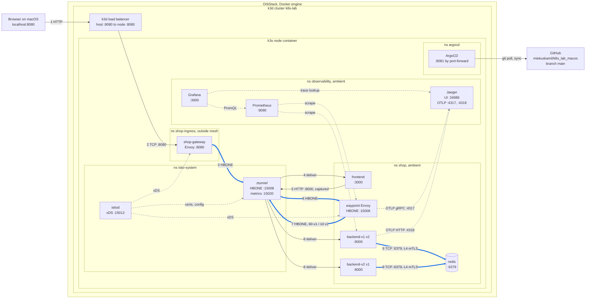
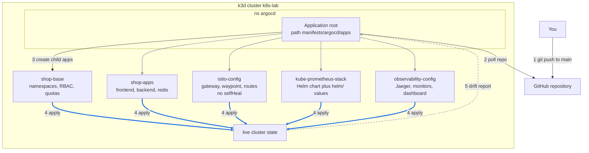

# Architecture

This page explains how the lab fits together: what runs where, how one request travels from your browser to Redis, and how Git changes reach the cluster. If you only want to run the lab, start with the [README](README.md).

## The layers on your Mac

```text
macOS
└── OrbStack (Docker engine)
    └── k3d cluster "k8s-lab"
        ├── load balancer container   host port 8080 -> cluster port 8080
        └── k3s node container        runs every pod in the lab
```

OrbStack only provides Docker. k3d starts the cluster as containers, so deleting the cluster leaves no trace in OrbStack. Everything below the node container is ordinary Kubernetes.

## What runs in the cluster

| Namespace | What is there | Why |
|---|---|---|
| `shop-ingress` | The `shop-gateway` Envoy | Entry point from your Mac, outside the mesh |
| `shop` | frontend, backend-v1 (2 pods), backend-v2 (1 pod), redis, the waypoint | The application, enrolled in ambient mode |
| `istio-system` | istiod, ztunnel, istio-cni | The mesh itself |
| `observability` | Prometheus, Grafana, Jaeger | Metrics, dashboards and traces |
| `argocd` | ArgoCD | Applies the manifests in this repo |

Both backend versions run the same image. The `APP_VERSION` environment variable sets which version a pod reports, so the canary experiments change routing and not code.

## How a request travels

Follow one request from the browser to Redis. Thick blue arrows are encrypted mesh tunnels, thin arrows are plaintext, dashed arrows are control and telemetry traffic.



The same flow as a standalone image, with the trust zones drawn in:


In words:

1. The browser connects to `localhost:8080`. The k3d load balancer forwards the connection to the gateway pod in the cluster.
2. The gateway sits outside the mesh. Because the frontend is in the mesh, the gateway wraps the request in an HBONE tunnel (mTLS over HTTP/2 on port 15008). The ztunnel on the node unwraps it and hands it to the frontend pod.
3. The frontend calls the backend. Istio's CNI plugin redirects that connection to ztunnel before it leaves the pod.
4. The `backend` Service has the label `istio.io/use-waypoint: waypoint`, so ztunnel sends the request to the waypoint proxy and not straight to a backend pod.
5. The waypoint is the only place that reads HTTP. It checks the authorization policy, applies the route weights (90% v1, 10% v2 in scenario A), injects faults, enforces the connection pool, and picks a pod.
6. The backend talks to Redis. ztunnel encrypts that connection too and allows it only if the caller is the `backend` service account.

The frontend and Redis have no waypoint, so their traffic stays on the cheaper layer-4 path. Only the backend pays for layer-7 features.

### Where traffic is encrypted

| Connection | Encrypted | What the receiver checks |
|---|---|---|
| Browser to the gateway | No | Nothing |
| Gateway to frontend | Yes | The gateway's service account |
| Frontend to waypoint | Yes | `shop/frontend` |
| Waypoint to backend pod | Yes | `shop/waypoint` |
| Backend to Redis | Yes | `shop/backend` |
| Pod to the ztunnel on its own node | No | Stays inside the node |
| Prometheus to pods | Yes | `observability/kube-prometheus-stack-prometheus` |

The hop between a pod and its local ztunnel is plaintext. It never leaves the node container, and that is the trust model ambient mode is built on.

## How Git changes reach the cluster




`provision.sh` installs Istio and ArgoCD with Helm, because ArgoCD cannot deploy things that need Istio before Istio exists. After that you change the cluster by pushing to `main`.

Five ArgoCD Applications deploy everything else:

| Application | Syncs | Self-heal |
|---|---|---|
| `shop-base` | Namespaces, RBAC, quotas | Yes |
| `shop-apps` | frontend, backend, redis | Yes |
| `istio-config` | Gateway, waypoint, routes, policies | No, on purpose |
| `kube-prometheus-stack` | The Prometheus and Grafana Helm chart | Yes |
| `observability-config` | Jaeger, monitors, the dashboard | Yes |

`istio-config` does not self-heal so you can apply a scenario by hand and watch ArgoCD report the drift without undoing your experiment. The files in `manifests/scenarios/` are not synced at all.

## Resource limits

The lab targets an OrbStack VM with 8 GiB of RAM. Every namespace has a quota, and a LimitRange gives containers default requests and limits (a quota rejects pods that declare none).

| Namespace | CPU requests | Memory requests | Memory limits |
|---|---|---|---|
| `shop` | 2 cores | 2 GiB | 3 GiB |
| `shop-ingress` | 0.5 cores | 512 MiB | 1 GiB |
| `observability` | 1.5 cores | 2.5 GiB | 6 GiB |

`istio-system` and `argocd` have no quota. Their limits are set in `helm/`. Run `kubectl top pods -A` to see what the cluster really uses.

## Secrets

Two Secrets exist and neither is in Git. `provision.sh` creates `shop/redis-auth` and `observability/grafana-admin` with random values from `openssl rand`. ArgoCD generates its own admin password. [learning.md](learning.md#secrets) explains what to use instead of this when more than one person shares a cluster.

## Editing the diagrams

Each diagram exists in three forms:

- The Mermaid blocks on this page. Treat them as the source.
- `docs/traffic-flow.svg` and `docs/gitops-flow.svg`, standalone images with no external fonts or scripts.
- `docs/traffic-flow.excalidraw`, an editable scene of the traffic flow.

**draw.io.** Choose Arrange, Insert, Advanced, Mermaid, paste a diagram's text without the code fence, and select Insert. The import may drop the edge colors set by `linkStyle`, so recolor the encrypted edges by hand. To export, use File, Export as (tick "Include a copy of my diagram" so the PNG or SVG stays editable) or File, Save as `.drawio`. There is no way back to Mermaid.

**Excalidraw.** Open `docs/traffic-flow.excalidraw` from Menu, Open. To start from Mermaid instead, open the library, choose Mermaid to Excalidraw, paste the text and select Insert. To export, use Menu, Export image with "Embed scene" ticked, or save the `.excalidraw` file.

**Command line.** To render the Mermaid blocks to SVG files:

```bash
npm install --global @mermaid-js/mermaid-cli
mmdc -i architecture.md -o docs/architecture.svg
```

This writes `architecture-1.svg` and `architecture-2.svg` in `docs/`.

## What this setup does not cover

- There is one node, so traffic between nodes and ztunnel failover are never exercised.
- A waypoint does not accept `EnvoyFilter`. Global rate limiting would need a separate rate limit service, so the lab limits requests inside the backend instead.
- VirtualService support on waypoints and some metric labels change between Istio releases. After changing `ISTIO_VERSION`, re-run scenario B and check the dashboard queries.
