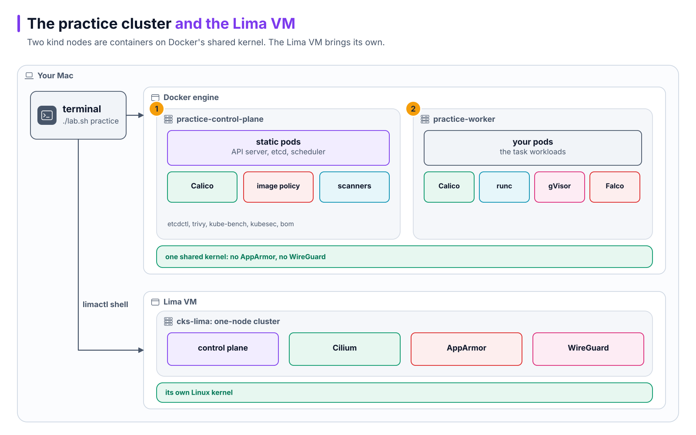

# Certification tracks

> New to a term here, like kubeadm or static pod? The [glossary](../platform-engineering/glossary.md#cks-exam-track) explains every term the tracks use.

The [course](../platform-engineering/README.md) teaches you how a platform works and why. A certification exam tests something narrower: whether you fix a given problem on a live cluster, from a terminal, against the clock. These tracks train that second skill. Each one covers an exam's official curriculum, links to the course wherever the course already explains a topic, and adds timed tasks and scored mock exams for the rest.

| Track | Exam | Status |
|---|---|---|
| [CKS](cks/README.md) | Certified Kubernetes Security Specialist, Kubernetes v1.37 | ready |

## How a track differs from the course

The course and the tracks use different clusters and a different rhythm. The table shows the differences:

| | Course (`platform-engineering/`) | Tracks (`certs/`) |
|---|---|---|
| Cluster | k3d on your Mac, one k3s node, Istio and the shop | kubeadm on two OrbStack Linux machines, no mesh |
| You work | from your Mac, with `kubectl` and the UIs | inside a node, with `kubectl`, `vim`, `systemctl` and `journalctl`, like in the exam |
| A unit is | a module of 30 to 60 minutes that explains one idea in depth | a domain file that opens with course-style theory, concepts, diagrams and exam traps, then tasks of 3 to 10 minutes each |
| You finish when | you understand why the platform behaves as it does | you solve each task inside its time budget without opening the solution |

The exam cluster comes from kubeadm, so the tracks use kubeadm too. kubeadm is the official tool that turns plain Linux machines into a Kubernetes cluster. It runs the control plane as **static pods**: pods that the kubelet starts from YAML files in `/etc/kubernetes/manifests`, with no API server involved. Many exam tasks edit those files. The k3s cluster of the course keeps its control plane inside one binary, so those tasks have nothing to edit there.

## The practice cluster



The cluster has two nodes, each an OrbStack Linux machine with Ubuntu 24.04 on arm64:

1. `cks-cp` runs the control plane: API server, etcd, scheduler and controller manager, all as static pods. It also holds `etcdctl`, `trivy`, `kube-bench`, `kubesec`, `bom` and a small image policy service for the supply chain tasks.
2. `cks-w1` runs the workloads. It holds gVisor, a second container runtime for sandboxed pods, and Falco, which watches system calls.

Both nodes run containerd 2.2.10 and Kubernetes 1.37.1. That is one patch release below the newest 1.37, so the upgrade task has somewhere to go. Calico 3.32.3 connects the pods and enforces NetworkPolicy. ingress-nginx 1.15.1 serves Ingress objects on NodePorts 30080 and 30443.

### Create, stop, reset, destroy

```bash
./certs/cks/cluster/create.sh          # builds both machines; safe to run again
orb -m cks-cp                          # a shell on the control plane, like "ssh cks-cp" in the exam
orb -m cks-w1                          # a shell on the worker; "sudo -i" for root
orb stop cks-cp cks-w1                 # frees the memory; "orb start cks-cp cks-w1" brings the cluster back
./certs/cks/cluster/reset.sh           # back to a fresh cluster at 1.37.1, machines and downloads kept
./certs/cks/cluster/destroy.sh --yes   # deletes both machines
```

In the test run, `create.sh` took 3 minutes 45 seconds from nothing, and 47 seconds when run again on a finished cluster. `reset.sh` took 2 minutes 30 seconds. With the cluster idle, `cks-cp` used 1.1 GB of memory and `cks-w1` 0.7 GB, page cache included.

The machines keep their IP addresses across `orb stop` and `orb start`, which matters because the API server's certificate names the control plane's IP. After a start, the pods take about a minute to come back.

### What the OrbStack kernel changes

OrbStack machines are not full virtual machines. They share one Linux kernel with each other and with OrbStack's Docker engine. Three consequences matter for the CKS track:

- The kernel has no AppArmor. The kubelet accepts AppArmor fields in a pod but refuses to start the pod: `Cannot enforce AppArmor: AppArmor is not enabled on the host`. So the AppArmor tasks run on the [Lima VM](#the-lima-vm-for-apparmor-and-cilium), which has a kernel of its own.
- The kernel has no WireGuard module, so Calico and Cilium node-to-node encryption don't run here. Pod-to-pod encryption points to Istio, which the course already runs.
- Cilium would load its eBPF programs into the kernel that every OrbStack machine and the Docker engine share. The Cilium tasks run on the Lima VM for that reason, and the OrbStack cluster keeps Calico.
- Falco sees every system call on the shared kernel, including the ones from other OrbStack machines and Docker containers. Filter its output by `k8s.ns.name` or container name to see only your cluster.

Two settings in `certs/cks/cluster/kubeadm-config.yaml` exist only because of OrbStack. kube-proxy doesn't set the kernel's connection tracking table size (`conntrack.maxPerCore: 0`), because a machine may not change a value the whole kernel shares. And the kubelet tolerates swap (`failSwapOn: false`), because OrbStack gives every machine the host's swap.

## The Lima VM for AppArmor and Cilium

Two exam topics need a kernel that belongs to one machine: AppArmor, which OrbStack's kernel lacks, and Cilium, which reprograms the kernel's network path. So the track has a third practice machine. **Lima** is a tool for macOS that runs Linux virtual machines on Apple's virtualization framework, each with its own kernel. The VM `cks-lima` runs Ubuntu 24.04 with AppArmor on, and a one-node kubeadm cluster at Kubernetes 1.37.1 with Cilium 1.20.4 as its CNI.

```bash
brew install lima                       # once
./certs/cks/cluster/lima.sh create      # builds the VM and the cluster; safe to run again
./certs/cks/cluster/lima.sh shell       # a root shell on the node, like "ssh cks-lima" in the exam
./certs/cks/cluster/lima.sh stop        # frees the memory; "start" brings it back
./certs/cks/cluster/lima.sh reset       # back to a fresh cluster, VM kept
./certs/cks/cluster/lima.sh destroy     # deletes the VM
```

In the test run, `create` took 2 minutes 5 seconds from nothing, and `reset` took 2 minutes 15 seconds. The VM gets 2 CPUs and 3 GiB. With the cluster idle, the guest used 1.25 GB and the VM process on the Mac 1.5 GB. Lima's memory comes from the Mac directly, not from OrbStack's share, so it doesn't compete with the OrbStack machines or the k3d lab.

Lima shows your Mac home folder inside the VM at the same path, read-only. The node has `kubectl` with the `k` alias, `crictl`, `apparmor_parser`, `aa-status` and the `cilium` command line tool.

The domain files mark each task that runs here with **Host:** `cks-lima`.

## The practice cluster on your own VMs (Proxmox or any SSH-reachable Ubuntu)

The same two-node cluster also runs on two virtual machines that you reach over SSH, for example on a Proxmox server at home. The scripts then send every node command through `ssh` and `sudo` instead of `orb`, so the tasks, the checks and the mock exams stay the same. A VM brings a kernel of its own, and that kernel has AppArmor, so the AppArmor and kernel module tasks move from the Lima VM to `cks-w1`.

### What you need

You need two VMs with Ubuntu 24.04 on amd64 or arm64. Give `cks-cp` 2 CPUs, 3 GB of memory and 30 GB of disk, and give `cks-w1` 2 CPUs, 2.5 GB and 30 GB. Both VMs need internet access, and one user that logs in with an SSH key and runs `sudo` without a password. Their network must stay clear of the pod network `10.244.0.0/16` and the service network `10.96.0.0/12`. The pod network avoids Calico's default `192.168.0.0/16` on purpose, because that range overlaps most home networks.

On Proxmox, `proxmox/create-vms.sh` builds both VMs from the Ubuntu cloud image. You run it as root on the Proxmox host, and it creates VM 221 `cks-cp` at 192.168.1.221 and VM 222 `cks-w1` at 192.168.1.222, with the user `ubuntu` and your public key. Any other hypervisor or cloud works the same way once the two VMs answer on SSH. The VMs need no particular hostname, because `create.sh` renames them to `cks-cp` and `cks-w1`, the node names that kubeadm and the tasks expect.

### Settings and commands

Five environment variables tell the scripts where the VMs are. Every script reads them, `task.sh` and the mock exam scripts included, so export them once in your shell:

```bash
export CKS_PLATFORM=vms                  # without it, the scripts use OrbStack
export CKS_CP_HOST=192.168.1.221         # the address of cks-cp (this is the default)
export CKS_W1_HOST=192.168.1.222         # the address of cks-w1 (this is the default)
export CKS_SSH_USER=ubuntu               # the login user on both VMs (the default)
export CKS_SSH_KEY=~/.ssh/cks_proxmox    # the private key for that user (the default)

./certs/cks/cluster/create.sh            # builds the cluster on both VMs; safe to run again
ssh -i ~/.ssh/cks_proxmox ubuntu@192.168.1.221   # a shell on cks-cp; "sudo -i" for root
./certs/cks/cluster/reset.sh             # back to a fresh cluster at 1.37.1
./certs/cks/cluster/destroy.sh --yes     # wipes the cluster with kubeadm reset and keeps both VMs
```

`destroy.sh` never deletes a VM here, because the VMs belong to you and to your hypervisor. It runs `kubeadm reset` and undoes the task changes, and `create.sh` builds the cluster again on the same VMs. A sixth variable, `CKS_SSH_OPTS`, passes extra options to `ssh`, such as a separate known hosts file.

### What the test run measured

The test ran on a Proxmox host with an Intel i7-12700T and 15 GB of memory, so the nodes ran on amd64. On two new VMs, `create.sh` built the cluster in 3 minutes 26 seconds, after it had waited for cloud-init to finish the first-boot package upgrade. A rebuild after `destroy.sh` took 2 minutes 28 seconds, and `reset.sh` took between 2 minutes 35 seconds and 4 minutes 33 seconds. With the cluster idle, `cks-cp` used 1.0 GB of memory and `cks-w1` 0.6 GB, page cache left out. The host kept 2.8 GB free through every task and mock exam, next to another VM of 7 GB, and never swapped.

All 65 tasks and the three mock exams passed in this setup. Two things differed from OrbStack, and neither changed a task. The node scripts pick the downloads for the VM's CPU, amd64 here and arm64 on a Mac. And the first boot stalled, because the VMs reached Ubuntu's package mirrors over HTTPS only and plain HTTP downloads hung. If `apt` hangs on your VMs, change `http://` to `https://` in `/etc/apt/sources.list.d/ubuntu.sources`.

### Where the kernel tasks run

On a VM, the AppArmor tasks (06 task 5, 06 task 12 and mock exam 2 task 9) and the kernel module tasks (03 task 7 and mock exam 3 task 10) run on `cks-w1`. Their text says `cks-lima`, so read it as `cks-w1`: load the profile or write the modprobe rule on `cks-w1`, and run `kubectl` on `cks-cp`. The pods land on `cks-w1` anyway, because the control plane keeps its taint, and AppArmor confines a container only on the node that loaded the profile.

The Cilium tasks stay on the Lima VM: 01 tasks 9, 10 and 11, 04 task 10, and task 3 of mock exams 2 and 3. Cilium replaces the cluster's network plugin, so it needs a cluster of its own, and a third VM for it needs another 3 GB that the test host lacked while `cks-cp` and `cks-w1` ran. So keep `cks-lima` on your Mac for those six tasks. Without it, they stop with a message, and every other task still works.
