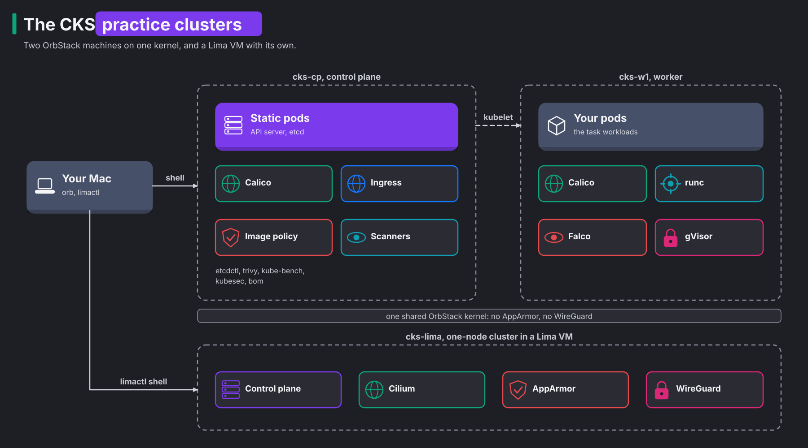

# Certification tracks

> New to a term here, like kubeadm or static pod? The [glossary](../platform-engineering/glossary.md#cks-exam-track) explains every term the tracks use.

The [course](../platform-engineering/README.md) teaches you how a platform works and why. A certification exam tests something narrower: whether you fix a given problem on a live cluster, from a terminal, against the clock. These tracks train that second skill. Each one covers an exam's official curriculum, links to the course wherever the course already explains a topic, and adds timed tasks and scored mock exams for the rest.

| Track | Exam | Status |
|---|---|---|
| [CKS](cks/README.md) | Certified Kubernetes Security Specialist, Kubernetes v1.37 | ready |
| CKA | Certified Kubernetes Administrator | planned |
| CKAD | Certified Kubernetes Application Developer | planned |

## How a track differs from the course

The course and the tracks use different clusters and a different rhythm. The table shows the differences:

| | Course (`platform-engineering/`) | Tracks (`certs/`) |
|---|---|---|
| Cluster | k3d on your Mac, one k3s node, Istio and the shop | kubeadm on two OrbStack Linux machines, no mesh |
| You work | from your Mac, with `kubectl` and the UIs | inside a node, with `kubectl`, `vim`, `systemctl` and `journalctl`, like in the exam |
| A unit is | a module of 30 to 60 minutes that explains one idea in depth | a domain file that opens with course-style theory, concepts, diagrams and exam traps, then tasks of 3 to 10 minutes each |
| You finish when | you understand why the platform behaves as it does | you solve each task inside its time budget without opening the solution |

The exam cluster comes from kubeadm, so the tracks use kubeadm too. kubeadm is the official tool that turns plain Linux machines into a Kubernetes cluster. It runs the control plane as **static pods**: pods that the kubelet starts from YAML files in `/etc/kubernetes/manifests`, with no API server involved. Many exam tasks edit those files. The k3s cluster of the course keeps its control plane inside one binary, so those tasks have nothing to edit there.

## The practice cluster



The cluster has two nodes, each an OrbStack Linux machine with Ubuntu 24.04 on arm64:

1. `cks-cp` runs the control plane: API server, etcd, scheduler and controller manager, all as static pods. It also holds `etcdctl`, `trivy`, `kube-bench`, `kubesec`, `bom` and a small image policy service for the supply chain tasks.
2. `cks-w1` runs the workloads. It holds gVisor, a second container runtime for sandboxed pods, and Falco, which watches system calls.

Both nodes run containerd 2.2.10 and Kubernetes 1.37.1. That is one patch release below the newest 1.37, so the upgrade task has somewhere to go. Calico 3.32.3 connects the pods and enforces NetworkPolicy. ingress-nginx 1.15.1 serves Ingress objects on NodePorts 30080 and 30443.

### Create, stop, reset, destroy

```bash
./certs/cks/cluster/create.sh          # builds both machines; safe to run again
orb -m cks-cp                          # a shell on the control plane, like "ssh cks-cp" in the exam
orb -m cks-w1                          # a shell on the worker; "sudo -i" for root
orb stop cks-cp cks-w1                 # frees the memory; "orb start cks-cp cks-w1" brings the cluster back
./certs/cks/cluster/reset.sh           # back to a fresh cluster at 1.37.1, machines and downloads kept
./certs/cks/cluster/destroy.sh --yes   # deletes both machines
```

In the test run, `create.sh` took 3 minutes 45 seconds from nothing, and 47 seconds when run again on a finished cluster. `reset.sh` took 2 minutes 30 seconds. With the cluster idle, `cks-cp` used 1.1 GB of memory and `cks-w1` 0.7 GB, page cache included.

The machines keep their IP addresses across `orb stop` and `orb start`, which matters because the API server's certificate names the control plane's IP. After a start, the pods take about a minute to come back.

### What the OrbStack kernel changes

OrbStack machines are not full virtual machines. They share one Linux kernel with each other and with OrbStack's Docker engine. Three consequences matter for the CKS track:

- The kernel has no AppArmor. The kubelet accepts AppArmor fields in a pod but refuses to start the pod: `Cannot enforce AppArmor: AppArmor is not enabled on the host`. So the AppArmor tasks run on the [Lima VM](#the-lima-vm-for-apparmor-and-cilium), which has a kernel of its own.
- The kernel has no WireGuard module, so Calico and Cilium node-to-node encryption don't run here. Pod-to-pod encryption points to Istio, which the course already runs.
- Cilium would load its eBPF programs into the kernel that every OrbStack machine and the Docker engine share. The Cilium tasks run on the Lima VM for that reason, and the OrbStack cluster keeps Calico.
- Falco sees every system call on the shared kernel, including the ones from other OrbStack machines and Docker containers. Filter its output by `k8s.ns.name` or container name to see only your cluster.

Two settings in `certs/cks/cluster/kubeadm-config.yaml` exist only because of OrbStack. kube-proxy doesn't set the kernel's connection tracking table size (`conntrack.maxPerCore: 0`), because a machine may not change a value the whole kernel shares. And the kubelet tolerates swap (`failSwapOn: false`), because OrbStack gives every machine the host's swap.

## The Lima VM for AppArmor and Cilium

Two exam topics need a kernel that belongs to one machine: AppArmor, which OrbStack's kernel lacks, and Cilium, which reprograms the kernel's network path. So the track has a third practice machine. **Lima** is a tool for macOS that runs Linux virtual machines on Apple's virtualization framework, each with its own kernel. The VM `cks-lima` runs Ubuntu 24.04 with AppArmor on, and a one-node kubeadm cluster at Kubernetes 1.37.1 with Cilium 1.20.4 as its CNI.

```bash
brew install lima                       # once
./certs/cks/cluster/lima.sh create      # builds the VM and the cluster; safe to run again
./certs/cks/cluster/lima.sh shell       # a root shell on the node, like "ssh cks-lima" in the exam
./certs/cks/cluster/lima.sh stop        # frees the memory; "start" brings it back
./certs/cks/cluster/lima.sh reset       # back to a fresh cluster, VM kept
./certs/cks/cluster/lima.sh destroy     # deletes the VM
```

In the test run, `create` took 2 minutes 5 seconds from nothing, and `reset` took 2 minutes 15 seconds. The VM gets 2 CPUs and 3 GiB. With the cluster idle, the guest used 1.25 GB and the VM process on the Mac 1.5 GB. Lima's memory comes from the Mac directly, not from OrbStack's share, so it doesn't compete with the OrbStack machines or the k3d lab.

Lima shows your Mac home folder inside the VM at the same path, read-only. The node has `kubectl` with the `k` alias, `crictl`, `apparmor_parser`, `aa-status` and the `cilium` command line tool.

The domain files mark each task that runs here with **Host:** `cks-lima`.
