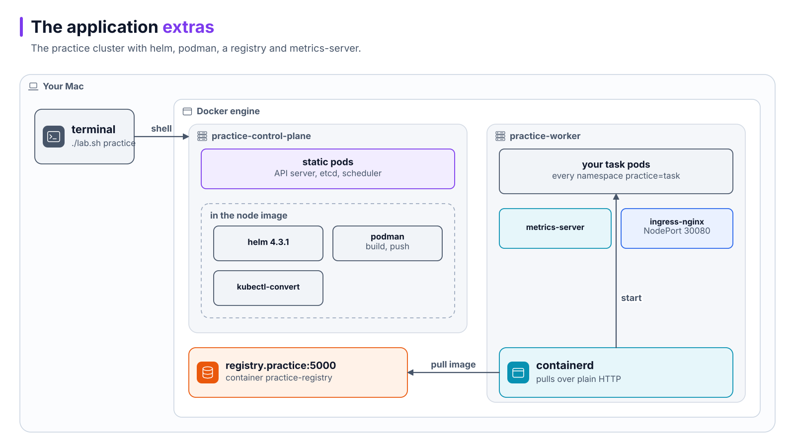

# CKAD: Certified Kubernetes Application Developer

> New to a term here, like Helm release or native sidecar? The [CKAD glossary](glossary.md) explains every term this track uses.

**Before this track:** basic Kubernetes from the [course](../../platform-engineering/README.md) or from work: pods, Deployments, Services and `kubectl`. The CKAD has no prerequisite exam. You need the [CKS practice cluster](../README.md#the-practice-cluster) and the CKAD extras on top of it, as the section [The practice cluster](#the-practice-cluster) explains, but neither Istio nor the k3d lab.

The CKS asks whether you lock a cluster down, while the CKAD asks something a developer meets every day: whether you get an application running on a cluster, configured, observable and reachable, quickly and from a terminal. Most of its tasks take a few minutes each, so the exam rewards speed with `kubectl` far more than deep knowledge of one component. This track walks through the five exam domains, each with connected theory (what problem a feature solves, how it works inside, and the traps the test runs measured) and 8 to 12 timed tasks, 50 in all. It ends with three scored mock exams that get harder one after another.

## The exam

The exam is a remote, proctored terminal session, where you get a remote Linux desktop with a browser and a terminal and solve tasks on real clusters. The facts below come from the [CNCF curriculum](https://github.com/cncf/curriculum) and the Linux Foundation's [important instructions for the CKA and CKAD](https://docs.linuxfoundation.org/tc-docs/certification/tips-cka-and-ckad), its [FAQ](https://docs.linuxfoundation.org/tc-docs/certification/faq-cka-ckad-cks) and its [list of allowed resources](https://docs.linuxfoundation.org/tc-docs/certification/certification-resources-allowed), as read on 20 November 2026:

| | |
|---|---|
| Kubernetes version | v1.37. The CNCF published the CKAD curriculum for 1.37 on 1 October 2026 |
| Duration | 2 hours |
| Tasks | 15 to 20 performance-based tasks, each worth a share of the score |
| Pass mark | 66% |
| Prerequisite | none |
| Where you work | each task names a host; you `ssh` to it from the base system, work there, and `exit` back. `sudo -i` gives you root |
| Tools on every host | `kubectl` with the `k` alias and Bash completion, `yq`, `curl`, `wget`, and `man` |
| Documentation allowed | kubernetes.io/docs, the Kubernetes blog, and helm.sh/docs |
| Retake | one free retake with each purchase |

The allowed documentation decides how you prepare. The browser opens the Kubernetes and Helm docs, but neither the podman nor the Docker docs, and searching the Kubernetes site works while following a search result to another site breaks the rules. So learn `podman build`, `podman push` and `podman save` by heart, and practise finding a YAML example on kubernetes.io in under a minute, because copying an example beats typing one.

The instructions page lists no image build tool, and helm only through its docs. Tasks that need `docker`, `podman` or `helm` run on a host that has them, and the task names that host. The practice cluster keeps all three tools on `cks-cp`, where you also run `kubectl`.

## Domains and where you learn each one

The curriculum has five domains, and the weight of each is its share of the score, so the number of tasks per domain follows the weights:

| File | Domain | Weight | Tasks |
|---|---|---|---|
| [01-application-design-and-build.md](01-application-design-and-build.md) | Application design and build | 20% | 10 |
| [02-application-deployment.md](02-application-deployment.md) | Application deployment | 20% | 10 |
| [03-application-observability-and-maintenance.md](03-application-observability-and-maintenance.md) | Application observability and maintenance | 15% | 8 |
| [04-application-environment-configuration-and-security.md](04-application-environment-configuration-and-security.md) | Application environment, configuration and security | 25% | 12 |
| [05-services-and-networking.md](05-services-and-networking.md) | Services and networking | 20% | 10 |
| [mock-exam.md](mock-exam.md) | Mock exam 1: all five domains, one topic per task | | 16 |
| [mock-exam-2.md](mock-exam-2.md) | Mock exam 2: broken things to repair, tasks that build on each other | | 16 |
| [mock-exam-3.md](mock-exam-3.md) | Mock exam 3: killer.sh difficulty, several objects per task | | 16 |

In the test run on the live cluster, every task's check failed after its setup and passed after its reference solution, and each mock exam scored 0 on a fresh setup and 100 after its reference solution.

## Gap map

The table lists every competency of the 1.37 curriculum. The middle column says where the course already shows the idea at work, so read that first when it exists, and the right column says where you practise it the exam way.

| Competency | The course already shows | Practise it in |
|---|---|---|
| **Application design and build** | | |
| Define, build and modify container images | nothing | [01, tasks 1 and 2](01-application-design-and-build.md#task-1-build-an-image-and-push-it) |
| Choose and use the right workload resource | Deployments everywhere; a Job in [module 22](../../platform-engineering/2-intermediate/22-gitops-with-argocd.md) | [01, tasks 5, 6, 7 and 9](01-application-design-and-build.md#task-5-a-job-with-parallel-completions) |
| Understand multi-container pod design patterns | sidecar injection and native sidecars in [module 7](../../platform-engineering/2-intermediate/07-sidecar-mode.md) | [01, tasks 3, 4 and 10](01-application-design-and-build.md#task-3-an-init-container-prepares-the-content) |
| Utilize persistent and ephemeral volumes | nothing | [01, tasks 3 and 8](01-application-design-and-build.md#task-8-a-persistentvolume-a-claim-and-a-pod) |
| **Application deployment** | | |
| Use primitives for blue/green or canary | a canary with Istio weights in [module 16](../../platform-engineering/2-intermediate/16-istio-api.md) | [02, tasks 3 and 4](02-application-deployment.md#task-3-blue-green) |
| Understand Deployments and rolling updates | nothing | [02, tasks 1, 2 and 10](02-application-deployment.md#task-1-roll-back-a-broken-update) |
| Use the Helm package manager to deploy existing packages | Helm installs in [module 22](../../platform-engineering/2-intermediate/22-gitops-with-argocd.md) and [module 26](../../platform-engineering/2-intermediate/26-kyverno-policy-as-code.md) | [02, tasks 5, 6 and 7](02-application-deployment.md#task-5-install-a-helm-chart-from-a-registry) |
| Kustomize | base and overlays in the GitOps repo of [module 22](../../platform-engineering/2-intermediate/22-gitops-with-argocd.md) | [02, tasks 8 and 9](02-application-deployment.md#task-8-a-kustomize-overlay-for-production) |
| **Application observability and maintenance** | | |
| Understand API deprecations | nothing | [03, task 7](03-application-observability-and-maintenance.md#task-7-manifests-written-for-apis-that-no-longer-exist) |
| Implement probes and health checks | nothing | [03, tasks 1 and 2](03-application-observability-and-maintenance.md#task-1-readiness-liveness-and-startup-probes) |
| Use built-in CLI tools to monitor applications | metrics with Prometheus in [module 23](../../platform-engineering/2-intermediate/23-prometheus-and-alerting.md) | [03, task 4](03-application-observability-and-maintenance.md#task-4-which-pod-uses-the-most-cpu) |
| Utilize container logs | logs in an incident in [module 8](../../platform-engineering/1-foundations/08-incidents.md) | [03, task 3](03-application-observability-and-maintenance.md#task-3-logs-of-a-container-that-crashed) |
| Debugging in Kubernetes | incident hunting in [module 8](../../platform-engineering/1-foundations/08-incidents.md) | [03, tasks 5, 6 and 8](03-application-observability-and-maintenance.md#task-5-debug-a-container-that-has-no-shell) |
| **Application environment, configuration and security** | | |
| Discover and use resources that extend Kubernetes (CRD, operators) | Istio's and Kyverno's CRDs in [module 16](../../platform-engineering/2-intermediate/16-istio-api.md) and [module 26](../../platform-engineering/2-intermediate/26-kyverno-policy-as-code.md) | [04, task 11](04-application-environment-configuration-and-security.md#task-11-use-a-customresourcedefinition) |
| Understand authentication, authorization and admission control | the API server's gates in [module 29](../../platform-engineering/1-foundations/29-life-of-a-request.md) | [04, tasks 8, 9 and 12](04-application-environment-configuration-and-security.md#task-8-a-role-for-a-ci-pipeline) |
| Understand requests, limits, quotas | nothing | [04, tasks 4, 5 and 6](04-application-environment-configuration-and-security.md#task-4-a-deployment-that-a-quota-keeps-from-starting) |
| Define resource requirements | nothing | [04, task 4](04-application-environment-configuration-and-security.md#task-4-a-deployment-that-a-quota-keeps-from-starting) |
| Understand ConfigMaps | ConfigMaps as files in [module 24](../../platform-engineering/2-intermediate/24-grafana-as-code.md) | [04, tasks 1 and 3](04-application-environment-configuration-and-security.md#task-1-a-configmap-from-a-file-and-a-literal) |
| Create and consume Secrets | nothing | [04, task 2](04-application-environment-configuration-and-security.md#task-2-a-secret-as-an-environment-variable-and-as-a-file) |
| Understand ServiceAccounts | service accounts as mesh identity in [module 2](../../platform-engineering/1-foundations/02-identity-and-mtls.md) | [04, tasks 7 and 9](04-application-environment-configuration-and-security.md#task-7-serviceaccounts-and-their-tokens) |
| Understand application security (SecurityContexts, capabilities) | nothing; the CKS track goes deeper in [its domain 04](../cks/04-minimize-microservice-vulnerabilities.md) | [04, tasks 10 and 12](04-application-environment-configuration-and-security.md#task-10-a-security-context-field-by-field) |
| **Services and networking** | | |
| Demonstrate basic understanding of NetworkPolicies | NetworkPolicy against Istio's AuthorizationPolicy in [module 3](../../platform-engineering/1-foundations/03-authorization.md) | [05, tasks 6 to 9](05-services-and-networking.md#task-6-deny-by-default-then-allow-one-path) |
| Provide and troubleshoot access to applications via services | a request through kube-proxy in [module 29](../../platform-engineering/1-foundations/29-life-of-a-request.md) | [05, tasks 1, 2, 3 and 10](05-services-and-networking.md#task-1-a-clusterip-service); [03, task 8](03-application-observability-and-maintenance.md#task-8-a-client-that-never-reaches-its-backend) |
| Use Ingress rules to expose applications | the Gateway API instead of Ingress in [module 11](../../platform-engineering/2-intermediate/11-edge-tls.md) | [05, tasks 4 and 5](05-services-and-networking.md#task-4-an-ingress-with-two-paths) |

The 1.37 curriculum doesn't mention the Gateway API for the CKAD, and the allowed resources list its docs only for the CKA, so the track covers Ingress and leaves the Gateway API to the course.

## The practice cluster



The CKAD track runs on the same two-node cluster as the [CKS track](../cks/README.md): `cks-cp` holds the control plane and `cks-w1` runs the workloads, both at Kubernetes 1.37.1 with Calico and ingress-nginx on NodePorts 30080 and 30443. A developer exam needs a few things that a security exam doesn't, so a small script adds them on top:

1. On `cks-cp`: helm 4.3.1 to install charts, podman to build and push images, `kubectl-convert` for API version changes, and a local image registry at `registry.ckad:5000`, which runs as the systemd service `ckad-registry` outside Kubernetes.
2. On both nodes: the name `registry.ckad`, and a containerd setting that lets the kubelet pull images from that registry over plain HTTP.
3. In the cluster: metrics-server 0.9.1, so that `kubectl top` works.

```bash
./certs/cks/cluster/create.sh          # the CKS cluster, if it doesn't exist yet; safe to run again
./certs/ckad/cluster/extras.sh         # the CKAD extras; safe to run again
orb -m cks-cp                          # a shell on the control plane, then sudo -i
./certs/ckad/cluster/reset.sh          # removes everything the CKAD tasks and mocks created
orb stop cks-cp cks-w1                 # frees the memory; "orb start cks-cp cks-w1" brings the cluster back
```

In the test run, `extras.sh` took 51 seconds the first time and about 20 seconds when run again. The extras follow the CKS scripts' platform setting, so with `CKS_PLATFORM=vms` they install on [your own VMs](../README.md#the-practice-cluster-on-your-own-vms-proxmox-or-any-ssh-reachable-ubuntu) the same way, and every download picks the node's CPU type from `dpkg --print-architecture`.

The two tracks share one cluster, so each keeps out of the other's way. Every namespace a CKAD task creates carries the label `ckad=task`, and every mock namespace `ckad=mock`, so `reset.sh` finds and deletes them all. Cluster-wide objects that the tasks create start with `ckad-`, and Custom Resource Definitions sit in the `ckad.io` group, so the reset finds those too. The reset also removes metrics-server, which the CKS cluster doesn't run, and the tasks that need it install it again. The tools on `cks-cp` stay, because nothing in Kubernetes sees them, and in the test run the reset took about 40 seconds.

`./certs/cks/cluster/reset.sh` rebuilds the cluster from scratch, which also rewrites containerd's settings, so run `extras.sh` again after it.

## How to use the track

The plan below takes about three weeks at an hour a day:

1. Build the cluster and the extras: `./certs/cks/cluster/create.sh`, then `./certs/ckad/cluster/extras.sh`.
2. Work through the domain files in order, 01 to 05. Domain 01 teaches pods and workloads that every later task builds on, and domain 05 assumes the Services of domain 03's debugging task. For each domain, read the theory, then do each task against its time budget, and open the solution only when the time runs out.
3. Run the task's check, which prints `PASS` or `FAIL` for each thing the task asked: `./certs/ckad/task.sh check 2.3`.
4. Reset between domains with `./certs/ckad/cluster/reset.sh`. Every task setup also starts its namespace from scratch, so you repeat a task by running its setup again.
5. Repeat the tasks you needed the solution for, a few days later, until each one fits its budget.
6. Take the mock exams in order, each after a reset and with its 2-hour clock: [mock exam 1](mock-exam.md), then [mock exam 2](mock-exam-2.md), then [mock exam 3](mock-exam-3.md). `score.sh` prints the minutes since `setup.sh` and flags a run over 120.
7. Aim for 80 points or more on mock 3 inside the time, because the pass mark is 66 and the exam's clusters are less familiar than this one.

Every command except `task.sh` and the cluster scripts runs on `cks-cp`, in a root shell that `orb -m cks-cp` and then `sudo -i` opens; on your own VMs, `ssh` to `cks-cp` and `sudo -i` instead. The task files sit under `/opt/ckad` on `cks-cp`, the way exam tasks keep theirs under a folder like `/opt/course`.

The command blocks are terminal transcripts, where each prompt line holds a command and the lines under it hold the real output of the test run. `$` is your Mac, in the repo folder, and `root@cks-cp:~#` is a root shell on the control plane. A line with only `...` marks output the transcript leaves out, and pod names, IP addresses, ages and digests differ on your run.

## Exam habits worth drilling

Speed decides the CKAD more than any single topic, because 16 tasks in 120 minutes leave about 7 minutes each, including reading. The habits below save the most time, and the practice cluster's `/etc/bash.bashrc` already sets the first two.

The `k` alias with completion saves typing on every command, and the variable `do` turns any imperative command into a YAML generator: `export do="--dry-run=client -o yaml"`. `k create deploy web --image=nginx:1.27-alpine $do > web.yaml` writes a complete Deployment that you then edit, which is faster and safer than typing YAML from memory. The imperative commands below cover most objects the exam asks for:

| Object | Command that writes it |
|---|---|
| Pod | `k run NAME --image=IMG --port=80 -l app=x $do -- sleep 1d` |
| Deployment | `k create deploy NAME --image=IMG --replicas=3 --port=80 $do` |
| Service | `k expose deploy NAME --port=80 --target-port=8080 [--type=NodePort]` |
| Job, CronJob | `k create job NAME --image=IMG $do -- CMD`, `k create cronjob NAME --image=IMG --schedule='*/5 * * * *' $do -- CMD` |
| ConfigMap, Secret | `k create cm NAME --from-literal=K=V --from-file=F`, `k create secret generic NAME --from-literal=K=V` |
| ServiceAccount, Role, RoleBinding | `k create sa NAME`, `k create role NAME --verb=get,list --resource=pods`, `k create rolebinding NAME --role=R --serviceaccount=NS:SA` |
| Ingress | `k create ingress NAME --class=nginx --rule='host/path*=svc:80'` |
| ResourceQuota | `k create quota NAME --hard=pods=5,requests.cpu=1` |
| Token | `k create token SA --duration=1h` |

A few edits never need YAML at all, because `kubectl` changes the field directly: `k set image deploy/web nginx=nginx:1.28-alpine`, `k set env deploy/web KEY=V`, `k set resources deploy/web --requests=cpu=100m`, `k set serviceaccount deploy web SA`, `k scale`, `k label` and `k annotate`.

When you forget where a field goes, `k explain` answers from the cluster's own API schema, which always matches the exam's version: `k explain pod.spec.containers.livenessProbe` describes one field, and `k explain deploy.spec --recursive | less` shows the whole tree. `k api-resources` lists every resource with its short name and API group, which settles the right `apiVersion` for a manifest.

Three more habits pay off in every task. Read the task's namespace and host twice, because a perfect answer in the wrong namespace scores zero. Set the namespace once per task with `k config set-context --current --namespace=NS` when a task has many commands. And delete a pod you are about to recreate with `k delete pod NAME --force --grace-period=0`, which skips the 30-second wait that [domain 01](01-application-design-and-build.md#task-2-change-a-dockerfile-and-roll-the-new-image-out) measured for a `sh` process.

A `~/.vimrc` with `set expandtab tabstop=2 shiftwidth=2` keeps `vim` from writing tabs into YAML, which `kubectl` refuses.
