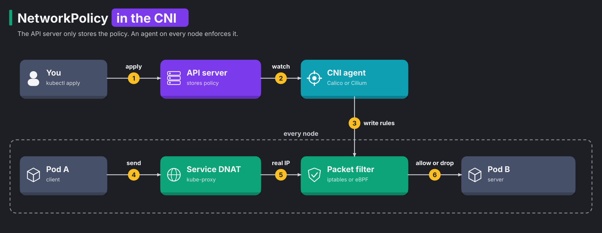
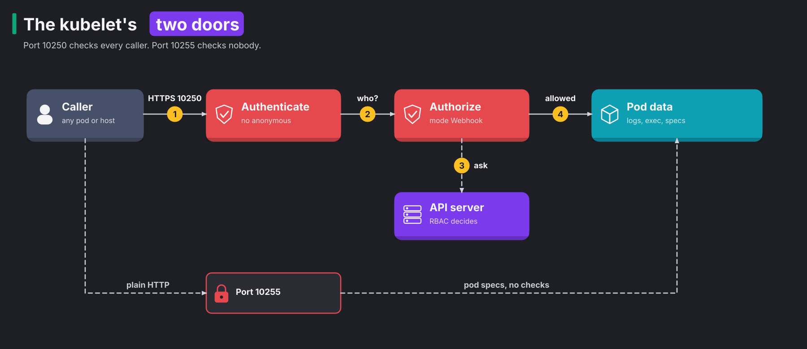

# CKS 01: Cluster setup (15%)

> New to a term here, like CIS benchmark or ipBlock? The [glossary](../../course/glossary.md#cks-exam-track) explains every term this track uses.

**Before this domain:** the [practice cluster](../README.md#the-practice-cluster) running, and for tasks 9 to 11 the [Lima VM](../README.md#the-lima-vm-for-apparmor-and-cilium) too. The course's [module 3](../../course/03-authorization.md#concept-authorizationpolicy-compared-with-networkpolicy) compares NetworkPolicy with Istio's rules, and [module 11](../../course/11-edge-tls.md) explains certificates and trust. Read those first if NetworkPolicy or TLS feel shaky.

A fresh kubeadm cluster lets every pod reach every other pod, exposes profiling data about its own internals, and trusts whatever binaries you copy onto the nodes. This domain closes those doors before any workload arrives. It has 13 tasks and takes about 2 hours, including the theory.

## The domain in one table

The exam's cluster setup domain covers five competencies. Each task answers one question:

| Question | Tool | Task |
|---|---|---|
| Which pods may talk to which? | NetworkPolicy | 1, 6, 7, 8 |
| Which pods may talk to which, on a Cilium cluster, down to the HTTP path? | CiliumNetworkPolicy | 9, 10, 11 |
| May a pod reach the cloud's metadata service? | NetworkPolicy with `ipBlock` | 2 |
| Do the control plane flags follow the industry baseline? | kube-bench | 3 |
| Do the control plane and the kubelet speak only modern TLS? | `--tls-min-version`, `--tls-cipher-suites` | 12, 13 |
| Do the kubelet's own endpoints refuse strangers? | the kubelet config file | 13 |
| Does the Ingress serve real TLS? | Ingress with a `tls` section | 4 |
| Are the binaries on the node the ones Kubernetes released? | `sha512sum` | 5 |

The sections below explain each control from the ground up: the problem first, then how the control works inside, then what it stops and where the exam trips people.

## Concept: a flat network and the allow list that closes it

Kubernetes connects every pod to every other pod by default. Any pod reaches any other pod's IP address on any port, across namespaces and across nodes. The designers chose this on purpose, because it makes networking simple: an application never needs to know which node its peer runs on.

The price is a flat network. Think of an office building where every door opens with any badge. One compromised pod reaches the database, the API server, the node's own services and every other team's workloads. Security people call that next step **lateral movement**: an attacker who got into one place moves sideways to the next.

A **NetworkPolicy** is an allow list for pod traffic. It selects pods by label and lists which peers may reach them (ingress) and which peers they may reach (egress). Three rules decide what a NetworkPolicy does:

1. A pod that no policy selects accepts everything. Kubernetes isolates a pod only once a policy selects it.
2. Once a policy selects a pod for a direction (`Ingress` or `Egress`), that direction allows only what some policy lists.
3. Policies only add. Two policies that select the same pod allow the union of their lists. No policy subtracts.

So the usual pattern has two layers. A **default-deny** policy selects every pod (`podSelector: {}`) and lists nothing. Then small policies open single paths. Every door starts locked, and each policy hands out one key.

Egress needs one extra path that people forget: DNS. A pod with default-deny egress fails to resolve `api` long before it fails to connect to it. So every egress allow list includes UDP and TCP port 53 to CoreDNS in `kube-system`.

**What this stops.** A default-deny policy turns one compromised pod into a dead end. The attacker holds a shell, but the database, the other namespaces and the cloud metadata service stay out of reach until somebody writes a policy that opens them.

### How a policy becomes a packet filter



The API server never looks at a single packet. It stores the NetworkPolicy object and nothing more. The work happens on every node, in six steps:

1. You apply the policy with `kubectl`.
2. The API server stores it in etcd, and the **CNI plugin**'s agent on each node watches for it. The CNI plugin is the network component that gives each pod its address and connects it to the network.
3. The agent translates the policy into packet filter rules in the node's kernel.
4. A pod sends a packet, for example to a Service address.
5. kube-proxy's DNAT rule rewrites the Service address into a real pod address. DNAT (destination network address translation) means the kernel swaps the packet's destination on the way.
6. The packet filter compares the packet with its rules and allows or drops it.

The two CNI plugins in this track build step 3 differently. **Calico** runs an agent called Felix on every node. Felix writes iptables rules, or eBPF programs when Calico runs its eBPF data plane. **Cilium** compiles eBPF programs and attaches them to each pod's network interface. Cilium also gives every set of pod labels a number, a security identity, so its programs compare identities instead of long IP lists. The course's [module 10](../../platform-engineering/10-ebpf-and-cilium.md#concept-what-ebpf-is) explains eBPF itself.

A NetworkPolicy works only when the CNI plugin implements it. flannel on its own, for example, accepts the object and enforces nothing. The API server stores the policy either way, so `kubectl get netpol` looks perfect while every packet still flows. Always test a policy with real traffic.

**Exam traps.** Step 5 comes before step 6, and that order breaks a common policy. Calico checks a packet after kube-proxy has translated a Service address into a pod or node address. So an `ipBlock` for the `kubernetes` Service, `10.96.0.1/32` port 443, never matches. The packet that Calico sees goes to the API server's real address on port 6443. The test run measured it: with `10.96.0.1/32`, the connection timed out; with the control plane's address and port 6443, it worked. `k get endpointslice -l kubernetes.io/service-name=kubernetes` prints the real address. Task 6 needs it.

### Four NetworkPolicy details the exam likes

The three rules above cover most tasks. Four details decide the harder ones.

The first detail is **one rule or two**. A `from` or `to` list holds peers, and each list item is one peer. Inside one item, a `namespaceSelector` and a `podSelector` must both match. In two items, either one is enough. The difference is a single dash:

```yaml
  - from:
    - namespaceSelector: {matchLabels: {team: api}}   # one item: pods labelled app=api
      podSelector: {matchLabels: {app: api}}          #   in namespaces labelled team=api
  - from:
    - namespaceSelector: {matchLabels: {team: api}}   # two items: every pod in team=api namespaces,
    - podSelector: {matchLabels: {app: api}}          #   or app=api pods in this namespace
```

A `podSelector` alone, without a `namespaceSelector`, only matches pods in the policy's own namespace. Task 7 fixes a policy that has the dash in the wrong place.

The second detail is **deny-all egress**. A policy with `policyTypes: [Egress]` and no `egress` list blocks every outgoing packet of the pods it selects, DNS included. Pods behind it fail with name errors, not connection errors, which confuses people.

The third detail is the **Service address**, which the previous section explained. Name the address the packet filter sees, not the one the client dials.

The fourth detail is **port ranges**. `port: 7000` with `endPort: 7100` opens every port from 7000 to 7100 in one entry. The range works only with a numeric `port`, never with a named port. Task 8 uses it.

## Concept: layer 3 and 4, and layer 7

Network people number the layers of a connection. Layer 3 is the IP address. Layer 4 is the protocol and port, such as TCP 80. Layer 7 is the application's own language, such as an HTTP method and path. A plain NetworkPolicy works at layers 3 and 4. It says "pod A may reach pod B on TCP 80", and it never reads what flows over that port.

That leaves a gap. A frontend that needs `GET /public` on an API also gets `DELETE /admin` on the same port, because both travel over TCP 80. Closing that gap needs something that reads HTTP.

**Cilium** fills the gap with its own resource, the **CiliumNetworkPolicy** (short name `cnp`). It enforces ordinary NetworkPolicies too. The exam allows the Cilium docs, and its tasks expect three things the Kubernetes NetworkPolicy lacks:

| Cilium feature | What it adds | Task |
|---|---|---|
| `toPorts.rules.http` | layer 7 rules: allow `GET /public/.*` and refuse everything else with `403` | 10 |
| `toEntities` | named groups of peers, such as `kube-apiserver`, `world` (everything outside the cluster), `host` or `cluster` | 11 |
| `ingressDeny`, `egressDeny` | rules that subtract. A deny wins over every allow | 11 |

A CiliumNetworkPolicy selects pods with `endpointSelector` instead of `podSelector`. Peers sit in `fromEndpoints` and `toEndpoints`, and a peer in another namespace carries the label `k8s:io.kubernetes.pod.namespace`. Once a policy selects a pod for a direction, that direction becomes an allow list, the same rule as for a NetworkPolicy.

The layer 7 rule needs an extra hop. eBPF programs in the kernel handle layers 3 and 4 fast, but parsing HTTP is a job for a proxy. So Cilium sends the selected traffic through an Envoy proxy on the node. Envoy reads the HTTP request and answers `403 Forbidden` itself when no rule matches. A connection refused at layer 4 times out instead, because the kernel simply drops the packets. That difference tells you which layer refused you.

The practice cluster runs Calico, so the Cilium tasks run on the third practice machine, the [Lima VM](../README.md#the-lima-vm-for-apparmor-and-cilium) `cks-lima`. It holds a one-node kubeadm cluster with Cilium 1.20.4. Open a root shell there with `./certs/cks/cluster/lima.sh shell`.

**What this stops.** An HTTP rule stops a compromised frontend from calling admin endpoints on a service it legitimately talks to. An `egressDeny` to `world` stops a pod from sending stolen data to the internet, whatever allow rules other teams add later.

**Exam traps.** In the test run, a refused HTTP request printed `wget: server returned error: HTTP/1.1 403 Forbidden`, an answer from Envoy, not from nginx. A pod with no layer 4 permission saw `wget: download timed out` instead. A deny rule wins over every allow, which is the opposite of plain NetworkPolicy, where nothing subtracts.

## Concept: the metadata endpoint

Cloud virtual machines answer HTTP on `169.254.169.254`, the **metadata service**. It hands out facts about the machine: its name, its network, and often temporary cloud credentials for the machine's role. The address is link-local, which means it only exists on the machine's own network segment, and every process on the machine reaches it without a password.

Every pod on the node reaches it too, because pod traffic leaves through the node. Attackers love this path. A common pattern is server-side request forgery, or SSRF: an attacker tricks a web application into fetching a URL of the attacker's choice. If the application fetches `http://169.254.169.254/...`, it hands the node's cloud credentials to the attacker, who then leaves the cluster with them and acts on the cloud account directly.

An egress NetworkPolicy closes that path for pods. It allows `0.0.0.0/0` with an `except` list that names `169.254.169.254/32`, so everything else still flows. Clouds add their own fences too. AWS's IMDSv2, for example, demands a session token and lets you set a hop limit of 1, so the answer never travels the extra network hop to a container.

OrbStack has no metadata service, so in this lab you build the policy and prove that other traffic still flows.

**What this stops.** A pod with an SSRF bug or a stolen shell no longer turns into the node's cloud identity. That's often the difference between "one pod compromised" and "the whole cloud account compromised".

## Concept: a checklist for the control plane

A fresh kubeadm cluster works, but "works" and "hardened" differ. Somebody has to decide which of the API server's hundred flags matter for security. Doing that from scratch on every cluster wastes time and misses things.

The **CIS Kubernetes Benchmark** answers that once for everybody. It's a checklist from the Center for Internet Security, a non-profit that writes hardening guides for operating systems and platforms. It lists about 130 settings for the API server, etcd, the scheduler, the controller manager and the kubelet. Each item names a setting, the reason it matters, how to check it, and how to fix it. Items marked automated have a check a program runs. Items marked manual need a human to judge, such as "minimize access to Secrets".

**kube-bench** is a tool from Aqua Security that runs those checks on a node. It works in five steps:

1. It detects the Kubernetes version and picks the matching benchmark version.
2. It loads the checks for the target you name: `master` for the control plane components, `node` for the kubelet, `etcd`, and `policies`.
3. For each check, it runs an audit command on the node, such as `ps -ef | grep kube-apiserver` or `stat -c %a /var/lib/kubelet/config.yaml`.
4. It compares the output with the expected value, for example "the flag `--profiling` is set to `false`".
5. It prints `[PASS]`, `[FAIL]` or `[WARN]` per item, and a remediation for each failure.

On a fresh practice cluster, the test run printed 39 passes, 10 failures and 11 warnings for the master target. Profiling failed on all three components. Profiling is a debug feature that serves `/debug/pprof` with details about the process's memory and threads. That helps an attacker study the process, and production never needs it.

**What this stops.** The benchmark stops the slow drift where each cluster gets a slightly different and slightly weaker set of flags. It gives a security team one shared list to argue about, instead of a hundred opinions.

**Exam traps.** kube-bench reads the flags of the running processes, so a fix shows up only after the kubelet restarts the static pod. That's why the solution waits for the API server before it runs kube-bench again. A file permission check, such as 4.1.9, reads the file on disk and passes at once. And a later `kubeadm upgrade` rewrites the manifests and drops hand-added flags, which [domain 02](02-cluster-hardening.md#task-4-upgrade-the-cluster-with-kubeadm) measured.

## Concept: TLS versions, cipher suites and downgrades

Every connection between Kubernetes components uses TLS, the protocol that encrypts traffic and proves the server's identity. TLS has evolved over two decades. Old versions (SSL 3.0, TLS 1.0 and TLS 1.1) and some old algorithms have known weaknesses, and attackers have working tools against them.

A TLS connection starts with a **handshake**, a short negotiation before any data flows:

1. The client sends a hello that lists the TLS versions and cipher suites it supports. A **cipher suite** is the set of algorithms that encrypts and signs the traffic.
2. The server picks the highest version and the best suite that both sides support.
3. The server sends its certificate, and both sides agree on fresh keys.
4. Everything after that travels encrypted.

Step 2 opens a door for a **downgrade attack**. An attacker in the middle of the network tampers with the hello or blocks the first attempts, so client and server settle on an old version or a weak suite. Then the attacker breaks that weak connection. TLS 1.3 carries a built-in signal that detects such tampering, but only if both sides refuse the old versions in the first place. So the CIS benchmark asks every component to set a minimum version and a list of strong suites. A server that never speaks TLS 1.0 never gets talked down to it.

Each component spells the setting differently, and the exam checks the exact spelling:

| Component | Where | Minimum version | Cipher suites |
|---|---|---|---|
| API server | flag in its static pod | `--tls-min-version=VersionTLS12` | `--tls-cipher-suites=TLS_ECDHE_RSA_WITH_AES_128_GCM_SHA256,...` |
| etcd | flag in its static pod | `--tls-min-version=TLS1.3` | `--cipher-suites=...` |
| kubelet | `/var/lib/kubelet/config.yaml` | `tlsMinVersion: VersionTLS13` | `tlsCipherSuites: [...]` |

TLS 1.3 has a fixed, short list of suites. So a cipher suite list only means something for TLS 1.2. kubeadm signs its certificates with RSA keys, so pick `ECDHE_RSA` suites. A list of only `ECDHE_ECDSA` suites leaves the API server with no suite its own certificate supports.

`openssl s_client` tests a setting from the node. `-tls1_2` and `-tls1_1` force a version, and `-cipher` offers one suite. The test run's check reads `Cipher is ...` from the output: present on success, `(NONE)` on a refusal.

**What this stops.** A minimum version and a suite list stop downgrade attacks and stop clients from settling on a suite with a known break. They also stop old, unpatched tools from talking to the cluster at all, which is usually a feature.

**Exam traps.** Before the fix, the test run's API server still accepted `ECDHE-RSA-CHACHA20-POLY1305`, a suite the task didn't list. OpenSSL names suites differently from Go, the language Kubernetes is written in: `ECDHE-RSA-AES128-GCM-SHA256` in OpenSSL is `TLS_ECDHE_RSA_WITH_AES_128_GCM_SHA256` in a flag. And restarting the API server and etcd together took 2 minutes 24 seconds in the test run, so wait before you test.

## Concept: the kubelet's own API

Every kubelet runs an HTTPS API on port 10250. The API server uses it for `kubectl logs`, `exec` and `port-forward`. It answers questions such as "which pods run here" and "run this command in that container". Whoever talks to it freely owns every container on the node.



A request to port 10250 passes four steps when the kubelet is set up right:

1. A caller connects to port 10250 over HTTPS.
2. The kubelet authenticates the caller: a client certificate signed by the cluster's certificate authority, or a bearer token that the kubelet checks with the API server.
3. The kubelet asks the API server whether this caller may do this action on this node. The API server answers with an RBAC decision.
4. Only then does the kubelet hand out logs, run `exec` or list pods.

Three settings in the kubelet config file decide whether those steps happen, and kubeadm sets them right:

1. `authentication.anonymous.enabled: false` turns away requests without a certificate or token. With it on, step 2 lets strangers through as `system:anonymous`.
2. `authorization.mode: Webhook` makes the kubelet ask the API server in step 3. `AlwaysAllow` skips step 3 and lets any authenticated caller do anything.
3. `readOnlyPort: 0` turns off the old **read-only port** 10255. That port speaks plain HTTP, checks nobody, and hands out pod specs to anybody. Pod specs often carry environment variables with passwords in them. kubeadm leaves it off, and a careless edit turns it back on.

The kubelet reads the file only at start, so every change needs `systemctl restart kubelet`. Task 13 finds all three undone on `cks-w1`. In the test run, before the fix, an anonymous `curl` to `https://127.0.0.1:10250/pods` returned `200` with every pod on the node, and the read-only port answered `200` too.

**What this stops.** These settings stop a pod on the node network, or a neighbour on the same network, from running commands in every container on the node. Without them, one reachable kubelet hands out a cluster-wide foothold.

**Exam traps.** `kubectl logs` keeps working after the fix, because the API server logs in to the kubelet with its own client certificate, and kubeadm grants that identity the `system:kubelet-api-admin` ClusterRole. In the test run, the kubelet answered again 2 seconds after the restart. Edit the config file, not the systemd unit: the file is what kubeadm manages.

## Concept: Ingress with TLS

An **Ingress** is a set of HTTP routing rules for traffic entering the cluster: host names and paths to Services. An Ingress controller, ingress-nginx here, carries them out. TLS needs two objects:

1. A Secret of type `kubernetes.io/tls` that holds the certificate and its private key.
2. A `tls` section in the Ingress that names the host and that Secret.

When the Secret is missing or the names don't match, ingress-nginx doesn't fail. It serves its own "Kubernetes Ingress Controller Fake Certificate" and carries on. The course's [module 11](../../platform-engineering/11-edge-tls.md#concept-how-a-client-decides-to-trust-a-certificate) explains why a client refuses such a certificate.

**What this stops.** Real TLS at the edge stops anybody on the path between the user and the cluster from reading or changing the traffic, and the redirect from HTTP stops users from landing on the unencrypted port by accident.

**Exam traps.** A check that only looks at the HTTP status code misses the fake certificate. Look at the certificate's subject: the test run printed `subject=CN = shop.cks.local`. ingress-nginx redirects plain HTTP to HTTPS with `308` once TLS is set, so a `308` on port 80 is a good sign, not an error.

## Concept: trust the binaries you run

The kubelet, kubectl and kube-proxy are binaries that run with great power on every node. A kubelet binary from a random mirror, or one that somebody changed on the node after an intrusion, might carry a backdoor. Nothing in Kubernetes checks the binary it runs.

A **checksum** is a fingerprint of a file. A hash function such as SHA-512 reads every byte and produces a fixed-length value. Change one byte, and the value changes completely. Kubernetes publishes a SHA-512 checksum next to every binary on `dl.k8s.io`. Checking a binary takes three steps:

1. Download the published checksum for the exact version, operating system and CPU architecture.
2. Compute the checksum of the file on the node with `sha512sum`.
3. Compare the two. Any difference means the file isn't the release.

A checksum proves the file matches what the release page lists. It doesn't prove who made the release page. For that, Kubernetes also signs its release artifacts with cosign, the signing tool that [domain 05](05-supply-chain-security.md#concept-signatures) explains, and a signature ties the file to the Kubernetes release process itself.

**What this stops.** A checksum stops a tampered or corrupted binary from running unnoticed. In task 5, the setup appended three bytes to `kube-proxy`, and `sha512sum -c` reported `FAILED`.

**Exam traps.** The checksum file on `dl.k8s.io` holds only the hash, so add the file name before `sha512sum -c`. Pick the right architecture: the practice cluster runs `linux/arm64`, and an `amd64` checksum fails for every file.

## The bigger picture: a fresh cluster has wide doors

A kubeadm cluster arrives tuned for "it works", not for "it resists". Every control in this domain closes one wide door that the defaults leave open:

1. The network door: every pod reaches every pod. NetworkPolicy closes it, and Cilium narrows it to single HTTP paths.
2. The cloud door: every pod reaches the metadata service. An egress `except` closes it.
3. The configuration door: flags drift from the baseline. kube-bench finds the drift.
4. The wire door: old TLS stays possible. A minimum version and a suite list close it.
5. The node door: the kubelet's API answers strangers. Three config lines close it.
6. The software door: nobody checks the binaries. A checksum closes it.

Real platform teams rarely do these by hand on each cluster. They bake them into the cluster's build: a Terraform module or a kubeadm config file with the hardened flags, a default-deny policy in every namespace template, and kube-bench as a scheduled job that alerts when a check flips to `FAIL`. The exam asks you to do each step by hand, because a person who knows the steps writes better automation.

## Why this way

**Why allow lists and not deny lists?** A deny list names what's bad, and attackers invent new bad things every day. An allow list names what's needed, which changes rarely and fits on one page. Kubernetes NetworkPolicy has no deny rule at all, so the only way to use it is the safe way.

**Why does the CNI enforce policies, not the API server?** The API server never sees pod traffic. Packets go straight from one pod to another through the node's kernel. So the only place that sees every packet is the kernel of each node, and the CNI agent is the component that programs it.

**Why does the policy name the pod address and not the Service address?** kube-proxy translates the Service address before the packet filter looks. The filter judges the packet as it is at that moment, which is pod to pod.

**Why keep the kubelet API at all?** `kubectl logs`, `exec` and the API server's health checks need it. Turning it off breaks the cluster. Locking it down with authentication and webhook authorization keeps the features and closes the door.

**Why check checksums when HTTPS already protects the download?** HTTPS protects the trip, not the source. A mirror that serves a backdoored file over perfect HTTPS still serves a backdoored file. The checksum compares the file with the official release.

## Task 1: Default-deny and one allowed path

**Time budget:** 7 minutes. **Host:** `cks-cp`.

Prepare it from your Mac:

```bash
./certs/cks/task.sh setup 1.1
```

> Namespace `team-app` runs three pods: `frontend` (label `app=frontend`), `api` (`app=api`, port 80) and `db` (`app=db`, port 80), each with a Service of the same name.
>
> 1. Create a NetworkPolicy `default-deny` that blocks all ingress and all egress for every pod in `team-app`.
> 2. Allow `frontend` to reach `api` on TCP port 80, and nothing else. `frontend` must still resolve Service names.
> 3. `db` must not reach `api`.

Useful commands:

```bash
k -n team-app get pods --show-labels
k -n kube-system get pods -l k8s-app=kube-dns --show-labels
k explain networkpolicy.spec.egress.to
k -n team-app exec frontend -- wget -qO- -T 3 http://api
```

<details>
<summary>Solution</summary>

Three policies: the deny, an ingress rule on `api`, and an egress rule on `frontend` that also opens DNS.

```yaml
apiVersion: networking.k8s.io/v1
kind: NetworkPolicy
metadata:
  name: default-deny
  namespace: team-app
spec:
  podSelector: {}
  policyTypes: [Ingress, Egress]
---
apiVersion: networking.k8s.io/v1
kind: NetworkPolicy
metadata:
  name: allow-frontend-to-api
  namespace: team-app
spec:
  podSelector:
    matchLabels: {app: api}
  policyTypes: [Ingress]
  ingress:
  - from:
    - podSelector:
        matchLabels: {app: frontend}
    ports:
    - {protocol: TCP, port: 80}
---
apiVersion: networking.k8s.io/v1
kind: NetworkPolicy
metadata:
  name: frontend-egress
  namespace: team-app
spec:
  podSelector:
    matchLabels: {app: frontend}
  policyTypes: [Egress]
  egress:
  - to:
    - podSelector:
        matchLabels: {app: api}
    ports:
    - {protocol: TCP, port: 80}
  - to:
    - namespaceSelector:
        matchLabels: {kubernetes.io/metadata.name: kube-system}
      podSelector:
        matchLabels: {k8s-app: kube-dns}
    ports:
    - {protocol: UDP, port: 53}
    - {protocol: TCP, port: 53}
```

Save it as `np.yaml` with `vim np.yaml` and run `k apply -f np.yaml`.

Two details decide whether it works:

- The `namespaceSelector` and the `podSelector` of the DNS rule sit in **one** list item, so both must match: CoreDNS pods in `kube-system`. As two separate items (a dash before each), the rule would allow every pod in `kube-system` or any pod labelled `k8s-app=kube-dns` in `team-app`.
- The port is the pod's port, not the Service's. Calico checks packets after kube-proxy has translated the Service address to a pod address. Here both are 80.

</details>

Check it:

```bash
./certs/cks/task.sh check 1.1
```

In the test run, the check failed three of four items before the solution and passed all four after it:

```
  PASS  NetworkPolicy default-deny selects every pod, Ingress and Egress
  PASS  frontend reaches api on port 80, by name
  PASS  frontend does not reach db
  PASS  db does not reach api
```

## Task 2: Block the node metadata endpoint

**Time budget:** 4 minutes. **Host:** `cks-cp`.

```bash
./certs/cks/task.sh setup 1.2
```

> Pods in namespace `batch` must not reach the node metadata service at `169.254.169.254`. All other egress stays allowed. Create a NetworkPolicy named `deny-metadata`.

<details>
<summary>Solution</summary>

```yaml
apiVersion: networking.k8s.io/v1
kind: NetworkPolicy
metadata:
  name: deny-metadata
  namespace: batch
spec:
  podSelector: {}
  policyTypes: [Egress]
  egress:
  - to:
    - ipBlock:
        cidr: 0.0.0.0/0
        except: [169.254.169.254/32]
```

The policy selects every pod for egress, so egress becomes an allow list. The list holds the whole IPv4 range minus one address. DNS keeps working, because CoreDNS's pod IP sits inside `0.0.0.0/0`.

</details>

```bash
./certs/cks/task.sh check 1.2
```

In the test run, the worker pod reached the API server's port both before and after the policy. The check reads the policy's structure for the block itself, because OrbStack has no metadata service to refuse:

```
  PASS  NetworkPolicy deny-metadata exists and selects every pod
  PASS  it allows 0.0.0.0/0 except 169.254.169.254/32
  PASS  the worker still resolves names and reaches the API server
```

## Task 3: Fix CIS findings with kube-bench

**Time budget:** 8 minutes. **Host:** `cks-cp`.

```bash
./certs/cks/task.sh setup 1.3     # seeds nothing: a fresh kubeadm cluster fails these checks already
```

> Run kube-bench against the control plane node `cks-cp` and fix these findings: 1.2.15, 1.3.2 and 1.4.1 (profiling on the API server, controller manager and scheduler), and 4.1.9 (the kubelet's config file permissions). The control plane must keep running.

Start by reading the report:

```bash
kube-bench run --targets master | grep -E '^\[FAIL\]|checks (PASS|FAIL|WARN)'
kube-bench run --targets master --check 1.2.15     # one check, with its remediation
kube-bench run --targets node --check 4.1.9
```

On a fresh cluster, the test run printed 39 passes, 10 failures and 11 warnings for the master target. The failures were profiling on all three components, four audit log flags, etcd's data directory owner, `--kubelet-certificate-authority` and `--service-account-extend-token-expiration`. Audit logging comes in [domain 06](06-monitoring-logging-runtime-security.md#task-1-turn-on-audit-logging).

<details>
<summary>Solution</summary>

Each profiling fix is one flag in a static pod manifest. Back the files up outside the manifests folder, because the kubelet starts every file inside it, backups included:

```bash
cp /etc/kubernetes/manifests/kube-{apiserver,controller-manager,scheduler}.yaml /root/
vim /etc/kubernetes/manifests/kube-apiserver.yaml
```

Add one line under the command, in each of the three files:

```yaml
  - command:
    - kube-apiserver
    - --profiling=false
```

Then fix the kubelet's config file and wait for the control plane:

```bash
chmod 600 /var/lib/kubelet/config.yaml
watch crictl ps                                        # the three containers restart
k -n kube-system get pods -l tier=control-plane
kube-bench run --targets master,node --check 1.2.15,1.3.2,1.4.1,4.1.9
```

In the test run, the three pods came back in under a minute, and kube-bench then printed `[PASS]` for all four checks.

</details>

```bash
./certs/cks/task.sh check 1.3
```

```
  PASS  kube-bench 1.2.15 passes
  PASS  kube-bench 1.3.2 passes
  PASS  kube-bench 1.4.1 passes
  PASS  kube-bench 4.1.9 passes
  PASS  every control plane pod runs
```

## Task 4: An Ingress with TLS

**Time budget:** 6 minutes. **Host:** `cks-cp`.

```bash
./certs/cks/task.sh setup 1.4
```

> Namespace `web` runs Deployment `shop` behind Service `shop` on port 80. A certificate and key for `shop.cks.local` wait in `/root/cks/shop.crt` and `/root/cks/shop.key`.
>
> 1. Store them in a TLS Secret named `shop-tls` in `web`.
> 2. Create an Ingress `shop` with class `nginx` that serves `https://shop.cks.local/` from Service `shop` with that certificate.
> 3. Plain HTTP must redirect to HTTPS.

The ingress controller listens on NodePort 30443 for HTTPS and 30080 for HTTP, on both nodes.

<details>
<summary>Solution</summary>

Two imperative commands do it:

```bash
k -n web create secret tls shop-tls --cert=/root/cks/shop.crt --key=/root/cks/shop.key
k -n web create ingress shop --class=nginx --rule="shop.cks.local/*=shop:80,tls=shop-tls"
```

The `tls=shop-tls` part of `--rule` writes the Ingress's `tls` section. ingress-nginx redirects HTTP to HTTPS by itself for every host that has TLS, with status 308, so step 3 needs nothing extra.

Test it from the node. `--resolve` makes curl send the right host name to an IP address without touching DNS:

```bash
curl -sk -o /dev/null -w '%{http_code}\n' --resolve shop.cks.local:30443:127.0.0.1 https://shop.cks.local:30443/
echo | openssl s_client -connect 127.0.0.1:30443 -servername shop.cks.local 2>/dev/null | openssl x509 -noout -subject
curl -s -o /dev/null -w '%{http_code}\n' --resolve shop.cks.local:30080:127.0.0.1 http://shop.cks.local:30080/
```

In the test run, these printed `200`, `subject=CN = shop.cks.local` and `308`. The controller reloaded nginx about 3 seconds after the Ingress appeared.

</details>

```bash
./certs/cks/task.sh check 1.4
```

```
  PASS  Secret shop-tls has type kubernetes.io/tls
  PASS  HTTPS on shop.cks.local:30443 answers 200
  PASS  the certificate served is CN=shop.cks.local, not the controller's fake one
  PASS  plain HTTP redirects to HTTPS (308)
```

## Task 5: Verify a platform binary

**Time budget:** 3 minutes. **Host:** `cks-cp`.

```bash
./certs/cks/task.sh setup 1.5
```

> `/opt/cks/bin` holds `kubectl` and `kube-proxy`, both claiming to be Kubernetes v1.37.1 for linux/arm64. Delete every binary that doesn't match the official release.

<details>
<summary>Solution</summary>

The checksum file on `dl.k8s.io` holds only the hash, so add the file name for `sha512sum -c`:

```bash
cd /opt/cks/bin
for b in kubectl kube-proxy; do
  echo "$(curl -fsSL https://dl.k8s.io/release/v1.37.1/bin/linux/arm64/$b.sha512) $b" | sha512sum -c || rm -f "$b"
done
```

In the test run:

```
kubectl: OK
kube-proxy: FAILED
sha512sum: WARNING: 1 computed checksum did NOT match
```

The setup had appended three bytes to `kube-proxy`. In the exam, the task often gives the expected hash in the text instead. Then compare by eye: `sha512sum kube-proxy` and look at the first and last few characters.

</details>

```bash
./certs/cks/task.sh check 1.5
```

```
  PASS  the tampered kube-proxy is gone
  PASS  kubectl stays, and matches the official v1.37.1 sha512
```

## Task 6: Egress to DNS and the API server only

**Time budget:** 7 minutes. **Host:** `cks-cp`.

```bash
./certs/cks/task.sh setup 1.6
```

> Namespace `egress-lab` runs pod `agent` (label `app=agent`) and pod `web` (label `app=web`, with a Service `web`).
>
> 1. Create a NetworkPolicy `deny-all-egress` that blocks all egress for every pod in `egress-lab`.
> 2. Create a NetworkPolicy `agent-egress` so that `agent` resolves names through CoreDNS and connects to the Kubernetes API server, and nothing else.

<details>
<summary>Solution</summary>

Find the API server's real address first. The theory explains why the Service address doesn't work:

```bash
k get endpointslice -n default -l kubernetes.io/service-name=kubernetes
```

In the test run, that printed the control plane's address with port 6443. Use it in the policy:

```yaml
apiVersion: networking.k8s.io/v1
kind: NetworkPolicy
metadata:
  name: deny-all-egress
  namespace: egress-lab
spec:
  podSelector: {}
  policyTypes: [Egress]
---
apiVersion: networking.k8s.io/v1
kind: NetworkPolicy
metadata:
  name: agent-egress
  namespace: egress-lab
spec:
  podSelector:
    matchLabels: {app: agent}
  policyTypes: [Egress]
  egress:
  - to:
    - namespaceSelector:
        matchLabels: {kubernetes.io/metadata.name: kube-system}
      podSelector:
        matchLabels: {k8s-app: kube-dns}
    ports:
    - {protocol: UDP, port: 53}
    - {protocol: TCP, port: 53}
  - to:
    - ipBlock:
        cidr: <the address>/32
    ports:
    - {protocol: TCP, port: 6443}
```

Test from the pod:

```bash
k -n egress-lab exec agent -- nc -z -w 3 kubernetes.default.svc.cluster.local 443 && echo api ok
k -n egress-lab exec agent -- wget -qO- -T 3 http://web      # download timed out
```

The `nc` goes to the Service's port 443, and the policy names port 6443. Both are right: kube-proxy rewrites the packet to port 6443 before Calico looks at it. In the test run, the same policy with `cidr: 10.96.0.1/32` and port 443 left `nc` waiting until its timeout.

</details>

```bash
./certs/cks/task.sh check 1.6
```

In the test run, the check failed three of five items before the solution and passed all five after it:

```
  PASS  NetworkPolicy deny-all-egress selects every pod for Egress and allows nothing
  PASS  agent resolves kubernetes.default
  PASS  agent reaches the API server through the kubernetes Service
  PASS  agent does not reach web
  PASS  web reaches nothing, not even the API server
```

## Task 7: One rule or two

**Time budget:** 5 minutes. **Host:** `cks-cp`.

```bash
./certs/cks/task.sh setup 1.7
```

> NetworkPolicy `db-ingress` in namespace `team-db` should let only pods labelled `app=api` in namespaces labelled `team=api` reach pod `db` on TCP port 80. Pod `debug` in `team-api` still gets in. Fix the policy and keep its name.

<details>
<summary>Solution</summary>

Read the policy and count the dashes under `from`:

```bash
k -n team-db get netpol db-ingress -o yaml
```

The `from` list has two items, so either selector lets a pod in, and `debug` lives in a `team=api` namespace. Merge them into one item with `k -n team-db edit netpol db-ingress`:

```yaml
  ingress:
  - from:
    - namespaceSelector:
        matchLabels: {team: api}
      podSelector:
        matchLabels: {app: api}
    ports:
    - {protocol: TCP, port: 80}
```

The only change is the dash before `podSelector`, which goes away. Then test both sides:

```bash
k -n team-api exec api -- wget -qO- -T 3 http://db.team-db | head -4
k -n team-api exec debug -- wget -qO- -T 3 http://db.team-db       # download timed out
```

</details>

```bash
./certs/cks/task.sh check 1.7
```

In the test run, the setup printed `debug in team-api reaches db: yes`, and the check failed one item. After the fix:

```
  PASS  NetworkPolicy db-ingress still exists
  PASS  api in team-api reaches db
  PASS  debug in team-api does not reach db
  PASS  api in team-web does not reach db
```

## Task 8: A port range

**Time budget:** 4 minutes. **Host:** `cks-cp`.

```bash
./certs/cks/task.sh setup 1.8
```

> Pod `server` in namespace `ports` listens on TCP ports 7000, 7050, 7100 and 8000. Create a NetworkPolicy `server-ports` so that `server` accepts TCP ports 7000 to 7100 from pods in its own namespace, and nothing else. Use one port entry for the whole range.

<details>
<summary>Solution</summary>

```yaml
apiVersion: networking.k8s.io/v1
kind: NetworkPolicy
metadata:
  name: server-ports
  namespace: ports
spec:
  podSelector:
    matchLabels: {app: server}
  policyTypes: [Ingress]
  ingress:
  - from:
    - podSelector: {}
    ports:
    - {protocol: TCP, port: 7000, endPort: 7100}
```

`podSelector: {}` inside `from` means every pod in the policy's namespace. Test with the pod's address, because `server` has no Service:

```bash
IP=$(k -n ports get pod server -o jsonpath='{.status.podIP}')
k -n ports exec client -- wget -qO- -T 3 http://$IP:7050/       # ok
k -n ports exec client -- wget -qO- -T 3 http://$IP:8000/       # download timed out
```

</details>

```bash
./certs/cks/task.sh check 1.8
```

```
  PASS  NetworkPolicy server-ports opens one port entry, 7000 to 7100 with endPort
  PASS  client reaches server on 7000, 7050 and 7100
  PASS  client does not reach server on 8000
```

## Task 9: A CiliumNetworkPolicy at layers 3 and 4

**Time budget:** 5 minutes. **Host:** `cks-lima`.

```bash
./certs/cks/cluster/lima.sh start      # once, when the VM is off
./certs/cks/task.sh setup 1.9
```

> Namespace `cilium-l4` runs pods `backend` (label `app=backend`, Service `backend` on port 80), `frontend` (`app=frontend`) and `other` (`app=other`). Create a CiliumNetworkPolicy `backend-ingress` so that `backend` accepts only TCP port 80, and only from `frontend`.

<details>
<summary>Solution</summary>

The Cilium docs' "Layer 3 examples" and "Layer 4 examples" pages hold this shape:

```yaml
apiVersion: cilium.io/v2
kind: CiliumNetworkPolicy
metadata:
  name: backend-ingress
  namespace: cilium-l4
spec:
  endpointSelector:
    matchLabels: {app: backend}
  ingress:
  - fromEndpoints:
    - matchLabels: {app: frontend}
    toPorts:
    - ports:
      - {port: "80", protocol: TCP}
```

The port is a string in a CiliumNetworkPolicy. A peer in `fromEndpoints` without a namespace label matches pods in the policy's own namespace, like a plain `podSelector`.

```bash
k -n cilium-l4 get cnp
k -n cilium-l4 exec frontend -- wget -qO- -T 3 http://backend | head -4
k -n cilium-l4 exec other -- wget -qO- -T 3 http://backend          # download timed out
```

</details>

```bash
./certs/cks/task.sh check 1.9
```

```
  PASS  CiliumNetworkPolicy backend-ingress selects app=backend and opens only TCP 80
  PASS  frontend reaches backend on port 80
  PASS  other does not reach backend
```

## Task 10: An HTTP rule with Cilium

**Time budget:** 6 minutes. **Host:** `cks-lima`.

```bash
./certs/cks/task.sh setup 1.10
```

> Pod `api` in namespace `cilium-l7` serves `/public/` and `/admin/` on port 80. Create a CiliumNetworkPolicy `api-l7`:
>
> 1. Pods labelled `app=client` may send `GET` requests for paths under `/public/`.
> 2. Every other request from `client` gets refused at the HTTP layer.
> 3. No other pod reaches `api`.

<details>
<summary>Solution</summary>

A layer 7 rule hangs under `toPorts`, next to the port it filters:

```yaml
apiVersion: cilium.io/v2
kind: CiliumNetworkPolicy
metadata:
  name: api-l7
  namespace: cilium-l7
spec:
  endpointSelector:
    matchLabels: {app: api}
  ingress:
  - fromEndpoints:
    - matchLabels: {app: client}
    toPorts:
    - ports:
      - {port: "80", protocol: TCP}
      rules:
        http:
        - method: GET
          path: "/public/.*"
```

`path` is a regular expression, so `/public/.*` covers everything under the folder. Test three requests:

```bash
k -n cilium-l7 exec client -- wget -qO- -T 5 http://api/public/                  # public
k -n cilium-l7 exec client -- wget -qO- -T 5 http://api/admin/                   # 403
k -n cilium-l7 exec client -- wget -qO- -T 5 --post-data=x http://api/public/    # 403
```

In the test run, the second and third commands printed `wget: server returned error: HTTP/1.1 403 Forbidden`. That answer came from Cilium's Envoy proxy, not from nginx. A request from `other` printed `wget: download timed out` instead, because layer 4 dropped it before any HTTP happened.

</details>

```bash
./certs/cks/task.sh check 1.10
```

In the test run, the check failed four of five items before the solution:

```
  PASS  CiliumNetworkPolicy api-l7 has an HTTP rule
  PASS  client gets /public/ with GET
  PASS  client gets 403 for /admin/
  PASS  client gets 403 for a POST to /public/
  PASS  other does not reach api at all
```

## Task 11: Entities and an explicit deny with Cilium

**Time budget:** 6 minutes. **Host:** `cks-lima`.

```bash
./certs/cks/task.sh setup 1.11
```

> In namespace `cilium-egress`:
>
> 1. Create a CiliumNetworkPolicy `deny-world` that denies egress from every pod to everything outside the cluster. Use an entity and a deny rule.
> 2. Create a CiliumNetworkPolicy `agent-egress` so that pod `agent` reaches the Kubernetes API server, through an entity, and DNS, and nothing else.

<details>
<summary>Solution</summary>

```yaml
apiVersion: cilium.io/v2
kind: CiliumNetworkPolicy
metadata:
  name: deny-world
  namespace: cilium-egress
spec:
  endpointSelector: {}
  egressDeny:
  - toEntities: [world]
---
apiVersion: cilium.io/v2
kind: CiliumNetworkPolicy
metadata:
  name: agent-egress
  namespace: cilium-egress
spec:
  endpointSelector:
    matchLabels: {app: agent}
  egress:
  - toEntities: [kube-apiserver]
  - toEndpoints:
    - matchLabels:
        k8s:io.kubernetes.pod.namespace: kube-system
        k8s-app: kube-dns
    toPorts:
    - ports:
      - {port: "53", protocol: ANY}
```

Three things to notice:

- `deny-world` has no allow rules, so it doesn't turn `web`'s egress into an allow list. `web` still reaches other pods. It only loses the world.
- `kube-apiserver` matches the API server wherever it runs, so the Service-address trap of task 6 doesn't exist here. Cilium works out the real address itself.
- `protocol: ANY` covers DNS over UDP and TCP in one entry.

```bash
k -n cilium-egress exec agent -- nc -z -w 3 kubernetes.default.svc.cluster.local 443 && echo api ok
k -n cilium-egress exec web -- nc -z -w 3 1.1.1.1 443 || echo world blocked
```

In the test run, the setup printed `web reaches 1.1.1.1:443 before any policy: yes`, and after the solution the second command printed `world blocked`.

</details>

```bash
./certs/cks/task.sh check 1.11
```

```
  PASS  CiliumNetworkPolicy deny-world denies egress to the world entity for every pod
  PASS  CiliumNetworkPolicy agent-egress uses the kube-apiserver entity
  PASS  agent resolves names and reaches the API server
  PASS  agent does not reach web
  PASS  web reaches nothing outside the cluster
```

## Task 12: TLS versions and ciphers for the API server and etcd

**Time budget:** 8 minutes. **Host:** `cks-cp`.

```bash
./certs/cks/task.sh setup 1.12
```

The setup shows that the API server still accepts an old suite. In the test run: `New, TLSv1.2, Cipher is ECDHE-RSA-CHACHA20-POLY1305`.

> 1. The API server accepts TLS 1.2 or newer, and on TLS 1.2 only the cipher suites `TLS_ECDHE_RSA_WITH_AES_128_GCM_SHA256` and `TLS_ECDHE_RSA_WITH_AES_256_GCM_SHA384`.
> 2. etcd accepts only TLS 1.3.
> 3. Both keep running.

<details>
<summary>Solution</summary>

Back up both manifests, then change etcd first. The API server is etcd's client, and it speaks TLS 1.3 already, so it keeps working when etcd moves:

```bash
cp /etc/kubernetes/manifests/{etcd,kube-apiserver}.yaml /root/
vim /etc/kubernetes/manifests/etcd.yaml
```

```yaml
  - command:
    - etcd
    - --tls-min-version=TLS1.3
```

Wait until `crictl ps --name etcd` shows a new container, then edit the API server:

```yaml
  - command:
    - kube-apiserver
    - --tls-min-version=VersionTLS12
    - --tls-cipher-suites=TLS_ECDHE_RSA_WITH_AES_128_GCM_SHA256,TLS_ECDHE_RSA_WITH_AES_256_GCM_SHA384
```

Test both from the node:

```bash
echo | openssl s_client -connect 127.0.0.1:6443 -tls1_2 -cipher ECDHE-RSA-CHACHA20-POLY1305 2>/dev/null | grep 'Cipher is'
echo | openssl s_client -connect 127.0.0.1:6443 -tls1_2 -cipher ECDHE-RSA-AES128-GCM-SHA256 2>/dev/null | grep 'Cipher is'
echo | openssl s_client -connect 127.0.0.1:2379 -tls1_2 2>/dev/null | grep 'Cipher is'
```

OpenSSL names the suites differently from Go: `ECDHE-RSA-AES128-GCM-SHA256` is `TLS_ECDHE_RSA_WITH_AES_128_GCM_SHA256`. In the test run, the first and third commands printed `Cipher is (NONE)`, and the second printed `Cipher is ECDHE-RSA-AES128-GCM-SHA256`. Both restarts together took 2 minutes 24 seconds before the pods were Ready again.

</details>

```bash
./certs/cks/task.sh check 1.12
```

```
  PASS  the API server sets --tls-min-version=VersionTLS12 and the two cipher suites
  PASS  the API server accepts ECDHE-RSA-AES128-GCM-SHA256 on TLS 1.2
  PASS  the API server refuses ECDHE-RSA-CHACHA20-POLY1305 on TLS 1.2
  PASS  etcd sets --tls-min-version=TLS1.3
  PASS  etcd refuses TLS 1.2 on 2379
  PASS  etcd accepts TLS 1.3 on 2379
  PASS  the API server and etcd pods are Ready
```

## Task 13: Harden the kubelet

**Time budget:** 6 minutes. **Host:** `cks-w1`.

```bash
./certs/cks/task.sh setup 1.13
```

The setup prints what a stranger gets from the kubelet. In the test run: `read-only port /pods: 200` and `anonymous /pods on 10250: 200`.

> Fix the kubelet on `cks-w1` through its config file:
>
> 1. Anonymous requests get refused.
> 2. The kubelet asks the API server whether a caller may do something.
> 3. The read-only port is off.
> 4. The kubelet accepts only TLS 1.3.
>
> `kubectl logs` must keep working for pods on `cks-w1`.

<details>
<summary>Solution</summary>

`systemctl cat kubelet` shows where the config file is: `--config=/var/lib/kubelet/config.yaml`. Back it up and edit it:

```bash
cp /var/lib/kubelet/config.yaml /root/
vim /var/lib/kubelet/config.yaml
```

```yaml
authentication:
  anonymous:
    enabled: false
...
authorization:
  mode: Webhook
...
readOnlyPort: 0
tlsMinVersion: VersionTLS13
```

Then restart the kubelet and test:

```bash
systemctl restart kubelet
curl -s http://127.0.0.1:10255/pods; echo "rc=$?"                     # rc=7, connection refused
curl -sk -o /dev/null -w '%{http_code}\n' https://127.0.0.1:10250/pods  # 401
```

`kubectl logs` keeps working because the API server logs in to the kubelet with a client certificate, and kubeadm granted that identity the `system:kubelet-api-admin` ClusterRole. With `mode: Webhook`, the kubelet asks the API server, and RBAC says yes. In the test run, the kubelet answered again 2 seconds after the restart.

</details>

```bash
./certs/cks/task.sh check 1.13
```

```
  PASS  nothing answers on the read-only port 10255
  PASS  an anonymous request to the kubelet API gets 401
  PASS  the kubelet config sets authorization mode Webhook
  PASS  the kubelet refuses TLS 1.2
  PASS  cks-w1 is Ready and kubectl logs still works for its pods
```

## Clean up

Tasks 1, 2, 4 to 8 leave only namespaces and files. Tasks 3 and 12 changed static pods, and task 13 changed the kubelet on `cks-w1`. To start the next domain from a fresh cluster:

```bash
./certs/cks/cluster/reset.sh
./certs/cks/cluster/lima.sh reset     # only when you did tasks 9 to 11; takes about 2 minutes
```
