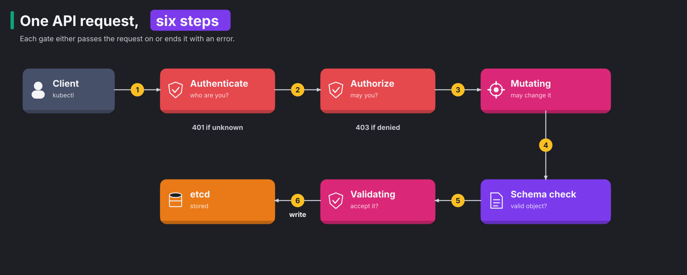
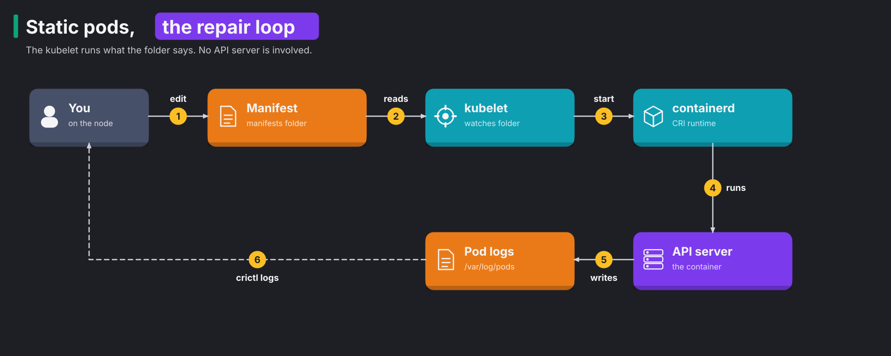

# CKS 02: Cluster hardening (15%)

> New to a term here, like resourceNames or AuthenticationConfiguration? The [glossary](../../course/glossary.md#cks-exam-track) explains every term this track uses.

**Before this domain:** the [practice cluster](../README.md#the-practice-cluster) at v1.37.1, so run `./certs/cks/cluster/reset.sh` after domain 01. The course's [module 29](../../course/29-life-of-a-request.md#concept-inside-the-api-server) walks one request through authentication, authorization and admission. Read it first, because this domain changes each of those gates.

Every attack on a cluster ends at the API server. A stolen service account token, a forgotten anonymous binding or a known bug in an old version all turn into API calls that change something. This domain shrinks what each caller may do, repairs a control plane that a bad edit broke, and keeps the API server patched. It has 12 tasks and takes about 2 hours.

## The domain in one table

Every request to the API server passes the same gates, and this domain changes each of them. The tasks map onto the gates like this:

| Gate or job | Tasks |
|---|---|
| Authentication: who may log in, with which token | 2, 3, 7, 8 |
| Authorization: what each caller may do | 1, 5, 6, 12 |
| Admission, and a control plane that runs at all | 9, 10, 11 |
| A patched API server | 4 |

The sections below follow one request through the gates, then look at the identities that pods carry, the static pods that run the control plane, and the upgrades that keep it patched.

## Concept: one request, six steps

The API server is the only door into the cluster's state. kubectl, controllers, kubelets and your own pods all go through it, and nothing writes to etcd any other way. So every security control for the API sits somewhere on the path of a single request.



A request that changes something passes six steps, in this order:

1. **Authentication** finds out who the caller is. It fails with `401 Unauthorized`.
2. **Authorization** decides whether that caller may do this verb on this resource. It fails with `403 Forbidden`.
3. **Mutating admission** may change the object, for example add a default or inject a sidecar.
4. **Schema validation** checks that the object is a well-formed object of its kind.
5. **Validating admission** accepts or refuses the final object, but never changes it.
6. The API server writes the object to etcd and answers the client.

Think of an airport. Passport control checks who you are. The boarding pass decides whether you may board this flight. Security screening looks inside your bag, and may take something out. Only then do you board. A read, such as `get` or `list`, skips the admission steps, because it changes nothing.

### Step 1: authentication

Kubernetes has no user database. A "user" is whatever name a trusted credential carries. The API server tries each configured method in turn, and the first one that recognizes the credential wins:

| Method | What the caller shows | Typical caller |
|---|---|---|
| Client certificate | a certificate signed by the cluster's CA. The common name (CN) becomes the user name, and each organization (O) becomes a group | kubelets, admins with a kubeconfig |
| Service account token | a signed token (a JWT) for a ServiceAccount | pods |
| OIDC token | a token from a company identity provider | people in a company with single sign-on |
| Webhook | any token, checked by an outside service | special setups |

When the request carries no credential at all, and **anonymous authentication** is on, the API server calls the caller `system:anonymous` in the group `system:unauthenticated`. A request with a wrong credential never becomes anonymous. It gets `401` at once.

kubeadm leaves anonymous authentication on, because its health probes call `/livez`, `/readyz` and the startup endpoint without credentials. Out of the box, RBAC lets anonymous callers read only health and version endpoints. One careless ClusterRoleBinding to `system:anonymous` opens the cluster to everybody who reaches port 6443.

Turning anonymous access off completely breaks the cluster in a slow way. The test run measured it:

1. The kubelet restarts the API server, and the new process starts serving within seconds.
2. The startup probe keeps failing with `HTTP probe failed with statuscode: 401`, so the pod stays `Ready: False`.
3. After 24 failures, 10 seconds apart, the kubelet kills the API server. In the test run, that took 4 minutes, and the loop repeats forever.

The **AuthenticationConfiguration** file fixes this. It keeps anonymous access only for named paths. The API server reads it from the `--authentication-config` flag. Think of a shop that lets anyone read the opening hours on the door, but lets nobody walk in without a badge.

**What this stops.** A narrow anonymous rule stops a forgotten binding to `system:anonymous` from turning into a public read of the whole cluster. In the test run, the setup's binding gave an anonymous caller `200` on a list of pods. After the fix, the same request got `401`.

**Exam traps.** Never set `--anonymous-auth` together with an `anonymous` block in the file. The API server exits at once with `--anonymous-auth flag cannot be set when anonymous field is configured in authentication configuration file`. And the file lives on the node, so the API server pod needs a `hostPath` volume and a mount for its folder.

### Step 2: authorization

Authorization takes the user, the groups, the verb, the resource and the namespace, and returns a verdict. The API server's `--authorization-mode` flag lists **authorizers** in order, and each one answers allow, deny, or "no opinion":

| Authorizer | What it decides |
|---|---|
| `Node` | requests from kubelets: a kubelet may read only what its own pods need. [Domain 03](03-system-hardening.md#concept-a-stolen-kubelet-identity) explains it |
| `RBAC` | everything else, from Roles and bindings stored in the cluster |
| `Webhook` | asks an outside service with a SubjectAccessReview |
| `ABAC` | an old file of policies, read at start. Nobody uses it any more |
| `AlwaysAllow` | says yes to everything |
| `AlwaysDeny` | says no to everything, for tests |

The first authorizer with an opinion decides. When every authorizer says "no opinion", the answer is `403`. kubeadm sets `Node,RBAC`. RBAC never says "deny". It either finds a rule that allows the request or has no opinion. So in practice, a request passes when some rule allows it, and fails otherwise.

`AlwaysAllow` has an opinion on everything: yes. With it, every authenticated caller does anything. Task 12 finds it on the practice cluster, where the setup printed `may the default ServiceAccount list every Secret? yes`.

**What this stops.** Authorization stops an authenticated caller from doing more than its job. A stolen CI token that may only update one Deployment stays a stolen CI token, not a stolen cluster.

**Exam traps.** Under `AlwaysAllow` alone, the API server turns anonymous access off by itself. In the test run, an anonymous request got `401`, and kubeadm's health probes got `401` too. The pod stayed `0/1`, and the kubelet restarted the API server after its 24 failed probes. So `AlwaysAllow` shows up as a restart loop, not only as an open door.

### Steps 3 to 5: admission

Authorization looks at the request: verb, resource, name. It never looks inside the object. A user allowed to create pods may create a privileged pod with the node's root folder mounted, and RBAC has nothing to say about it. **Admission control** closes that gap. An **admission controller** is a piece of code that sees the full object after authorization and before storage.

Admission runs in two phases, so that checks see the final object:

1. Mutating controllers run first. They change the object: set a default ServiceAccount, add a toleration, inject a sidecar.
2. Schema validation checks the result.
3. Validating controllers run last. They accept or refuse, and never change anything. Because they run after every mutation, they judge exactly what etcd will store.

Kubernetes compiles some admission controllers into the API server, and `--enable-admission-plugins` turns them on. kubeadm adds `NodeRestriction`, and Kubernetes turns on a default set, including `ServiceAccount` and `PodSecurity`. Others live outside as **admission webhooks**: the API server sends the object to an HTTPS service and waits for its verdict. Kyverno works this way, and so does the back end behind the ImagePolicyWebhook of [domain 05](05-supply-chain-security.md#concept-admission-the-clusters-front-door), and the course's [module 26](../../platform-engineering/26-kyverno-policy-as-code.md#concept-where-kyverno-sits) shows one in action. A ValidatingAdmissionPolicy is a third kind: a rule written in the CEL expression language that the API server runs itself, with no webhook to call.

**What this stops.** Admission stops dangerous objects that a caller may legally create: privileged pods, images from unknown registries, missing labels. It's the only gate that reads the object.

## Concept: RBAC, the permission model

**RBAC** (role-based access control) answers one question: may this subject do this verb on this resource? A subject is a user, a group or a ServiceAccount. RBAC has four objects:

| Object | Scope | Job |
|---|---|---|
| Role | one namespace | lists permissions |
| ClusterRole | the whole cluster | lists permissions, for cluster-wide resources or for reuse in many namespaces |
| RoleBinding | one namespace | hands a Role or a ClusterRole to subjects, inside that namespace |
| ClusterRoleBinding | the whole cluster | hands a ClusterRole to subjects, everywhere |

Permissions only add. No rule ever takes a right away. A RoleBinding that points to a ClusterRole grants that role's rules only inside the binding's namespace, which lets one `pod-reader` ClusterRole serve fifty namespaces.

A rule has three parts, and each one narrows the grant:

| Part | Example | Too broad |
|---|---|---|
| `verbs` | `get`, `list`, `watch` | `*`, which includes `delete`, `escalate` and `impersonate` |
| `resources` | `pods` | `*`, which includes Secrets |
| `resourceNames` | `report-key` | missing, which means every object of that kind |

Three verbs deserve their own warning. `escalate` lets a subject write a Role with rights it doesn't hold itself. `bind` lets it bind roles it doesn't hold. `impersonate` lets it act as another user. RBAC refuses role edits that grant more than the editor holds, unless the editor has `escalate` or `bind`. So those two verbs are keys to every other right.

**What this stops.** Narrow RBAC stops a compromised workload or a leaked credential from reading Secrets, creating privileged pods or deleting namespaces it never needed.

**Exam traps.** `list` on Secrets returns their contents, not only their names. So "may list secrets" equals "may read every secret". And `resourceNames` covers `get`, `update` and `delete` on the named object. It never covers `create`, and it covers a plain `list` or `watch` neither, because those requests name no single object. In task 1, the setup's Role failed three of seven checks, among them listing Secrets.

### Aggregated ClusterRoles

Some ClusterRoles collect their rules from other ClusterRoles. Such a role has an `aggregationRule` with a label selector and no rules of its own. A controller in the controller manager finds every ClusterRole with a matching label and copies their rules in. The built-in `admin`, `edit` and `view` roles work this way: a ClusterRole labelled `rbac.authorization.k8s.io/aggregate-to-view: "true"` adds its rules to `view`. That's how a CRD installer gives every viewer read access to its new resource without touching `view` itself.

Two consequences matter:

1. To extend an aggregated role, create a new labelled ClusterRole. A rule written straight into the aggregated role disappears, because the controller overwrites the list.
2. A permission leaks through the label. An over-broad rule in any labelled role reaches everybody bound to the aggregated role. To take it away, fix the source role.

### Finding out who may do what

`kubectl auth can-i` answers the question for any caller, without becoming that caller. It asks the API server's own authorizers, so the answer is exact. Two forms help in an investigation:

```bash
k auth can-i get secrets -n kube-system --as=system:serviceaccount:apps:cleaner   # one verb, one caller
k auth can-i --list -n apps --as=system:serviceaccount:apps:viewer                 # everything one caller may do
```

`--list` prints a table of resources, resource names, non-resource URLs and verbs. It lists the rules that apply in the namespace you name, from Roles and ClusterRoles together. To find which binding grants a right, search the bindings for the subject: `k get rolebinding,clusterrolebinding -A -o wide | grep apps/cleaner`. In task 6, the culprit was a ClusterRoleBinding named `log-cleanup`, a harmless name for a role that may get, list and delete every Secret in the cluster.

## Concept: the identity every pod carries

Every pod runs as a **service account**, an identity for software instead of a person. Unless told otherwise, the kubelet mounts a token for that account into `/var/run/secrets/kubernetes.io/serviceaccount/`. Most applications never call the Kubernetes API, yet each one carries a key to it. An attacker who gets a shell in the pod picks up the key.

### How tokens evolved

Kubernetes has issued service account tokens in two ways, and both still appear in the exam.

The old way was the **legacy token**. A controller created a Secret of type `kubernetes.io/service-account-token` for every ServiceAccount, and pods mounted that Secret. The token had no audience and no expiry. Anybody who read the Secret once, from etcd, a backup or a `kubectl get secret -o yaml`, held a key that worked forever.

The new way is the **bound token**, issued by the **TokenRequest API**. The API server mints a token on demand, signs it, and writes three limits into it:

1. An **audience**: the service that should accept the token. The Kubernetes API server accepts only tokens whose audience is its own.
2. An **expiry**: a time after which the token stops working.
3. A **binding** to one pod: when somebody deletes the pod, the token stops working too, even before it expires.

Since 1.22, every pod gets a bound token through a **projected volume**: a volume that the kubelet fills with a fresh token and renews before it expires. The kubelet renews the token once it's older than 80 percent of its lifetime, or older than 24 hours. Kubernetes stopped creating legacy token Secrets by itself in 1.24, and since 1.30 a controller labels, invalidates and finally deletes legacy tokens nobody used for a year.

`kubectl create token <sa> --audience=vault --duration=2h` asks for a bound token by hand. A pod asks for an extra one, for another audience, with a `serviceAccountToken` source in a projected volume:

```yaml
  volumes:
  - name: vault-token
    projected:
      sources:
      - serviceAccountToken:
          audience: vault
          expirationSeconds: 3600
          path: token
```

The audience protects you from a replay, which means reusing a stolen token somewhere else. A token minted for Vault carries `aud: ["vault"]`, so the Kubernetes API server refuses it, and a stolen Vault token gets the thief nothing in the cluster. In task 7, the claims held `"aud":["vault"]`, and `exp` minus `iat` was exactly 7200 seconds.

### Two settings that shrink the risk

`automountServiceAccountToken: false` on the ServiceAccount stops the mount for every pod that uses the account. The same field on a pod spec overrides the account's setting for that pod. Give each application its own account, too. Then a permission granted to one app never leaks to the others through the shared `default` account.

**What this stops.** No token in the pod means nothing for an attacker to steal. Bound tokens mean a stolen token dies with its pod and its expiry, and never works against a service it wasn't minted for.

**Exam traps.** A legacy token keeps working until somebody deletes its Secret. In task 8, the setup's legacy token answered `200`, and after the delete it got `401` 8 seconds later, once the API server's token cache expired. Find them all with `k get secrets -A --field-selector type=kubernetes.io/service-account-token`. And the API server's `--service-account-extend-token-expiration`, on by default, stretches the tokens that pods get to a year, which kube-bench flags in [domain 01](01-cluster-setup.md#concept-a-checklist-for-the-control-plane).

## Concept: static pods and control plane repair

A kubeadm cluster runs its own control plane as pods. That raises a puzzle: pods need the API server, and the API server is a pod. **Static pods** solve it. A static pod is a pod that the kubelet starts from a YAML file on its own disk, with no API server involved.



The loop has six steps:

1. You edit a file in `/etc/kubernetes/manifests`, for example `kube-apiserver.yaml`.
2. The kubelet watches that folder and notices the change.
3. The kubelet stops the old container and asks containerd, the container runtime, to start a new one.
4. containerd runs the container with the new flags.
5. The container writes its output to `/var/log/pods/`.
6. You read that output with `crictl`, a command-line tool that talks to the container runtime directly.

The kubelet also creates a **mirror pod** in the API server for each static pod, so `kubectl get pods -n kube-system` shows it. The mirror is only a reflection. Deleting it with `kubectl` doesn't stop the container, and `kubectl edit` on it changes nothing. The file is the truth. To stop a static pod, move its file out of the folder. To restart it without a change, move the file out and back.

This design is why control plane repair works the way it does. When the API server is down, `kubectl` fails too, so the tools come from the node:

1. `crictl ps -a --name kube-apiserver` lists the containers, the exited ones too. A container that keeps exiting points to a bad flag or a missing file.
2. `crictl logs <container id>` prints that container's last words. They name the problem almost every time.
3. `/var/log/pods/kube-system_kube-apiserver-cks-cp_<uid>/kube-apiserver/` holds the same logs as files, which survive the container's removal.
4. `journalctl -u kubelet` shows what the kubelet thinks: a manifest it fails to parse never becomes a container, and only the kubelet's log mentions it.

The test run met each case. A misspelled admission plugin made the API server exit with `enable-admission-plugins plugin "AlwaysPullImage" is unknown`. A wrong certificate path made etcd exit with `open /etc/kubernetes/pki/etcd/server.cert: no such file or directory`. A misspelled flag made the controller manager exit with `unknown flag: --cluster-signing-keyfile`. When etcd is down, the API server fails as well, and its log says `dial tcp 127.0.0.1:2379: connect: connection refused`. Always fix the lowest broken layer first: etcd, then the API server, then the scheduler and controller manager.

A broken scheduler or controller manager hides better, because `kubectl` keeps working. The symptoms differ:

| Component down | What you notice |
|---|---|
| kube-scheduler | new pods stay `Pending` with no events |
| kube-controller-manager | a new Deployment gets no ReplicaSet, so no pods appear at all |

**Exam traps.** Back up a manifest outside the folder, never as `kube-apiserver.yaml.bak` inside it, because the kubelet reads every file there. A new flag that names a file needs a `volumeMount` and a `hostPath` volume too, or the API server exits with "no such file". And give the kubelet up to a minute: in the test run, the API server answered again within a minute of a manifest change.

## Concept: upgrades and version skew

A known security bug in the API server gets a CVE number, a fix and a public write-up. From that day, attackers know exactly what to try against clusters that didn't upgrade. So keeping up with patch releases is a security control, not housekeeping.

Each Kubernetes minor release, such as 1.37, gets patches for about 14 months. A patch release such as 1.37.2 fixes bugs and security holes without changing APIs, so patch upgrades are cheap and urgent. Minor upgrades go one minor at a time: from 1.36 to 1.37, never from 1.35 straight to 1.37.

The components may run different versions for a while, within the **version skew** rules:

| Component | Allowed versions, compared with the API server |
|---|---|
| kube-controller-manager, kube-scheduler | the same, or one minor older |
| kubelet, kube-proxy | the same, or up to three minors older. Never newer |
| kubectl | one minor older, the same, or one minor newer |

That's why kubeadm upgrades the control plane first: the rules allow a newer API server with older kubelets, never the other way round.

kubeadm upgrades one node at a time, in the same order on each node:

1. Upgrade the `kubeadm` package.
2. Run `kubeadm upgrade apply` on the first control plane node, or `kubeadm upgrade node` on every other node. `kubeadm upgrade plan` shows the target versions first.
3. Drain the node, so its pods move elsewhere.
4. Upgrade the `kubelet` and `kubectl` packages and restart the kubelet.
5. Uncordon the node, so it accepts pods again.

`kubeadm upgrade apply` rewrites every static pod manifest and renews the control plane certificates. Before a minor upgrade, also point the package source at the new minor's repository on `pkgs.k8s.io`, because each minor has its own.

**What this stops.** Patching stops attacks that use published bugs, which are the cheapest attacks there are.

**Exam traps.** The test run found the biggest trap of this domain. `kubeadm upgrade apply` rewrites every static pod manifest from the cluster's stored kubeadm configuration, and flags you added by hand disappear. After the upgrade, `--profiling=false` from domain 01 and `--authentication-config` from task 3 were gone, and an anonymous request for pods got `403` again instead of `401`. To make a flag survive upgrades, add it to the `kubeadm-config` ConfigMap in `kube-system` under `apiServer.extraArgs`, with `extraVolumes` for any file it reads. Also keep the packages on hold with `apt-mark hold`, so a routine `apt-get upgrade` never moves the kubelet past the API server.

## The bigger picture: the API is the cluster

Every attack on a cluster ends at the API server. A stolen token, a forgotten anonymous binding, a pod that may create privileged pods, or a known bug in an old version all turn into API calls that change something. The gates in this domain give defenders four separate chances to stop such a call:

1. Authentication rejects credentials that are fake, expired or minted for another audience.
2. Authorization rejects callers who hold a real credential with too little right.
3. Admission rejects objects that are dangerous even for a caller with the right.
4. Patching removes bugs that would skip all three.

Real platform teams rarely hand out client certificates to people. They connect the API server to the company's identity provider with OIDC, so a person who leaves the company loses access the same day. They give each workload its own ServiceAccount with a narrow Role, review RBAC with tools that list who may read Secrets, and upgrade on a schedule with the flags stored in the kubeadm configuration, not in the manifests.

## Why this way

**Why does Kubernetes have no user database?** Companies already have one. Kubernetes trusts certificates and tokens from systems that manage people, and only stores what those people may do. A user database inside every cluster would drift out of date the day somebody leaves.

**Why does RBAC have no deny rule?** An allow-only model has one simple answer to "why may this caller do this?": find the rule that allows it. Deny rules create order problems, where the outcome depends on which rule wins. Kubernetes keeps deny decisions for admission and for authorizer webhooks.

**Why does admission run after authorization?** Admission reads the whole object, which costs more than reading the verb and resource. Running it only for callers who may make the request saves that work, and keeps strangers from probing admission webhooks.

**Why do static pods exist at all?** Something has to start the API server before there is an API server. The kubelet already knows how to run pods, so kubeadm hands it files instead of objects. The price is that the files on the node, not the API, are the source of truth for the control plane.

**Why bound tokens instead of a better Secret?** A Secret is a stored value, and stored values leak through backups, logs and over-broad RBAC. The API server mints a bound token for one pod and one audience, and it expires on its own, so a leak has a short life.

## Task 1: Trim an over-broad Role

**Time budget:** 6 minutes. **Host:** `cks-cp`.

```bash
./certs/cks/task.sh setup 2.1
```

> In namespace `finance`, ServiceAccount `reporter` is bound to Role `reporter-role`, which allows every verb on every resource.
>
> 1. Change `reporter-role` so it allows only `get`, `list` and `watch` on pods.
> 2. `reporter` must also read the Secret `report-key`, and no other Secret. Create a Role `secret-reader` and a RoleBinding `secret-reader` for that.

<details>
<summary>Solution</summary>

`kubectl create role ... --dry-run=client -o yaml | kubectl replace -f -` rewrites the existing Role in one line:

```bash
k -n finance create role reporter-role --verb=get,list,watch --resource=pods $do | k replace -f -
k -n finance create role secret-reader --verb=get --resource=secrets --resource-name=report-key
k -n finance create rolebinding secret-reader --role=secret-reader --serviceaccount=finance:reporter
```

Then ask the API server as the account:

```bash
for q in "list pods" "delete pods" "get secret/report-key" "get secret/db-password" "list secrets"; do
  echo "$q: $(k auth can-i $q --as=system:serviceaccount:finance:reporter -n finance)"
done
```

`list secrets` must say `no`. With `--resource-name`, the Role allows `get` on one Secret only, and `list` never matches a named rule.

</details>

```bash
./certs/cks/task.sh check 2.1
```

In the test run, the setup's Role failed three of the seven checks: it allowed deleting pods, reading `db-password` and listing Secrets. After the solution:

```
  PASS  reporter lists pods
  PASS  reporter watches pods
  PASS  reporter does not delete pods
  PASS  reporter does not create deployments
  PASS  reporter gets the Secret report-key
  PASS  reporter does not get the Secret db-password
  PASS  reporter does not list Secrets
```

## Task 2: Service account tokens

**Time budget:** 5 minutes. **Host:** `cks-cp`.

```bash
./certs/cks/task.sh setup 2.2
```

> In namespace `payments`, Deployment `checkout` runs with the `default` ServiceAccount and never calls the Kubernetes API.
>
> 1. Stop the `default` ServiceAccount in `payments` from mounting tokens.
> 2. Create a ServiceAccount `checkout` that mounts no token either, and make the Deployment use it.

<details>
<summary>Solution</summary>

```bash
k -n payments patch sa default -p '{"automountServiceAccountToken": false}'
k -n payments create sa checkout
k -n payments patch sa checkout -p '{"automountServiceAccountToken": false}'
k -n payments set serviceaccount deploy checkout checkout
k -n payments rollout status deploy checkout
k -n payments exec deploy/checkout -- ls /var/run/secrets/kubernetes.io/serviceaccount/
```

`set serviceaccount` changes the pod template, so the Deployment rolls out new pods. The old pods keep their token until they stop: a ServiceAccount change never reaches running pods. The last command fails with `No such file or directory`, which is the goal.

</details>

```bash
./certs/cks/task.sh check 2.2
```

```
  PASS  ServiceAccount default in payments has automountServiceAccountToken: false
  PASS  ServiceAccount checkout exists, also without automount
  PASS  Deployment checkout runs as ServiceAccount checkout
  PASS  the running pod has no API token mounted
```

## Task 3: Restrict anonymous access to the API

**Time budget:** 8 minutes. **Host:** `cks-cp`.

```bash
./certs/cks/task.sh setup 2.3
```

The setup creates a binding and prints what an anonymous caller gets. In the test run: `anonymous list of pods: 200`.

> Somebody bound the ClusterRole `view` to `system:anonymous`.
>
> 1. Remove that ClusterRoleBinding.
> 2. Configure the API server so that anonymous requests work only for `/livez`, `/readyz` and `/healthz`. Use the file `/etc/kubernetes/auth/auth-config.yaml`.
> 3. The API server must stay healthy.

<details>
<summary>Solution</summary>

Find and delete the binding:

```bash
k get clusterrolebinding -o wide | grep system:anonymous
k delete clusterrolebinding anonymous-view
```

Write the configuration:

```bash
mkdir -p /etc/kubernetes/auth
vim /etc/kubernetes/auth/auth-config.yaml
```

```yaml
apiVersion: apiserver.config.k8s.io/v1
kind: AuthenticationConfiguration
anonymous:
  enabled: true
  conditions:
  - path: /livez
  - path: /readyz
  - path: /healthz
```

The API server runs in a container, so it sees the file only through a volume. Edit `/etc/kubernetes/manifests/kube-apiserver.yaml` after a backup, in three places:

```yaml
  - command:
    - kube-apiserver
    - --authentication-config=/etc/kubernetes/auth/auth-config.yaml
...
    volumeMounts:
    - mountPath: /etc/kubernetes/auth
      name: auth-config
      readOnly: true
...
  volumes:
  - hostPath:
      path: /etc/kubernetes/auth
      type: DirectoryOrCreate
    name: auth-config
```

Don't also set `--anonymous-auth`. With both, the API server exits at once: `--anonymous-auth flag cannot be set when anonymous field is configured in authentication configuration file`.

Wait for the API server to come back, then test with curl, which sends no credentials:

```bash
watch crictl ps --name kube-apiserver
IP=$(hostname -I | cut -d' ' -f1)
curl -sk -o /dev/null -w '%{http_code}\n' https://$IP:6443/api/v1/namespaces/default/pods   # 401
curl -sk -o /dev/null -w '%{http_code}\n' https://$IP:6443/livez                            # 200
```

In the test run, the API server answered again within a minute of the manifest change.

</details>

```bash
./certs/cks/task.sh check 2.3
```

```
  PASS  ClusterRoleBinding anonymous-view is gone
  PASS  an anonymous request for pods gets 401
  PASS  an anonymous request for /livez still gets 200
  PASS  the API server uses --authentication-config
  PASS  the API server pod is Ready
```

`401` means "I don't know who you are". Before the fix, an anonymous caller without the binding got `403`, "I know you're anonymous, and anonymous may not". Both refuse, but `401` refuses earlier, at gate 1.

## Task 4: Upgrade the cluster with kubeadm

**Time budget:** 12 minutes. **Hosts:** `cks-cp`, then `cks-w1`.

```bash
./certs/cks/task.sh setup 2.4     # prints the node versions; both must say v1.37.1
```

> Upgrade the control plane and the worker from v1.37.1 to v1.37.2. Drain each node before you upgrade its kubelet, and make it schedulable again afterwards. Keep the packages on hold.

<details>
<summary>Solution</summary>

On `cks-cp`:

```bash
apt-mark unhold kubeadm
apt-get update && apt-get install -y kubeadm=1.37.2-1.1
apt-mark hold kubeadm
kubeadm upgrade plan v1.37.2
kubeadm upgrade apply v1.37.2 -y
k drain cks-cp --ignore-daemonsets --delete-emptydir-data
apt-mark unhold kubelet kubectl
apt-get install -y kubelet=1.37.2-1.1 kubectl=1.37.2-1.1
apt-mark hold kubelet kubectl
systemctl daemon-reload && systemctl restart kubelet
k uncordon cks-cp
k drain cks-w1 --ignore-daemonsets --delete-emptydir-data --force
```

`--force` lets the drain delete bare pods that no controller owns, such as the ones earlier tasks created. Then on `cks-w1`:

```bash
apt-mark unhold kubeadm kubelet kubectl
apt-get update && apt-get install -y kubeadm=1.37.2-1.1
kubeadm upgrade node
apt-get install -y kubelet=1.37.2-1.1 kubectl=1.37.2-1.1
apt-mark hold kubeadm kubelet kubectl
systemctl daemon-reload && systemctl restart kubelet
```

And back on `cks-cp`: `k uncordon cks-w1`, then `k get nodes`.

`apt-cache madison kubeadm` lists the exact package versions when you don't know the `-1.1` suffix. In the test run, the whole upgrade took 2 minutes 39 seconds, and `kubeadm` left backups of the old manifests and etcd data in `/etc/kubernetes/tmp/`.

</details>

```bash
./certs/cks/task.sh check 2.4
```

```
  PASS  cks-cp kubelet reports v1.37.2
  PASS  cks-w1 kubelet reports v1.37.2
  PASS  the API server runs image v1.37.2
  PASS  both nodes are schedulable
  PASS  kubeadm, kubelet and kubectl stay on hold on cks-w1
```

## Task 5: Aggregated ClusterRoles

**Time budget:** 6 minutes. **Host:** `cks-cp`.

```bash
./certs/cks/task.sh setup 2.5
```

> ServiceAccount `prom` in namespace `monitoring` is bound to the aggregated ClusterRole `monitoring-reader`.
>
> 1. `prom` must also get, list and watch `endpoints` and `services` in every namespace. Create a ClusterRole `monitoring-endpoints` for that, and don't edit `monitoring-reader`.
> 2. `prom` may exec into pods today. Take that right away.

<details>
<summary>Solution</summary>

Read how the role collects its rules:

```bash
k get clusterrole monitoring-reader -o yaml | grep -A4 aggregationRule
k get clusterrole -l rbac.cks.io/aggregate-to-monitoring=true
```

Create the new role with the same label:

```bash
k create clusterrole monitoring-endpoints --verb=get,list,watch --resource=endpoints,services $do > me.yaml
vim me.yaml        # add the label under metadata
k apply -f me.yaml
```

```yaml
metadata:
  name: monitoring-endpoints
  labels:
    rbac.cks.io/aggregate-to-monitoring: "true"
```

The `pods/exec` rule comes from the labelled role `monitoring-pods`. Remove it there with `k edit clusterrole monitoring-pods`. Editing `monitoring-reader` instead would last only until the controller copies the rules again.

```bash
k auth can-i list endpoints -A --as=system:serviceaccount:monitoring:prom      # yes
k auth can-i create pods/exec -A --as=system:serviceaccount:monitoring:prom    # no
```

</details>

```bash
./certs/cks/task.sh check 2.5
```

In the test run, the check failed four of six items before the solution:

```
  PASS  ClusterRole monitoring-endpoints carries the aggregation label
  PASS  prom lists endpoints in every namespace
  PASS  prom watches services in every namespace
  PASS  prom still lists pods
  PASS  prom may no longer exec into pods
  PASS  monitoring-reader still aggregates, with no rules of its own written by hand
```

## Task 6: Who may read the Secrets?

**Time budget:** 6 minutes. **Host:** `cks-cp`.

```bash
./certs/cks/task.sh setup 2.6
```

> Namespace `apps` has four ServiceAccounts: `builder`, `deployer`, `viewer` and `cleaner`.
>
> 1. One of them may read Secrets in `kube-system`. Write its name to `/root/cks/secret-reader.txt`, and remove the binding that grants the right. Keep the ServiceAccount.
> 2. Write everything `viewer` may do in `apps`, as `kubectl auth can-i --list` prints it, to `/root/cks/viewer-perms.txt`.

<details>
<summary>Solution</summary>

Ask the API server once per account:

```bash
for sa in builder deployer viewer cleaner; do
  echo "$sa: $(k auth can-i get secrets -n kube-system --as=system:serviceaccount:apps:$sa)"
done
echo cleaner > /root/cks/secret-reader.txt
k get rolebinding,clusterrolebinding -A -o wide | grep apps/cleaner
k delete clusterrolebinding log-cleanup
k auth can-i --list -n apps --as=system:serviceaccount:apps:viewer > /root/cks/viewer-perms.txt
```

The right came from a ClusterRoleBinding named `log-cleanup`, a harmless name for a role that may get, list and delete every Secret in the cluster. In the test run, `viewer-perms.txt` held these lines among the default ones every account has:

```
Resources                                       Non-Resource URLs   Resource Names   Verbs
pods                                            []                  []               [get list watch]
services                                        []                  []               [get list watch]
```

</details>

```bash
./certs/cks/task.sh check 2.6
```

```
  PASS  /root/cks/secret-reader.txt names cleaner
  PASS  cleaner may no longer read Secrets in kube-system
  PASS  ServiceAccount cleaner still exists
  PASS  deployer keeps its rights
  PASS  /root/cks/viewer-perms.txt holds viewer's can-i list
```

## Task 7: A bound token for another audience

**Time budget:** 7 minutes. **Host:** `cks-cp`.

```bash
./certs/cks/task.sh setup 2.7
```

> In namespace `vault-client`, ServiceAccount `vault-auth` logs in to a Vault server.
>
> 1. Create a token for `vault-auth` with the audience `vault`, valid for 2 hours, and save it to `/root/cks/vault-token.txt`.
> 2. Create pod `client` (image `busybox:1.36`, command `sleep 1d`) that runs as `vault-auth`, mounts no default API token, and gets a token with audience `vault`, valid for 3600 seconds, at `/var/run/secrets/vault/token`.

<details>
<summary>Solution</summary>

```bash
k -n vault-client create token vault-auth --audience=vault --duration=2h > /root/cks/vault-token.txt
```

The pod uses a projected volume, as in the theory:

```yaml
apiVersion: v1
kind: Pod
metadata:
  name: client
  namespace: vault-client
spec:
  serviceAccountName: vault-auth
  automountServiceAccountToken: false
  containers:
  - name: client
    image: busybox:1.36
    command: [sleep, 1d]
    volumeMounts:
    - {name: vault-token, mountPath: /var/run/secrets/vault, readOnly: true}
  volumes:
  - name: vault-token
    projected:
      sources:
      - serviceAccountToken:
          audience: vault
          expirationSeconds: 3600
          path: token
```

`automountServiceAccountToken: false` stops only the default token. A projected `serviceAccountToken` that you spell out still arrives. To read a token's claims, decode its middle part:

```bash
cut -d. -f2 /root/cks/vault-token.txt | tr '_-' '/+' | base64 -d 2>/dev/null; echo
```

In the test run, the claims held `"aud":["vault"]`, and `exp` minus `iat` was exactly 7200 seconds.

</details>

```bash
./certs/cks/task.sh check 2.7
```

```
  PASS  /root/cks/vault-token.txt is a token for vault-auth with audience vault, valid 2 hours
  PASS  pod client runs as vault-auth without the default token
  PASS  a projected token with audience vault and 3600 seconds sits at /var/run/secrets/vault/token
```

## Task 8: Clean up legacy token Secrets

**Time budget:** 4 minutes. **Host:** `cks-cp`.

```bash
./certs/cks/task.sh setup 2.8
```

The setup creates two legacy token Secrets and uses one of them. In the test run it printed `old-ci's legacy token against the API: 200` and `label legacy-token-last-used: 2026-11-14`.

> Namespace `legacy` still holds Secrets of type `kubernetes.io/service-account-token`. Delete all of them, so that their tokens stop working. Keep the ServiceAccounts and every other Secret.

<details>
<summary>Solution</summary>

A field selector finds Secrets by type, and the same selector deletes them:

```bash
k get secrets -A --field-selector type=kubernetes.io/service-account-token
k -n legacy delete secret --field-selector type=kubernetes.io/service-account-token
```

Secret `app-config` has type `Opaque`, so the selector leaves it alone. In the test run, the deleted token got `401` 8 seconds after the delete, once the API server's token cache had expired.

</details>

```bash
./certs/cks/task.sh check 2.8
```

```
  PASS  no Secret of type kubernetes.io/service-account-token is left in legacy
  PASS  old-ci's old token no longer authenticates (401)
  PASS  both ServiceAccounts and Secret app-config still exist
```

## Task 9: Repair the API server

**Time budget:** 8 minutes. **Host:** `cks-cp`.

```bash
./certs/cks/task.sh setup 2.9
```

> A colleague enabled the `AlwaysPullImages` admission plugin, and the API server never came back. Get it running with `NodeRestriction` and `AlwaysPullImages` enabled. Change nothing else that worked before.

<details>
<summary>Solution</summary>

`kubectl` fails, so look on the node, as the theory describes:

```bash
crictl ps -a --name kube-apiserver
crictl logs <id of the newest exited container>
```

The setup broke two lines, and the API server reports only the first problem it meets. In the test run, the first log ended with:

```
"command failed" err="error creating storage factory: open /etc/kubernetes/pki/etcd/ca.cert: no such file or directory"
```

After fixing that path, the next container failed on the plugin name:

```
"command failed" err="enable-admission-plugins plugin \"AlwaysPullImage\" is unknown"
```

So fix, wait, and read the log again until the container stays up. `ls /etc/kubernetes/pki/etcd/` shows the real file name, `ca.crt`.

Fix both lines in `/etc/kubernetes/manifests/kube-apiserver.yaml`:

```yaml
    - --enable-admission-plugins=NodeRestriction,AlwaysPullImages
    - --etcd-cafile=/etc/kubernetes/pki/etcd/ca.crt
```

Then `watch crictl ps --name kube-apiserver` until a container stays up, and `k get nodes`. AlwaysPullImages sets `imagePullPolicy: Always` on every new pod, so a pod on a shared node never starts from an image somebody else pulled with their credentials:

```bash
k run pull-test --image=busybox:1.36 --image-pull-policy=IfNotPresent --dry-run=server -o yaml -- sleep 1 | grep imagePullPolicy
```

</details>

```bash
./certs/cks/task.sh check 2.9
```

```
  PASS  the API server answers and its pod is Ready
  PASS  the admission plugins are NodeRestriction and AlwaysPullImages
  PASS  --etcd-cafile points to the etcd CA
  PASS  AlwaysPullImages sets imagePullPolicy Always on a new pod
```

## Task 10: Repair etcd

**Time budget:** 8 minutes. **Host:** `cks-cp`.

```bash
./certs/cks/task.sh setup 2.10
```

> Somebody edited etcd's manifest, and now the whole control plane is down. Repair it without losing any data.

<details>
<summary>Solution</summary>

Start at the bottom layer:

```bash
crictl ps -a --name etcd
crictl logs <id of the newest etcd container>
```

In the test run, etcd exited with:

```
"msg":"listener failed","error":"open /etc/kubernetes/pki/etcd/server.cert: no such file or directory"
```

Fix the path in `/etc/kubernetes/manifests/etcd.yaml` to `server.crt`. etcd then starts, but the API server still fails. Its log says why:

```
Error while dialing: dial tcp 127.0.0.1:2379: connect: connection refused
```

The API server talks to etcd at `https://127.0.0.1:2379`, its `--etcd-servers` flag. So compare that address with etcd's own flags:

```bash
grep etcd-servers /etc/kubernetes/manifests/kube-apiserver.yaml
grep -E 'listen-client-urls|advertise-client-urls' /etc/kubernetes/manifests/etcd.yaml
ss -tlnp | grep etcd
```

`--listen-client-urls` says `https://127.0.0.1:2378`. Put the port back to 2379, and the API server connects on its next restart.

Never change `--data-dir` or the `etcd-data` volume to make etcd start. etcd pointed at an empty folder starts happily, as a brand-new cluster with nothing in it.

</details>

```bash
./certs/cks/task.sh check 2.10
```

```
  PASS  the API server answers again
  PASS  etcd uses its server certificate
  PASS  etcd listens for clients on 127.0.0.1:2379
  PASS  the cluster's data survived: ConfigMap cks-canary still exists
  PASS  the etcd pod is Ready
```

## Task 11: No pods for a new Deployment

**Time budget:** 7 minutes. **Host:** `cks-cp`.

```bash
./certs/cks/task.sh setup 2.11
```

> Deployment `canary` in namespace `default` gets no pods. Find out why and fix the control plane.

<details>
<summary>Solution</summary>

```bash
k get deploy,rs,pods -l app=canary      # a Deployment, no ReplicaSet: the controller manager
k -n kube-system get pods -l tier=control-plane
```

In the test run, both `kube-controller-manager-cks-cp` and `kube-scheduler-cks-cp` showed `CrashLoopBackOff`. The API server runs, so `k logs` works here:

```bash
k -n kube-system logs kube-scheduler-cks-cp
k -n kube-system logs kube-controller-manager-cks-cp
```

The scheduler said `"command failed" err="stat /etc/kubernetes/scheduler.config: no such file or directory"`, and the controller manager said `Error: unknown flag: --cluster-signing-keyfile`. Fix `--kubeconfig=/etc/kubernetes/scheduler.conf` in `kube-scheduler.yaml` and `--cluster-signing-key-file=` in `kube-controller-manager.yaml`. The controller manager comes first: it creates the ReplicaSet and the pod, and only then does the scheduler have something to place. In the test run, the Deployment rolled out 36 seconds after both fixes.

</details>

```bash
./certs/cks/task.sh check 2.11
```

```
  PASS  kube-scheduler runs and is Ready
  PASS  kube-controller-manager runs and is Ready
  PASS  Deployment canary has a ready pod
  PASS  the manifests use scheduler.conf and --cluster-signing-key-file
```

## Task 12: An API server that allows everything

**Time budget:** 5 minutes. **Host:** `cks-cp`.

```bash
./certs/cks/task.sh setup 2.12
```

The setup prints what the cluster allows now. In the test run: `may the default ServiceAccount list every Secret? yes`.

> Every authenticated caller may do anything on this cluster. Restore the authorizers kubeadm sets, in the right order.

<details>
<summary>Solution</summary>

```bash
grep authorization-mode /etc/kubernetes/manifests/kube-apiserver.yaml     # AlwaysAllow
```

Change it to:

```yaml
    - --authorization-mode=Node,RBAC
```

Node comes first, so a kubelet's requests get the Node authorizer's narrow answer before RBAC looks at them.

The setup's message shows the danger: every ServiceAccount token, and so every pod, may read every Secret. Anonymous callers are the one group the mode doesn't open up. In the test run, an anonymous request under `AlwaysAllow` got `401`: the API server turns anonymous access off by itself when `AlwaysAllow` is the only authorizer. After the fix, the same request got `403`, the normal answer for an anonymous caller without a binding.

The same switch has a side effect you notice within minutes. kubeadm's health probes for the API server send no credentials, so under `AlwaysAllow` they get `401` too. In the test run, `k -n kube-system describe pod kube-apiserver-cks-cp` showed `Startup probe failed: HTTP probe failed with statuscode: 401`, the pod stayed `0/1`, and the kubelet restarted the API server after its 24 failed probes, the same loop the theory describes for anonymous access. A cluster whose API server keeps restarting is a hint to read its authorization flags.

</details>

```bash
./certs/cks/task.sh check 2.12
```

```
  PASS  the API server uses --authorization-mode=Node,RBAC
  PASS  an anonymous request for kube-system Secrets gets 403
  PASS  the default ServiceAccount may not list Secrets
  PASS  the nodes stay Ready
```

## Clean up

Tasks 9 to 12 change static pods, and each solution puts them back as kubeadm wrote them. Task 4 is one-way: the packages stay at 1.37.2. `./certs/cks/cluster/reset.sh` puts both nodes back at 1.37.1 and rebuilds the cluster.
