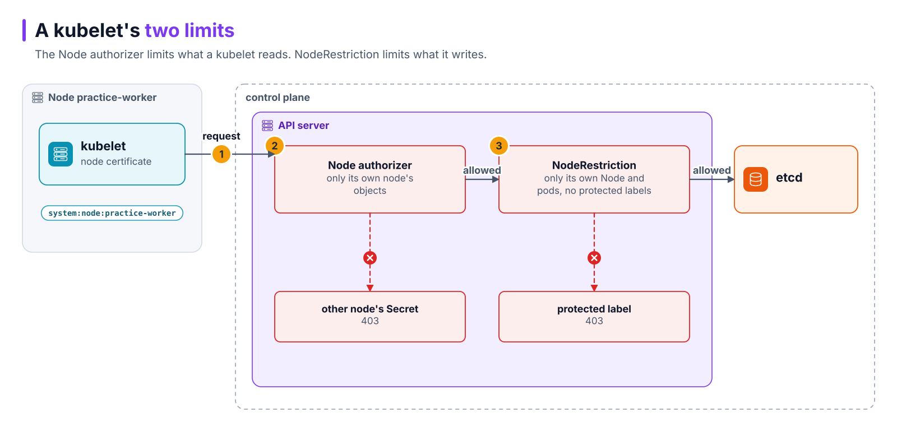

# CKS 03: System hardening (10%)

> New to a term here, like attack surface or NodeRestriction? The [glossary](../../platform-engineering/glossary.md#cks-exam-track) explains every term this track uses.

**Before this domain:** the [practice cluster](../README.md#the-practice-cluster) running, and the [Lima VM](../README.md#the-lima-vm-for-apparmor-and-cilium) for task 7. No course module covers node hardening, so this domain starts from the basics.

Kubernetes runs on ordinary Linux machines, so an attacker who escapes a container lands on a machine with whatever services, users and credentials it holds. This domain makes the node itself a poor place to land, so that an escape stays a small incident. It has seven tasks and takes about an hour.

The curriculum lists AppArmor and seccomp under domain 06, so they live in [06, tasks 4 and 5](06-monitoring-logging-runtime-security.md#task-4-a-seccomp-profile).

## The domain in one table

Kubernetes security usually starts at the API, but this domain starts one floor lower, at the Linux machine under the kubelet, and each task answers one question about that machine:

| Question | Tool | Task |
|---|---|---|
| Which services listen, and does the node need them? | `ss`, `systemctl`, `apt-get purge` | 1, 4 |
| Who has root on the node? | `sudo -l`, `/etc/sudoers.d/`, `passwd -l` | 2 |
| What may a kubelet change in the cluster? | NodeRestriction | 3 |
| Who may log in, and how? | `sshd -T` | 5 |
| Which files on the node hold cluster keys? | `grep`, `chmod` | 6 |
| Which kernel code may load at all? | `/etc/modprobe.d/` | 7 |

## Concept: the node is the last wall

A container is a normal Linux process with a few fences around it, and it shares the node's kernel with every other container. When an attacker escapes a container, through a kernel bug, a privileged pod or a `hostPath` mount, they land on the node itself, and from there the node's own settings decide how far they get.

A hotel shows the idea well, with the container as a room and the node as the building. A guest who climbs out of the window lands in the corridor. A hardened hotel has locked service doors, no master keys lying on trolleys, and staff who carry only the keys for their own floor, while a soft hotel hands the intruder the whole building.

The **attack surface** is everything an attacker might use to get in or move on: listening ports, installed packages, running services, user accounts, files with credentials and kernel features. Each item is a door, and a Kubernetes node needs very few of them, namely the kubelet, the container runtime, the CNI agent and SSH for the admins. Everything else is risk without benefit.

**Least privilege** is the rule that narrows the remaining doors as far as the job allows, because each user, each program and each credential gets the rights its job needs and nothing more. The rest of this domain applies those two ideas, a small surface and least privilege, to services, kernel modules, logins, users, kubeconfig files and the kubelet's own identity.

## Concept: services nobody needs

Every listening service is a program that accepts input from the network. A bug in that program, or a weak setting such as clear text passwords, gives an attacker a way in or a way to stay, so shrinking the surface follows the same four steps every time:

1. List what listens: `ss -tlnp` shows TCP sockets with the owning process.
2. Find which package owns the program: `dpkg -S /usr/sbin/vsftpd`.
3. Stop and disable the service: `systemctl disable --now vsftpd`.
4. Remove the package: `apt-get purge vsftpd`, so a later reboot or upgrade doesn't bring it back.

Step 4 matters, because a disabled service is still on disk, and the next `apt-get upgrade` or a careless `systemctl start` revives it. In task 1, `ss` showed vsftpd on port 21. vsftpd is an FTP server, and FTP sends passwords in clear text, so it has no place on a Kubernetes node.

A service doesn't need a package to exist. An attacker who got root once often leaves a **backdoor**, a hidden way back in, such as a copied binary with an innocent name that a systemd unit starts so it survives a reboot. Three commands follow the trail from the open port back to the file:

1. `ss -tlnp` names the process and its PID.
2. `/proc/<pid>/exe` points to the file that really runs, whatever the process calls itself.
3. `systemctl status <pid>` names the unit that started it.

In task 4, that trail led from a process called `sysmond` to `/usr/local/lib/.sysmon/sysmond`, a renamed copy of `socat` that handed a root shell to anybody on port 4444. `dpkg -S` found no package for it, which is a warning sign on its own.

**What this stops.** Removing services stops attacks on software the node never needed, and finding backdoors stops an attacker who already got in once from coming back.

**Exam traps.** Disabling a service is not the same as removing it. Check afterwards that the port is really closed with `ss -tlnp`, because a socket-activated unit keeps listening even after you stop its service.

## Concept: kernel modules

The kernel is the one program that every container shares, so its size matters most. The kernel loads **modules**, which are pieces of kernel code, on demand. A program that opens a socket for an unusual protocol, such as DCCP or TIPC, makes the kernel load that protocol's module with all its code and its bugs, and any process on the node triggers such a load, including one inside a container. Several kernel exploits started exactly this way, with an old, rarely used network protocol that an unprivileged process asked for.

The CIS benchmark for Linux lists modules that a server never needs and asks you to block them. A file in `/etc/modprobe.d/` does that with two kinds of lines:

| Line | Effect |
|---|---|
| `blacklist dccp` | stops loading by alias, for example when hardware or a socket asks for it. A direct `modprobe dccp` still works |
| `install dccp /bin/false` | replaces the load command with one that fails. Every load fails, direct ones too |

Use both lines. The file stops future loads only, so also unload a module that is already in with `modprobe -r dccp`, and use `modprobe -n -v dccp` to see what a load would do without doing it.

OrbStack machines share one kernel and may not load modules, so task 7 runs on the Lima VM.

**What this stops.** A blocked module stops an unprivileged process from pulling buggy code into the kernel that every pod shares.

**Exam traps.** A module that something uses refuses to unload, and `lsmod` shows its user count in the third column. In the test run, `sctp` had 8 users and stayed, which is why the task picks modules nobody uses. After the fix, a direct `modprobe tipc` failed with `Error running install command '/bin/false' for module tipc: retcode 1`.

## Concept: remote logins

An exam node usually runs `sshd`, the SSH server, which is the main door for people and therefore also the main door for password guessing. Two settings matter most:

1. `PermitRootLogin no` stops direct root logins. Every admin logs in as themselves and uses `sudo`, so the logs show who did what.
2. `PasswordAuthentication no` leaves only keys. A key is a long random secret that never crosses the network, so guessing gets an attacker nowhere.

Ubuntu's `/etc/ssh/sshd_config` starts with `Include /etc/ssh/sshd_config.d/*.conf`, and for most settings sshd keeps the first value it reads. That means a line in a drop-in file beats the same setting further down the main file.

**What this stops.** These two lines stop password guessing against the node and stop anonymous root sessions that leave no trace of who acted.

**Exam traps.** An edit to the main file that looks right changes nothing when a drop-in file sets the value first, and in task 5 both lines came from `/etc/ssh/sshd_config.d/10-legacy.conf`. `sshd -T` prints the configuration sshd really uses, which settles the question. Test the syntax with `sshd -t` before a restart, so a typo doesn't lock you out.

## Concept: people on the node

On a Linux node the big right is root, and `sudo` hands it out. Ubuntu grants it in two places:

1. Membership in the `sudo` group.
2. Files under `/etc/sudoers.d/`, which grant rights to single users, sometimes with `NOPASSWD:ALL`, meaning any command without a password.

A user who needs no root keeps the account but loses both grants, because removing only one leaves the other working. A user who left the team keeps the files for the audit trail, but the account gets locked with `passwd -l`, so nobody logs in as that user again.

**What this stops.** Fewer root users means fewer accounts whose stolen password or key turns into root on a node, and from there into every container on it.

**Exam traps.** In task 2, the group membership was the obvious grant and a `NOPASSWD:ALL` file in `/etc/sudoers.d/cks-dev` was the hidden one. `sudo -l -U cks-dev` shows the effective rights after the fix, and the test run ended with `User cks-dev is not allowed to run sudo on cks-w1.`

## Concept: kubeconfig files are keys

A **kubeconfig** file tells kubectl where the API server is and how to log in, and many kubeconfig files embed a client certificate together with its private key. Whoever holds such a file is that user, from any machine that reaches the API server.

`/etc/kubernetes/admin.conf` holds a client certificate for a cluster administrator. kubeadm also writes `super-admin.conf`, whose certificate sits in the group `system:masters`, a group that skips authorization entirely. Both belong on the control plane, readable by root only, because a copy in somebody's home folder or a backup folder is a full admin key lying in the corridor.

Kubernetes has no revocation list for client certificates, which is a list of certificates that a server refuses even though they haven't expired. Without one, nothing stops a leaked certificate before its expiry date, which kubeadm sets a year out. Deleting the leaked file stops the next person from finding it, but it leaves the certificate working for anybody who already copied it.

**What this stops.** Removing copies and tightening file modes stops a local user, a backup reader or a container with a `hostPath` mount from picking up cluster admin rights.

**Exam traps.** In task 6, the setup's leaked file let user `cks-ops` answer `yes` to `kubectl auth can-i "*" "*"`, and the search for `client-certificate-data` found two copies: `/home/cks-ops/.kube/config` and `/var/backups/k8s/admin.conf.bak`. The kubelet's own `kubelet.conf` points to certificate files instead of embedding them, so the same search skips it, and you fix its mode separately. In a real incident you would also rotate the cluster's certificate authority so the leaked certificate dies, which is beyond the exam.

## Concept: a stolen kubelet identity

Every kubelet holds a client certificate for the user `system:node:<name>` in the group `system:nodes`, stored in `/var/lib/kubelet/pki/`. The kubelet needs real rights, because it reads the pods scheduled to its node with their Secrets and ConfigMaps, and writes their status. So anybody who is root on one node owns that identity, and with it the kubelet's rights.

The question is how far those rights reach. If every kubelet read every Secret in the cluster, one escaped container would read them all, so two layers limit the kubelet's reach:



1. The kubelet sends a request with its node certificate.
2. The **Node authorizer** checks reads and writes against the node's own pods. A kubelet reads only the Secrets, ConfigMaps and volumes that pods on its own node use, and in 1.37 only its own Node object.
3. The **NodeRestriction** admission plugin checks the object of every write. A kubelet changes only its own Node and the pods bound to it, and never sets labels with the `node-restriction.kubernetes.io/` prefix.

The two layers split the work along the request chain from [domain 02](02-cluster-hardening.md#concept-one-request-six-steps). The Node authorizer works at step 2 and sees the verb and the target, while NodeRestriction works at step 5 and sees the object's contents, such as which labels a Node update sets.

The label prefix exists for a reason. Admins use labels under it to steer sensitive workloads to trusted nodes with a nodeSelector or node affinity, so a kubelet that set such a label on itself would let a compromised node attract the very workloads meant to avoid it.

**What this stops.** Together, the two layers turn "root on one node" into "root on one node and the Secrets of the pods already there", instead of "every Secret in the cluster". They also stop a node from lying about itself to attract sensitive pods.

**Exam traps.** The test run measured both layers. With NodeRestriction off, the kubelet of `cks-w1` still failed to touch `cks-cp`, because the Node authorizer refused the read first with `node 'cks-w1' cannot read 'cks-cp', only its own Node object`, which is why one check in task 3 passes even before the fix. But the kubelet set `node-restriction.kubernetes.io/cks=1` on itself without complaint, and with NodeRestriction back the same label failed with `is not allowed to modify labels: node-restriction.kubernetes.io/cks`. Also remove `AlwaysAdmit` when you find it, because that old plugin admits everything.

## The bigger picture: defence in depth on the node

No single control in this domain stops a determined attacker, but together they make each step costly. An attacker who escapes a container finds no extra services to abuse, no buggy kernel modules to load, no admin kubeconfig to pick up, no sudo rights for the account they stole, and a kubelet identity that reaches only its own node. Security people call that **defence in depth**, which means several independent layers, so that one failure doesn't decide the outcome.

Real platform teams go further than hand-tuning each node. They build node images with a minimal operating system, often one made only for containers, such as Talos, which has no package manager and no SSH at all. They replace nodes instead of patching them, so any backdoor dies with the old machine, and they log every sudo and SSH session centrally, so the record survives an attacker who wipes the node's own logs.

## Why this way

**Why remove packages instead of only stopping services?** A stopped service waits on disk for the next upgrade, reboot script or tired admin to start it again, while a removed package is gone.

**Why does Kubernetes split the kubelet's limits across two components?** Authorization sees the request and not the object, so "update Node cks-w1" looks the same whether it changes a status field or adds a protected label. Only admission reads the object, which means the label rule has to live there.

**Why not just revoke a leaked client certificate?** Kubernetes never built certificate revocation into the API server. Short-lived credentials, such as bound tokens and OIDC logins, avoid the problem, which is why production clusters keep long-lived client certificates for break-glass use only.

**Why block kernel modules at all, if root on the node loads them anyway?** The block matters for processes that are not root, such as containers, because their socket calls trigger automatic loads, and the `install` line stops exactly that path.

## Task 1: Remove a service nobody needs

**Time budget:** 4 minutes. **Host:** `cks-w1`.

```console
$ ./certs/cks/task.sh setup 3.1
== setup task 3.1
LISTEN 0      32                 *:21               *:*    users:(("vsftpd",pid=68941,fd=3))     
```

> Something on `cks-w1` listens on TCP port 21. Find the program and the package it comes from, stop it for good, and remove the package.

<details>
<summary>Solution</summary>

```console
root@cks-w1:~# ss -tlnp | grep ':21 '
LISTEN 0      32                 *:21               *:*    users:(("vsftpd",pid=68941,fd=3))     
root@cks-w1:~# dpkg -S /usr/sbin/vsftpd
vsftpd: /usr/sbin/vsftpd
root@cks-w1:~# systemctl disable --now vsftpd
Synchronizing state of vsftpd.service with SysV service script with /usr/lib/systemd/systemd-sysv-install.
Executing: /usr/lib/systemd/systemd-sysv-install disable vsftpd
Removed "/etc/systemd/system/multi-user.target.wants/vsftpd.service".
root@cks-w1:~# apt-get purge -y vsftpd
...
The following packages were automatically installed and are no longer required:
  libdeflate0 ncurses-term openssh-sftp-server python3-blinker
  python3-cryptography python3-distro python3-httplib2 python3-jwt
  python3-launchpadlib python3-lazr.restfulclient python3-lazr.uri
  python3-oauthlib python3-pyparsing python3-six python3-wadllib spawn-fcgi
  ssh-import-id ssl-cert wget
...
The following packages will be REMOVED:
  vsftpd*
0 upgraded, 0 newly installed, 1 to remove and 8 not upgraded.
...
Removing vsftpd (3.0.5-0ubuntu3.1)…
...
Purging configuration files for vsftpd (3.0.5-0ubuntu3.1)…
...
root@cks-w1:~# ss -tlnp | grep ':21 '        # prints nothing now
```

In the test run, `ss` showed `users:(("vsftpd",pid=41498,fd=3))` on `*:21`, and `dpkg -S` answered `vsftpd: /usr/sbin/vsftpd`. vsftpd is an FTP server, and FTP sends passwords in clear text, so it has no place on a Kubernetes node.

</details>

```console
$ ./certs/cks/task.sh check 3.1
== check task 3.1
  PASS  nothing listens on TCP port 21
  PASS  the package vsftpd is removed
== task 3.1: 2 passed, 0 failed
```

## Task 2: A user with too much power

**Time budget:** 4 minutes. **Host:** `cks-w1`.

```console
$ ./certs/cks/task.sh setup 3.2
== setup task 3.2
```

> On `cks-w1`, user `cks-dev` must keep the account but lose every root right. User `old-admin` left the team: lock the account's password without deleting the user.

<details>
<summary>Solution</summary>

```console
root@cks-w1:~# id cks-dev
uid=1000(cks-dev) gid=1000(cks-dev) groups=1000(cks-dev),27(sudo)
root@cks-w1:~# gpasswd -d cks-dev sudo
Removing user cks-dev from group sudo
root@cks-w1:~# grep -rl cks-dev /etc/sudoers /etc/sudoers.d/
/etc/sudoers.d/cks-dev
root@cks-w1:~# rm /etc/sudoers.d/cks-dev
root@cks-w1:~# passwd -l old-admin
passwd: password changed.
root@cks-w1:~# sudo -l -U cks-dev
User cks-dev is not allowed to run sudo on cks-w1.
root@cks-w1:~# passwd -S old-admin
old-admin L 2026-11-14 0 99999 7 -1
```

The `grep` finds the second grant, a `NOPASSWD:ALL` line in `/etc/sudoers.d/cks-dev`, which keeps working when you remove only the group membership. In the test run, `sudo -l -U cks-dev` ended with `User cks-dev is not allowed to run sudo on cks-w1.`, and `passwd -S old-admin` showed `L` in the second column.

</details>

```console
$ ./certs/cks/task.sh check 3.2
== check task 3.2
  PASS  cks-dev is no longer in the sudo group
  PASS  sudo grants cks-dev nothing
  PASS  cks-dev still exists
  PASS  old-admin's password is locked
== task 3.2: 4 passed, 0 failed
```

## Task 3: Limit what a kubelet may change

**Time budget:** 6 minutes. **Hosts:** `cks-cp`, and `cks-w1` to test.

```console
$ ./certs/cks/task.sh setup 3.3
== setup task 3.3
    - --enable-admission-plugins=AlwaysAdmit
```

> Someone changed the API server's admission plugins. Restore them so that a kubelet may change only its own Node object and may not set `node-restriction.kubernetes.io/` labels. Remove any plugin that admits everything.

First test with the kubelet's own credentials on `cks-w1`, to see what a stolen node identity gets today:

```console
root@cks-w1:~# kubectl --kubeconfig /etc/kubernetes/kubelet.conf label node cks-w1 node-restriction.kubernetes.io/cks=1
node/cks-w1 labeled
root@cks-w1:~# kubectl --kubeconfig /etc/kubernetes/kubelet.conf label node cks-w1 node-restriction.kubernetes.io/cks-
node/cks-w1 unlabeled
```

<details>
<summary>Solution</summary>

Then fix the API server's admission plugins on `cks-cp`:

```console
root@cks-cp:~# grep admission-plugins /etc/kubernetes/manifests/kube-apiserver.yaml
    - --enable-admission-plugins=AlwaysAdmit
root@cks-cp:~# cp /etc/kubernetes/manifests/kube-apiserver.yaml /root/
root@cks-cp:~# vim /etc/kubernetes/manifests/kube-apiserver.yaml
```

The transcript leaves out the editor session.

Change the line to this value:

```yaml
    - --enable-admission-plugins=NodeRestriction
```

`AlwaysAdmit` admits every request, and Kubernetes deprecated it years ago. The default plugins, such as `ServiceAccount` and `LimitRanger`, stay on without being listed. Wait for the API server, then repeat the test on `cks-w1`, where the label command now fails with `is not allowed to modify labels: node-restriction.kubernetes.io/cks`.

</details>

```console
$ ./certs/cks/task.sh check 3.3
== check task 3.3
  PASS  the API server enables NodeRestriction
  PASS  the API server no longer enables AlwaysAdmit
  PASS  cks-w1's kubelet may not label node cks-cp (the Node authorizer already blocks this)
  PASS  cks-w1's kubelet may not set a node-restriction label on itself
== task 3.3: 4 passed, 0 failed
```

In the test run, the third check passed even before the fix, for the reason the theory gives.

## Task 4: A listener that hides

**Time budget:** 5 minutes. **Host:** `cks-w1`.

```console
$ ./certs/cks/task.sh setup 3.4
== setup task 3.4
LISTEN 0      5                  *:4444             *:*    users:(("sysmond",pid=71147,fd=5))    
```

> Something on `cks-w1` listens on TCP port 4444. No package owns it. Stop it for good: the process, whatever starts it at boot, and its binary. Leave the system's packages alone.

<details>
<summary>Solution</summary>

```console
root@cks-w1:~# ss -tlnp | grep ':4444 '
LISTEN 0      5                  *:4444             *:*    users:(("sysmond",pid=71147,fd=5))    
root@cks-w1:~# ls -l /proc/<pid>/exe
lrwxrwxrwx 1 root root 0 Nov 14 23:49 /proc/71147/exe -> /usr/local/lib/.sysmon/sysmond
root@cks-w1:~# systemctl status <pid> | head -1
● sysmon.service - System monitor agent
```

The transcript ran the last two commands with the PID that `ss` printed.

In the test run, `ss` showed `users:(("sysmond",pid=33256,fd=5))`, the link pointed to `/usr/local/lib/.sysmon/sysmond`, and `systemctl status` named `sysmon.service`. The unit file shows what it does, `sysmond TCP-LISTEN:4444,fork,reuseaddr EXEC:/bin/sh`, which is a copy of `socat` handing a root shell to anybody who connects. `dpkg -S /usr/local/lib/.sysmon/sysmond` finds no package, and that is the giveaway.

```console
root@cks-w1:~# systemctl disable --now sysmon
Removed "/etc/systemd/system/multi-user.target.wants/sysmon.service".
root@cks-w1:~# rm /etc/systemd/system/sysmon.service
root@cks-w1:~# systemctl daemon-reload
root@cks-w1:~# rm -rf /usr/local/lib/.sysmon
```

Kill only the process, and `Restart=always` starts it again a moment later. Delete only the binary, and the next boot fails to start it, but the unit stays behind as a clue for the next attacker. So remove all three: the process, the unit and the binary.

</details>

```console
$ ./certs/cks/task.sh check 3.4
== check task 3.4
  PASS  nothing listens on TCP port 4444
  PASS  systemd knows no sysmon unit any more
  PASS  the binary behind it is gone
  PASS  the socat package stays installed
== task 3.4: 4 passed, 0 failed
```

## Task 5: Harden sshd

**Time budget:** 4 minutes. **Host:** `cks-w1`.

```console
$ ./certs/cks/task.sh setup 3.5
== setup task 3.5
permitrootlogin yes
passwordauthentication yes
```

> On `cks-w1`, sshd must refuse root logins and password logins. It must keep running.

<details>
<summary>Solution</summary>

Ask sshd what it uses before you edit anything, then find where each value comes from:

```console
root@cks-w1:~# sshd -T | grep -E '^(permitrootlogin|passwordauthentication) '
permitrootlogin yes
passwordauthentication yes
root@cks-w1:~# grep -rnE '^(PermitRootLogin|PasswordAuthentication)' /etc/ssh/sshd_config /etc/ssh/sshd_config.d/
/etc/ssh/sshd_config.d/10-legacy.conf:1:PermitRootLogin yes
/etc/ssh/sshd_config.d/10-legacy.conf:2:PasswordAuthentication yes
```

In the test run, both lines came from `/etc/ssh/sshd_config.d/10-legacy.conf`. Change them there to `PermitRootLogin no` and `PasswordAuthentication no`, then test the syntax and restart the service:

```console
root@cks-w1:~# sshd -t && systemctl restart ssh
root@cks-w1:~# sshd -T | grep -E '^(permitrootlogin|passwordauthentication) '
permitrootlogin no
passwordauthentication no
```

`sshd -t` checks the files first, so a typo doesn't leave the node without SSH. On Ubuntu 24.04 the service is called `ssh`, not `sshd`.

</details>

```console
$ ./certs/cks/task.sh check 3.5
== check task 3.5
  PASS  sshd's effective config says permitrootlogin no
  PASS  sshd's effective config says passwordauthentication no
  PASS  sshd runs, with the new config loaded
== task 3.5: 3 passed, 0 failed
```

## Task 6: Admin credentials lying around

**Time budget:** 4 minutes. **Host:** `cks-w1`.

```console
$ ./certs/cks/task.sh setup 3.6
== setup task 3.6
  kubectl auth can-i "*" "*" as cks-ops on cks-w1: yes
```

The setup shows what the leak gives away, which in the test run was `kubectl auth can-i "*" "*" as cks-ops on cks-w1: yes`.

> Somebody copied the cluster's admin kubeconfig onto the worker `cks-w1`. Remove every copy from the node. Keep user `cks-ops`. Also make `/etc/kubernetes/kubelet.conf` readable by root only.

<details>
<summary>Solution</summary>

An admin kubeconfig embeds its certificate as `client-certificate-data`, while the kubelet's own file points to a certificate file instead, so a search for the embedded form finds exactly the copies:

```console
root@cks-w1:~# grep -rlsE 'client-certificate-data' /home /root /var/backups /tmp /etc
/home/cks-ops/.kube/config
/var/backups/k8s/admin.conf.bak
root@cks-w1:~# rm /home/cks-ops/.kube/config /var/backups/k8s/admin.conf.bak
root@cks-w1:~# chmod 600 /etc/kubernetes/kubelet.conf && chown root:root /etc/kubernetes/kubelet.conf
```

In the test run, the search found `/home/cks-ops/.kube/config` and `/var/backups/k8s/admin.conf.bak`. The theory explains why deleting the files is only the first half of a real response, because the certificate inside stays valid until it expires.

</details>

```console
$ ./certs/cks/task.sh check 3.6
== check task 3.6
  PASS  no file on cks-w1 holds the admin client certificate any more
  PASS  user cks-ops still exists
  PASS  /etc/kubernetes/kubelet.conf is 600 and owned by root
== task 3.6: 3 passed, 0 failed
```

## Task 7: Keep a kernel module out

**Time budget:** 4 minutes. **Host:** `cks-lima`.

```console
$ ./certs/cks/cluster/lima.sh start      # once, when the VM is off
cluster ready
$ ./certs/cks/task.sh setup 3.7
== setup task 3.7
dccp                  114688  0
tipc                  425984  0
```

> On `cks-lima`, the kernel holds the modules `dccp` and `tipc`. Unload them, and make sure no later request loads them again. Put the rules in a file under `/etc/modprobe.d/`.

<details>
<summary>Solution</summary>

```console
root@cks-lima:~# cat > /etc/modprobe.d/cks-blacklist.conf <<EOF
install dccp /bin/false
blacklist dccp
install tipc /bin/false
blacklist tipc
EOF
root@cks-lima:~# modprobe -r dccp tipc
root@cks-lima:~# lsmod | grep -E '^(dccp|tipc) '       # prints nothing
root@cks-lima:~# modprobe -n -v tipc                    # install /bin/false
install /bin/false 
```

In the test run, a direct `modprobe tipc` afterwards failed with `Error running install command '/bin/false' for module tipc: retcode 1`. The `sctp` module sat in the kernel too, with 8 users, and refused to unload, which is why the task picks two modules nobody uses.

</details>

```console
$ ./certs/cks/task.sh check 3.7
== check task 3.7
  PASS  tipc is not loaded
  PASS  modprobe refuses to load tipc
  PASS  dccp is not loaded, and modprobe refuses it
  PASS  the rule lives in a file under /etc/modprobe.d
== task 3.7: 4 passed, 0 failed
```

## Clean up

Task 3 restarts the API server twice, once in the setup and once in your fix. `./certs/cks/cluster/reset.sh` also wipes the users, units and packages of tasks 1 to 6, and `./certs/cks/cluster/lima.sh reset` removes task 7's file.
