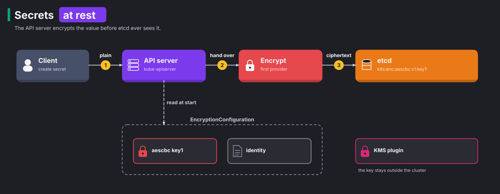
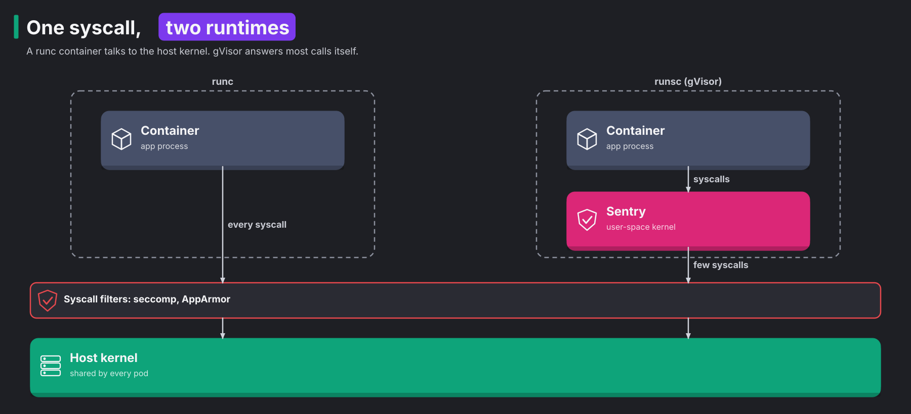

# CKS 04: Minimize microservice vulnerabilities (20%)

> New to a term here, like Pod Security Admission or RuntimeClass? The [glossary](../../platform-engineering/glossary.md#cks-exam-track) explains every term this track uses.

**Before this domain:** the [practice cluster](../README.md#the-practice-cluster) running. The course's [module 2](../../platform-engineering/02-identity-and-mtls.md) explains mTLS between pods, and [module 10](../../platform-engineering/10-ebpf-and-cilium.md#concept-kernel-space-and-user-space) explains the kernel boundary that gVisor moves. Read them for the pod-to-pod encryption topic. Task 10 runs on the [Lima VM](../README.md#the-lima-vm-for-apparmor-and-cilium).

A container is a process with a few fences around it. It shares the node's kernel, and by default it runs as root, keeps a dozen Linux capabilities, and sees its API token and its Secrets as plain text. This domain tightens each fence: what a pod may ask for, where Secrets rest, how a pod receives them, and which kernel a risky pod talks to. It has ten tasks and takes about 1 hour 45 minutes.

## The domain in one table

A workload runs inside four fences, and this domain tightens each one. Each task answers one question:

| Question | Tool | Task |
|---|---|---|
| How much power may a pod ask for? | Pod Security Admission, `securityContext` | 1, 6, 7, 8 |
| Do Secrets rest in etcd as plain text? | EncryptionConfiguration | 2, 5 |
| How does a Secret reach the container? | a volume instead of an environment variable | 3 |
| Which kernel does a risky pod talk to? | RuntimeClass and gVisor | 4, 9 |
| Who reads the traffic between pods? | Cilium WireGuard, or Istio mTLS | 10 |

## Concept: what a container shares with its node

A container feels like a small machine of its own, but it isn't one. It's a normal Linux process that the kernel wraps in a few fences:

1. **Namespaces** give it its own view of processes, network, mounts and host name.
2. **cgroups** limit how much CPU and memory it uses.
3. **Capabilities**, seccomp and AppArmor limit which privileged actions it may take.

Under all of that, every container on the node talks to the same kernel. By default, it also runs as root, keeps about a dozen Linux capabilities, and sees its API token and its Secrets as plain text. Each default makes sense for compatibility. Together they make a compromised container a short step away from the node.

A **Linux capability** is one slice of root's power. Classic Unix had two kinds of user: root, who may do everything, and everybody else. Linux split root's power into about forty capabilities, such as `NET_ADMIN` to change network settings, `SYS_ADMIN` to mount file systems and much more, and `NET_BIND_SERVICE` to listen on ports below 1024. A process holds only the capabilities it got.

## Concept: securityContext, field by field

The **securityContext** is the part of a pod or container spec that sets these fences. Each field blocks a specific attack:

| Field | Safe value | What it blocks |
|---|---|---|
| `runAsNonRoot` | `true` | a container that starts as user 0. The kubelet refuses to start it |
| `runAsUser` | a non-zero ID, such as `1000` | root inside the container, which owns every file the container sees |
| `allowPrivilegeEscalation` | `false` | a process that gains rights later, for example through a setuid binary such as `sudo` |
| `capabilities.drop` | `[ALL]` | every slice of root power, such as changing network settings or loading kernel modules |
| `privileged` | `false` (the default) | nearly every capability and every device of the node |
| `readOnlyRootFilesystem` | `true` | an attacker writing tools or changing binaries, which [domain 06](06-monitoring-logging-runtime-security.md#concept-immutable-containers) covers |
| `seccompProfile.type` | `RuntimeDefault` | dangerous syscalls such as `mount` and `kexec_load`, also in domain 06 |

`allowPrivilegeEscalation: false` sets a kernel flag called `no_new_privs` on the process. After that, no child process ever gets more rights than its parent, whatever binary it runs. That's the line that makes a setuid `sudo` inside the image useless.

**What this stops.** A container that runs as a normal user, with no capabilities and no way to gain rights, leaves an attacker with a shell and very little else. Most container escapes need root or a capability inside the container first.

## Concept: Pod Security Standards and Pod Security Admission

Writing a safe `securityContext` is one problem. Making sure every team does it is another. Nobody reviews every pod by hand, so the cluster has to refuse unsafe pods by itself.

The **Pod Security Standards** are three fixed levels that say how much power a pod may ask for:

| Level | Allows | Typical user |
|---|---|---|
| `privileged` | everything | CNI agents, storage drivers |
| `baseline` | most apps; refuses host namespaces, privileged mode, `hostPath` volumes, host ports and extra capabilities | ordinary apps that run as root |
| `restricted` | only hardened pods: `runAsNonRoot`, no privilege escalation, all capabilities dropped (only `NET_BIND_SERVICE` may come back), a `RuntimeDefault` or `Localhost` seccomp profile, and a short list of volume types | everything you write yourself |

**Pod Security Admission** is the built-in admission plugin that applies a level to a namespace. It runs at the validating admission step of [domain 02's request chain](02-cluster-hardening.md#concept-one-request-six-steps). You set it with labels, one per mode:

1. `pod-security.kubernetes.io/enforce` refuses pods that break the level.
2. `pod-security.kubernetes.io/warn` lets them in and prints a warning to the client.
3. `pod-security.kubernetes.io/audit` lets them in and writes a note into the audit log.

Each mode also takes a version label, such as `pod-security.kubernetes.io/enforce-version: v1.37`. The rules of a level grow a little with each Kubernetes release. A pinned version keeps the rules of that release, so an upgrade never starts refusing pods that ran yesterday. `latest`, the default, always means the newest rules. A common pattern pins `enforce` and leaves `warn` and `audit` on `latest`, so the warnings show what the next upgrade would break. Task 6 sets all three.

**What this stops.** Pod Security stops a developer, a Helm chart or an attacker with `create pods` rights from starting a pod that owns the node. It turns the table in the previous section into a rule the API server enforces.

**Exam traps.** Enforce never touches pods that already run, the same lesson the course's [module 26](../../platform-engineering/26-kyverno-policy-as-code.md#concept-two-paths-to-a-verdict) teaches for Kyverno. A Deployment's existing pods keep running after you label the namespace. The refusal hits the next pod the ReplicaSet creates, and it shows up only as an event on the ReplicaSet. A server-side dry run of the label lists the pods that would break the rule before you apply it:

```bash
k label --dry-run=server --overwrite ns secure-apps pod-security.kubernetes.io/enforce=restricted
```

In the test run, that printed `Warning: existing pods in namespace "secure-apps" violate the new PodSecurity enforce level "restricted:latest"`, then the four reasons for the one pod.

### Pod Security for the whole cluster

Namespace labels cover one namespace each, and a new namespace starts with none. The PodSecurity admission plugin also reads a cluster-wide configuration, and it applies to every namespace without labels:

```yaml
apiVersion: apiserver.config.k8s.io/v1
kind: AdmissionConfiguration
plugins:
- name: PodSecurity
  configuration:
    apiVersion: pod-security.admission.config.k8s.io/v1
    kind: PodSecurityConfiguration
    defaults:
      enforce: baseline
      enforce-version: latest
      warn: restricted
      warn-version: latest
      audit: restricted
      audit-version: latest
    exemptions:
      usernames: []
      runtimeClasses: []
      namespaces: [kube-system, monitoring-agents]
```

Three kinds of **exemption** switch Pod Security off completely: for pods in named namespaces, for pods created by named users, and for pods that ask for named RuntimeClasses. Exempt `kube-system`, because the CNI and other node agents there need host access. A label on a namespace still beats the defaults, so a namespace labelled `enforce=privileged` stays open.

The API server reads the file from `--admission-control-config-file`, the same flag that [domain 05](05-supply-chain-security.md#allowing-only-approved-registries) uses for ImagePolicyWebhook. One file holds the configuration of every plugin that has one, as items in its `plugins` list. Task 7 writes it. In the test run, the restart took 61 seconds, and the defaults hit every unlabelled namespace from then on, including ones created later.

### Pods that reach into the node

Pod Security names the fields that matter most. A pod with any of these shares something with its node, and a compromised container takes the node with it:

| Field | What the pod shares |
|---|---|
| `hostPID: true` | the node's process list: it sees and signals every process |
| `hostNetwork: true` | the node's network: every port, and traffic of other pods on the node |
| `hostIPC: true` | the node's shared memory |
| a `hostPath` volume | any folder of the node, `/` included |
| `privileged: true` | nearly every kernel capability and every device |

The `baseline` level refuses all five. On an old cluster without Pod Security, you find such pods by hand, which task 8 does. In the test run, four pods had something: one with `hostPID`, one with a `hostPath` of `/`, one with `hostNetwork` and one privileged.

## Concept: Secrets at rest

A Secret looks protected, because `kubectl get secret -o yaml` shows scrambled text. That text is base64, and base64 is an encoding, not a cipher. An **encoding** changes how data looks so it survives transport, and anybody reverses it with `base64 -d`. A **cipher** needs a key to reverse.

The API server stores Secrets in etcd exactly as it stores ConfigMaps. Anybody with a copy of etcd's data folder, an etcd backup file, or the etcd client certificate reads every password in the cluster. Backups travel to storage buckets and laptops, so this is a real path, not a theory.



**Encryption at rest** closes it. An **EncryptionConfiguration** file tells the API server to encrypt chosen resources before it writes them to etcd. A write goes like this:

1. A client sends a Secret in plain text, over TLS, to the API server.
2. The API server hands the value to the first provider in the configuration's list.
3. The provider encrypts it, and the API server stores the ciphertext in etcd, behind a prefix such as `k8s:enc:aescbc:v1:key1:`.

A read runs the other way. The API server reads the prefix, picks the provider and key it names, and decrypts. If no provider decrypts the value, the read fails. The order of the list follows from that:

1. The API server encrypts every new write with the first provider in the list.
2. On a read, it tries the providers until one decrypts the value.
3. `identity` means "no encryption". Keeping it last lets the API server still read the Secrets stored before you turned encryption on.

The providers differ in where the key lives and how strong the algorithm is:

| Provider | What it does | Notes |
|---|---|---|
| `identity` | no encryption | the default when no file exists |
| `aescbc` | AES in CBC mode, key in the file | the exam's usual choice. The docs advise against it, because CBC is open to padding oracle attacks |
| `aesgcm` | AES in GCM mode, key in the file | fast, but the key must change every 200,000 writes |
| `secretbox` | XSalsa20 and Poly1305, key in the file | strong and fast |
| `kms` (v2) | envelope encryption with an outside key service | the key never sits on the node |

All file-based providers share one weakness: the key sits in a file on the control plane node, next to etcd. An attacker who copies the node's disk gets both. The **KMS** provider fixes that with **envelope encryption**. The API server encrypts data with a data encryption key (DEK). An outside key management service, such as a cloud KMS or Vault, encrypts that DEK with a key encryption key (KEK) that never leaves the service. etcd stores only the encrypted DEK next to the data. Think of a safe deposit box: the bank keeps the master key, and your box key is useless without it.

**What this stops.** Encryption at rest stops a stolen etcd backup or data folder from revealing Secrets. It doesn't stop a caller with RBAC rights to read Secrets through the API, because the API server decrypts for every authorized reader.

**Exam traps.** Turning encryption on changes nothing that's already stored. Each Secret gets encrypted the next time someone writes it. So the last step rewrites every Secret once: `k get secrets -A -o json | k replace -f -`. The test run showed the difference with `etcdctl`: a plain object starts with `k8s` and a zero byte, followed by readable protobuf, and an encrypted one starts with `k8s:enc:aescbc:v1:key1:`. The file needs a `hostPath` volume in the API server pod, like every file in this track.

### Key rotation

The prefix names the key, which makes **key rotation** safe. Rotation replaces the key that encrypts the data, for example after somebody saw the config file. It takes four steps on a cluster with one API server:

1. Add the new key at the top of the provider's `keys` list, above the old one.
2. Restart the API server. New writes use the new key, and the old key still decrypts old data.
3. Rewrite every Secret with `k get secrets -A -o json | k replace -f -`.
4. Remove the old key and restart once more.

Remove the old key before step 3, and the API server fails to read every Secret it hasn't rewritten yet. With several API servers, add the new key in second place on all of them first, so that every server reads it before any server writes with it. In task 5, the value afterwards started with `k8s:enc:aescbc:v1:key2:`, and the whole rotation took 71 seconds.

## Concept: how a Secret reaches the container

A Secret reaches a container in one of two ways, and the file is the safer one:

| | Environment variable | Mounted file |
|---|---|---|
| Visible in | `/proc/<pid>/environ`, crash dumps, child processes, logs that print the environment | only the file, readable by the container's user |
| On rotation | stays old until the pod restarts | the kubelet updates the file within about a minute |

An environment variable spreads. Every child process inherits it, and many frameworks print the whole environment in a debug page or an error report. A file stays where it is, and the kubelet keeps Secret volumes in memory (`tmpfs`), so they never touch the node's disk.

**What this stops.** A file mount stops a password from leaking through error pages, crash dumps and child processes, and it lets a rotated password reach the app without a restart.

## Concept: sandboxes, a second kernel

Every fence so far still leaves one shared thing: the kernel. A **container escape** is an attack that breaks out of the container's fences onto the node. Most serious escapes use a kernel bug that some syscall reaches. A **system call**, or syscall, is a request from a program to the kernel, such as "open this file". The Linux kernel offers more than 300 of them, and each one is code an attacker might find a bug in. One reachable bug lets a container own the node and every pod on it.

A **sandboxed runtime** puts a second kernel between the container and the host. Two designs exist:

1. **gVisor** writes a kernel in user space. Its core, the **Sentry**, is a Go program that implements the Linux syscall interface itself. The container's syscalls go to the Sentry, which answers most of them without the host kernel. The Sentry itself calls the host kernel with only a small, fixed set of syscalls, behind its own seccomp filter.
2. **Kata Containers** starts each pod in a lightweight virtual machine with its own real Linux kernel. The host kernel sees only a virtual machine.



The diagram compares the two paths. On the left, runc, the normal runtime, lets every syscall through to the shared kernel, filtered only by seccomp and AppArmor. On the right, gVisor's runtime `runsc` sends the container's syscalls to the Sentry first. An attacker now needs a bug in the Sentry and then a bug in the few host syscalls the Sentry uses. The course's [module 10](../../platform-engineering/10-ebpf-and-cilium.md#concept-kernel-space-and-user-space) explains the line between kernel space and user space that gVisor moves.

The cost is speed. Every syscall takes a longer path, and file and network heavy apps notice it. So teams use sandboxes for untrusted code: CI jobs, customer plugins, scanners, anything that runs code somebody else wrote.

Kubernetes picks the runtime per pod with a **RuntimeClass**. Its `handler` names a runtime that containerd knows. The practice cluster's `cks-w1` has a `runsc` handler in `/etc/containerd/config.toml`. A pod asks for it with `runtimeClassName`.

**What this stops.** A sandbox stops a kernel bug from turning a compromised container into a compromised node. It's the only control in this domain that protects against bugs in the kernel itself.

**Exam traps.** Usually only some nodes have the sandbox installed. A pod for `runsc` on a node without it fails to start. A RuntimeClass fixes that with a `scheduling.nodeSelector`: the RuntimeClass admission plugin copies the selector into every pod that asks for the class, so the scheduler only picks nodes with the right label. In the test run, a pod of task 9 showed `nodeSelector: {"sandbox":"gvisor"}` without its Deployment ever naming it. To prove a pod runs in gVisor, run `dmesg` inside it: the test run printed `Starting gVisor...`, while a normal pod got `dmesg: klogctl: Operation not permitted`.

## Concept: pod-to-pod encryption

NetworkPolicy decides who may talk. It doesn't hide what they say: traffic between nodes crosses the network in clear text. Anybody who reads that network, a compromised switch, a cloud provider's tap or a pod with `hostNetwork`, reads every password and token the pods send. The curriculum names two ways to encrypt it:

| | Istio | Cilium |
|---|---|---|
| How | mTLS between proxies, with a certificate per service account | WireGuard or IPsec tunnels between nodes |
| Proves | which workload sent the request | which node sent the packet |
| Turn on | label the namespace for the mesh, then a `PeerAuthentication` with `mode: STRICT` | Helm values `encryption.enabled=true` and `encryption.type=wireguard` |
| In this repo | the whole Istio route of the course, [module 2](../../platform-engineering/02-identity-and-mtls.md) first | compared in [module 10](../../platform-engineering/10-ebpf-and-cilium.md#why-this-way-the-two-designs-share-one-idea) |

**mTLS** (mutual TLS) means both sides of a connection show a certificate, so each knows who the other is. **WireGuard** is a small, fast VPN protocol built into the Linux kernel. The two answer different questions. WireGuard encrypts every packet between two nodes, whatever pod sent it. mTLS encrypts per connection and also proves which workload is calling, which authorization rules then use.

The OrbStack cluster runs neither. Its kernel has no WireGuard module, and Calico's own encryption needs WireGuard too. The Lima VM's kernel has the module, so task 10 turns on Cilium's WireGuard there and checks it with `cilium encrypt status`.

**What this stops.** Encryption between pods stops anybody on the network path from reading or changing traffic. mTLS also stops a pod from pretending to be another workload.

**Exam traps.** The Lima VM has one node, and WireGuard encrypts traffic between nodes, so no packet actually crosses the tunnel. The task proves the setting and the interface, not encrypted traffic. Cilium's agents read the setting only at start: in the test run, `cilium encrypt status` said `Disabled` until the agents restarted, then `Encryption: Wireguard (1/1 nodes)` 12 seconds later.

## The bigger picture: four fences, each for a different failure

Each fence in this domain assumes the previous one failed:

1. The `securityContext` and Pod Security assume the app has a bug, and keep the attacker from gaining root powers inside the container.
2. Encryption at rest assumes somebody copies etcd, and keeps the copy useless.
3. File-mounted Secrets assume the app leaks its environment, and keep the password out of it.
4. Sandboxes assume the attacker reaches a kernel bug, and put a second kernel in the way.

Pod-to-pod encryption adds a fifth, for the network between them.

Real platform teams set these once, centrally, so app teams never think about them. Every new namespace gets `enforce=restricted` from a template, with a short, reviewed list of exemptions. Secrets come from a cloud KMS or Vault, often through an operator that writes them as files. Untrusted workloads land on a separate node pool with gVisor or Kata, and a service mesh or the CNI encrypts all traffic by default.

## Why this way

**Why three fixed levels and not custom policies?** Fixed levels are easy to reason about and ship inside every cluster. Teams that need custom rules, such as "only images from our registry", add a policy engine like Kyverno on top.

**Why does enforce leave running pods alone?** Admission only sees requests. A running pod sends no request, so nothing checks it until its controller creates a new one. That also keeps a label change from deleting production pods.

**Why does `identity` stay in the provider list?** Old Secrets in etcd are still plain text until you rewrite them. Without `identity`, the API server fails to read them.

**Why not run every pod in gVisor?** It costs speed, and gVisor doesn't implement every syscall, so some apps fail inside it. Most of your own apps are trusted code, and the other fences cover them well. Sandboxes earn their price where the code itself is untrusted.

## Task 1: Enforce the restricted standard

**Time budget:** 8 minutes. **Host:** `cks-cp`.

```bash
./certs/cks/task.sh setup 4.1
```

> 1. Make namespace `secure-apps` enforce the `restricted` Pod Security Standard, and warn about it too.
> 2. Deployment `app` in that namespace runs `busybox:1.36` with `sleep`. Change it so that its pods run under `restricted`, as user 1000.

<details>
<summary>Solution</summary>

Label first, and read the warning:

```bash
k label ns secure-apps pod-security.kubernetes.io/enforce=restricted pod-security.kubernetes.io/warn=restricted
```

The warning names the four gaps: `allowPrivilegeEscalation != false, unrestricted capabilities, runAsNonRoot != true, seccompProfile`. Fix each one in the pod template with `k -n secure-apps edit deploy app`:

```yaml
    spec:
      securityContext:
        runAsNonRoot: true
        runAsUser: 1000
        seccompProfile:
          type: RuntimeDefault
      containers:
      - name: busybox
        securityContext:
          allowPrivilegeEscalation: false
          capabilities:
            drop: ["ALL"]
```

Then `k -n secure-apps rollout status deploy app`. The new pod starts, and the old one goes away. `runAsUser` matters for `busybox`: the image's default user is root, and `runAsNonRoot` alone makes the kubelet refuse to start it.

</details>

```bash
./certs/cks/task.sh check 4.1
```

```
  PASS  namespace secure-apps enforces the restricted standard
  PASS  Deployment app has a ready pod that the namespace admitted
  PASS  no running pod in secure-apps violates restricted
  PASS  a privileged pod is refused in secure-apps
```

## Task 2: Encrypt Secrets at rest

**Time budget:** 10 minutes. **Host:** `cks-cp`.

```bash
./certs/cks/task.sh setup 4.2
```

The setup creates Secret `db-creds` in namespace `vault-test` and prints the password as it sits in etcd, in clear text.

> 1. Encrypt Secrets in etcd with the `aescbc` provider, using the configuration file `/etc/kubernetes/enc/enc.yaml` and a key named `key1`.
> 2. Encrypt the Secrets that already exist, too.
> 3. Prove it with `etcdctl` for `vault-test/db-creds`.

<details>
<summary>Solution</summary>

Make a 32-byte key and the file:

```bash
mkdir -p /etc/kubernetes/enc
head -c 32 /dev/urandom | base64
vim /etc/kubernetes/enc/enc.yaml
```

```yaml
apiVersion: apiserver.config.k8s.io/v1
kind: EncryptionConfiguration
resources:
- resources: [secrets]
  providers:
  - aescbc:
      keys:
      - name: key1
        secret: <the base64 key>
  - identity: {}
```

Back up the API server manifest, then add the flag, a volume mount and a volume, as in [02, task 3](02-cluster-hardening.md#task-3-restrict-anonymous-access-to-the-api):

```yaml
    - --encryption-provider-config=/etc/kubernetes/enc/enc.yaml
...
    - mountPath: /etc/kubernetes/enc
      name: enc
      readOnly: true
...
  - hostPath:
      path: /etc/kubernetes/enc
      type: DirectoryOrCreate
    name: enc
```

When the API server is back, rewrite every Secret and look at etcd:

```bash
k get secrets -A -o json | k replace -f -
ETCDCTL_API=3 etcdctl --endpoints=https://127.0.0.1:2379 \
  --cacert=/etc/kubernetes/pki/etcd/ca.crt \
  --cert=/etc/kubernetes/pki/apiserver-etcd-client.crt \
  --key=/etc/kubernetes/pki/apiserver-etcd-client.key \
  get /registry/secrets/vault-test/db-creds --print-value-only | head -c 48 | od -c
```

The certificate paths come from the API server's own `--etcd-*` flags, so `grep etcd /etc/kubernetes/manifests/kube-apiserver.yaml` finds them when you forget. etcdctl 3.7 no longer needs `ETCDCTL_API=3` and prints a warning about it, but older versions in exam environments still need it. In the test run, the value started with `k8s:enc:aescbc:v1:key1:`, and the replace rewrote 4 Secrets.

</details>

```bash
./certs/cks/task.sh check 4.2
```

```
  PASS  the API server runs with --encryption-provider-config
  PASS  Secret db-creds is stored with prefix k8s:enc:aescbc:v1:
  PASS  the password no longer appears in etcd in clear text
  PASS  kubectl still reads the Secret
```

## Task 3: A Secret as a file, not an environment variable

**Time budget:** 5 minutes. **Host:** `cks-cp`.

```bash
./certs/cks/task.sh setup 4.3
```

> Pod `api` in namespace `orders` reads Secret `api-token` through the environment variable `API_TOKEN`. Change it to read the Secret as a read-only file at `/etc/api/token`, and remove the variable. Keep the pod name.

<details>
<summary>Solution</summary>

A pod's containers don't change in place, so save, delete and recreate:

```bash
k -n orders get pod api -o yaml > api.yaml
vim api.yaml       # remove env, add volumeMounts and volumes
k -n orders replace --force -f api.yaml
```

```yaml
spec:
  containers:
  - name: api
    image: busybox:1.36
    command: [sleep, 1d]
    volumeMounts:
    - {name: token, mountPath: /etc/api, readOnly: true}
  volumes:
  - name: token
    secret: {secretName: api-token}
```

`replace --force` deletes the pod and creates it again in one step. `k -n orders exec api -- cat /etc/api/token` prints `t0k3n-123`.

</details>

```bash
./certs/cks/task.sh check 4.3
```

```
  PASS  pod api has no environment variable from a Secret
  PASS  pod api mounts Secret api-token read-only at /etc/api
  PASS  the token is readable at /etc/api/token
```

## Task 4: Sandbox a pod with gVisor

**Time budget:** 5 minutes. **Host:** `cks-cp`.

```bash
./certs/cks/task.sh setup 4.4
```

> 1. Create a RuntimeClass `gvisor` for the containerd handler `runsc`.
> 2. Make Deployment `untrusted` in namespace `sandbox` run its pods with it.

<details>
<summary>Solution</summary>

The RuntimeClass page in the Kubernetes docs has this YAML:

```yaml
apiVersion: node.k8s.io/v1
kind: RuntimeClass
metadata:
  name: gvisor
handler: runsc
```

```bash
k apply -f rc.yaml
k -n sandbox patch deploy untrusted -p '{"spec":{"template":{"spec":{"runtimeClassName":"gvisor"}}}}'
k -n sandbox rollout status deploy untrusted
k -n sandbox exec deploy/untrusted -- dmesg | head -2
```

`dmesg` inside a gVisor pod shows gVisor's own made-up kernel log. In the test run: `[   0.000000] Starting gVisor...`. A normal pod gets `dmesg: klogctl: Operation not permitted` instead, because it shares the host kernel and may not read its log.

</details>

```bash
./certs/cks/task.sh check 4.4
```

```
  PASS  RuntimeClass gvisor uses handler runsc
  PASS  Deployment untrusted uses RuntimeClass gvisor
  PASS  the running pod's kernel is gVisor
```

## Task 5: Rotate the encryption key

**Time budget:** 10 minutes. **Host:** `cks-cp`.

```bash
./certs/cks/task.sh setup 4.5
```

The setup starts from task 2's result and applies its solution when encryption is off. It prints how the Secret sits in etcd. In the test run: `stored as: k8s:enc:aescbc:v1:key1:`.

> The API server encrypts Secrets with the `aescbc` key `key1` from `/etc/kubernetes/enc/enc.yaml`. Rotate to a new key `key2`: every Secret in etcd ends up encrypted with `key2`, and the file no longer holds `key1`. Keep the file's path.

<details>
<summary>Solution</summary>

Step 1, the new key on top:

```bash
cp /etc/kubernetes/enc/enc.yaml /root/
head -c 32 /dev/urandom | base64
vim /etc/kubernetes/enc/enc.yaml
```

```yaml
  - aescbc:
      keys:
      - name: key2
        secret: <the new base64 key>
      - name: key1
        secret: <the old key, unchanged>
```

Step 2, a restart. The API server reads the file only at start, and the manifest didn't change, so the kubelet sees no reason to restart it. Move the manifest out of the folder and back:

```bash
mv /etc/kubernetes/manifests/kube-apiserver.yaml /root/
watch crictl ps --name kube-apiserver        # wait until the container is gone
mv /root/kube-apiserver.yaml /etc/kubernetes/manifests/
```

Step 3, rewrite, once `k get nodes` answers again:

```bash
k get secrets -A -o json | k replace -f -
```

Step 4: delete the two `key1` lines, and restart the API server the same way. Then prove it with etcdctl, using the variables from task 2:

```bash
etcdctl ... get /registry/secrets/rotate-me/app-secret --print-value-only | head -c 23; echo
```

In the test run, that printed `k8s:enc:aescbc:v1:key2:`. The rewrite touched 5 Secrets, and the two restarts made the whole rotation take 71 seconds.

</details>

```bash
./certs/cks/task.sh check 4.5
```

```
  PASS  app-secret is stored with key2
  PASS  every Secret in etcd is stored with key2
  PASS  the configuration no longer holds key1, and key2 comes first
  PASS  kubectl still reads app-secret
```

## Task 6: Pod Security levels, modes and versions

**Time budget:** 4 minutes. **Host:** `cks-cp`.

```bash
./certs/cks/task.sh setup 4.6
```

> Namespace `psa-levels` runs Deployment `legacy` with nginx as root. Configure Pod Security for the namespace:
>
> 1. Enforce `baseline`, pinned to the rules of Kubernetes v1.37.
> 2. Warn and audit at `restricted`, with the newest rules.
>
> `legacy` keeps running.

<details>
<summary>Solution</summary>

```bash
k label ns psa-levels \
  pod-security.kubernetes.io/enforce=baseline pod-security.kubernetes.io/enforce-version=v1.37 \
  pod-security.kubernetes.io/warn=restricted pod-security.kubernetes.io/warn-version=latest \
  pod-security.kubernetes.io/audit=restricted pod-security.kubernetes.io/audit-version=latest
```

Write `latest` explicitly even though it's the default: the task asks for it, and a check reads the label. Test both levels with server-side dry runs:

```bash
k -n psa-levels run t1 --image=busybox:1.36 --privileged --dry-run=server -- sleep 1   # Forbidden
k -n psa-levels run t2 --image=nginx:1.27-alpine --dry-run=server                      # Warning, then created
```

In the test run, the second command printed `Warning: would violate PodSecurity "restricted:latest": allowPrivilegeEscalation != false ...` and then `pod/t2 created (server dry run)`. nginx as root passes `baseline`, so `legacy` keeps running.

</details>

```bash
./certs/cks/task.sh check 4.6
```

```
  PASS  enforce is baseline, pinned to v1.37
  PASS  warn and audit are restricted, at version latest
  PASS  a privileged pod is refused
  PASS  a root nginx pod is admitted, with a restricted warning
  PASS  Deployment legacy keeps its ready pod
```

## Task 7: Cluster-wide Pod Security defaults with exemptions

**Time budget:** 10 minutes. **Host:** `cks-cp`.

```bash
./certs/cks/task.sh setup 4.7
```

The setup shows the cluster's default today. In the test run, a privileged pod in an unlabelled namespace got `pod/t created (server dry run)`.

> Configure Pod Security for every namespace without labels, through the file `/etc/kubernetes/admission/psa.yaml`:
>
> 1. Enforce `baseline`. Warn and audit at `restricted`. Use the newest rules for all three.
> 2. Exempt the namespaces `kube-system` and `monitoring-agents`.

<details>
<summary>Solution</summary>

Write the file from the theory section, then point the API server at it. Back up the manifest first:

```yaml
    - --admission-control-config-file=/etc/kubernetes/admission/psa.yaml
...
    - mountPath: /etc/kubernetes/admission
      name: admission
      readOnly: true
...
  - hostPath:
      path: /etc/kubernetes/admission
      type: DirectoryOrCreate
    name: admission
```

The "Enforce Pod Security Standards by configuring the built-in admission controller" page in the Kubernetes docs holds the YAML. Once the API server answers, test three namespaces:

```bash
k -n psa-default run t1 --image=busybox:1.36 --privileged --dry-run=server -- sleep 1        # Forbidden
k -n psa-default run t2 --image=nginx:1.27-alpine --dry-run=server                           # Warning, then created
k -n monitoring-agents run t3 --image=busybox:1.36 --privileged --dry-run=server -- sleep 1  # created, exempt
```

In the test run, the restart took 61 seconds. The defaults hit every namespace without labels from then on, including ones created later.

</details>

```bash
./certs/cks/task.sh check 4.7
```

```
  PASS  the API server reads /etc/kubernetes/admission/psa.yaml
  PASS  a privileged pod in the unlabelled namespace psa-default is refused
  PASS  a root nginx pod in psa-default gets a restricted warning but runs
  PASS  a privileged pod in monitoring-agents is admitted
  PASS  the API server pod is Ready
```

## Task 8: Pods that reach into the node

**Time budget:** 6 minutes. **Host:** `cks-cp`.

```bash
./certs/cks/task.sh setup 4.8
```

> Namespaces `team-blue` and `team-green` run seven pods. Delete every pod that shares a host namespace (PID, network or IPC), mounts a `hostPath` volume, or runs a privileged container. Leave the others running.

<details>
<summary>Solution</summary>

`jsonpath` prints the fields side by side, one pod per line:

```bash
for n in team-blue team-green; do
  k -n $n get pods -o jsonpath='{range .items[*]}{.metadata.name}{" pid="}{.spec.hostPID}{" net="}{.spec.hostNetwork}{" ipc="}{.spec.hostIPC}{" priv="}{.spec.containers[*].securityContext.privileged}{" vols="}{.spec.volumes[*].hostPath.path}{"\n"}{end}'
done
```

Empty fields mean "not set". In the test run, four pods had something: `node-debug` (hostPID), `log-reader` (a hostPath of `/`), `net-tool` (hostNetwork) and `metrics` (privileged). `cache` mounts an `emptyDir`, which lives inside the pod's own storage and is harmless here.

```bash
k -n team-blue delete pod node-debug log-reader
k -n team-green delete pod net-tool metrics
```

Both namespaces carry `pod-security.kubernetes.io/enforce=privileged`, which explains how those pods got in. Changing the label to `baseline` afterwards keeps new ones out.

</details>

```bash
./certs/cks/task.sh check 4.8
```

```
  PASS  node-debug (hostPID) is gone
  PASS  log-reader (hostPath /) is gone
  PASS  net-tool (hostNetwork) is gone
  PASS  metrics (privileged) is gone
  PASS  web, api and cache still run
```

## Task 9: A sandbox only on the nodes that have it

**Time budget:** 6 minutes. **Host:** `cks-cp`.

```bash
./certs/cks/task.sh setup 4.9
```

> Only `cks-w1` has gVisor. Label it `sandbox=gvisor`. Create a RuntimeClass `gvisor-pinned` for the handler `runsc` that sends its pods only to nodes with that label. Then create Deployment `scanner` in namespace `sandbox-sched`, image `busybox:1.36`, command `sleep 1d`, 3 replicas, with that RuntimeClass.

<details>
<summary>Solution</summary>

```bash
k label node cks-w1 sandbox=gvisor
```

```yaml
apiVersion: node.k8s.io/v1
kind: RuntimeClass
metadata:
  name: gvisor-pinned
handler: runsc
scheduling:
  nodeSelector:
    sandbox: gvisor
```

```bash
k -n sandbox-sched create deploy scanner --image=busybox:1.36 --replicas=3 $do -- sleep 1d > scanner.yaml
vim scanner.yaml      # add runtimeClassName: gvisor-pinned under the pod template's spec
k apply -f scanner.yaml
k -n sandbox-sched get pods -o wide
```

In the test run, all three pods landed on `cks-w1`, and each one carried `nodeSelector: {"sandbox":"gvisor"}`, copied in from the RuntimeClass.

</details>

```bash
./certs/cks/task.sh check 4.9
```

```
  PASS  cks-w1 carries the label sandbox=gvisor, cks-cp does not
  PASS  RuntimeClass gvisor-pinned uses runsc and schedules onto sandbox=gvisor
  PASS  Deployment scanner has 3 ready pods, all on cks-w1, all under gVisor
```

## Task 10: Pod-to-pod encryption with Cilium

**Time budget:** 5 minutes. **Host:** `cks-lima`.

```bash
./certs/cks/cluster/lima.sh start      # once, when the VM is off
./certs/cks/task.sh setup 4.10
```

> Turn on WireGuard encryption for pod traffic in Cilium on `cks-lima`. Pods must keep reaching each other.

<details>
<summary>Solution</summary>

The Cilium docs' "WireGuard Transparent Encryption" page gives the Helm values. The `cilium` command line tool applies them to the installed release:

```bash
cilium upgrade --version 1.20.4 --reuse-values --set encryption.enabled=true --set encryption.type=wireguard
k -n kube-system rollout restart ds/cilium
k -n kube-system rollout status ds/cilium
cilium encrypt status
ip link show cilium_wg0
```

The upgrade only changes the `cilium-config` ConfigMap, and the agents read it at start, so the restart is part of the job. The test run missed it once: the upgrade printed `You maybe need to restart Cilium pods for configmap changes to take effect`, and `cilium encrypt status` kept saying `Disabled`. After the restart, it said `Encryption: Wireguard (1/1 nodes)`, 12 seconds later.

</details>

```bash
./certs/cks/task.sh check 4.10
```

```
  PASS  cilium-config has enable-wireguard: true
  PASS  cilium encrypt status reports Wireguard on every node
  PASS  the node has the WireGuard interface cilium_wg0
  PASS  pods still reach each other
```

## Clean up

Tasks 2, 5 and 7 changed the API server, and task 9 labelled a node. `./certs/cks/cluster/reset.sh` returns to a fresh cluster. `./certs/cks/cluster/lima.sh reset` turns WireGuard off again.
