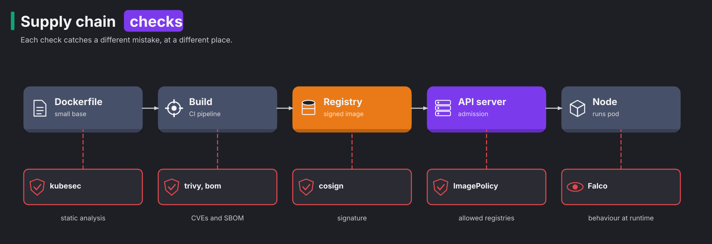

# CKS 05: Supply chain security (20%)

> New to a term here, like SBOM or ImagePolicyWebhook? The [glossary](../../course/glossary.md#cks-exam-track) explains every term this track uses.

**Before this domain:** the [practice cluster](../README.md#the-practice-cluster) running. The course's [module 26](../../course/26-kyverno-policy-as-code.md) explains admission webhooks, which task 5 configures by hand.

Most of the code in a container image came from someone else: a base image, system packages, language libraries. A vulnerable or poisoned piece anywhere in that chain ends up running in your cluster with your permissions. This domain checks the chain at each step, from the Dockerfile to the API server's front door. It has five tasks and takes about 45 minutes.

## Theory: a check at every step



An image travels through five places before it runs, and each place has its own check:

1. The Dockerfile and the Kubernetes manifest. A small base image and a non-root user shrink what an attacker finds. **kubesec** reads the manifest and scores its security settings.
2. The build. **trivy** lists known vulnerabilities in the image, and an **SBOM** lists everything inside it.
3. The registry. A signature, made with a tool such as cosign, proves who built the image.
4. The API server. An admission check refuses images from registries you don't trust.
5. The node. Falco watches what the container does, which is [domain 06](06-monitoring-logging-runtime-security.md#task-2-catch-a-shell-with-falco).

No single check is enough. trivy only knows vulnerabilities somebody already found. A signature proves where an image came from, not that it's safe. The admission check is the only one the cluster enforces by itself.

### Base images

Every package in an image is code an attacker might use. `curl` and `wget` download tools. A shell runs commands. A package manager installs more. The test run built the same three-line Python app twice:

| Base | Extra packages | Runs as | Size |
|---|---|---|---|
| `ubuntu:latest` | python3, curl, wget, netcat, vim | root | 425 MB |
| `python:3.13-alpine` | none | `nobody` (65534) | 74.4 MB |

Three habits get you most of the way. Pin the base image to a tag or digest, because `latest` changes under you. Pick a minimal variant: `-alpine`, `-slim`, or a distroless image with no shell at all. End with a `USER` that isn't root. Alpine still ships `wget` and `apk` through BusyBox, which the test run confirmed. A distroless image removes even those.

### Vulnerability scanning

A **CVE** (Common Vulnerabilities and Exposures entry) is a public record of one known security bug, with an ID such as `CVE-2024-6387` and a severity. trivy reads the package lists inside an image and compares them with a database of CVEs. It downloads that database the first time it runs, which took about 30 seconds in the test run.

| Image | CRITICAL findings in the test run |
|---|---|
| `nginx:1.19.0` | 44 |
| `redis:6.0.5` | 22 |
| `nginx:1.27-alpine` | 3 |
| `busybox:1.36` | 0 |
| `registry.k8s.io/pause:3.10` | 0 |

The numbers grow over time without any change to the image, because researchers keep finding bugs in old code. An exam task usually says "delete the pods whose image has CRITICAL vulnerabilities". Scan each distinct image once, not each pod.

### SBOMs

An **SBOM** (software bill of materials) is a machine-readable list of every package in an image, with versions and licenses. When the next big CVE arrives, a team with SBOMs searches files instead of rescanning every image. Two formats dominate: **SPDX**, from the Linux Foundation, and **CycloneDX**, from OWASP. The exam allows the docs of **bom**, a Kubernetes SIG tool that writes SPDX. trivy writes both.

### Static analysis of manifests

kubesec reads a manifest without running it. It gives points for good settings, such as `readOnlyRootFilesystem` or resource limits, and marks dangerous ones as critical, such as `privileged` or `hostPID`. A pod with any critical finding fails, whatever its points. KubeLinter, also named in the curriculum, works the same way with a different rule set.

### Allowing only approved registries

The cluster's last line of defence is admission. Two ways to restrict registries come up in the exam:

1. **ImagePolicyWebhook**, a built-in admission plugin. For every new pod, the API server POSTs an `ImageReview` with the image names to an outside service, and that service answers allowed or denied.
2. A policy engine such as Kyverno, or a ValidatingAdmissionPolicy, which [module 26](../../course/26-kyverno-policy-as-code.md) covers.

ImagePolicyWebhook needs three files, and the exam usually hands you the last two half-filled:

1. The API server flags `--enable-admission-plugins=...,ImagePolicyWebhook` and `--admission-control-config-file=<file>`.
2. The admission configuration, an `AdmissionConfiguration` that points to a kubeconfig and sets `defaultAllow`.
3. That kubeconfig, whose `cluster.server` is the webhook's URL and whose `certificate-authority` checks the webhook's certificate.

`defaultAllow` decides what happens when the webhook doesn't answer. The test run stopped the back end with `defaultAllow: false`, and every new pod failed: `Post "https://localhost:8443/review?timeout=30s": dial tcp [::1]:8443: connect: connection refused`. That's the safe choice for a registry rule, and the reason the webhook needs high availability in production.

The practice cluster runs a small back end on `cks-cp` at `https://localhost:8443/review`, from `certs/cks/cluster/image-policy/`. It allows images from the prefixes in `/etc/image-policy/allowed-registries`, refuses `latest` and untagged images, and logs each verdict to `journalctl -u image-policy`.

### Signatures

A signature ties an image digest to the key or identity that built it. **cosign**, from the Sigstore project, signs images and stores the signature next to the image in the registry. Kyverno's `verifyImages` rule or the Sigstore policy controller then refuses unsigned images at admission. The practice cluster doesn't run a signing flow, because it needs a registry you push to. Know the two commands: `cosign sign --key cosign.key <image>@<digest>` and `cosign verify --key cosign.pub <image>`.

## Task 1: Shrink a Dockerfile

**Time budget:** 4 minutes. **Host:** `cks-cp`.

```bash
./certs/cks/task.sh setup 5.1
```

> Fix `/root/cks/app/Dockerfile`:
>
> 1. Use `python:3.13-alpine` as the base image.
> 2. Install nothing besides what the base image brings.
> 3. Run the app as user `65534`, not root.
>
> Don't build the image.

<details>
<summary>Solution</summary>

```dockerfile
FROM python:3.13-alpine
COPY app.py /app/app.py
USER 65534
CMD ["python3", "/app/app.py"]
```

The alpine image already has `python3`, so the `RUN` line goes. The `USER root` line goes too, replaced by `USER 65534`. Exam tasks often hide a second `USER root` lower in the file. The last one wins, so read to the end.

</details>

```bash
./certs/cks/task.sh check 5.1
```

```
  PASS  the base image has an explicit tag, not latest
  PASS  the base image is a slim, alpine or distroless variant
  PASS  no RUN line installs curl, wget, netcat or vim
  PASS  the last USER is neither root nor 0
```

## Task 2: Find and remove vulnerable images

**Time budget:** 6 minutes. **Host:** `cks-cp`.

```bash
./certs/cks/task.sh setup 5.2
```

> Namespace `scan` runs three pods. Use trivy to find the pods whose image has at least one CRITICAL vulnerability, and delete those pods. Leave the others running.

<details>
<summary>Solution</summary>

List the images, then scan each one:

```bash
k -n scan get pods -o custom-columns=POD:.metadata.name,IMAGE:.spec.containers[0].image
trivy image --severity CRITICAL --quiet nginx:1.19.0 | grep Total
trivy image --severity CRITICAL --quiet redis:6.0.5 | grep Total
trivy image --severity CRITICAL --quiet busybox:1.36 | grep Total
k -n scan delete pod web cache
```

`--quiet` hides the progress bars, and the `Total` line gives the count per target. In the test run, trivy reported 44 CRITICAL findings for `nginx:1.19.0`, 22 for `redis:6.0.5` and none for `busybox:1.36`.

</details>

```bash
./certs/cks/task.sh check 5.2
```

```
  PASS  pod web (nginx:1.19.0, CRITICAL findings) is gone
  PASS  pod cache (redis:6.0.5, CRITICAL findings) is gone
  PASS  pod tools (busybox:1.36, no CRITICAL findings) still runs
```

## Task 3: Write an SBOM

**Time budget:** 5 minutes. **Host:** `cks-cp`.

```bash
./certs/cks/task.sh setup 5.3
```

> For the image `registry.k8s.io/kube-proxy:v1.37.1`:
>
> 1. Write an SPDX JSON SBOM with bom to `/root/cks/kube-proxy.spdx.json`.
> 2. Write a CycloneDX SBOM with trivy to `/root/cks/kube-proxy.cdx.json`.
> 3. Write the version of the package `iptables`, as the SPDX SBOM lists it, to `/root/cks/iptables-version.txt`.

<details>
<summary>Solution</summary>

```bash
cd /root/cks
bom generate --image registry.k8s.io/kube-proxy:v1.37.1 --format json --output kube-proxy.spdx.json
trivy image --format cyclonedx --output kube-proxy.cdx.json registry.k8s.io/kube-proxy:v1.37.1
grep -A3 '"name": "iptables"' kube-proxy.spdx.json | grep -m1 versionInfo
echo 1.8.9-2 > iptables-version.txt
```

bom 0.8.0 writes JSON by default, and `--format tag-value` gives the older text format. Older bom versions defaulted to tag-value, so pass `--format json` anyway. In the test run, bom took 4 seconds and listed 266 packages, trivy listed 172 components, and `iptables` had version `1.8.9-2`. The two tools count differently: bom also lists every Go module inside the Kubernetes binaries.

An SBOM is also something trivy scans later, without the image: `trivy sbom kube-proxy.cdx.json`.

</details>

```bash
./certs/cks/task.sh check 5.3
```

```
  PASS  /root/cks/kube-proxy.spdx.json is SPDX JSON for kube-proxy v1.37.1
  PASS  /root/cks/kube-proxy.cdx.json is a CycloneDX SBOM
  PASS  /root/cks/iptables-version.txt holds the iptables version from the SBOM
```

## Task 4: Static analysis with kubesec

**Time budget:** 6 minutes. **Host:** `cks-cp`.

```bash
./certs/cks/task.sh setup 5.4
```

The setup prints kubesec's verdict on the manifest. In the test run: `score -39 critical ['Privileged', 'HostPID']`.

> Fix `/root/cks/report.yaml` so that kubesec reports no critical issue and a score of 8 or more. Then create the pod. It must run.

<details>
<summary>Solution</summary>

```bash
kubesec scan /root/cks/report.yaml | less
```

The `advise` list names the settings that give points. Remove `hostPID` and `privileged`, then add enough of the advice:

```yaml
apiVersion: v1
kind: Pod
metadata:
  name: report
  namespace: reports
spec:
  automountServiceAccountToken: false
  securityContext:
    runAsNonRoot: true
    runAsUser: 1000
    runAsGroup: 1000
    seccompProfile: {type: RuntimeDefault}
  containers:
  - name: report
    image: busybox:1.36
    command: [sleep, 1d]
    securityContext:
      allowPrivilegeEscalation: false
      readOnlyRootFilesystem: true
      capabilities: {drop: [ALL]}
    resources:
      requests: {cpu: 10m, memory: 16Mi}
      limits: {cpu: 100m, memory: 32Mi}
```

```bash
kubesec scan /root/cks/report.yaml | grep -E '"score"|"message"'
k apply -f /root/cks/report.yaml
```

In the test run, the score went from -39 to 10. The `sleep` command writes nothing, so `readOnlyRootFilesystem` doesn't stop it.

</details>

```bash
./certs/cks/task.sh check 5.4
```

```
  PASS  kubesec finds no critical issue and scores 8 or more
  PASS  pod report runs in namespace reports
  PASS  the running pod has no hostPID and is not privileged
```

## Task 5: Allow only approved registries

**Time budget:** 10 minutes. **Host:** `cks-cp`.

```bash
./certs/cks/task.sh setup 5.5
```

> An image policy back end runs at `https://localhost:8443/review`. The kubeconfig to reach it is `/etc/kubernetes/policy-webhook/kubeconfig.yaml`.
>
> 1. Write an admission configuration at `/etc/kubernetes/admission/admission-config.yaml` for the ImagePolicyWebhook plugin, with that kubeconfig, TTLs of 50 seconds, a retry backoff of 500 ms, and pods refused when the back end doesn't answer.
> 2. Enable the plugin in the API server.
> 3. Prove that the API server refuses `nginx:latest`.

<details>
<summary>Solution</summary>

The admission configuration comes from the "Using admission controllers" page of the Kubernetes docs:

```yaml
apiVersion: apiserver.config.k8s.io/v1
kind: AdmissionConfiguration
plugins:
- name: ImagePolicyWebhook
  configuration:
    imagePolicy:
      kubeConfigFile: /etc/kubernetes/policy-webhook/kubeconfig.yaml
      allowTTL: 50
      denyTTL: 50
      retryBackoff: 500
      defaultAllow: false
```

In the API server manifest, after a backup:

```yaml
    - --enable-admission-plugins=NodeRestriction,ImagePolicyWebhook
    - --admission-control-config-file=/etc/kubernetes/admission/admission-config.yaml
```

The API server reads two folders it doesn't mount yet: `/etc/kubernetes/admission` and `/etc/kubernetes/policy-webhook`. Add a `volumeMount` and a `hostPath` volume for each, as in [02, task 3](02-cluster-hardening.md#task-3-restrict-anonymous-access-to-the-api). Forgetting one is the most common reason the API server doesn't come back. The test run left out the `policy-webhook` mount, and `crictl logs` on the exited container said: `couldn't init admission plugin "ImagePolicyWebhook": stat /etc/kubernetes/policy-webhook/kubeconfig.yaml: no such file or directory`.

When the API server answers again:

```bash
k run t1 --image=nginx:latest --dry-run=server
k run t2 --image=busybox:1.36 --dry-run=server -- sleep 1
journalctl -u image-policy -n 5
```

In the test run, the first command failed with `image policy webhook backend denied one or more images: image docker.io/library/nginx:latest has no tag or uses latest`, and the second printed `pod/t2 created (server dry run)`. The back end expands short names the way container runtimes do, so `busybox:1.36` counts as `docker.io/library/busybox:1.36`.

</details>

```bash
./certs/cks/task.sh check 5.5
```

```
  PASS  the API server enables ImagePolicyWebhook
  PASS  the admission configuration sets defaultAllow: false
  PASS  a pod with busybox:1.36 is admitted
  PASS  a pod with nginx:latest is refused
  PASS  a pod from quay.io/evil is refused
```

## Clean up

Task 5 leaves the webhook on, and every later pod passes through it. Run `./certs/cks/cluster/reset.sh` before the next domain.
