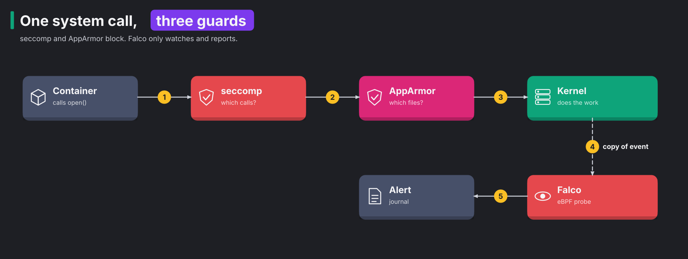
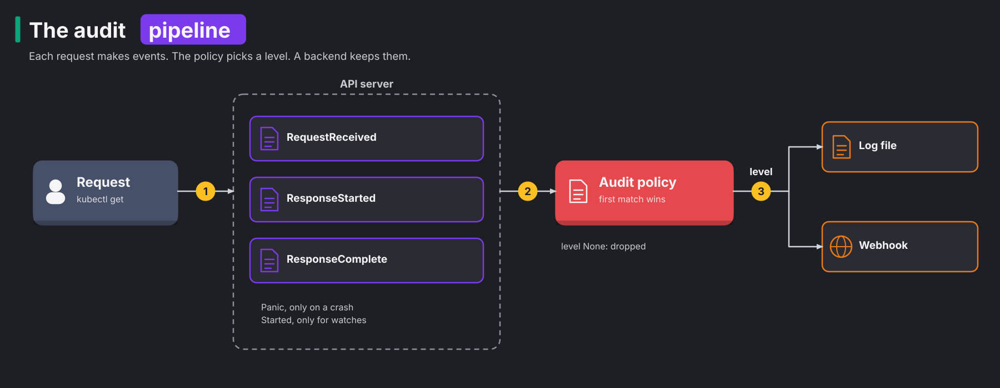
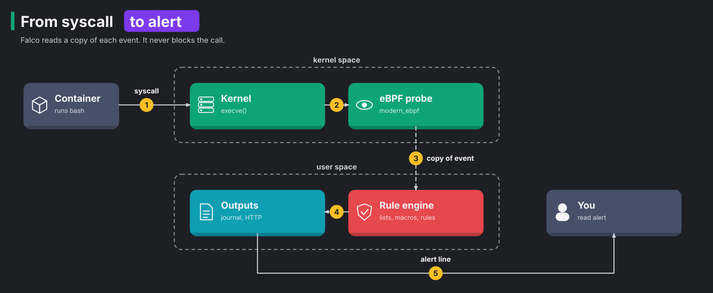

# CKS 06: Monitoring, logging and runtime security (20%)

> New to a term here, like audit policy or syscall? The [glossary](../../platform-engineering/glossary.md#cks-exam-track) explains every term this track uses.

**Before this domain:** the [practice cluster](../README.md#the-practice-cluster) running, ideally fresh from `./certs/cks/cluster/reset.sh`, and the [Lima VM](../README.md#the-lima-vm-for-apparmor-and-cilium) for tasks 5 and 12. The course's [module 10](../../platform-engineering/10-ebpf-and-cilium.md#concept-what-ebpf-is) explains eBPF, the technique Falco uses to watch the kernel.

The other domains try to keep attackers out. This one assumes somebody got in anyway. Then three questions matter: what did they do through the API, what are they doing inside the container right now, and how much damage does the container let them do. Audit logs answer the first, Falco the second, and immutable root file systems, seccomp and AppArmor limit the third. This domain has 13 tasks and takes about 2 hours.

## The domain in one table

The other domains try to keep attackers out. This one assumes somebody got in anyway. Then three questions matter, and each task answers one of them:

| Question | Tool | Task |
|---|---|---|
| What did they do through the API? | audit logs | 1, 10, 11 |
| What are they doing inside the container right now? | Falco | 2, 7, 8, 9 |
| How much damage does the container let them do? | read-only root, seccomp, AppArmor | 3, 4, 5, 12, 13 |
| What happened, from start to end? | audit log and Falco together | 6 |

## Concept: syscalls, the kernel boundary

Everything a container does that matters passes one border: the line between the process and the kernel. A **system call**, or syscall, is a request from a program to the kernel. Opening a file is `openat`, starting a program is `execve`, opening a connection is `connect`, changing a file's mode is `chmod`. A process has no other way to touch files, the network or other processes. The course's [module 10](../../platform-engineering/10-ebpf-and-cilium.md#concept-kernel-space-and-user-space) explains this line between user space and kernel space.

That border is the best place to defend, for two reasons:

1. Every action passes it, so a check there misses nothing, whatever language or tool the attacker uses.
2. Attackers need syscalls too. An exploit that breaks out of a container calls the kernel. A cryptominer opens connections. A shell starts with `execve`.

Three tools in this domain work at the border, each in its own way:



The diagram follows one `open()` call from a container:

1. The container's process makes the call.
2. **seccomp** checks the syscall's number against a filter and blocks the ones the profile forbids. It knows nothing about files or paths.
3. **AppArmor** checks the file path or capability against a profile and blocks what the profile denies.
4. The kernel does the work, and Falco's probe gets a copy of the event.
5. Falco matches a rule and writes an alert. It blocks nothing.

gVisor, from [domain 04](04-minimize-microservice-vulnerabilities.md#concept-sandboxes-a-second-kernel), sits in a different place. It answers the syscall itself, before the host kernel ever sees it. The four tools layer like this:

| Tool | Decides by | Action | Stops |
|---|---|---|---|
| seccomp | syscall number, sometimes its arguments | block | whole families of kernel features, such as `mount` or `kexec_load` |
| AppArmor | file path, capability, network access | block | writes to `/etc`, reads of keys, raw sockets |
| gVisor | everything, by answering it in user space | replace the kernel | kernel bugs from reaching the host |
| Falco | any field of the event | alert only | nothing, but it tells you |

**Prevention** blocks an action before it happens. **Detection** notices an action and reports it. Prevention needs you to know in advance what to forbid, and a wrong rule breaks the app. Detection tolerates surprises, but the action has already happened. A good setup uses both: prevention for the things you know an app never does, and detection for the rest.

## Concept: seccomp, a filter on syscalls

A typical web server needs a few dozen of the kernel's more than 300 syscalls. The rest are attack surface: each one is kernel code that a bug might hide in. **seccomp** (secure computing mode) is a kernel feature that attaches a filter to a process. The kernel runs the filter on every syscall the process makes, before the syscall does anything.

A seccomp profile is a JSON file with a default action and a list of syscalls with their own action:

| Action | Effect |
|---|---|
| `SCMP_ACT_ALLOW` | the syscall runs |
| `SCMP_ACT_ERRNO` | the syscall fails with an error, such as "Operation not permitted". The process keeps running |
| `SCMP_ACT_KILL_PROCESS` | the kernel kills the process |
| `SCMP_ACT_LOG` | the syscall runs, and the kernel logs it. Handy for learning what an app needs |

A pod picks a profile in `securityContext.seccompProfile`:

1. `RuntimeDefault` uses containerd's built-in profile, an allow list that leaves out dangerous syscalls such as `mount`, `reboot` and `kexec_load`. The `restricted` Pod Security level asks for it.
2. `Localhost` loads a profile from a file on the node, below the kubelet's seccomp folder `/var/lib/kubelet/seccomp/`. The pod names the path below that folder in `localhostProfile`.
3. `Unconfined` means no filter at all.

Without a setting, a pod runs `Unconfined`, unless the kubelet's `seccompDefault: true` makes `RuntimeDefault` the default.

**What this stops.** A seccomp profile stops a compromised process from reaching kernel code it never needed, which removes whole classes of container escapes before anybody finds the bug.

**Exam traps.** The profile file must exist on the node that runs the pod. With a wrong path, the pod hangs in `CreateContainerError`, and the test run's message named the full path it tried: `cannot load seccomp profile "/var/lib/kubelet/seccomp/profiles/missing.json"`. In task 4, the profile blocked `chmod`, so the container printed `chmod: /tmp/f: Operation not permitted` while writing the file still worked.

## Concept: AppArmor, a filter on paths

seccomp sees only syscall numbers. It says "no `openat` at all" or "`openat` is fine", but never "`openat` is fine except on `/etc/shadow`". **AppArmor** fills that gap. It's a Linux security module, a hook inside the kernel that checks each access against a **profile**: a text file of rules about paths, capabilities and network access.

```text
profile cks-deny-write flags=(attach_disconnected) {
  #include <abstractions/base>
  file,
  deny /** w,
}
```

That profile, from task 5, pulls in the basic rules every program needs, allows file access in general, and denies every write. A profile runs in one of two modes:

1. **Enforce** blocks what the rules deny and logs it.
2. **Complain** blocks nothing and only logs what enforce mode would block. Teams use it to learn what an app does before they enforce.

A profile works only once it's loaded into the kernel of the node that runs the pod. The sequence on the node is always the same:

```bash
apparmor_parser -Q /root/cks/cks-deny-write            # parse only: finds syntax errors, loads nothing
cp /root/cks/cks-deny-write /etc/apparmor.d/           # the boot-time folder, so it survives a reboot
apparmor_parser -r /etc/apparmor.d/cks-deny-write      # load it, or replace an older version
aa-status | grep cks-deny-write                        # listed under "profiles are in enforce mode"
```

A pod asks for a profile with `securityContext.appArmorProfile`. Its `type` is `RuntimeDefault` (the container runtime's default profile), `Localhost` (a profile loaded on the node, named in `localhostProfile`), or `Unconfined`. Before Kubernetes 1.30, an annotation did this job. The exam still shows old tasks with it, but write the field.

**What this stops.** An AppArmor profile stops a compromised process from writing where it shouldn't, reading keys it never needed, or using capabilities the profile denies, even when it runs as root inside the container.

**Exam traps.** The name in `localhostProfile` is the name after `profile` in the file, not the file name. When the pod names a profile the node hasn't loaded, the kubelet refuses to create the container: in the test run, the pod sat in `CreateContainerError` with `apparmor profile not found cks-nginx`. A Deployment's pods land on any node, so every node needs the profile. The OrbStack machines have no AppArmor, because their kernel lacks it: there the kubelet refuses every AppArmor pod with `Cannot enforce AppArmor: AppArmor is not enabled on the host`. So the AppArmor tasks run on the Lima VM.

## Concept: immutable containers

A container image is the whole truth about what should run. Yet by default, the container's root file system is writable. An attacker who gets a shell downloads tools into `/usr/bin`, changes a config file, or replaces a binary, and the change lives as long as the container.

An **immutable** container never changes after it starts. `readOnlyRootFilesystem: true` makes the container's root file system read-only, so there's nowhere to drop a tool or change a file. Most programs still need a few writable folders for caches, sockets and temporary files. Each gets an `emptyDir` volume, a scratch folder that lives as long as the pod. Change happens only by building and deploying a new image, which leaves a record.

**What this stops.** A read-only root stops an attacker from installing tools, planting a backdoor in a binary, or changing configuration at run time. It also makes every change visible, because any write outside the `emptyDir` folders fails.

**Exam traps.** nginx needs three writable folders: `/var/cache/nginx`, `/run` and `/tmp`. Without them, the test run's pod went into `CrashLoopBackOff` with `mkdir() "/var/cache/nginx/client_temp" failed (30: Read-only file system)`. A pod is immutable only when every container says `readOnlyRootFilesystem: true` and none is `privileged`. A privileged container remounts any file system it likes, so its read-only root protects nothing. Task 13 finds both cases.

## Concept: audit logs, the API's flight recorder

The API server handles every change to the cluster, so it's the one place that sees who did what. Without a record, an investigation after an incident has nothing to read. An **audit log** is that record. kubeadm leaves it off.



An event goes through three steps:

1. A request arrives, and the API server produces an event at each **stage** of its life.
2. The **audit policy** finds the first rule that matches the request and takes its level. Level `None` drops the event.
3. A **backend** writes the event: the log backend to a file, the webhook backend to an outside service.

The stages are `RequestReceived` (as soon as the request arrives), `ResponseStarted` (only for long-running requests such as a watch), `ResponseComplete` (when the answer is sent), and `Panic` (when the API server crashes on the request). `omitStages` in the policy drops stages you don't need, most often `RequestReceived`.

Each rule sets a level:

| Level | Records |
|---|---|
| `None` | nothing |
| `Metadata` | who, when, which verb on which object, the response code. No bodies |
| `Request` | metadata plus the object the client sent |
| `RequestResponse` | metadata plus both the request and the response bodies |

A rule matches on more than the resource. It also takes `users`, `userGroups`, `verbs`, `namespaces` and `nonResourceURLs`, and all the fields in one rule must match. So a single policy logs everything a suspicious user does at `RequestResponse`, drops the noisy `system:kube-proxy` watches with `None`, and logs pod creations at `Request`. Order still decides: a rule for Secrets at `Metadata` above the rule for that user keeps the user's Secret reads free of bodies.

The log backend writes one JSON object per line. Four flags control it: the policy file, the log path, and how many days, files and megabytes to keep. Both the policy and the log folder live on the node, so the API server pod needs two `hostPath` volumes, and the log one must be writable.

**What this stops.** An audit log doesn't block anything. It stops an attacker's API activity from going unseen, and it turns "somebody deleted the namespace" into a user name, a time and a source address.

**Exam traps.** Two habits keep the log useful. Put Secrets, ConfigMaps and TokenReviews at `Metadata` and near the top, because a body at `Request` or above would copy every password into a log file. And end with a catch-all rule, usually `- level: None` or `- level: Metadata`, so you decide what happens to everything else instead of leaving it to chance. The API server reads the policy only at start: in task 11, the restart took 42 seconds.

### Reading an audit log

Every line is one event, and each request produces up to four. Count the `ResponseComplete` lines, or each request counts twice. A few fields answer most questions:

| Question | Field |
|---|---|
| who | `user.username`, and `user.groups` |
| from which pod, for a service account token | `user.extra["authentication.kubernetes.io/pod-name"]` |
| did what | `verb`, `objectRef.resource`, `objectRef.namespace`, `objectRef.name` |
| with which tool | `userAgent` |
| did it work | `responseStatus.code` |

`grep` finds the candidate lines and `python3 -m json.tool` makes one readable. A list request has no `objectRef.name`, which tells it apart from a `get`.

## Concept: Falco, a camera on the kernel

seccomp and AppArmor block what you predicted. Attackers do things nobody predicted. **Falco** is a CNCF runtime security tool that watches every syscall on the node and reports the ones that match its rules. It works like a security camera: it records and raises the alarm, but it doesn't lock any door.



An alert takes five steps:

1. A process in a container makes a syscall, for example `execve` for `bash`.
2. Falco's **driver** in the kernel sees it. The driver is the part that collects events: the modern eBPF probe on the practice cluster, or an older eBPF probe or kernel module elsewhere.
3. The driver copies the event into a buffer that Falco reads in user space. Falco adds context: the process tree, the container, the pod and its namespace.
4. The rule engine compares the event with every rule.
5. A match produces an alert line, sent to the configured **outputs**: standard output, a file, syslog, a program or HTTP. Falcosidekick, a companion service, forwards alerts to chat, SIEMs and more.

Falco runs its rules after the syscall happened, in user space, so it never slows the syscall down and never stops it.

### Rules, lists and macros

A rule has a condition, an output and a priority:

```yaml
- rule: Shell in container (cks)
  desc: A shell runs inside a container
  condition: spawned_process and container and proc.name in (sh, bash, ash, dash)
  output: "shell in container (user=%user.name ns=%k8s.ns.name pod=%k8s.pod.name cmd=%proc.cmdline)"
  priority: WARNING
```

`spawned_process` and `container` are **macros**, named conditions from Falco's default rules. The `%` fields fill the output with details of the event. The **priority** is one of `EMERGENCY`, `ALERT`, `CRITICAL`, `ERROR`, `WARNING`, `NOTICE`, `INFORMATIONAL` and `DEBUG`, and Falco's `priority` setting drops alerts below a chosen level.

A rules file holds three kinds of items:

1. A **list** names a set of values: `- list: cks_pkg_mgrs` with `items: [apk, apt, dpkg]`.
2. A **macro** names a piece of condition: `- macro: cks_in_pod` with `condition: (container and k8s.ns.name exists)`.
3. A **rule** uses both: `condition: spawned_process and cks_in_pod and proc.name in (cks_pkg_mgrs)`.

Lists and macros keep long conditions readable, and a change to a list reaches every rule that uses it.

Falco loads `/etc/falco/falco_rules.yaml`, then `falco_rules.local.yaml`, then every file in `/etc/falco/rules.d/`. It watches those files and reloads by itself when one changes. Never edit `/etc/falco/falco_rules.yaml`. A package upgrade overwrites it, and `dpkg -V falco` shows that you touched it. Change a default rule from a file in `rules.d/` instead, with an `override` block:

```yaml
- rule: Read sensitive file untrusted
  priority: CRITICAL
  override:
    priority: replace

- rule: Terminal shell in container
  enabled: false
  override:
    enabled: replace
```

`replace` swaps the field's value. `append` adds to it, which suits a condition (`and not proc.name = backup`) or an output. Files in `rules.d/` load after the default file, so the override finds its rule.

On the practice cluster, Falco runs as the systemd service `falco-modern-bpf` on `cks-w1` and logs to the journal. `journalctl -u falco-modern-bpf` shows its alerts. Out of the box it already flags, among others, a read of `/etc/shadow` with `Sensitive file opened for reading by non-trusted program`.

**What this stops.** Falco stops attacks from going unnoticed: a shell in a production container, a package manager running at night, a process reading private keys. It turns minutes of attacker activity into an alert with a pod name.

**Exam traps.** Falco 0.45 adds container and Kubernetes fields to every alert by itself: `container_name=`, `k8s_pod_name=` and `k8s_ns_name=` appear at the end of each line, whatever the rule's own output says. That's how you find the pod behind a default rule's alert. The alert shows the rule's output text, not its name, so search the rules files for the text. Falco on OrbStack sees more than its own node, because every machine shares one kernel. In the test run, Falco on `cks-w1` reported `Log files were tampered` for a file on `cks-cp`, and alerted on commands typed into the `cks-cp` shell with `ns=<NA>`. Filter alerts by `ns=` or `k8s_pod_name=` to see only pods.

## Concept: investigating an attack

An attack moves through phases, and each phase leaves different traces:

1. Get in: an exploited app, a stolen token, a leaked kubeconfig.
2. Look around: list pods and Secrets, read files, scan the network.
3. Gain more rights: read a token with more power, start a privileged pod.
4. Reach the goal: steal data, run a miner, plant a backdoor.
5. Cover the tracks: delete logs, remove the pod.

The audit log shows the API side of each phase. Since 1.30, a service account token's audit entry also names the pod and node it came from, so an API call leads back to a pod. Falco shows what happened inside containers: the shell, the file reads, the downloads. Put the two side by side on one timeline, and you see the whole path.

The response follows a fixed order. First, contain: scale the Deployment to zero or isolate the pod with a deny-all NetworkPolicy, so the attacker stops. Then keep the evidence: copy the logs before anything rotates them. Then remove the cause and every credential the attacker touched.

**Exam traps.** Exam tasks usually ask for a name: who deleted a Secret and from which pod, or which pod hunts for keys. In task 6, the audit entry's `user.username` named the service account and `user.extra` named the pod. For a Falco alert, take the pod from `k8s_pod_name=`, then its owner with `k get pod -o jsonpath='{.metadata.ownerReferences}'`, because deleting a pod that a ReplicaSet owns only brings a fresh copy back.

## The bigger picture: assume breach

Security teams used to aim for a perfect wall. Today the common stance is **assume breach**: plan as if an attacker is already inside, and make sure you see them and limit them. This domain is that stance in practice:

1. Limit: read-only roots, seccomp and AppArmor shrink what a compromised container does.
2. See: Falco watches the kernel, and the audit log watches the API.
3. Respond: the investigation joins both records into one story.

Real platform teams ship audit logs and Falco alerts off the node to a central system, often a SIEM (security information and event management system), so an attacker who gets root on a node finds no evidence there to erase. They roll out seccomp and AppArmor in learning mode first (`SCMP_ACT_LOG`, complain mode), then enforce. And they tune Falco rules for weeks, because a tool that raises a hundred false alarms a day trains people to ignore it.

## Why this way

**Why both seccomp and AppArmor?** They see different things. seccomp sees which kernel feature a process asks for, and AppArmor sees which file or capability. A process that needs `openat` passes seccomp, and AppArmor still keeps it away from `/etc`.

**Why doesn't Falco block?** Falco reads a copy of each event in user space, after the kernel acted. Blocking would put a slow user-space program in the path of every syscall on the node. Falco leaves blocking to seccomp, AppArmor and admission, and does the one job they don't: noticing the unexpected.

**Why does the first matching audit rule win?** It makes the policy readable from the top. You read down until a rule matches, and that's the answer. Put the specific rules first and the catch-all last.

**Why log Secrets at Metadata and not at None?** You still want to know who read which Secret and when. You don't want the Secret's value in a log file that many more people read than the Secret itself.

## Task 1: Turn on audit logging

**Time budget:** 10 minutes. **Host:** `cks-cp`.

```bash
./certs/cks/task.sh setup 6.1
```

> Turn on audit logging in the API server:
>
> 1. The policy lives at `/etc/kubernetes/audit/policy.yaml`. It logs Secrets in every namespace at `Metadata`, everything in namespace `audit-me` at `RequestResponse`, and nothing else. Skip the `RequestReceived` stage.
> 2. The log goes to `/var/log/kubernetes/audit/audit.log`, kept 30 days, at most 10 old files of at most 100 MB each.

<details>
<summary>Solution</summary>

```yaml
apiVersion: audit.k8s.io/v1
kind: Policy
omitStages: [RequestReceived]
rules:
- level: Metadata
  resources:
  - group: ""
    resources: [secrets]
- level: RequestResponse
  namespaces: [audit-me]
- level: None
```

Order matters. The Secrets rule comes first, so a Secret in `audit-me` gets `Metadata`, not `RequestResponse` with its contents.

In the API server manifest, after a backup:

```yaml
    - --audit-policy-file=/etc/kubernetes/audit/policy.yaml
    - --audit-log-path=/var/log/kubernetes/audit/audit.log
    - --audit-log-maxage=30
    - --audit-log-maxbackup=10
    - --audit-log-maxsize=100
...
    volumeMounts:
    - mountPath: /etc/kubernetes/audit
      name: audit-policy
      readOnly: true
    - mountPath: /var/log/kubernetes/audit
      name: audit-log
      readOnly: false
...
  volumes:
  - hostPath:
      path: /etc/kubernetes/audit
      type: DirectoryOrCreate
    name: audit-policy
  - hostPath:
      path: /var/log/kubernetes/audit
      type: DirectoryOrCreate
    name: audit-log
```

When the API server is back, make a request and read the log:

```bash
k -n audit-me get secret token
tail -1 /var/log/kubernetes/audit/audit.log | python3 -m json.tool | head -20
```

</details>

```bash
./certs/cks/task.sh check 6.1
```

The check makes three requests and looks for each one in the log. In the test run, after the solution:

```
  PASS  --audit-policy-file is /etc/kubernetes/audit/policy.yaml
  PASS  --audit-log-path is /var/log/kubernetes/audit/audit.log
  PASS  --audit-log-maxage=30, maxbackup=10, maxsize=100
  PASS  a get on a Secret appears at level Metadata
  PASS  no Secret appears with its body
  PASS  a configmap create in audit-me appears at RequestResponse
  PASS  a configmap create in default does not appear
```

## Task 2: Catch a shell with Falco

**Time budget:** 8 minutes. **Host:** `cks-w1`.

```bash
./certs/cks/task.sh setup 6.2
```

> Write a Falco rule named `Shell in container (cks)` in `/etc/falco/rules.d/cks-shell.yaml`. It fires with priority `WARNING` whenever `sh`, `bash`, `ash` or `dash` starts in a container. Its output contains the namespace as `ns=<namespace>`, the pod as `pod=<pod>`, the user and the command line. Then open a shell in pod `target` in namespace `falco-test` and find the alert.

<details>
<summary>Solution</summary>

```yaml
- rule: Shell in container (cks)
  desc: A shell runs inside a container
  condition: spawned_process and container and proc.name in (sh, bash, ash, dash)
  output: "shell in container (time=%evt.time user=%user.name ns=%k8s.ns.name pod=%k8s.pod.name container=%container.name cmd=%proc.cmdline)"
  priority: WARNING
```

Save it, and Falco reloads by itself. Check the reload and fire the rule:

```bash
journalctl -u falco-modern-bpf -n 20 | grep cks-shell        # "schema validation: ok"
k -n falco-test exec target -- sh -c 'echo hello'             # on cks-cp
journalctl -u falco-modern-bpf --since -1min | grep 'ns=falco-test'
```

In the test run, the alert read:

```
Warning shell in container (time=00:27:32.006475786 user=root ns=falco-test pod=target container=target cmd=sh -c echo marker42)
```

Falco's documentation, which the exam allows, lists every field under "Supported Fields". When a task asks for a format such as `%evt.time,%user.name,%proc.name`, copy it into `output` exactly.

</details>

```bash
./certs/cks/task.sh check 6.2
```

```
  PASS  a rule named 'Shell in container (cks)' exists in /etc/falco/rules.d/
  PASS  falco accepts every rules file
  PASS  a shell in falco-test/target produces the alert with namespace, pod and command
```

## Task 3: Make a container immutable

**Time budget:** 6 minutes. **Host:** `cks-cp`.

```bash
./certs/cks/task.sh setup 6.3
```

> Deployment `web` in namespace `immutable` runs nginx. Make its container's root file system read-only. nginx must keep serving.

<details>
<summary>Solution</summary>

`k -n immutable edit deploy web`, and add to the pod template:

```yaml
      containers:
      - name: nginx
        securityContext:
          readOnlyRootFilesystem: true
        volumeMounts:
        - {name: cache, mountPath: /var/cache/nginx}
        - {name: run, mountPath: /run}
        - {name: tmp, mountPath: /tmp}
      volumes:
      - {name: cache, emptyDir: {}}
      - {name: run, emptyDir: {}}
      - {name: tmp, emptyDir: {}}
```

Without the volumes, nginx exits at start. In the test run, the pod went into `CrashLoopBackOff`, and its log said `mkdir() "/var/cache/nginx/client_temp" failed (30: Read-only file system)`. Prove both sides:

```bash
k -n immutable exec deploy/web -- touch /cks-was-here    # Read-only file system
k -n immutable run t --rm -i --restart=Never --image=busybox:1.36 -- wget -qO- http://web | head -4
```

</details>

```bash
./certs/cks/task.sh check 6.3
```

```
  PASS  container web has readOnlyRootFilesystem: true
  PASS  the Deployment's pod is Ready
  PASS  writing to / fails inside the pod
  PASS  nginx still serves on the Service
```

## Task 4: A seccomp profile

**Time budget:** 6 minutes. **Hosts:** `cks-w1`, then `cks-cp`.

```bash
./certs/cks/task.sh setup 6.4
```

> The seccomp profile `/root/cks/no-chmod.json` on `cks-w1` blocks the `chmod` family of syscalls. Install it where the kubelet finds it, as `profiles/no-chmod.json`. Then create pod `locked` in namespace `seccomp` on `cks-w1` with image `busybox:1.36` and command `sleep 1d`, using that profile.

<details>
<summary>Solution</summary>

On `cks-w1`:

```bash
mkdir -p /var/lib/kubelet/seccomp/profiles
cp /root/cks/no-chmod.json /var/lib/kubelet/seccomp/profiles/
```

On `cks-cp`:

```yaml
apiVersion: v1
kind: Pod
metadata:
  name: locked
  namespace: seccomp
spec:
  nodeName: cks-w1
  securityContext:
    seccompProfile:
      type: Localhost
      localhostProfile: profiles/no-chmod.json
  containers:
  - name: c
    image: busybox:1.36
    command: [sleep, 1d]
```

```bash
k -n seccomp exec locked -- sh -c 'touch /tmp/f && chmod 600 /tmp/f'
```

In the test run, that printed `chmod: /tmp/f: Operation not permitted`, while writing the file worked. The path in `localhostProfile` is relative to `/var/lib/kubelet/seccomp/`. With a wrong path, the pod hangs in `CreateContainerError`, and the test run's message named the full path it tried: `cannot load seccomp profile "/var/lib/kubelet/seccomp/profiles/missing.json": open ...: no such file or directory`.

</details>

```bash
./certs/cks/task.sh check 6.4
```

```
  PASS  the kubelet finds the profile at /var/lib/kubelet/seccomp/profiles/no-chmod.json
  PASS  pod locked in seccomp uses the Localhost profile profiles/no-chmod.json
  PASS  pod locked runs on cks-w1
  PASS  chmod fails inside pod locked
  PASS  other writes still work inside pod locked
```

## Task 5: An AppArmor profile

**Time budget:** 7 minutes. **Host:** `cks-lima`.

```bash
./certs/cks/cluster/lima.sh start      # once, when the VM is off
./certs/cks/task.sh setup 6.5
```

The setup writes a profile with a mistake and shows the parser's complaint. In the test run: `syntax error, unexpected TOK_DENY, expecting TOK_ID or TOK_MODE or TOK_SET_VAR`.

> On `cks-lima`:
>
> 1. Fix `/root/cks/cks-deny-write` so `apparmor_parser` accepts it. It must still deny every write.
> 2. Load the profile into the kernel, so that it also loads after a reboot.
> 3. Create pod `writer` in namespace `apparmor`, image `busybox:1.36`, command `sh -c "echo hi > /tmp/x; sleep 1d"`, with its container confined by the profile `cks-deny-write`.

<details>
<summary>Solution</summary>

The parser points at line 6: the `file` rule above it lacks its comma. Every rule in an AppArmor profile ends with one.

```
profile cks-deny-write flags=(attach_disconnected) {
  #include <abstractions/base>
  file,
  deny /** w,
}
```

Then load it the way the theory shows:

```bash
apparmor_parser -Q /root/cks/cks-deny-write && echo parses
cp /root/cks/cks-deny-write /etc/apparmor.d/
apparmor_parser -r /etc/apparmor.d/cks-deny-write
aa-status | grep cks-deny-write
```

The pod:

```yaml
apiVersion: v1
kind: Pod
metadata:
  name: writer
  namespace: apparmor
spec:
  containers:
  - name: c
    image: busybox:1.36
    command: [sh, -c, "echo hi > /tmp/x; sleep 1d"]
    securityContext:
      appArmorProfile:
        type: Localhost
        localhostProfile: cks-deny-write
```

```bash
k -n apparmor logs writer
k -n apparmor exec writer -- cat /proc/1/attr/current
```

In the test run, the log said `sh: can't create /tmp/x: Permission denied`, and the process's AppArmor label read `cks-deny-write (enforce)`. The name in `localhostProfile` is the name after `profile` in the file, not the file name. Here both are `cks-deny-write`. Before Kubernetes 1.30, the annotation `container.apparmor.security.beta.kubernetes.io/<container>: localhost/<profile>` did this job. Old exam tasks still show it; write the field.

</details>

```bash
./certs/cks/task.sh check 6.5
```

In the test run, every check failed before the solution:

```
  PASS  the profile in /root/cks/cks-deny-write parses and still denies every write
  PASS  profile cks-deny-write is loaded in enforce mode
  PASS  pod writer asks for the Localhost profile cks-deny-write
  PASS  pod writer runs, confined by the profile
  PASS  the write to /tmp/x was denied
```

## Task 6: Investigate an attack

**Time budget:** 8 minutes. **Host:** `cks-cp`.

```bash
./certs/cks/task.sh setup 6.6
```

The setup needs audit logging. When task 1 isn't done, it applies task 1's solution first.

> Somebody deleted Secret `prod-db` in namespace `team-x`. Two service accounts there, `ci-bot` and `docs-bot`, may delete Secrets.
>
> 1. Use the audit log to find who deleted it, and from which pod. Write `<username> <pod name>` on one line to `/root/cks/culprit.txt`.
> 2. Remove the RoleBinding that gave that account the right. Leave the other account alone.

<details>
<summary>Solution</summary>

```bash
grep '"verb":"delete"' /var/log/kubernetes/audit/audit.log | grep '"name":"prod-db"' | tail -1 | python3 -m json.tool
```

The entry in the test run, shortened:

```json
    "verb": "delete",
    "user": {
        "username": "system:serviceaccount:team-x:ci-bot",
        "extra": {
            "authentication.kubernetes.io/node-name": ["cks-w1"],
            "authentication.kubernetes.io/pod-name": ["nightly-cleanup"]
        }
    },
    "sourceIPs": ["192.168.139.60"],
    "userAgent": "curl/8.11.1",
```

The pod no longer exists, but its token carried the pod's name, so the log keeps it. The source IP is the node's, not the pod's, because the request left the pod through the node.

```bash
echo "system:serviceaccount:team-x:ci-bot nightly-cleanup" > /root/cks/culprit.txt
k -n team-x get rolebinding -o wide | grep ci-bot
k -n team-x delete rolebinding ci-bot-secrets
k auth can-i delete secrets -n team-x --as=system:serviceaccount:team-x:ci-bot    # no
```

`userAgent: curl/8.11.1` is a clue in a real investigation: kubectl and controllers identify themselves differently, so a curl call with a service account token points to a person or a script inside a pod.

</details>

```bash
./certs/cks/task.sh check 6.6
```

```
  PASS  /root/cks/culprit.txt names the ServiceAccount and the pod
  PASS  RoleBinding ci-bot-secrets is gone
  PASS  docs-bot keeps its RoleBinding
  PASS  ci-bot may no longer delete Secrets in team-x
```

## Task 7: A Falco rule with a list and a macro

**Time budget:** 8 minutes. **Host:** `cks-w1`.

```bash
./certs/cks/task.sh setup 6.7
```

> Create `/etc/falco/rules.d/cks-pkg.yaml` on `cks-w1` with:
>
> 1. A list `cks_pkg_mgrs` with `apk`, `apt`, `apt-get`, `dpkg` and `pip`.
> 2. A macro `cks_in_pod` that is true for processes in a container that belongs to a Kubernetes pod.
> 3. A rule `Package manager in pod` with priority `ERROR` that fires when a process from the list starts in a pod. Its output is exactly `package manager in pod (ns=%k8s.ns.name pod=%k8s.pod.name proc=%proc.name)`.

<details>
<summary>Solution</summary>

```yaml
- list: cks_pkg_mgrs
  items: [apk, apt, apt-get, dpkg, pip]

- macro: cks_in_pod
  condition: (container and k8s.ns.name exists)

- rule: Package manager in pod
  desc: A package manager runs inside a Kubernetes pod
  condition: spawned_process and cks_in_pod and proc.name in (cks_pkg_mgrs)
  output: "package manager in pod (ns=%k8s.ns.name pod=%k8s.pod.name proc=%proc.name)"
  priority: ERROR
```

Falco reloads by itself. Check the reload, then fire the rule from `cks-cp`:

```bash
journalctl -u falco-modern-bpf -n 20 | grep cks-pkg         # "schema validation: ok"
k -n falco-test exec target -- apk --version                # on cks-cp
journalctl -u falco-modern-bpf --since -1min | grep 'package manager'
```

In the test run, the alert read:

```
Error package manager in pod (ns=falco-test pod=target proc=apk) container_id=56b5fdcd4371 container_name=target container_image_repository=docker.io/library/nginx container_image_tag=1.27-alpine k8s_pod_name=target k8s_ns_name=falco-test
```

Everything after the closing bracket is the part Falco 0.45 appends by itself. `falco -V <file>` validates a rules file without starting a second Falco.

</details>

```bash
./certs/cks/task.sh check 6.7
```

```
  PASS  /etc/falco/rules.d/cks-pkg.yaml defines the list cks_pkg_mgrs with apk, apt, apt-get, dpkg and pip
  PASS  /etc/falco/rules.d/cks-pkg.yaml defines the macro cks_in_pod, and the rule uses the macro and the list
  PASS  falco accepts the rules
  PASS  apk in falco-test/target raises an Error alert with ns, pod and process
```

## Task 8: Change what a default Falco rule does

**Time budget:** 6 minutes. **Host:** `cks-w1`.

```bash
./certs/cks/task.sh setup 6.8
```

> On `cks-w1`, without editing `/etc/falco/falco_rules.yaml`:
>
> 1. Raise the priority of the rule `Read sensitive file untrusted` to `CRITICAL`.
> 2. Turn off the rule `Terminal shell in container`.

<details>
<summary>Solution</summary>

Write the overrides from the theory into `/etc/falco/rules.d/cks-override.yaml`:

```yaml
- rule: Read sensitive file untrusted
  priority: CRITICAL
  override:
    priority: replace

- rule: Terminal shell in container
  enabled: false
  override:
    enabled: replace
```

Test from `cks-cp`. A shell "with a terminal" needs `-t`:

```bash
k -n falco-test exec target -- cat /etc/shadow > /dev/null
k -n falco-test exec -it target -- sh -c 'echo hi'
```

On `cks-w1`, `journalctl -u falco-modern-bpf --since -1min` showed this in the test run, and no line about a terminal shell:

```
Critical Sensitive file opened for reading by non-trusted program | file=/etc/shadow ... command=cat /etc/shadow ...
```

The rule's name and its output text differ. Find a rule by name with `grep -n 'rule: Read sensitive file untrusted' /etc/falco/falco_rules.yaml`, and an alert by its text.

</details>

```bash
./certs/cks/task.sh check 6.8
```

```
  PASS  /etc/falco/falco_rules.yaml is unchanged
  PASS  reading /etc/shadow in falco-test/target raises a Critical alert
  PASS  a shell with a terminal in falco-test/target raises no alert
```

## Task 9: Which pod hunts for keys?

**Time budget:** 6 minutes. **Hosts:** `cks-w1`, then `cks-cp`.

```bash
./certs/cks/task.sh setup 6.9
```

> One of the three Deployments in namespace `shop-runtime` searches the file system for private keys, and a default Falco rule catches it. Write two lines to `/root/cks/falco-finding.txt` on `cks-cp`: the name of the Falco rule, then `<namespace>/<deployment>`. Then delete that Deployment.

<details>
<summary>Solution</summary>

On `cks-w1`, filter the alerts by namespace:

```bash
journalctl -u falco-modern-bpf --since -5min | grep 'k8s_ns_name=shop-runtime' | tail -1
```

In the test run, the line began `Warning Grep private keys or passwords activities found | ... process=find ... command=find / -name id_rsa` and ended with `k8s_pod_name=inventory-fcc7f88...`. The alert shows the rule's output text, not its name. Find the name from the text:

```bash
grep -B20 'Grep private keys or passwords activities found' /etc/falco/falco_rules.yaml | grep 'rule:' | tail -1
```

That prints `- rule: Search Private Keys or Passwords`. On `cks-cp`, the pod's `app` label names its Deployment:

```bash
k -n shop-runtime get pod <pod> --show-labels
printf 'Search Private Keys or Passwords\nshop-runtime/inventory\n' > /root/cks/falco-finding.txt
k -n shop-runtime delete deploy inventory
```

</details>

```bash
./certs/cks/task.sh check 6.9
```

```
  PASS  /root/cks/falco-finding.txt holds the rule name and shop-runtime/inventory
  PASS  Deployment inventory is gone
  PASS  Deployments cart and reports still run
```

## Task 10: Read the audit log like a detective

**Time budget:** 8 minutes. **Host:** `cks-cp`.

```bash
./certs/cks/task.sh setup 6.10
```

The setup needs audit logging. When task 1 isn't done, it applies task 1's solution first. Then three users, `alice`, `bob` and `carol`, work in namespace `hr` with client certificates.

> Use the audit log `/var/log/kubernetes/audit/audit.log` to answer three questions. Write one answer per line to `/root/cks/audit-answers.txt`:
>
> 1. Which user read Secret `salaries` in `hr`?
> 2. Which user deleted Secret `old-salaries` in `hr`?
> 3. How many times did `carol` list the Secrets in `hr`?
>
> Then take away the right to delete Secrets in `hr` from the user who deleted one. Leave the other two alone.

<details>
<summary>Solution</summary>

Search for each question, and count only the `ResponseComplete` stage:

```bash
L=/var/log/kubernetes/audit/audit.log
grep '"name":"salaries"' $L | grep '"verb":"get"' | grep ResponseComplete | python3 -m json.tool | grep username
grep '"name":"old-salaries"' $L | grep '"verb":"delete"' | grep ResponseComplete | grep -o '"username":"[^"]*"'
grep '"verb":"list"' $L | grep '"resource":"secrets","namespace":"hr"' | grep '"username":"carol"' | grep -c ResponseComplete
```

In the test run, the answers were `alice`, `bob` and `2`. Task 1's policy logs Secrets at `Metadata`, so each line names the user and the object but holds no Secret data.

```bash
printf 'alice\nbob\n2\n' > /root/cks/audit-answers.txt
k -n hr get rolebinding -o wide | grep bob
k -n hr delete rolebinding bob-secrets
```

`grep` on a JSON line depends on the order of its fields, so test each pattern against one line first. When a pattern finds nothing, fall back to `python3`.

</details>

```bash
./certs/cks/task.sh check 6.10
```

```
  PASS  line 1 of /root/cks/audit-answers.txt: alice read salaries
  PASS  line 2: bob deleted old-salaries
  PASS  line 3: carol listed the Secrets 2 times
  PASS  bob may no longer delete Secrets in hr, alice and carol keep their rights
```

## Task 11: An audit policy per user and per resource

**Time budget:** 8 minutes. **Host:** `cks-cp`.

```bash
./certs/cks/task.sh setup 6.11
```

> Replace the audit policy `/etc/kubernetes/audit/policy.yaml`, keeping the API server's audit flags:
>
> 1. Log nothing from the user `system:kube-proxy`, and nothing about `events`.
> 2. Log Secrets and ConfigMaps at `Metadata`, for everybody.
> 3. Log everything else the user `alice` does at `RequestResponse`.
> 4. Log pod creations and deletions at `Request`.
> 5. Log nothing else. Skip the `RequestReceived` stage.

<details>
<summary>Solution</summary>

The order of the task is the order of the rules, because the first match wins:

```yaml
apiVersion: audit.k8s.io/v1
kind: Policy
omitStages: [RequestReceived]
rules:
- level: None
  users: ["system:kube-proxy"]
- level: None
  resources:
  - group: ""
    resources: [events]
- level: Metadata
  resources:
  - group: ""
    resources: [secrets, configmaps]
- level: RequestResponse
  users: [alice]
- level: Request
  verbs: [create, delete]
  resources:
  - group: ""
    resources: [pods]
- level: None
```

The API server reads the policy only at start, and the manifest doesn't change, so restart it by moving the manifest out and back, as in [04, task 5](04-minimize-microservice-vulnerabilities.md#task-5-rotate-the-encryption-key). In the test run, that took 42 seconds. Then make traffic and read the newest lines:

```bash
k -n audit-11 run p1 --image=busybox:1.36 -- sleep 1
tail -3 /var/log/kubernetes/audit/audit.log | grep -o '"level":"[A-Za-z]*","auditID[^,]*,"stage":"[A-Za-z]*","requestURI":"[^"]*","verb":"[a-z]*"'
```

</details>

```bash
./certs/cks/task.sh check 6.11
```

The check makes requests as `alice` and as the admin, then looks for each one. In the test run, it failed three of six items before the solution:

```
  PASS  alice's get on a Secret appears at Metadata
  PASS  alice's Deployment create appears at RequestResponse
  PASS  an admin's pod create appears at Request
  PASS  an admin's pod get does not appear
  PASS  a ConfigMap create appears at Metadata
  PASS  events appear nowhere in the log since the change
```

## Task 12: AppArmor for a Deployment

**Time budget:** 6 minutes. **Host:** `cks-lima`.

```bash
./certs/cks/task.sh setup 6.12
```

The setup shows the Deployment's pod and its error. In the test run: `CreateContainerError` and `failed to generate apparmor spec opts: apparmor profile not found cks-nginx`.

> Deployment `web` in namespace `aa-web` asks for the AppArmor profile `cks-nginx`, and its pod doesn't start. The profile file is `/etc/apparmor.d/cks-nginx` on `cks-lima`. Make the Deployment run confined by that profile.

<details>
<summary>Solution</summary>

The file exists, but nothing loaded it into the kernel:

```bash
aa-status | grep cks-nginx || echo not loaded
apparmor_parser -r /etc/apparmor.d/cks-nginx
aa-status | grep cks-nginx
k -n aa-web rollout restart deploy web
k -n aa-web rollout status deploy web
```

The profile allows nginx everything except writes below `/usr/share/nginx/html`. Prove both sides:

```bash
k -n aa-web exec deploy/web -- sh -c 'echo x > /usr/share/nginx/html/index.html'    # Permission denied
k -n aa-web exec deploy/web -- wget -qO- http://127.0.0.1 | head -4                  # the nginx page
```

A process started with `kubectl exec` runs under the container's profile too, which is why the first command fails. The kubelet retries a failed container with a growing delay, so `rollout restart` gets a new pod at once instead of waiting.

</details>

```bash
./certs/cks/task.sh check 6.12
```

```
  PASS  profile cks-nginx is loaded in enforce mode
  PASS  Deployment web has a ready pod
  PASS  a write below /usr/share/nginx/html fails with Permission denied
  PASS  a write to /tmp still works, and nginx serves
```

## Task 13: Pods that are not immutable

**Time budget:** 5 minutes. **Host:** `cks-cp`.

```bash
./certs/cks/task.sh setup 6.13
```

> Namespace `immutable-check` runs five pods. Delete every pod in which some container may write to its root file system, or runs privileged. Leave the others running.

<details>
<summary>Solution</summary>

Print each container's two settings, one line per pod:

```bash
k -n immutable-check get pods -o jsonpath='{range .items[*]}{.metadata.name}{": ro="}{.spec.containers[*].securityContext.readOnlyRootFilesystem}{" priv="}{.spec.containers[*].securityContext.privileged}{"\n"}{end}'
```

A pod is immutable only when every container says `ro=true` and none says `priv=true`. In the test run, three pods failed that test: `writable` (no setting), `half-frozen` (one of its two containers has no setting) and `frozen-but-privileged`. A privileged container remounts any file system it likes, so its read-only root protects nothing.

```bash
k -n immutable-check delete pod writable half-frozen frozen-but-privileged
```

</details>

```bash
./certs/cks/task.sh check 6.13
```

```
  PASS  writable, half-frozen and frozen-but-privileged are gone
  PASS  frozen and frozen-too still run
```

## Clean up

Tasks 1, 10 and 11 changed the API server, and tasks 2, 4, 7 and 8 left files on `cks-w1`. `./certs/cks/cluster/reset.sh` removes all of it, including the Falco rules. Tasks 5 and 12 loaded AppArmor profiles on `cks-lima`; `./certs/cks/cluster/lima.sh reset` unloads and deletes them.
