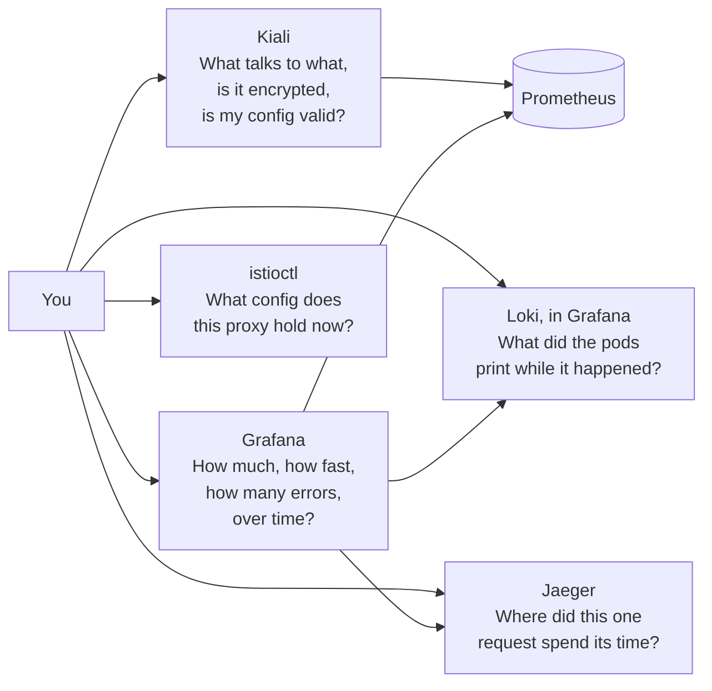

# Module 0: setup

Check that the lab works, install `istioctl`, and learn where each tool fits. Takes 15 minutes.

## Check the lab

```bash
./scripts/start.sh               # safe to run any time, repairs the cluster after a reboot
kubectl config current-context   # k3d-k8s-lab
kubectl -n argocd get applications
```

All ten Applications should show `Synced` and `Healthy`. Then open the UIs in a spare terminal and leave it running:

```bash
./scripts/port-forward.sh
```

The [course README](README.md#before-you-start) lists every UI. One tip: keep Headlamp (http://localhost:4466) open in a tab. It shows every pod, its logs and its events in one place, and it needs no login.

## Install istioctl

`istioctl` is to Istio what `kubectl` is to Kubernetes: it reads the mesh's state and explains it. Install it with Homebrew on macOS, or from the [Istio releases page](https://github.com/istio/istio/releases) on Linux.

```bash
brew install istioctl
istioctl version
```

**What you should see.**

```text
client version: 1.32.0
control plane version: 1.24.2
data plane version: 1.24.2 (3 proxies)
```

The client can be newer than the control plane. Every command in this course was tested with client 1.32 against control plane 1.24. If a command fails with an unknown field error, install the matching client from the releases page.

The "3 proxies" are the Envoy proxies istiod knows about: the ingress gateway, the waypoint and ztunnel. The shop's own pods are not in the count. Module 1 explains why.

## The tools and what each one answers



Kiali and Grafana read the same Prometheus data. Kiali turns it into a live map of the mesh. Grafana turns it into graphs over time. Use Kiali to find which edge is broken, then Grafana to see since when and how badly.

## Learn Kiali in five minutes

Start some traffic, then open http://localhost:20001:

```bash
./course/load.sh 300
```

1. **Overview** lists namespaces with a health badge. Click `shop`.
2. **Traffic Graph** draws the services and the calls between them. Choose namespace `shop` and `shop-ingress`, then set Display to show "Traffic Animation" and "Security". A padlock on an edge means mTLS.
3. **Applications**, **Workloads**, **Services** list the same pods from three angles, each with metrics, traces and logs tabs.
4. **Istio Config** lists every Istio resource and flags invalid ones with a red icon.

Kiali is read-only in this course. You make every change with `kubectl` so it stays in your shell history.

## What the verification run showed

`./course/verify.sh` replays every module against the lab. Run it whenever you change the lab, and after this course to check your own work. The summary of the last run is at the end of [the course README](README.md#check-that-the-course-works).
