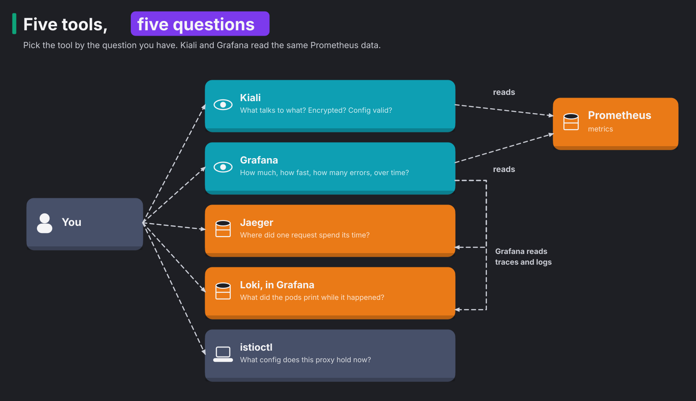

# Module 0: setup

> Haven't read [Start here: Istio in one picture](start-here.md) yet? Do that first. New to a term, like VirtualService or waypoint? The [glossary](glossary.md) explains every Istio resource and term in this course.

**Before this module:** none. Read [Istio in one picture](start-here.md) first.

In this module you check that the lab works, install `istioctl`, and learn where each tool fits. It takes 15 minutes.

## Check the lab

```bash
./scripts/start.sh               # safe to run any time, repairs the cluster after a reboot
kubectl config current-context   # k3d-k8s-lab
kubectl -n argocd get applications
```

All twelve Applications should show `Synced` and `Healthy`. Then open the UIs in a spare terminal and leave it running:

```bash
./scripts/port-forward.sh
```

The [course README](README.md#before-you-start) lists every UI. One tip: keep Headlamp (http://localhost:4466) open in a tab. It shows every pod, its logs and its events in one place, and it needs no login.

## Install istioctl

`istioctl` is to Istio what `kubectl` is to Kubernetes. It reads the mesh's state and explains it. Install it with Homebrew on macOS, or from the [Istio releases page](https://github.com/istio/istio/releases) on Linux.

```bash
brew install istioctl
istioctl version
```

### On Linux and WSL (Ubuntu 24.04)

Homebrew is macOS only. Download the release that matches the control plane instead:

```bash
ARCH=$(dpkg --print-architecture)
curl -fsSL "https://github.com/istio/istio/releases/download/1.24.2/istioctl-1.24.2-linux-$ARCH.tar.gz" | tar xz
sudo install istioctl /usr/local/bin/ && rm istioctl
istioctl version
```

Your client then reports 1.24.2, the same as the control plane. [Running the lab on Linux and WSL2](../docs/linux-and-wsl.md) covers the rest of the setup, WSL2 memory and the few commands that differ.

**What you should see.**

```text
client version: 1.32.0
control plane version: 1.24.2
data plane version: 1.24.2 (3 proxies)
```

It's fine for the client to be newer than the control plane. Every command in this course ran with client 1.32 against control plane 1.24. If a command fails with an unknown field error, install the matching client from the releases page.

The "3 proxies" line counts the proxies that take orders from istiod, the Istio control plane:

- the ingress gateway, which is an Envoy proxy
- the waypoint, which is also an Envoy proxy
- ztunnel, which is a separate program written in Rust, not Envoy

The shop's own pods are not in the count. Module 1 explains why.

If you see more than 3, something from a later module is still running. Module 7's two sidecar pods, for example, add 2 more, so you'd see 5. To get back to the starting point, run:

```bash
./course/reset.sh --all
```

Plain `./course/reset.sh` keeps the module 7 namespaces, so you may return to that module later. `--all` removes them too.

The three version lines come from three places:

1. `istioctl` prints its own version.
2. It asks istiod for the control plane version.
3. It asks istiod which proxies it sends configuration to right now.

This third line is useful when something breaks. A proxy that lost its connection to istiod drops out of the count. So a number lower than you expect is a first clue that a proxy no longer gets its configuration.

## The tools and what each one answers



Kiali and Grafana read the same Prometheus data. Kiali turns it into a live map of the mesh. Grafana turns it into graphs over time. Use Kiali to find which edge, the arrow between two services, is broken. Then use Grafana to see since when and how badly.

## Learn Kiali in five minutes

Start some traffic, then open http://localhost:20001:

```bash
./course/load.sh 300
```

1. **Overview** lists namespaces with a health badge. Click `shop`.
2. **Traffic Graph** draws the services and the calls between them. Choose namespace `shop` and `shop-ingress`, then set Display to show "Traffic Animation" and "Security". A padlock on an edge means mTLS.
3. **Applications**, **Workloads** and **Services** list the same pods from three angles. Each view has tabs for metrics, traces and logs.
4. **Istio Config** lists every Istio resource and flags invalid ones with a red icon.

Kiali is read-only in this course. You make every change with `kubectl` so it stays in your shell history.

## What the verification run showed

`./course/verify.sh` replays every module against the lab. Run it whenever you change the lab. Run it again after this course to check your own work. The summary of the last run is at the end of [the course README](README.md#check-that-the-course-works).
