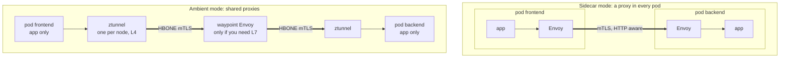

# Module 1: what a mesh adds

> New to a term here, like VirtualService or waypoint? The [glossary](glossary.md) explains every Istio resource and term in this course.

You know how Kubernetes moves a packet from one pod to another. This module shows what that path leaves out, and the two ways Istio fills the gap.

## Concept: what Kubernetes networking does not do

When the frontend calls `http://backend:8000`, Kubernetes does three things:

1. CoreDNS resolves `backend` to the Service's ClusterIP.
2. kube-proxy (iptables or IPVS rules on the node) rewrites the ClusterIP to one pod IP, chosen at random.
3. The CNI plugin (flannel in this lab) delivers the packet to that pod.

That is all. Kubernetes networking works at layer 3 and 4: addresses and ports. It does not know:

| Question | Why Kubernetes cannot answer it |
|---|---|
| Who is calling? | A source IP is not an identity. Pods are recreated with new IPs, and many pods share a node's IP after SNAT. |
| Is the traffic encrypted? | The CNI moves packets. Encryption is the application's problem. |
| Should this caller be allowed? | NetworkPolicy matches IPs, namespaces and labels. It cannot say "only the frontend's GET /api/orders". |
| Send 10% to v2 | A Service picks pods at random. The only way to get 10% is to run 1 v2 pod for every 9 v1 pods. |
| Retry, time out, break the circuit | Every application has to implement it, in every language. |
| How many requests failed, how slow were they? | kube-proxy counts nothing per request. |

A service mesh puts a proxy in the traffic path that understands identities and HTTP, so all of that happens outside the application code.

## Concept: two ways to put a proxy in the path



**Sidecar mode** injects an Envoy container into every pod. Envoy handles both layers: mTLS (layer 4) and HTTP features (layer 7).

**Ambient mode** splits the two layers:

- **ztunnel** is a small Rust proxy that runs once per node as a DaemonSet. It gives every pod on its node an identity, encrypts traffic and enforces layer 4 rules. It never parses HTTP.
- **A waypoint** is an Envoy proxy you deploy only for the Services that need HTTP features. In this lab only the backend has one.

## Why this way

**Why split L4 and L7?** Most of what a mesh is used for is encryption and identity. That needs no HTTP parsing, and a TCP proxy written for that one job is small and fast. HTTP parsing is expensive and needed by few services. Sidecar mode pays the full Envoy cost in every pod. Ambient mode pays it once per waypoint. In this lab ztunnel uses about 13 MiB for the whole node, and the waypoint about 40 to 50 MiB. Module 7 measures a sidecar for comparison.

**Why not do L7 in ztunnel too?** Then every node would run a full HTTP proxy for every pod on it, and one tenant's heavy traffic would slow everyone's on that node. A waypoint is scoped to a namespace or a Service, so you size and scale it like any other Deployment.

**Why do pods not need a restart to join?** Sidecars are added by a mutating admission webhook, which only runs when a pod is created. In ambient mode the `istio-cni` agent watches for the namespace label and moves the redirect rules into running pods' network namespaces. Module 2 shows this live.

**Why does ambient still use Envoy at all?** The waypoint is Envoy because Envoy already has the HTTP features: routing, retries, faults, outlier detection, telemetry. Istio reuses it where those features are needed.

## The bigger picture: why meshes exist

Picture a company around 2012. It breaks one big application into fifty small services. Suddenly every service talks to ten others over the network, and the network fails in ways a function call never did. Calls hang. Servers die halfway through a response. One slow service drags down everything that depends on it.

The first answer came as libraries. Twitter wrote Finagle, and Netflix wrote Hystrix and Ribbon. Each library handled retries, timeouts and load balancing inside the application. They worked well, with one catch: each one served a single language. A Python team got nothing from a Java library, and every fix meant rebuilding and redeploying every service.

So people moved that logic out of the application and into a proxy next to it. Lyft open-sourced Envoy in 2016 for exactly this job. In 2017 Google, IBM and Lyft launched Istio to manage whole fleets of those proxies. The app stays ignorant of the network, and the proxy speaks for it. That idea is the service mesh.

Every mesh has two halves, and the split matters for everything that follows:

- The **data plane** touches your traffic: ztunnel, waypoints and sidecars. If it stops, requests stop.
- The **control plane** only gives orders. That's istiod. It watches the Kubernetes API, turns your YAML into proxy configuration and pushes it out over xDS, Envoy's configuration protocol. It also signs certificates. If istiod dies for a minute, traffic keeps flowing with the last configuration the proxies received. Nothing new reaches them until istiod returns.

You know this pattern already. The API server and the kubelet split their work the same way: one side decides, the other side does the work.

Ambient mode arrived much later. Istio announced it in September 2022, after years of users complaining about the cost of sidecars, and declared it stable in Istio 1.24 in November 2024. That's the version this lab runs. Older blog posts show sidecars everywhere. Most of their ideas still apply; only the plumbing differs.

## Do it: see the data plane

**1. Count the containers in a shop pod.**

```bash
kubectl -n shop get pods -l app=backend -o jsonpath='{.items[0].spec.containers[*].name}{"\n"}'
```

You should see `backend`, only. There is no sidecar.

**2. See which pods ztunnel has taken over.**

```bash
istioctl ztunnel-config workloads | grep -E "NAMESPACE|shop"
```

```text
NAMESPACE  POD NAME                     ADDRESS     NODE                  WAYPOINT  PROTOCOL
shop       backend-v1-...               10.42.0.34  k3d-k8s-lab-server-0  None      HBONE
shop       frontend-...                 10.42.0.13  k3d-k8s-lab-server-0  None      HBONE
```

`HBONE` means ztunnel handles this pod's traffic. A pod outside the mesh shows `TCP`.

**3. See which Services use the waypoint.**

```bash
istioctl ztunnel-config services | grep -E "NAMESPACE|shop"
```

`backend`, `backend-v1` and `backend-v2` show `waypoint` in the WAYPOINT column. `frontend` and `redis` show `None`, because only the backend needs HTTP features.

The label that does it:

```bash
kubectl -n shop get svc backend --show-labels
```

`istio.io/use-waypoint=waypoint` sends this Service's traffic through the Gateway named `waypoint`.

**4. See the proxy in the response.**

```bash
curl -sD - -o /dev/null http://localhost:8080/api/version | grep -iE "server|x-envoy"
```

`server: istio-envoy` and `x-envoy-upstream-service-time` come from the ingress gateway's Envoy, not from the app.

**5. Count the proxies istiod manages.**

```bash
istioctl proxy-status
```

You see the gateway, the waypoint and ztunnel. The shop's pods are not listed, because in ambient mode they have no proxy of their own.

## Investigate

Run `./course/load.sh 300` and open Kiali at http://localhost:20001.

1. In **Traffic Graph**, select the `shop` and `shop-ingress` namespaces. Which node sits between `frontend` and `backend`? Why is there no such node between `backend` and `redis`?
2. In the graph's Display menu, turn on **Security**. Which edges show a padlock? (Answer in module 2.)
3. Open **Workloads**, then `backend-v1`. Is there a "Logs" tab for an `istio-proxy` container? Compare with a pod in module 7.

## Clean up

Nothing to clean up. This module only reads.
