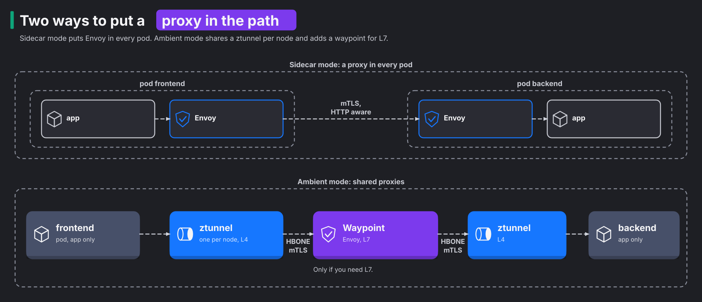
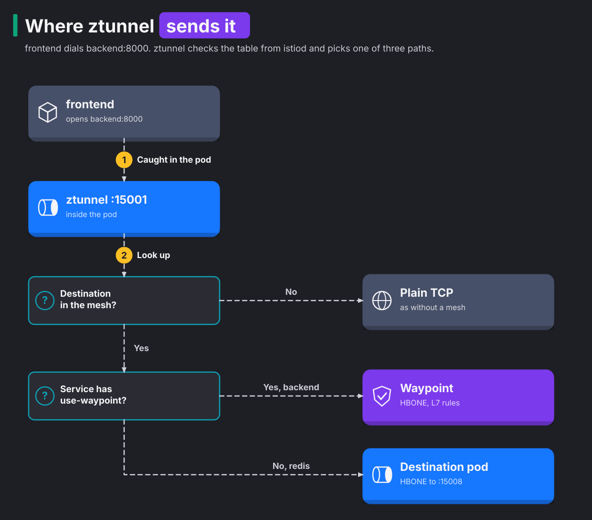

# Module 1: what a mesh adds

> New to a term here, like VirtualService or waypoint? The [glossary](glossary.md) explains every Istio resource and term in this course.

**Before this module:** module 0.

**You need:** the lab running (`./scripts/start.sh` starts or repairs it), `istioctl`, and `./scripts/port-forward.sh` running in a spare terminal for Kiali (http://localhost:20001).

You know how Kubernetes moves a packet from one pod to another. This module shows what that path leaves out, and the two ways Istio fills the gap.

## Concept: what Kubernetes networking does not do

When the frontend calls `http://backend:8000`, Kubernetes does three things:

1. CoreDNS, the cluster's DNS server, turns the name `backend` into the Service's ClusterIP. The ClusterIP works like a forwarding address. No machine actually owns it.
2. kube-proxy rewrites the ClusterIP to the IP of one backend pod, chosen at random. It does this with iptables or IPVS rules on the node.
3. The Container Network Interface (CNI) plugin, flannel in this lab, delivers the packet to that pod.

That is all. Kubernetes networking works at layer 3 and 4, which means it only sees addresses and ports. It has no answer to these questions:

| Question | Why Kubernetes has no answer |
|---|---|
| Who is calling? | A source IP is not an identity. A recreated pod comes back with a new IP. Also, when traffic leaves a node, source NAT (SNAT) often rewrites many pods' addresses to the node's single IP. |
| Is the traffic encrypted? | The CNI moves packets. Encryption is the application's problem. |
| May this caller come in? | NetworkPolicy matches IPs, namespaces and labels. It has no way to say "only the frontend's GET /api/orders". |
| Send 10% to v2 | A Service picks pods at random. The only way to get 10% is to run 1 v2 pod for every 9 v1 pods. |
| Retry, time out, break the circuit | Every application has to implement it, in every language. |
| How many requests failed, how slow were they? | kube-proxy counts nothing per request. |

A service mesh answers these questions without any change to your code. It puts a proxy in the traffic path. The proxy knows who is calling and understands HTTP, so it does all of this work instead of the application.

## Concept: two ways to put a proxy in the path

A mesh needs a proxy in the path of every request. Istio offers two ways to put it there. The diagram shows both, sidecar mode on top and ambient mode below.



**Sidecar mode** adds an extra container, an Envoy proxy, to every pod. Envoy handles both layers. At layer 4, the connection level, it encrypts connections with mutual TLS (mTLS). In mTLS, both sides show a certificate. At layer 7, the HTTP level, it handles features such as routing and retries.

**Ambient mode** splits the two layers between two kinds of proxy:

- **ztunnel** is a small proxy written in Rust. One copy runs on each node, as a DaemonSet. It gives every pod on its node an identity, encrypts its traffic and enforces layer 4 rules. It never reads HTTP.
- **A waypoint** is an Envoy proxy you deploy only for the Services that need HTTP features. In this lab only the backend has one.

## Concept: how a request finds ztunnel and the waypoint

Your app doesn't know the mesh exists, so it never sends anything to ztunnel on purpose. The mesh has to catch each connection on its way out of the pod and hand it to ztunnel.

In plain Kubernetes, the first thing that touches a request is kube-proxy. Its iptables rules on the node rewrite the ClusterIP to a pod IP. Ambient mode catches the request earlier, while it's still inside the pod. Two steps set this up:

1. The `istio-cni` agent enters the network namespace of each mesh pod. A network namespace is the pod's private copy of the network stack. The agent adds redirect rules there, and these rules send the pod's traffic to ztunnel.
2. ztunnel opens listening sockets inside that same namespace, one per job:
   - port 15001 takes traffic the pod sends
   - port 15006 takes plain traffic coming in
   - port 15008 takes HBONE traffic coming in. HBONE is the mTLS tunnel that ztunnel and waypoints use between each other (module 2 goes deeper).

The app sees none of this. It still dials `backend:8000`.

Now ztunnel holds the outgoing connection. It looks up the destination address in a table that istiod sends it. Then it makes one of three choices. The chart walks through them, with the frontend's call to `backend:8000` as the example:



Notice who decides. The `istio.io/use-waypoint` label sits on the destination Service, not on the caller. In ambient mode, a waypoint belongs to the receiving side. It handles traffic *to* the Services that point at it, from any caller. That's why the backend's calls to Redis never touch the waypoint. The backend's own Service uses a waypoint, but the Redis Service doesn't.

Many people think that ambient traffic leaves the pod as plain text, because there's no proxy in the pod. It doesn't. The only plain hop runs from the app to a ztunnel socket, and that socket sits inside the pod's own network namespace. ztunnel wraps the traffic in HBONE mTLS before it reaches any network interface.

## Why this way

**Why split L4 and L7?** Most teams adopt a mesh for encryption and identity. That job needs no HTTP parsing. A TCP proxy written for that one job stays small and fast. Reading HTTP costs a lot of memory and CPU, and few services need it. Sidecar mode pays the full Envoy cost in every pod. Ambient mode pays it once per waypoint. In this lab ztunnel uses 12 to 16 MiB for the whole node, and the waypoint about 30 to 40 MiB. Module 7 measures a sidecar for comparison.

**Why not do L7 in ztunnel too?** Then every node would run a full HTTP proxy for every pod on it. One tenant's heavy traffic would slow down every other pod on that node. A waypoint serves one namespace or one Service. So you size and scale it like any other Deployment.

**Why do pods not need a restart to join?** In sidecar mode, a mutating admission webhook adds the sidecar. This webhook edits the pod spec, and it only runs when the API server creates a pod. So an existing pod needs a restart to get its sidecar. Ambient mode never changes the pod spec. The `istio-cni` agent watches for the namespace label. When the label appears, the agent puts the redirect rules into the network namespaces of pods that are already running. Module 2 shows this live.

**Why does ambient still use Envoy at all?** Envoy already has the HTTP features Istio needs: routing, retries, faults, outlier detection and telemetry. So the waypoint is an Envoy proxy. Istio reuses Envoy wherever a Service needs those features.

## The bigger picture: why meshes exist

Picture a company around 2012. It breaks one big application into fifty small services. Suddenly every service talks to ten others over the network, and the network fails in ways a function call never did. Calls hang. Servers die halfway through a response. One slow service drags down everything that depends on it.

The first answer came as libraries. Twitter wrote Finagle, and Netflix wrote Hystrix and Ribbon. Each library handled retries, timeouts and load balancing inside the application. They worked well, with one catch: each one served a single language. A Python team got nothing from a Java library, and every fix meant rebuilding and redeploying every service.

So people moved that logic out of the application and into a proxy next to it. Lyft open-sourced Envoy in 2016 for exactly this job. In 2017 Google, IBM and Lyft launched Istio to manage whole fleets of those proxies. The app stays ignorant of the network, and the proxy speaks for it. That idea is the service mesh.

Every mesh has two halves. The split matters for everything that follows.

- The **data plane** touches your traffic: ztunnel, waypoints and sidecars. If it stops, requests stop.
- The **control plane** only gives orders. In Istio, that's istiod. It watches the Kubernetes API and turns your YAML into proxy configuration. Then it pushes that configuration out over xDS, Envoy's configuration protocol. istiod also signs certificates.

If istiod dies for a minute, traffic keeps flowing. The proxies keep using the last configuration they received. Nothing new reaches them until istiod returns.

You know this pattern already. The API server and the kubelet split their work the same way: one side decides, the other side does the work.

Ambient mode arrived much later. For years, users complained about the cost of sidecars. Istio announced ambient mode in September 2022. It declared ambient mode stable in Istio 1.24, in November 2024. That's the version this lab runs. Older blog posts show sidecars everywhere. Most of their ideas still apply. Only the plumbing differs.

## Do it: see the data plane

**1. Count the containers in a shop pod.**

```bash
kubectl -n shop get pods -l app=backend -o jsonpath='{.items[0].spec.containers[*].name}{"\n"}'
```

**What you should see.** One word: `backend`. The pod runs your app and nothing else. Ambient mode adds no sidecar container, so the pod spec looks exactly like the Deployment you wrote.

**2. See which pods ztunnel has taken over.**

```bash
istioctl ztunnel-config workloads | grep -E "NAMESPACE|shop"
```

**What you should see.** A table like this (your pod names and IPs differ):

```text
NAMESPACE     POD NAME                                  ADDRESS     NODE                 WAYPOINT PROTOCOL
kube-system   svclb-shop-gateway-istio-f7b228cb-pgfnv   10.42.0.18  k3d-k8s-lab-server-0 None     TCP
shop-ingress  shop-gateway-istio-858774d7cd-wpvlw       10.42.0.20  k3d-k8s-lab-server-0 None     TCP
shop          backend-v1-54c86bf9b-dnfq2                10.42.0.17  k3d-k8s-lab-server-0 None     HBONE
shop          backend-v1-54c86bf9b-wm5tn                10.42.0.16  k3d-k8s-lab-server-0 None     HBONE
shop          backend-v2-5fd94d9cf4-pf8wn               10.42.0.14  k3d-k8s-lab-server-0 None     HBONE
shop          frontend-d8cfc88bd-rbjps                  10.42.0.13  k3d-k8s-lab-server-0 None     HBONE
shop          redis-7bbf49c9f8-zm8gf                    10.42.0.15  k3d-k8s-lab-server-0 None     HBONE
shop          waypoint-b9b76876f-5jhcm                  10.42.0.19  k3d-k8s-lab-server-0 None     TCP
```

`HBONE` means ztunnel handles this pod's traffic. All five app pods in `shop` show it. A pod outside the mesh shows `TCP`. The waypoint and the ingress gateway show `TCP` too, even though they belong to the mesh. Both are Envoy proxies that speak HBONE themselves, so ztunnel leaves their traffic alone.

The `svclb` pod comes from the load balancer built into k3s. It passes the node's port 8080 on to the gateway. The `grep` only catches it because its name contains `shop`.

**3. See which Services use the waypoint.**

```bash
istioctl ztunnel-config services | grep -E "NAMESPACE|shop"
```

**What you should see.** `backend`, `backend-v1` and `backend-v2` show `waypoint` in the WAYPOINT column. `frontend`, `redis` and the `waypoint` Service itself show `None`. Only the backend needs HTTP features, so only its Services send traffic through the waypoint. The ENDPOINTS column counts ready pods. `backend` shows `3/3` because it selects the pods of both versions.

The label that does it:

```bash
kubectl -n shop get svc backend --show-labels
```

**What you should see.** Among the labels, you find `istio.io/use-waypoint=waypoint`. That label sends this Service's traffic through the Gateway named `waypoint`. The waypoint is defined as a Gateway resource, which is why the label names one. If you remove the label, ztunnel delivers straight to the pods again.

**4. See the proxy in the response.**

```bash
curl -sD - -o /dev/null http://localhost:8080/api/version | grep -iE "server|x-envoy"
```

**What you should see.**

```text
x-envoy-upstream-service-time: 104
server: istio-envoy
```

The number changes with every request. Both headers come from the ingress gateway's Envoy, not from the app.

- `server: istio-envoy` names the proxy.
- `x-envoy-upstream-service-time` says how many milliseconds Envoy waited for the frontend.

**5. Count the proxies istiod manages.**

```bash
istioctl proxy-status
```

**What you should see.** Three rows:

```text
NAME                                               CLUSTER     ISTIOD                  VERSION  SUBSCRIBED TYPES
shop-gateway-istio-858774d7cd-wpvlw.shop-ingress   Kubernetes  istiod-5c5bf76f-vskzs   1.24.2   4 (CDS,LDS,EDS,RDS)
waypoint-b9b76876f-5jhcm.shop                      Kubernetes  istiod-5c5bf76f-vskzs   1.24.2   4 (CDS,LDS,EDS,WDS)
ztunnel-ttgf9.istio-system                         Kubernetes  istiod-5c5bf76f-vskzs   1.24.2   2 (WADS,WDS)
```

The three rows are the gateway, the waypoint and ztunnel. The shop's five pods don't appear, because in ambient mode they have no proxy of their own. The last column lists the xDS feeds that each proxy takes from istiod. Each feed carries one kind of configuration. The two Envoys get listeners, clusters and endpoints. ztunnel only gets workloads and addresses, which is a much smaller feed.

## Investigate

Run `./course/load.sh 300` and open Kiali at http://localhost:20001.

1. In **Traffic Graph**, select the `shop` and `shop-ingress` namespaces, and in the Display menu turn on **Waypoint Proxies**. Follow a request from `frontend` to `backend`. Which nodes does it pass? Why does no waypoint sit between `backend` and `redis`?
2. In the same Display menu, turn on **Security**. Which edges show a padlock, and which edges don't?
3. Open **Workloads**, then `backend-v1`, then the **Logs** tab. Which containers does it offer, and what is the extra `ztunnel` checkbox for? Compare with a pod in module 7.

<details>
<summary>Answers</summary>

1. The request leaves `frontend`, reaches the `backend` service node, and lands on the `backend` v1 app node. The HTTP edges carry request rates, because the waypoint read the requests and reported them. The `waypoint` workload also shows up as its own node, joined by TCP edges. The `backend` service sends its bytes to the waypoint, and the waypoint sends them on to the backend pods. Redis gets no waypoint because its Service has no `istio.io/use-waypoint` label. Step 3 showed `None` for it. Its edges carry only TCP bytes from ztunnel, with no request counts.
2. Almost every edge carries a padlock. Examples are gateway to frontend, frontend to backend over HTTP, and backend to redis. Two TCP edges have no padlock:
   - `frontend` to the `backend` service
   - the `backend` service to `waypoint`

   The gap is in the metrics, not in the encryption. ztunnel doesn't capture the waypoint's side of that hop. So Prometheus holds only the report from the sending side, with `reporter="source"` and `connection_security_policy="mutual_tls"`. Kiali draws no padlock from that one report. The traffic is still mTLS. Module 2 explains what the padlock proves.
3. Kiali offers one container, `backend`. There is no `istio-proxy`, because the pod has none. The `ztunnel` checkbox mixes in the lines from the node's ztunnel log that concern this pod. For each connection, these lines show fields such as `src.identity` and `dst.hbone_addr`. That's where an ambient pod's mesh logs live. A sidecar pod in module 7 lists `istio-proxy` as a second container instead.

</details>

## Clean up

Nothing to clean up. This module only reads.
