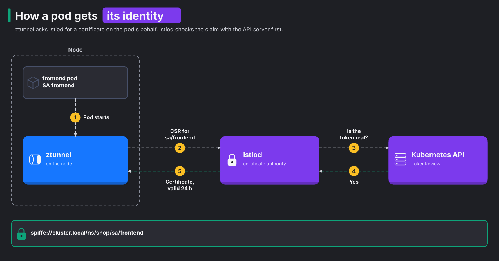
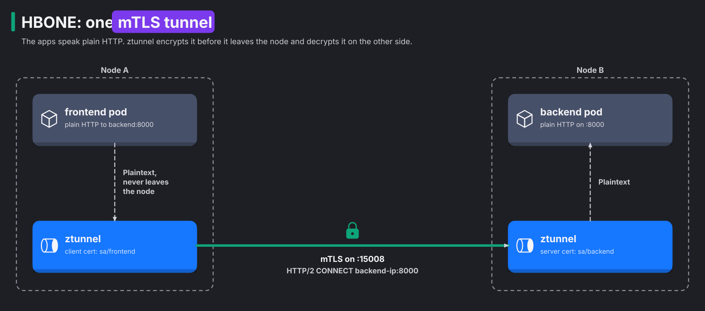

# Module 2: identity and mTLS

> New to a term here, like VirtualService or waypoint? The [glossary](glossary.md) explains every Istio resource and term in this course.

**Before this module:** module 1.

**You need:** the lab running (`./scripts/start.sh` starts or repairs it), `istioctl`, and `./scripts/port-forward.sh` running in a spare terminal for Kiali (http://localhost:20001).

Every pod in the mesh gets an identity that it proves with a certificate. Every connection between mesh pods uses that certificate for two jobs. It encrypts the traffic, and it proves who sent it. This module shows three things:

- where the identity comes from
- what travels on the wire
- how a pod joins or leaves the mesh without a restart

## Concept: an identity per service account

A pod needs a name that other pods trust, and the name must survive restarts. Kubernetes already gives every pod one: its ServiceAccount. A pod uses its ServiceAccount to prove who it is to the API server. Istio reuses the same ServiceAccount to prove who the pod is to other pods.

To make that proof work, istiod acts as a certificate authority (CA), an issuer whose signature everyone in the mesh trusts. istiod signs a short-lived X.509 certificate for each service account. The certificate names the workload with a SPIFFE ID, a standard format for workload names:

```text
spiffe://cluster.local/ns/shop/sa/frontend
          trust domain  namespace  service account
```



## Concept: HBONE, the tunnel between nodes

A TLS handshake is slow, because both sides exchange certificates and agree on keys. If ztunnel ran one for every TCP connection the app opens, each new connection would pay that cost. So ztunnel builds one encrypted tunnel and sends many connections through it. It works like this:

1. ztunnel opens an mTLS connection to port 15008 on the other side.
2. For each TCP connection the app opens, ztunnel sends an HTTP/2 CONNECT request inside that mTLS connection. Each one becomes a separate stream.
3. When the same two identities talk again, ztunnel reuses the open mTLS connection for the new stream.

A connection from `sa/frontend` never carries another service account's streams. The reason is that the client certificate names exactly one identity. Istio calls this design HBONE (HTTP-Based Overlay Network Environment).



The application still speaks plain HTTP. ztunnel captures it on the way out, encrypts it, and decrypts it on the other side.

The diagram draws two nodes to show the idea. This lab has one node, so the same ztunnel process plays both roles. It still builds the tunnel. It dials the destination pod's IP on port 15008, where ztunnel listens inside that pod's network namespace. Module 1 showed the three ports. Step 2 shows exactly this in the log.

## Concept: who accepts plain text

During a migration, some callers are already in the mesh and some aren't. The receiving side has to decide whether to accept the second kind. PeerAuthentication answers that one question: "do I accept a connection that arrives without mTLS?"

The destination's ztunnel enforces the answer. It knows which kind of connection it got from the port it arrives on. Inside the receiving pod, a plain connection lands on port 15006, and an HBONE connection lands on port 15008.

| Mode | HBONE (mTLS) from a mesh pod | Plain TCP from outside the mesh |
|---|---|---|
| `PERMISSIVE` (Istio's default) | accepted | accepted |
| `STRICT` (the lab's `shop`) | accepted | closed at once |

PeerAuthentication says nothing about *which* identity may connect. Any mesh pod with a valid certificate passes STRICT. Choosing callers is authorization, the topic of module 3.

People also make the opposite mistake. They expect PERMISSIVE to mean "unencrypted". It doesn't. Between two mesh pods, ztunnel always uses mTLS, whatever the mode. PERMISSIVE only keeps the door open for callers that have no mesh.

## Why this way

**Why service accounts, not IPs or labels?** IPs change every time Kubernetes recreates a pod. Labels are no proof either, because anyone who edits a Deployment sets its labels. A service account is an identity that Kubernetes already checks. Istio ties the certificate to it. So a policy that says "allow `sa/frontend`" stays true, however many frontend pods run and wherever they run.

**Why short-lived certificates?** A long-lived certificate needs a revocation list, a list of stolen certificates that every checker must read. A 24 hour certificate that renews itself needs no such list. If a key leaks, it stops working within a day, and nobody has to do anything.

**Why does ztunnel request certificates on behalf of pods?** In sidecar mode, each sidecar requests its own certificate. In ambient mode, the pod has no proxy. So the node's ztunnel holds the certificates for every pod on its node. This creates a risk: a ztunnel might ask for a certificate it shouldn't have. To stop that, istiod asks the API server whether the pod really runs on that node. So one ztunnel never gets a certificate for a pod on another node.

**Why streams inside a tunnel, not one handshake per connection?** Streams mean fewer TLS handshakes and fewer connections. HTTP/2 already knows how to carry many streams on one connection, so Istio did not need a new protocol.

**Why STRICT in `shop`?** Istio's default is PERMISSIVE, which accepts both mTLS and plaintext. With PERMISSIVE, you enroll workloads one at a time without breaking their callers. Once every workload has joined, STRICT closes the plaintext door. The lab sets STRICT in `shop` with a `PeerAuthentication` in `manifests/istio/security.yaml`.

## The bigger picture: what mTLS actually proves

You use TLS every day. When your browser opens your bank's website, the server sends a certificate. The browser checks two things:

1. A trusted authority signed the certificate.
2. The name inside the certificate matches the site.

Then both sides agree on keys and encrypt everything after that. Notice what's missing. The bank learns nothing about you from TLS. You prove who you are later, with a password.

Mutual TLS runs the same check in both directions. The caller shows a certificate too. So when the backend's ztunnel accepts a connection, it knows two facts for certain:

- Nobody read or changed the bytes on the way.
- The caller holds the private key for `sa/frontend`.

The app needs no password and no API key in an environment variable. It has nothing to manage.

So why encrypt inside your own cluster? Old-style network security drew a line around the data centre. Everything outside the line was dangerous, and everything inside was trusted. That model breaks the moment an attacker takes over one pod. The attacker is now inside the trusted zone and talks to everything. The newer approach, called zero trust, drops the idea of a safe inside. Every connection proves where it comes from, every time. Policy decides on that proof, not on the packet's source address.

One more detail. Every certificate traces back to a root certificate, the one all others depend on. In this lab, istiod owns that root. It generated a self-signed root CA at install time. It keeps the root in the `istio-ca-secret` Secret in `istio-system`. Whoever steals that key creates any identity they like. Production teams plug in their own root, or an intermediate certificate from the company CA. They guard it like a database password. For a laptop lab, the self-signed root does the job.

## Do it

**1. See the certificates ztunnel holds.**

```bash
istioctl ztunnel-config certificates | grep -E "CERTIFICATE|ns/shop"
```

**What you should see.** You see three identities, one per service account in `shop`. Each identity has a leaf certificate, its own, and a root certificate, the CA's. Some columns are trimmed here:

```text
CERTIFICATE NAME                             TYPE  STATUS     VALID CERT  NOT AFTER             NOT BEFORE
spiffe://cluster.local/ns/shop/sa/backend    Leaf  Available  true        2026-11-13T18:45:27Z  2026-11-12T18:43:27Z
spiffe://cluster.local/ns/shop/sa/backend    Root  Available  true        2036-11-09T18:44:33Z  2026-11-12T18:44:33Z
spiffe://cluster.local/ns/shop/sa/frontend   Leaf  Available  true        2026-11-13T18:45:26Z  2026-11-12T18:43:26Z
...
spiffe://cluster.local/ns/shop/sa/redis      Leaf  Available  true        2026-11-13T18:45:29Z  2026-11-12T18:43:29Z
...
```

The leaf certificate lives 24 hours plus two minutes. The extra two minutes are on purpose. istiod sets NOT BEFORE a little in the past, so a node with a slightly slow clock still accepts the certificate. The root, istiod's own CA, lives 10 years, and every root row shows the same serial number. Three backend pods, two v1 and one v2, share one certificate because they all run as `sa/backend`. The identity belongs to the service account, not to the pod.

**2. See the identities on a real connection.** Send a request, then read ztunnel's access log:

```bash
curl -s -o /dev/null http://localhost:8080/api/orders
kubectl -n istio-system logs ds/ztunnel --tail=50 | grep 'src.workload="shop-gateway' | tail -1
```

**What you should see.** One long `connection complete` line. Look for these fields:

```text
src.identity="spiffe://cluster.local/ns/shop-ingress/sa/shop-gateway-istio"
dst.addr=10.42.0.13:15008             <- the HBONE port, not the app port
dst.hbone_addr=10.42.0.13:3000        <- the app port, carried inside the tunnel
dst.identity="spiffe://cluster.local/ns/shop/sa/frontend"
direction="inbound"
```

Both identities sit in one line. The gateway proved `sa/shop-gateway-istio`, and the frontend's side proved `sa/frontend`. The line may show a `duration` of many seconds. That's because the gateway keeps the connection open and sends many requests through it. ztunnel logs the connection only once, when it closes.

**3. Try to get in from outside the mesh.**

```bash
kubectl apply -f course/manifests/02-outside-client.yaml
kubectl -n course-outside rollout status deploy/client
kubectl -n course-outside exec deploy/client -- curl -s -m 5 -o /dev/null -w "%{http_code}\n" http://frontend.shop:3000/healthz
```

**What you should see.** You see `000`, then `command terminated with exit code 56`. Exit code 56 is curl's "connection reset by peer". Now and then the exit code reads `52` instead, which means "empty reply from server". Either way, the connection died before any HTTP answer came back. Here is why. The client sends plaintext, but the frontend requires mTLS. So the destination ztunnel closes the connection.

ztunnel's log names the rule that did it:

```bash
kubectl -n istio-system logs ds/ztunnel --since=1m | grep course-outside | tail -1
```

**What you should see.** You see a line with `error="connection closed due to policy rejection: explicitly denied by: istio-system/istio_converted_static_strict"`. istiod turned the STRICT `PeerAuthentication` in `shop` into an internal rule that denies plaintext. ztunnel applied that rule. The line has no `src.identity`, because a plaintext client has no identity.

**4. Enroll the namespace, without restarting the pod.**

```bash
kubectl label namespace course-outside istio.io/dataplane-mode=ambient
sleep 5
kubectl -n course-outside exec deploy/client -- curl -s -m 5 -o /dev/null -w "%{http_code}\n" http://frontend.shop:3000/healthz
kubectl -n course-outside get pods     # same pod, RESTARTS 0
```

**What you should see.** You see `200`, and the same pod as before, with `RESTARTS 0` and its old AGE. The pod joined the mesh while it kept running. Here is what happened:

1. The `istio-cni` agent saw the label.
2. It entered the running pod's network namespace and added the redirect rules.
3. ztunnel requested a certificate for `ns/course-outside/sa/default`.

To check the certificate, run `istioctl ztunnel-config certificates | grep course-outside`. It's there, valid for 24 hours like the others.

**5. Leave the mesh again.**

```bash
kubectl label namespace course-outside istio.io/dataplane-mode-
sleep 5
kubectl -n course-outside exec deploy/client -- curl -s -m 5 -o /dev/null -w "%{http_code}\n" http://frontend.shop:3000/healthz
```

**What you should see.** You're back to `000` with exit code 56, still with the same pod. istio-cni removed the redirect rules, so the client's traffic leaves as plaintext again. The frontend's ztunnel refuses it, as in step 3.

## Investigate

1. With the namespace enrolled (step 4), run `istioctl ztunnel-config workloads | grep course-outside`. What does the PROTOCOL column say, and what does it say after step 5?
2. In Kiali, open **Traffic Graph** for `shop`, `observability` and `istio-system`, with Display, Security on. Find the edge from `kiali` to Prometheus. Does it carry a padlock? Why does the mesh not cover it?
3. In Kiali, open **Workloads**, `frontend`, tab **Logs**. Is there an `istio-proxy` container to choose? Where are the frontend's mesh logs instead?
4. Kiali's **Overview** shows an mTLS badge per namespace. What does it show for `shop`, and why is it different for `course-outside`?

<details>
<summary>Answers</summary>

1. While the namespace carries the label, the column says `HBONE`. That means ztunnel handles the pod's traffic. After step 5 it says `TCP`. ztunnel still knows the pod, but it no longer captures its traffic. The pod name stays the same in both rows, which proves again that nothing restarted.
2. The edge has no padlock. The mesh only encrypts traffic that it captures at the sender, and here the sender is outside the mesh.
   - Kiali runs in `istio-system`. That namespace has no `istio.io/dataplane-mode` label, so Kiali sends plain TCP.
   - Prometheus runs in `observability`. That namespace is in ambient mode, but it has no STRICT `PeerAuthentication`. So its ztunnel accepts plaintext.

   Prometheus records that connection with `reporter="destination"` and `connection_security_policy="unknown"`, so Kiali draws no padlock. Check it in Prometheus with `sum by (destination_workload, connection_security_policy) (istio_tcp_connections_opened_total{source_workload="kiali"})`. If you leave a namespace out of the mesh, its traffic stays plain.
3. No. The pod has one container, `frontend`. For an ambient pod, the Logs tab adds a `ztunnel` checkbox instead. It mixes in the lines from the node's ztunnel log that belong to this pod. There is one line per connection, with `src.identity`, `dst.identity` and `dst.hbone_addr`. Those are the frontend's mesh logs.
4. `shop` shows a full lock, "mTLS is enabled for this namespace". `course-outside` shows no lock. Kiali's API reports `MTLS_NOT_ENABLED` for it, which you see with `curl -s http://localhost:20001/api/namespaces/course-outside/tls`. The badge reads configuration, not traffic. `shop` has a STRICT `PeerAuthentication`, and `course-outside` has none. `observability` also reports `MTLS_NOT_ENABLED`, even though its pods talk mTLS through ztunnel. So a missing badge means "plaintext still allowed". It doesn't mean "nothing encrypted".

</details>

## Clean up

```bash
kubectl label namespace course-outside istio.io/dataplane-mode- 2>/dev/null
```

Keep the `course-outside` namespace, because module 7 uses it again. `./course/reset.sh --all` removes it.
