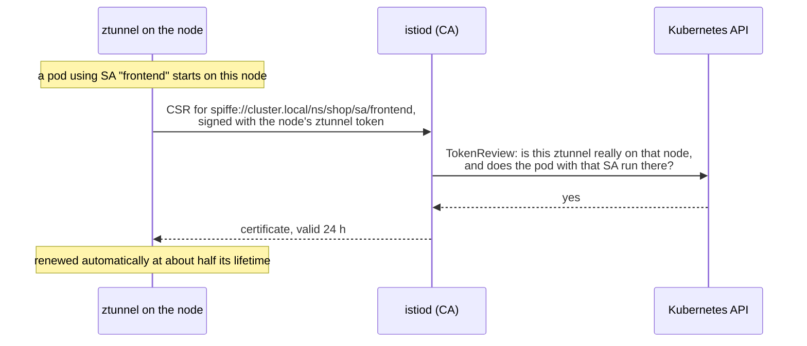
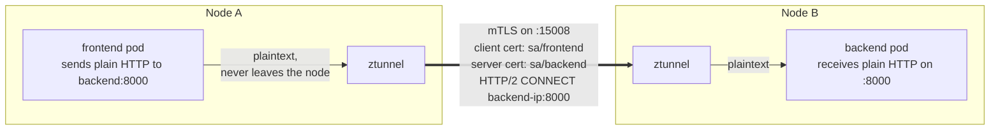

# Module 2: identity and mTLS

> New to a term here, like VirtualService or waypoint? The [glossary](glossary.md) explains every Istio resource and term in this course.

Every pod in the mesh gets a cryptographic identity, and every connection between mesh pods is encrypted and authenticated with it. This module shows where the identity comes from, what travels on the wire, and how a pod joins or leaves the mesh without a restart.

## Concept: an identity per service account

In Kubernetes, a ServiceAccount is how a pod proves who it is to the API server. Istio reuses it for pod-to-pod traffic. istiod is a certificate authority: it signs a short-lived X.509 certificate for each service account, and the certificate names the workload with a SPIFFE ID:

```text
spiffe://cluster.local/ns/shop/sa/frontend
          trust domain  namespace  service account
```



## Concept: HBONE, the tunnel between nodes

ztunnel does not encrypt each pod's TCP stream separately. It opens one mTLS connection per destination node on port 15008 and carries every pod's streams inside it as HTTP/2 CONNECT requests. Istio calls this HBONE (HTTP-Based Overlay Network Environment).



The application still speaks plain HTTP. ztunnel captures it on the way out, encrypts it, and decrypts it on the other side.

## Why this way

**Why service accounts, not IPs or labels?** IPs change every time a pod is recreated. Labels can be set by anyone who can edit a Deployment. A service account is the identity Kubernetes already authenticates. Tying the certificate to it means a policy that says "allow `sa/frontend`" stays true no matter how many frontend pods run or where.

**Why short-lived certificates?** A 24 hour certificate that renews itself needs no revocation list. If a key leaks, it stops working within a day without anyone doing anything.

**Why does ztunnel request certificates on behalf of pods?** In sidecar mode each sidecar requests its own. In ambient mode the pod has no proxy, so the node's ztunnel holds the certificates for every pod on its node. istiod checks with the API server that the pod really runs on that node, so one ztunnel cannot impersonate a pod on another node.

**Why one tunnel per node pair, not per pod?** Fewer TLS handshakes and fewer connections. HTTP/2 already knows how to carry many streams on one connection, so Istio did not need a new protocol.

**Why STRICT in `shop`?** Istio's default is PERMISSIVE: accept both mTLS and plaintext, so you can enroll workloads one at a time without breaking callers. Once everything is enrolled, STRICT closes the plaintext door. The lab sets STRICT in `shop` with a `PeerAuthentication` in `manifests/istio/security.yaml`.

## The bigger picture: what mTLS actually proves

You use TLS every day. When your browser opens your bank's website, the server sends a certificate, and the browser checks two things: a trusted authority signed it, and the name inside matches the site. Then both sides agree on keys and encrypt everything after that. Notice what's missing. The bank learns nothing about you from TLS. You prove who you are later, with a password.

Mutual TLS runs the same check in both directions. The caller shows a certificate too. So when the backend's ztunnel accepts a connection, it knows two facts for certain: nobody read or changed the bytes on the way, and the caller holds the private key for `sa/frontend`. No password, no API key in an environment variable, nothing for the app to manage.

Why bother inside your own cluster? Old-style network security drew a line around the data centre: outside means danger, inside means trust. That model collapses the moment an attacker takes over one pod, because they land inside the trusted zone and talk to everything. The newer approach, which people call zero trust, throws away the idea of a safe inside. Every connection proves where it comes from, every time, and policy decides on that proof, not on the packet's source address.

One more detail. Every certificate traces back to a root, and in this lab istiod owns that root. It generated a self-signed root CA at install and keeps it in the `istio-ca-secret` Secret in `istio-system`. Whoever steals that key mints any identity they like. Production teams plug in their own root, or an intermediate from the company CA, and guard it like a database password. For a laptop lab, the self-signed root does the job.

## Do it

**1. See the certificates ztunnel holds.**

```bash
istioctl ztunnel-config certificates | grep -E "CERTIFICATE|ns/shop"
```

```text
CERTIFICATE NAME                               TYPE  STATUS     VALID CERT  NOT AFTER             NOT BEFORE
spiffe://cluster.local/ns/shop/sa/backend      Leaf  Available  true        2026-11-12T20:22:01Z  2026-11-11T20:20:01Z
spiffe://cluster.local/ns/shop/sa/backend      Root  Available  true        2036-11-08T20:21:19Z  2026-11-11T20:21:19Z
```

The leaf certificate lives 24 hours. The root, istiod's own CA, lives 10 years.

**2. See the identities on a real connection.** Send a request, then read ztunnel's access log:

```bash
curl -s -o /dev/null http://localhost:8080/api/orders
kubectl -n istio-system logs ds/ztunnel --tail=50 | grep 'src.workload="shop-gateway' | tail -1
```

Look for these fields:

```text
src.identity="spiffe://cluster.local/ns/shop-ingress/sa/shop-gateway-istio"
dst.addr=10.42.0.13:15008             <- the HBONE port, not the app port
dst.hbone_addr=10.42.0.13:3000        <- the app port, carried inside the tunnel
direction="inbound"
```

**3. Try to get in from outside the mesh.**

```bash
kubectl apply -f course/manifests/02-outside-client.yaml
kubectl -n course-outside rollout status deploy/client
kubectl -n course-outside exec deploy/client -- curl -s -m 5 -o /dev/null -w "%{http_code}\n" http://frontend.shop:3000/healthz
```

You get `000` and "Connection reset by peer". The client sends plaintext, the frontend requires mTLS, and the destination ztunnel resets the connection.

**4. Enroll the namespace, without restarting the pod.**

```bash
kubectl label namespace course-outside istio.io/dataplane-mode=ambient
sleep 5
kubectl -n course-outside exec deploy/client -- curl -s -m 5 -o /dev/null -w "%{http_code}\n" http://frontend.shop:3000/healthz
kubectl -n course-outside get pods     # same pod, RESTARTS 0
```

Now you get `200`. The `istio-cni` agent saw the label, entered the running pod's network namespace and added the redirect rules. ztunnel requested a certificate for `ns/course-outside/sa/default`.

**5. Leave the mesh again.**

```bash
kubectl label namespace course-outside istio.io/dataplane-mode-
sleep 5
kubectl -n course-outside exec deploy/client -- curl -s -m 5 -o /dev/null -w "%{http_code}\n" http://frontend.shop:3000/healthz
```

Back to `000`.

## Investigate

1. With the namespace enrolled (step 4), run `istioctl ztunnel-config workloads | grep course-outside`. What does the PROTOCOL column say, and what does it say after step 5?
2. In Kiali, open **Traffic Graph** for `shop` and `shop-ingress` with Display, Security on. Every edge shows a padlock. Which edge in the graph has no padlock if you include the `kube-system` namespace? Why does the mesh not cover it?
3. In Kiali, open **Workloads**, `frontend`, tab **Logs**. Is there an `istio-proxy` container to choose? Where are the frontend's mesh logs instead?
4. Kiali's **Overview** shows an mTLS badge per namespace. What does it show for `shop`, and why is it different for `course-outside`?

## Clean up

```bash
kubectl label namespace course-outside istio.io/dataplane-mode- 2>/dev/null
```

Keep the `course-outside` namespace: module 7 uses it again. `./course/reset.sh --all` removes it.
