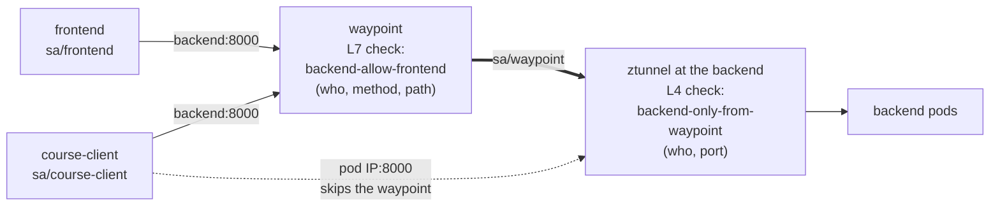

# Module 3: authorization

> New to a term here, like VirtualService or waypoint? The [glossary](glossary.md) explains every Istio resource and term in this course.

mTLS tells the receiver who is calling. Authorization decides whether that caller is allowed. This module writes rules at both layers of the mesh and shows a gap you get if you only write one of them.

## Concept: AuthorizationPolicy compared with NetworkPolicy

You know NetworkPolicy. It allows or blocks connections by pod labels, namespaces and IP ranges, and the CNI enforces it. AuthorizationPolicy is Istio's equivalent, with two differences:

| | NetworkPolicy | Istio AuthorizationPolicy |
|---|---|---|
| Who is the caller | Pod labels, namespace, IP | Cryptographic identity from mTLS (service account) |
| What can it match | Ports | Ports, and at L7 also HTTP methods, paths, headers |
| Who enforces it | The CNI plugin | ztunnel (L4 rules) or a waypoint (L7 rules) |
| Can it be spoofed | A pod that gets the right labels or IP passes | Only a pod running as that service account holds the certificate |

Both can be used together. This lab uses only AuthorizationPolicy.

## Concept: two enforcement points



A policy is enforced where it is attached:

- **`selector`** (pod labels) attaches it to the pods. ztunnel enforces it, so it can only use L4 facts: the caller's identity, namespace and the port.
- **`targetRefs`** to a Service attaches it to that Service's waypoint. The waypoint understands HTTP, so the rule can also match methods and paths.

The lab has one of each for the backend:

```yaml
# L7, on the waypoint: only the frontend may call GET or POST /api/*
name: backend-allow-frontend
targetRefs: [{kind: Service, name: backend}, ...]
rules:
  - from: [{source: {principals: ["cluster.local/ns/shop/sa/frontend"]}}]
    to:   [{operation: {methods: ["GET", "POST"], paths: ["/api/*"]}}]
---
# L4, on the backend pods: only the waypoint and Prometheus may connect at all
name: backend-only-from-waypoint
selector: {matchLabels: {app: backend}}
rules:
  - from: [{source: {principals: ["cluster.local/ns/shop/sa/waypoint",
                                  "cluster.local/ns/observability/sa/kube-prometheus-stack-prometheus"]}}]
```

## Concept: how ALLOW rules combine

1. If any `DENY` policy matches the request, it is denied.
2. If there are no `ALLOW` policies for the target, it is allowed.
3. If there are `ALLOW` policies, the request must match at least one of them.

So one ALLOW policy for a workload turns it into "deny unless allowed", and ALLOW policies add up. You can grant a new client access by adding a policy, without editing the existing one.

## Why this way

**Why do you need the L4 rule if the L7 rule is stricter?** The L7 rule only sees traffic that goes through the waypoint. A client that connects to a backend pod's IP directly never reaches the waypoint, so the L7 rule never runs. Sidecar clients do the same thing: they pick a backend pod themselves. The L4 rule on the pods closes that path by allowing only the waypoint's identity. You will open and close this hole in the exercise.

**Why does Prometheus appear in the L4 rule?** Prometheus scrapes `/metrics` on each pod by IP, not through the Service, so it also skips the waypoint.

**Why identities and not namespaces?** A rule like "allow namespace `shop`" lets every workload in `shop` in, including a compromised one or a test pod like `course-client`. Naming the service account allows exactly one workload.

**Why does Redis need only an L4 rule?** Redis speaks its own protocol, not HTTP, so there is nothing for a waypoint to inspect. "Only the backend may connect" is the whole rule.

## The bigger picture: two questions, not one

Security people separate two questions, and Istio does the same. Authentication asks "who are you?" Authorization asks "now that I know who you are, may you do this?" Module 2 answered the first question with certificates. This module deals with the second.

The two layers of the mesh see different things, and that decides what each rule checks. ztunnel works at layer 4. It sees a connection, the caller's identity from the certificate and the destination port. That's all. It never looks inside the bytes. The waypoint works at layer 7. It reads the HTTP request, so it knows the method, the path and the headers. A rule like "only GET on /api/*" only makes sense where something reads HTTP.

Istio checks policies in a fixed order: CUSTOM first (an external authorizer, which this lab skips), then DENY, then ALLOW. A matching DENY always wins, whatever the ALLOW rules say. That gives you a handy emergency brake. Block one misbehaving caller with a small DENY policy and leave your carefully built ALLOW rules alone.

The habit that pays off most is "deny by default". Start from nothing allowed, then add one rule for each caller that really needs access. It feels slow at first. Six months later, though, someone asks "who talks to Redis?", and you answer by reading one file instead of tracing traffic for a week. And if an attacker takes over the `course-client` pod, they find closed doors instead of an open network.

## Do it

**1. Deploy a client with its own identity.**

```bash
cat course/manifests/03-course-client.yaml
kubectl apply -f course/manifests/03-course-client.yaml
kubectl -n shop rollout status deploy/course-client
```

It runs in `shop` as service account `course-client`.

**2. It is refused at L7.**

```bash
kubectl -n shop exec deploy/course-client -- curl -s -w " [%{http_code}]\n" http://backend:8000/api/version
kubectl -n shop exec deploy/course-client -- curl -s -o /dev/null -w "frontend [%{http_code}]\n" http://frontend:3000/healthz
```

```text
RBAC: access denied [403]
frontend [200]
```

The waypoint refused it with HTTP 403. The frontend has no policy, so it answers.

**3. Allow exactly one call.**

```bash
cat course/manifests/03-allow-course-client.yaml
kubectl apply -f course/manifests/03-allow-course-client.yaml
sleep 5
kubectl -n shop exec deploy/course-client -- curl -s -w " [%{http_code}]\n" http://backend:8000/api/version
kubectl -n shop exec deploy/course-client -- curl -s -w " [%{http_code}]\n" http://backend:8000/api/orders
```

`/api/version` now returns `200`. `/api/orders` still returns `403`. The frontend still works too, because ALLOW policies add up.

**4. Find the bypass.**

```bash
BACKEND_IP=$(kubectl -n shop get pod -l app=backend,version=v1 -o jsonpath='{.items[0].status.podIP}')
kubectl -n shop exec deploy/course-client -- curl -s -m 5 -o /dev/null -w "%{http_code}\n" http://$BACKEND_IP:8000/api/orders
```

`000`: connection reset. The L4 policy only admits the waypoint. Now remove it:

```bash
kubectl -n shop delete authorizationpolicy backend-only-from-waypoint
sleep 10
kubectl -n shop exec deploy/course-client -- curl -s -m 5 -o /dev/null -w "%{http_code}\n" http://$BACKEND_IP:8000/api/orders
```

`200`. `course-client` read the orders, which its L7 rule forbids. Without the L4 rule, the L7 rule protects only the front door.

**5. Close it again.**

```bash
kubectl apply -f manifests/istio/security.yaml
sleep 10
kubectl -n shop exec deploy/course-client -- curl -s -m 5 -o /dev/null -w "%{http_code}\n" http://$BACKEND_IP:8000/api/orders
```

Back to `000`.

## Investigate

1. **ztunnel's log.** After step 4 with the policy in place, run:

   ```bash
   kubectl -n istio-system logs ds/ztunnel --tail=100 | grep course-client | tail -3
   ```

   The line ends with `error="http status: 401 Unauthorized"`. The client's ztunnel sent an HBONE `CONNECT` request carrying `sa/course-client`, and the backend's ztunnel answered 401 because no policy allows that identity. Compare `src.identity` in the line with the principals in `backend-only-from-waypoint`.

2. **The waypoint's log.** Turn on access logs (`kubectl apply -f course/manifests/06-waypoint-access-logs.yaml`), repeat step 2 before step 3, and read `kubectl -n shop logs deploy/waypoint --tail=5`. Envoy logs the reason as `rbac_access_denied_matched_policy[none]`. What does `[none]` mean, given the ALLOW rules?
3. **Kiali.** Open **Istio Config**, namespace `shop`. Kiali lists the three AuthorizationPolicies and validates their principals. In **Traffic Graph**, edges rejected by policy show as errors. Run `./course/load.sh 60` while `course-client` loops on `/api/orders`. Where does the 403 show up?
4. **Grafana Explore, Prometheus.**

   ```promql
   sum by (source_workload, response_code) (increase(istio_requests_total{reporter="waypoint", destination_service_name="backend"}[5m]))
   ```

   The 403s carry `source_workload="course-client"`. The waypoint knows the caller's name because it comes from the certificate. (`increase` over 5 minutes counts requests even when you sent them in one short burst. A `rate` over 1 minute shows nothing once the burst is older than a minute.)
5. Is Redis reachable from `course-client`? Try a port check, then real data:

   ```bash
   kubectl -n shop exec deploy/course-client -- nc -zv -w 3 redis 6379
   kubectl -n shop exec deploy/course-client -- sh -c "printf 'PING\r\n' | nc -w 3 redis 6379"
   ```

   The port check says `open`, but `PING` gets no `+PONG` back. Why? (Hint: which process accepted the TCP handshake? Look at the ztunnel log line for `dst.service="redis..."`.) What does this mean for port scans as a security test inside an ambient mesh?

## Clean up

```bash
./course/reset.sh
```

`course-client` stays deployed for later modules. `./course/reset.sh --all` removes it.
