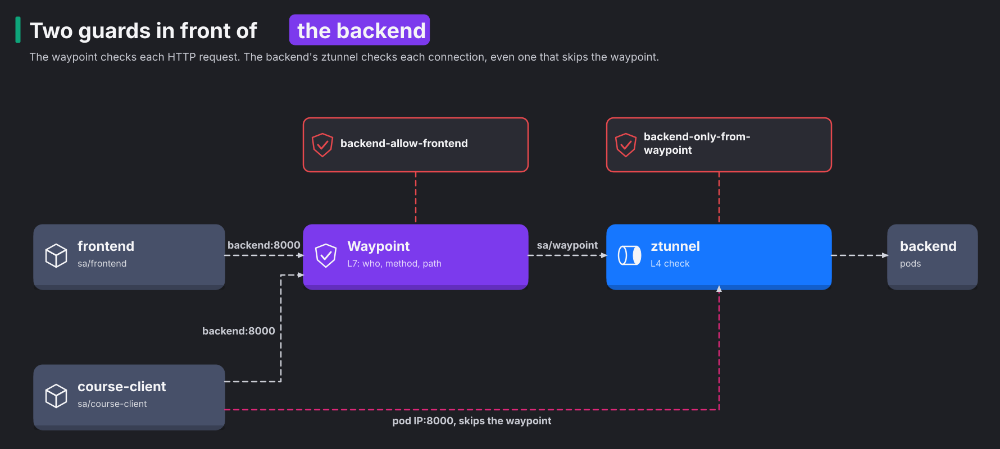

# Module 3: authorization

> New to a term here, like VirtualService or waypoint? The [glossary](glossary.md) explains every Istio resource and term in this course.

**Before this module:** module 2.

**You need:** the lab running (`./scripts/start.sh` starts or repairs it).

mTLS tells the receiver who is calling. Authorization decides whether to let that caller in. In this module you write rules at both layers of the mesh. You also see the gap that opens if you only write one of them.

## Concept: AuthorizationPolicy compared with NetworkPolicy

You know NetworkPolicy. It allows or blocks connections by pod labels, namespaces and IP ranges, and the CNI plugin enforces it. AuthorizationPolicy is Istio's equivalent. The table compares the two:

| | NetworkPolicy | Istio AuthorizationPolicy |
|---|---|---|
| Who is the caller | Pod labels, namespace, IP | Cryptographic identity from mTLS (service account) |
| What it matches | Ports | Ports, and at L7 also HTTP methods, paths, headers |
| Who enforces it | The CNI plugin | ztunnel (L4 rules) or a waypoint (L7 rules) |
| Spoofing | A pod with the right labels or IP passes | Only a pod running as that service account holds the certificate |

Both work side by side. This lab uses only AuthorizationPolicy.

## Concept: two enforcement points



The diagram shows two guards in front of the backend. The waypoint checks HTTP requests, and the backend's ztunnel checks connections. The dotted line shows `course-client` dialling a pod IP and skipping the waypoint. Each policy goes to one of the two guards, and the field you use to attach the policy picks which one:

- A policy with a `selector` names pod labels, so it attaches to the pods. ztunnel enforces it. ztunnel only sees L4 facts: the caller's identity, its namespace and the port.
- A policy with `targetRefs` names a Service, so it attaches to that Service's waypoint. The waypoint understands HTTP, so the rule also matches methods and paths.

The lab has one of each for the backend:

```yaml
# L7, on the waypoint: only the frontend may call GET or POST /api/*
name: backend-allow-frontend
targetRefs: [{kind: Service, name: backend}, ...]
rules:
  - from: [{source: {principals: ["cluster.local/ns/shop/sa/frontend"]}}]
    to:   [{operation: {methods: ["GET", "POST"], paths: ["/api/*"]}}]
---
# L4, on the backend pods: only the waypoint and Prometheus may connect at all
name: backend-only-from-waypoint
selector: {matchLabels: {app: backend}}
rules:
  - from: [{source: {principals: ["cluster.local/ns/shop/sa/waypoint",
                                  "cluster.local/ns/observability/sa/kube-prometheus-stack-prometheus"]}}]
```

## Concept: which caller each check sees

A waypoint does not pretend to be the client. Instead, it does three things:

1. It ends the frontend's connection.
2. It reads the request.
3. It opens a new connection to a backend pod, using its own certificate, `sa/waypoint`.

So the two checks see different callers for the same request:

| Check | Runs in | Caller it sees for a frontend request |
|---|---|---|
| `backend-allow-frontend` (L7) | waypoint | `sa/frontend` |
| `backend-only-from-waypoint` (L4) | ztunnel at the backend pod | `sa/waypoint` |

That's why the L4 rule names the waypoint and not the frontend. A common mistake is to write the pod-level rule with `sa/frontend`. Then every request through the waypoint fails at the backend's ztunnel, even though the frontend is the "right" caller.

There's a second trap. Suppose you put HTTP fields such as `methods` or `paths` in a policy with a `selector`. ztunnel enforces that policy, but ztunnel never reads HTTP. So Istio plays it safe. It turns the ALLOW rule into a DENY, and ztunnel closes every matching connection. If a rule mentions methods or paths, attach it with `targetRefs` so that a waypoint enforces it.

## Concept: how ALLOW rules combine

1. If any `DENY` policy matches the request, the proxy denies it.
2. If no `ALLOW` policy exists for the target, the proxy lets it through.
3. If `ALLOW` policies exist, the request must match at least one of them.

So a single ALLOW policy changes a workload to "deny unless allowed". ALLOW policies also add up. To give a new client access, you add a policy and leave the existing one alone.

## Why this way

**Why do you need the L4 rule if the L7 rule is stricter?** The L7 rule only sees traffic that goes through the waypoint. Some clients skip the waypoint. A client that connects straight to a backend pod's IP never reaches the waypoint, so the L7 rule never runs. Sidecar clients skip it too, because they pick a backend pod themselves. The L4 rule on the pods closes that path. It allows only the waypoint's identity. You will open and close this hole in the exercise.

**Why does Prometheus appear in the L4 rule?** Prometheus collects `/metrics` from each pod by its IP, not through the Service. So it also skips the waypoint, and the L4 rule has to let it in.

**Why identities and not namespaces?** A rule like "allow namespace `shop`" lets in every workload in `shop`. That includes a hacked one, or a test pod like `course-client`. A rule that names the service account allows exactly one workload.

**Why does Redis need only an L4 rule?** Redis speaks its own protocol, not HTTP, so there is nothing for a waypoint to inspect. "Only the backend may connect" is the whole rule.

## The bigger picture: two questions, not one

Security people keep two questions apart, and Istio does the same. Authentication asks "who are you?" Authorization asks "now that I know who you are, may you do this?" Module 2 answered the first question with certificates. This module deals with the second.

The two layers of the mesh see different things, and that decides what each rule checks. ztunnel works at layer 4. It sees a connection, the caller's identity from the certificate, and the destination port. That's all. It never looks inside the bytes. The waypoint works at layer 7. It reads the HTTP request, so it knows the method, the path and the headers. A rule like "only GET on /api/*" only makes sense where something reads HTTP.

Istio checks policies in a fixed order:

1. CUSTOM policies, which ask an outside service for a decision. This lab skips them.
2. DENY policies.
3. ALLOW policies.

A matching DENY always wins, whatever the ALLOW rules say. That gives you a handy emergency brake. You block one misbehaving caller with a small DENY policy, and you leave your ALLOW rules alone.

The habit that pays off most is "deny by default". Start with nothing allowed. Then add one rule for each caller that really needs access. It feels slow at first. But six months later, someone asks "who talks to Redis?" You answer by reading one file, instead of tracing traffic for a week. And if an attacker takes over the `course-client` pod, they find closed doors instead of an open network.

## Do it

**1. Deploy a client with its own identity.**

```bash
cat course/manifests/03-course-client.yaml
kubectl apply -f course/manifests/03-course-client.yaml
kubectl -n shop rollout status deploy/course-client
```

**What you should see.** You see the manifest, then `serviceaccount/course-client created`, `deployment.apps/course-client created` and `successfully rolled out`. The pod runs in `shop` as service account `course-client`. The namespace is in ambient mode, so ztunnel gives the pod the identity `spiffe://cluster.local/ns/shop/sa/course-client` with no extra step.

**2. The waypoint refuses it at L7.**

```bash
kubectl -n shop exec deploy/course-client -- curl -s -w " [%{http_code}]\n" http://backend:8000/api/version
kubectl -n shop exec deploy/course-client -- curl -s -o /dev/null -w "frontend [%{http_code}]\n" http://frontend:3000/healthz
```

**What you should see.**

```text
RBAC: access denied [403]
frontend [200]
```

The waypoint refused the call with HTTP 403 and wrote the body `RBAC: access denied` itself. The backend never saw the request. The frontend has no policy, so it answers.

**3. Allow exactly one call.**

```bash
cat course/manifests/03-allow-course-client.yaml
kubectl apply -f course/manifests/03-allow-course-client.yaml
sleep 5
kubectl -n shop exec deploy/course-client -- curl -s -w " [%{http_code}]\n" http://backend:8000/api/version
kubectl -n shop exec deploy/course-client -- curl -s -w " [%{http_code}]\n" http://backend:8000/api/orders
```

**What you should see.**

```text
{"version":"v1","pod":"backend-v1-54c86bf9b-wm5tn"} [200]
RBAC: access denied [403]
```

`/api/version` now returns `200`. `/api/orders` still returns `403`, because the new rule names only `GET /api/version`. The shop on http://localhost:8080 keeps working too. ALLOW policies add up, so the frontend's rule still matches the frontend's calls.

**4. Find the bypass.**

```bash
BACKEND_IP=$(kubectl -n shop get pod -l app=backend,version=v1 -o jsonpath='{.items[0].status.podIP}')
kubectl -n shop exec deploy/course-client -- curl -s -m 5 -o /dev/null -w "%{http_code}\n" http://$BACKEND_IP:8000/api/orders
```

**What you should see.** You see `000`, then `command terminated with exit code 56`, which means the connection was reset. The client dialled a pod IP, so no waypoint took part. The backend's ztunnel checked the L4 policy. That policy only admits the waypoint, so ztunnel closed the connection. Now remove that policy:

```bash
kubectl -n shop delete authorizationpolicy backend-only-from-waypoint
sleep 10
kubectl -n shop exec deploy/course-client -- curl -s -m 5 -o /dev/null -w "%{http_code}\n" http://$BACKEND_IP:8000/api/orders
```

**What you should see.** You see `authorizationpolicy.security.istio.io "backend-only-from-waypoint" deleted`, then `200`. `course-client` read the orders, even though its L7 rule forbids that. Without the L4 rule, the L7 rule protects only the front door. A client that walks around to the side door, the pod IP, gets in.

**5. Close it again.**

```bash
kubectl apply -f manifests/istio/security.yaml
sleep 10
kubectl -n shop exec deploy/course-client -- curl -s -m 5 -o /dev/null -w "%{http_code}\n" http://$BACKEND_IP:8000/api/orders
```

**What you should see.** Among the lines, you see `authorizationpolicy.security.istio.io/backend-only-from-waypoint created`. Then you see `000` and exit code 56 again. The other resources in the file report `configured`. The bypass is gone again.

## Investigate

1. Read ztunnel's log. After step 4, with the policy in place, run:

   ```bash
   kubectl -n istio-system logs ds/ztunnel --tail=100 | grep course-client | tail -3
   ```

   Find the two `error` lines for the backend pod. Which side wrote `allow policies exist, but none allowed`, and which side wrote `http status: 401 Unauthorized`? Compare `src.identity` with the principals in `backend-only-from-waypoint`.

2. Read the waypoint's log.
   1. Turn on access logs with `kubectl apply -f course/manifests/06-waypoint-access-logs.yaml`.
   2. Repeat step 2. Do this before step 3, while the waypoint still refuses `course-client`.
   3. Read `kubectl -n shop logs deploy/waypoint --tail=5`.

   Envoy logs the reason as `rbac_access_denied_matched_policy[none]`. What does `[none]` mean, given the ALLOW rules?
3. Use Kiali. Open **Istio Config**, namespace `shop`. How many AuthorizationPolicies does Kiali list, and does it flag any? What happens if a principal has a typo? Then open **Traffic Graph** and loop `course-client` on `/api/orders` for a minute. On which edge does the 403 show up?
4. In Grafana, open Explore with the Prometheus data source and run this query:

   ```promql
   sum by (source_workload, response_code) (increase(istio_requests_total{reporter="waypoint", destination_service_name=~"backend.*"}[5m]))
   ```

   Which `source_workload` carries the 403s? The query uses `increase` over 5 minutes, which counts requests even when you sent them in one short burst. A `rate` over 1 minute shows nothing once the burst is older than a minute.
5. Is Redis reachable from `course-client`? Try a port check, then real data:

   ```bash
   kubectl -n shop exec deploy/course-client -- nc -zv -w 3 redis 6379
   kubectl -n shop exec deploy/course-client -- sh -c "printf 'PING\r\n' | nc -w 3 redis 6379"
   ```

   The port check says `open`, but `PING` gets no `+PONG` back. Why? Hint: ask yourself which process accepted the TCP handshake. Look at the ztunnel log lines for `dst.service="redis..."`. What does this mean for port scans as a security test inside an ambient mesh?

<details>
<summary>Answers</summary>

1. You find two lines for the same attempt. Both carry `src.identity="spiffe://cluster.local/ns/shop/sa/course-client"`. Each end of the tunnel logged the same refusal once.
   - The `direction="inbound"` line comes from the backend's side. It says `error="connection closed due to policy rejection: allow policies exist, but none allowed"`. The caller's identity isn't in the policy's list, which only names `sa/waypoint` and Prometheus.
   - The `direction="outbound"` line comes from the client's side. Its HBONE `CONNECT` request got the answer `error="http status: 401 Unauthorized"`.
2. `[none]` means no policy matched. The waypoint holds only ALLOW policies for the backend. Once ALLOW policies exist, a request must match one of them. `course-client` matched none, so Envoy denied it by default. A matching DENY policy would show up by name instead. For example, a test DENY rule for `course-client` produced `rbac_access_denied_matched_policy[ns[shop]-policy[deny-course-client-test]-rule[0]]`. The full line reads like `"GET /api/version HTTP/1.1" 403 - rbac_access_denied_matched_policy[none]`, with `curl/8.11.1` as the user agent.
3. Kiali lists four, once step 3 has run: `backend-allow-frontend`, `backend-only-from-waypoint`, `redis-allow-backend` and `backend-allow-course-client`. All four pass validation.

   Kiali checks that each principal belongs to a real service account. Apply a policy with `cluster.local/ns/shop/sa/course-clinet`, and Kiali flags it at once with `KIA0106 Service Account not found for this principal`, severity error. Istio itself accepts the typo without complaint. That's why this Kiali check is worth having.

   In the graph, the 403s sit on the HTTP edge from `course-client` to the `backend` service node. 100% of its requests count as 4xx errors, with response code `403`. The edge stops at the service node, because the waypoint answered and no backend pod took part.
4. `course-client` carries them, with `response_code="403"`. The frontend's calls appear as `200`. The waypoint knows the caller's name from the certificate, not from anything the client sent. Notice that the query uses a regex. The waypoint labels these requests with the Service that the route picked, `backend-v1`, not with `backend`. So a filter on `destination_service_name="backend"` finds nothing.
5. The client's own ztunnel accepted the handshake, not Redis. ztunnel captures every outgoing connection on the client's node. It answers the TCP handshake right there, before it opens the HBONE tunnel to Redis. Then the rest happens in order:
   1. Redis's ztunnel checks `redis-allow-backend` and refuses with `allow policies exist, but none allowed`.
   2. The client's ztunnel logs `http status: 401 Unauthorized`.
   3. The client's ztunnel closes the connection without sending a byte of data.

   So `nc -z` reports `open` for any port inside the mesh. `nc -zv -w 3 redis 1234` says `open` too, and so does an unused pod IP. A port scan from an ambient pod tells you nothing. Test access with real requests, and read ztunnel's log for the verdict.

</details>

## Clean up

```bash
./course/reset.sh
```

`course-client` stays deployed for later modules. `./course/reset.sh --all` removes it.
