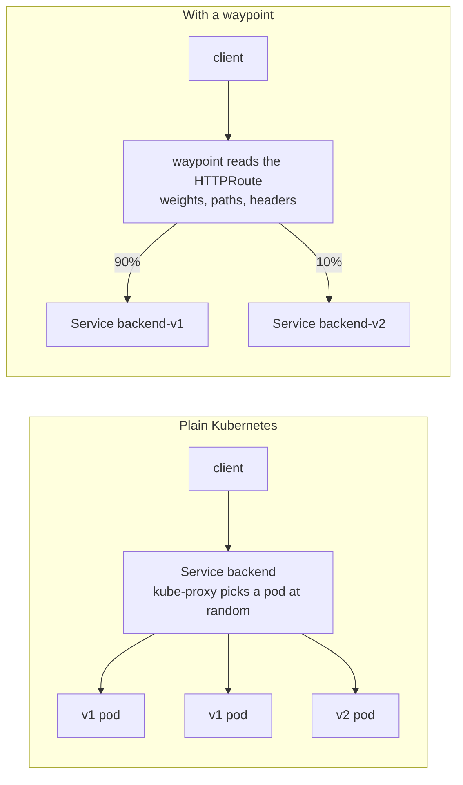

# Module 4: traffic routing

A Kubernetes Service spreads requests evenly over its pods. This module makes the waypoint decide instead: send a percentage to a new version, or route by what the request contains.

## Concept: who decides where a request goes



Without a mesh, the share each version gets equals its share of pods: 2 v1 pods and 1 v2 pod means about 33% to v2. To send 10% you would need 9 v1 pods for every v2 pod.

With a waypoint, the share is a number in a manifest, independent of pod counts. The route is a Gateway API `HTTPRoute`. Its `parentRefs` points at the `backend` Service, which means "this route applies to traffic addressed to `backend`". Its `backendRefs` lists where that traffic actually goes.

```yaml
spec:
  parentRefs:
    - group: ""
      kind: Service
      name: backend          # traffic sent to backend:8000...
      port: 8000
  rules:
    - backendRefs:
        - name: backend-v1   # ...goes 90% here
          port: 8000
          weight: 90
        - name: backend-v2   # ...and 10% here
          port: 8000
          weight: 10
```

## Why this way

**Why Gateway API and not Istio's VirtualService?** Istio has had its own routing API (VirtualService and DestinationRule) since 2017. Gateway API is the Kubernetes project's standard for the same job, supported by Istio, Cilium, Envoy Gateway and others. A route written against it works with other implementations. Istio still needs VirtualService for a few features Gateway API lacks, such as fault injection (module 5).

**Why one Service per version?** `backendRefs` points at Services, not label selectors. `backend-v1` and `backend-v2` each select one version. Istio's VirtualService uses "subsets" defined by labels in a DestinationRule instead. Both approaches end at the same pods.

**Why weights in a route and not replica counts?** Replica count is a capacity decision, traffic share is a release decision. Mixing them means you cannot scale v1 for load without changing the canary percentage.

**Why does the route attach to a Service and not to a Gateway?** In the mesh, the "gateway" is the waypoint, and the waypoint serves many Services. Attaching to the Service means the rule follows the destination, whoever the caller is.

## The bigger picture: deploy is not release

Teams used to treat "deploy" and "release" as one step. New code went out, and every user got it at once. If it broke, everybody saw it break. A mesh pulls those two steps apart. You deploy v2 so it runs next to v1, and then you decide, separately, who sees it.

Three common patterns use the tools you're about to try:

- **Canary.** Send a small share, say 10%, to v2. Watch its error rate and latency, then raise the share step by step. A bad release hurts 10% of users for a few minutes instead of everyone.
- **Blue-green.** Run two full copies and move all traffic at once, with one weight change from 100/0 to 0/100. Rolling back takes one more change.
- **Header routing, or dark launch.** Send only requests with a header like `x-version: v2` to the new version. Your testers use v2 in production while real users notice nothing.

One detail surprises people. A weighted route picks a backend for every request on its own. With a 90/10 split, one user might hit v1, then v2, then v1 again within a single page load. An API rarely minds. A website whose layout changed in v2 suddenly feels broken. Teams fix this by routing on something stable, like a cookie or a user id header, so each user sticks to one version.

Also keep the two directions of traffic apart in your head. North-south traffic enters the cluster from outside, through the ingress gateway on port 8080 in this lab. East-west traffic moves between services inside the cluster, through the waypoint. The canary route in this module sits on the east-west path. It splits the frontend's calls to the backend, no matter who started the request.

## Do it

Start steady traffic in a second terminal and leave it running during the module:

```bash
./course/load.sh 900 /api/version 5
```

Open Kiali **Traffic Graph**, namespace `shop`, graph type "Versioned app", Display: "Traffic Distribution" and "Traffic Animation". At first, all traffic goes to `backend v1`.

**1. Canary: 90% to v1, 10% to v2.**

```bash
kubectl apply -f manifests/scenarios/a-canary-httproute.yaml
./scripts/traffic-test.sh 300 10 /api/version
```

About 270 v1, 30 v2. In Kiali, after a minute, the edge to `v2` shows about 10%.

**2. Half and half.**

```bash
kubectl apply -f course/manifests/04-route-50-50.yaml
./scripts/traffic-test.sh 300 10 /api/version
```

About 150 each. This is the step where you would watch v2's error rate and latency before going further.

**3. Route by path, not by chance.**

```bash
cat course/manifests/04-route-by-path.yaml
kubectl apply -f course/manifests/04-route-by-path.yaml
./scripts/traffic-test.sh 50 5 /api/version     # 50 of 50 to v2
./scripts/traffic-test.sh 50 5 /api/orders      # 50 of 50 to v1
```

The route has two rules. The first matches the path prefix `/api/version` and sends it to v2. The second has no match, so it catches everything else. You could match on a header instead (`matches: - headers: - name: x-canary, value: "true"`) to let testers opt in to v2.

**4. See what the waypoint received.**

```bash
istioctl proxy-config routes deploy/waypoint -n shop | grep -E "MATCH|backend.shop"
```

```text
NAME                                                  VHOST NAME          DOMAINS  MATCH                    VIRTUAL SERVICE
inbound-vip|8000|http|backend.shop.svc.cluster.local  inbound|http|8000   *        PathPrefix:/api/version  backend-route-0-istio-autogenerated-k8s-gateway.shop
inbound-vip|8000|http|backend.shop.svc.cluster.local  inbound|http|8000   *        /*                       backend-route-0-istio-autogenerated-k8s-gateway.shop
```

Two things to notice:

- The two rows are your two rules, in the order Envoy tries them: the path match first, then the catch-all.
- The VIRTUAL SERVICE column says `backend-route-0-istio-autogenerated-k8s-gateway`. istiod translates every HTTPRoute into its own internal VirtualService form before it builds Envoy config. Gateway API is the interface, Istio's older API is still the engine.

The table can list a route more than once: istioctl prints every route configuration Envoy holds, including copies for each Service name. Only the MATCH and VIRTUAL SERVICE columns matter here.

## Investigate

1. In Grafana, open the dashboard **Shop mesh and traffic experiments**, panel "Backend request rate by workload". Watch it while you move from step 1 to step 3. How long after `kubectl apply` does the graph change? Most of the delay is Prometheus scraping every 15 seconds and the `rate(...[1m])` window, not the mesh.
2. Break the route on purpose and find it two ways:

   ```bash
   sed 's/name: backend-v2/name: backend-v3/' course/manifests/04-route-by-path.yaml | kubectl apply -f -
   ```

   In Kiali **Istio Config**, `backend-route` gets a red icon with `KIA1402 Reference doesn't have a valid service`. Without Kiali, the route's own status says the same:

   ```bash
   kubectl -n shop get httproute backend-route -o jsonpath='{range .status.parents[0].conditions[*]}{.type}={.status} {.reason}{"\n"}{end}'
   ```

   `Accepted=True` (the YAML is valid) but `ResolvedRefs=False BackendNotFound`. What happens to requests for `/api/version` meanwhile? Try it, then run `./course/reset.sh`.
3. Why does `/api/orders` in step 3 still create orders correctly when v2 serves `/api/version`? What would go wrong if v1 and v2 used different Redis schemas?

## Clean up

```bash
./course/reset.sh
```
