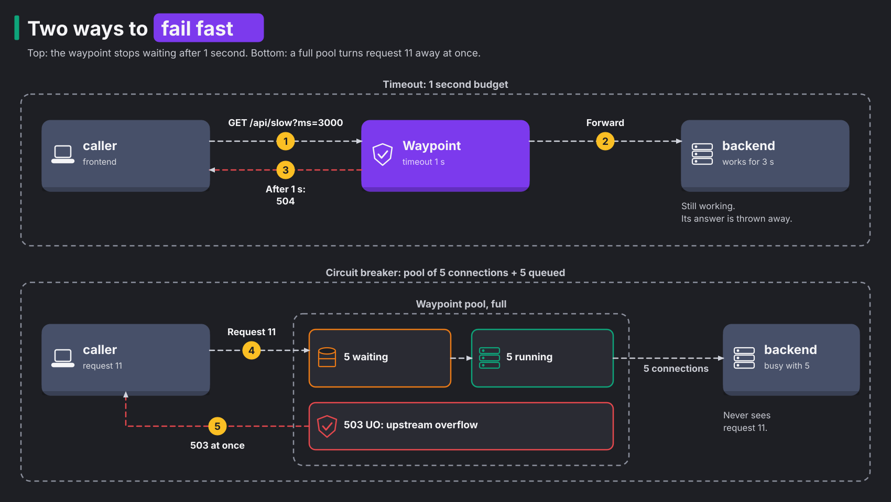

# Module 5: resilience

> New to a term here, like VirtualService or waypoint? The [glossary](glossary.md) explains every Istio resource and term in this course.

**Before this module:** module 4.

**You need:** the lab running (`./scripts/start.sh` starts or repairs it).

Networks fail and services slow down. When that happens, you want the damage to stay small. This module adds four protections: timeouts, fault injection, circuit breaking and rate limiting. Then you watch each one act in Grafana, in Jaeger and in the waypoint's access log.

## Concept: four tools for four failure modes

Each tool answers one kind of failure. The table pairs them up.

| Failure | Tool | Where it lives | What the caller sees |
|---|---|---|---|
| A call hangs | Timeout | HTTPRoute `timeouts.request` | `504` after the budget |
| You want to know if callers cope with failure | Fault injection | VirtualService `fault` | Delays and errors you chose |
| A slow backend drags everyone down | Circuit breaker | DestinationRule `connectionPool` | Immediate `503` once the pool is full |
| One client floods the service | Rate limit | the backend itself, in this lab | `429` over the limit |

The diagram walks through two of them. The top half shows a timeout of 1 second. The bottom half shows the circuit breaker with a pool of 5.



## Why this way

**Why put these in the mesh, not in the code?** Without a mesh, every team writes timeouts and retries in its own language. Each team then has its own bugs and its own defaults. In the waypoint, you configure them once. They look the same for every service, and they show up in the same metrics.

**Why a timeout in the route, not in the client?** The waypoint is the one place that sees every caller. So a route timeout protects all of the backend's callers, even one that forgot to set its own timeout.

**Why fail fast with a circuit breaker?** Without one, requests to a slow backend pile up in queues. Each waiting request holds a connection and memory in every hop in front of the backend. Soon the whole chain is slow. A circuit breaker rejects the extra requests at once. That keeps the callers responsive and gives the backend room to recover. You will see this as the "UO" response flag. It means Envoy refused to send the request because the upstream pool overflowed.

**Why fault injection?** You need to know how callers behave when the backend is slow. Waiting for that to happen by itself makes a poor test plan. Fault injection means the waypoint adds delays or errors on purpose. It tests the real code paths with real traffic, and you switch it off in seconds.

**Why is rate limiting in the app and not the waypoint?** Envoy has a local rate limiter. But Istio exposes it only through `EnvoyFilter`, and waypoints do not support `EnvoyFilter` in 1.24. A global limiter needs a separate rate-limit service. So the lab puts a token bucket in the backend, set by `RATE_LIMIT_RPS`. A token bucket is a counter that refills at a fixed rate, and each request spends one token. It shows the behaviour with no extra component.

**Why does fault injection need a VirtualService?** Gateway API has no fault injection field. Istio still supports its own API for features that the standard lacks. There's one catch. Istio defines no result when an HTTPRoute and a VirtualService both target the same Service. So you delete the route first.

## The bigger picture: how one slow service takes down ten

Failures in distributed systems rarely stay where they start. Picture the backend slowing from 50 ms to 5 seconds per request. Here is what follows:

1. The frontend keeps sending at the same rate, so requests pile up.
2. Each waiting request holds a connection, a thread or a slice of memory in every hop in front of the backend.
3. The frontend runs out of those as well.
4. Users see the frontend fail, not just the backend.

Engineers call this a cascading failure. It works like a traffic jam that spreads back from one blocked exit to the whole motorway.

Careless retries make it worse. Say the gateway, the frontend and the waypoint each make up to 3 attempts. Then one click turns into as many as 27 requests at the backend, at the exact moment it struggles most. That's a retry storm. The rule of thumb is to retry in one layer only. Retry only errors where a second try makes sense, like a reset connection. Never blindly retry a POST that creates an order.

Timeouts need the same care. The outer layer has to wait longer than the inner one. Imagine the frontend gives up after 1 second, while the waypoint waits 3 seconds for the backend. The frontend has already shown the user an error. Meanwhile, the backend keeps working on a request nobody wants. Think of it as a budget. Each layer spends part of the time its caller gave it.

Istio puts two different features under the name "circuit breaking", and people mix them up. The first protects a service from too much traffic. The second protects callers from one bad pod.

Connection pool limits, set with `connectionPool` in a DestinationRule, cap how many connections and waiting requests go to a service. Above the limit, Envoy rejects the request at once with the `UO` flag. The exercise below uses this one.

Outlier detection, set with `outlierDetection`, watches each backend pod separately. When a pod returns several 5xx errors in a row, Envoy takes it out of the load-balancing pool for a while. Each time Envoy ejects the same pod again, the break grows longer.

## Do it

Turn on the waypoint's access log for this module. It's off by default because it writes one line for every request:

```bash
cat course/manifests/06-waypoint-access-logs.yaml
kubectl apply -f course/manifests/06-waypoint-access-logs.yaml
```

**What you should see.** You see a `Telemetry` resource. Its `targetRefs` points at the Gateway `waypoint`, and it names the provider `envoy`. Then you see `telemetry.telemetry.istio.io/waypoint-access-logs created`. Only the waypoint changes. The gateway and ztunnel keep their logging as it was.

Keep a terminal open on it:

```bash
kubectl -n shop logs deploy/waypoint -f | grep -v "Envoy proxy"
```

**What you should see.** You see a few startup lines from the waypoint. Then you see one line per request through it, starting with a timestamp in square brackets: `[2026-11-12T19:05:52.385Z] "GET /api/slow?ms=300 HTTP/1.1" 200 - via_upstream ...`. After the status code come the response flags and a short reason. A flag of `-` means Envoy added nothing.

### 1. Timeout

```bash
kubectl apply -f course/manifests/05-timeout.yaml
curl -s -o /dev/null -w "%{http_code} in %{time_total}s\n" "http://localhost:8080/api/slow?ms=300"
curl -s -w " %{http_code} in %{time_total}s\n" "http://localhost:8080/api/slow?ms=3000"
```

**What you should see.**

```text
200 in 0.329724s
upstream request timeout 504 in 1.019298s
```

The 300 ms call fits in the 1 second budget. The waypoint cuts off the 3 second call after one second. The waypoint wrote the body `upstream request timeout`, and the frontend passed the 504 on to you. The access log shows the reason in its fourth and fifth fields:

```text
"GET /api/slow?ms=3000 HTTP/1.1" 504 UT response_timeout
```

`UT` is Envoy's response flag for "upstream request timeout".

### 2. Fault injection

```bash
kubectl -n shop delete httproute backend-route
kubectl apply -f manifests/scenarios/b-fault-injection.yaml
./scripts/traffic-test.sh 200 10
./scripts/traffic-test.sh 40 5 /api/version
```

**What you should see.** For `/api/orders`, about 10% of requests return `503`, and the average latency sits just above 500 ms. The lab got:

```text
Status codes
  503  20  (10%)
  200  180  (90%)

Backend versions
  v1  159  (80%)
  v2  21  (10%)
  unknown  20  (10%)

Average latency 525 ms, slowest 581 ms
```

Every request waits 500 ms, and then one in ten gets a 503. The 503s show version `unknown`. No backend answered them, so nobody set the `x-app-version` header. The VirtualService also splits traffic 90/10 between v1 and v2, so a few v2 answers appear.

`/api/version` returns 40 `200` with an average around 13 ms. The fault rule matches only the `/api/orders` prefix, so `/api/version` stays clean.

In the access log, the response flags show what the waypoint did:

- `DI` (delay injected) appears on every request.
- `DI,FI` (delayed, then fault injected) appears on the 503s.

```text
"GET /api/orders HTTP/1.1" 200 DI ...
"GET /api/orders HTTP/1.1" 503 DI,FI ...
```

### Concept: what the connection pool numbers mean

The scenario file sets a few limits under `connectionPool`. Two of them do the work in this step. Together they decide how many requests the waypoint lets through at once.

| Field | Value | Meaning |
|---|---|---|
| `tcp.maxConnections` | 5 | the waypoint opens at most 5 connections to the host |
| `http.http1MaxPendingRequests` | 5 | at most 5 requests wait for a free connection |

The backend speaks HTTP/1.1, and Envoy sends one HTTP/1.1 request at a time on a connection. So at most 5 requests run and 5 wait. Request number 11 gets `503 UO` at once. Think of a café with 5 tables and room for 5 people at the door. The eleventh guest is turned away at once. Now picture 50 callers and a backend that takes 300 ms. You should predict that most requests fail and only a small share fits through.

Three details catch people out.

First, the limits live inside each waypoint pod. Envoy counts its own connections and has no idea what other replicas do. If you scale the waypoint to two pods, the backend sees up to twice the traffic. Step 4 shows the same weakness for rate limits.

Second, a DestinationRule applies to the host the route picked, not to the host the caller dialled. The baseline route sends traffic to `backend-v1` and `backend-v2`. So the scenario file repeats the same limits for `backend`, `backend-v1` and `backend-v2`. A rule only for `backend` would never fire here.

Third, the breaker does not "open" for a while, as in the classic pattern. Envoy checks the counters for every request. The moment a slot frees up, the next request goes through.

### 3. Circuit breaking

First, run without a breaker to see the baseline:

```bash
./course/reset.sh
./scripts/traffic-test.sh 200 50 "/api/slow?ms=300"
```

**What you should see.** All 200 return `200`, every one from v1. The average latency sits above the 300 ms that the backend sleeps. The lab measured 414 ms, with the slowest at 704 ms. The extra time comes from the queue, because 50 requests at a time wait in front of the two v1 pods.

Now run with a pool of 5 connections and 5 queued requests:

```bash
kubectl apply -f manifests/scenarios/c-circuit-breaker.yaml
./scripts/traffic-test.sh 200 50 "/api/slow?ms=300"
```

**What you should see.** Most requests now return `503`, between 85% and 92% in the lab's runs. The average latency drops, to 248 ms in one run. It drops because a rejected request returns at once instead of waiting its turn. The access log shows `503 UO upstream_reset_before_response_started{overflow}` for each rejected request. The few that fit into the pool, about 25 of the 200, return `200` from v1.

### 4. Rate limiting

```bash
./course/reset.sh
kubectl -n shop set env deploy/backend-v1 deploy/backend-v2 RATE_LIMIT_RPS=20
kubectl -n shop rollout status deploy/backend-v1
./scripts/traffic-test.sh 400 40
```

**What you should see.** You see `env updated` for both Deployments and a rolling update of the v1 pods. Then most of the 400 requests return `429`. The lab got 318 `429` and 82 `200`. Each pod has its own bucket of 20 per second, so the total allowed rate grows with the number of pods. That's the main weakness of local rate limiting. It's also why production systems use a shared rate-limit service.

## Investigate

Run each step again with `./course/load.sh 120 <path> 10` in a second terminal, so the graphs have a full minute of data.

1. In Grafana, open the dashboard "Shop mesh and traffic experiments". During fault injection, which panel shows the errors, and which shows the delay? Why does "Backend p95 latency measured in the app" not show the 500 ms?
2. In Grafana, open Explore with the Prometheus data source. Run this query during the circuit breaker step:

   ```promql
   sum by (response_code, response_flags) (rate(istio_requests_total{reporter="waypoint", destination_service_name=~"backend.*"}[1m]))
   ```

   Which `response_flags` value appears with the 503s? Compare it with the fault injection step.
3. In Jaeger, pick the service `shop-gateway-istio.shop-ingress` and the tag `http.status_code=504`. Open a timed-out trace. The waypoint's span lasts about 1 s, but the backend's `GET /api/slow` span lasts about 3 s. What does that tell you about what a timeout does and does not do? What goes wrong if the slow request is a `POST` that a client retried after the 504?
4. In Kiali, open the Traffic Graph with "Response Time" edge labels. During the circuit breaker step, which edge turns red?
5. During rate limiting, which component returned the 429, the waypoint or the backend? Prove it with the access log or Jaeger.

<details>
<summary>Answers</summary>

1. "Backend responses by status code" shows the errors, as a `503` line at about one tenth of the total.

   "Backend p95 latency at the waypoint" shows the delay. The lab measured 975 ms there, not 525 ms. The reason is the histogram's buckets. They jump from 500 to 1000 ms, and the p95 estimate lands near the top of that bucket.

   "Backend p95 latency measured in the app" stays at about 10 ms. The waypoint holds each request for 500 ms before it forwards it. The backend's own timer only starts when the request arrives, so it never sees the wait.
2. The 503s carry `UO` (upstream overflow), on `response_code="503"`. The lab saw `{response_code="503", response_flags="UO"}` next to `{response_code="200", response_flags="-"}`. During fault injection, the 503s carry `DI,FI` instead, and the 200s carry `DI`. Both steps produce the same status code for different causes, and the flag tells them apart.

   `load.sh` at 10 per second produces only a few overflows. 10 requests of 300 ms rarely fill a pool of 5 plus 5. A burst like `./scripts/traffic-test.sh 200 50 "/api/slow?ms=300"` fills it at once.
3. The lab's trace had three spans:
   - The gateway span lasted 1017 ms, with status 504.
   - The waypoint span lasted 1004 ms, with `response_flags` `UT`.
   - The backend's `GET /api/slow` span lasted 3008 ms, with status 200.

   A timeout stops the waiting, not the work. The backend finished the job and answered, and nobody listened. Now take a `POST` that creates an order. The first attempt still writes its order after the 504. If the client retries, a second order appears. So retry only requests that are safe to repeat. Or give each request an idempotency key, a unique id that lets the server spot the duplicate.
4. The HTTP edge from `frontend` to the `backend` service node turns red. In the lab, 90% of its requests were `503` with the flag `UO`. Its response time sits near 0 ms, because the waypoint rejects at once.

   The edge from `shop-gateway-istio` to `frontend` turns red too, with 85% errors, because the frontend passes the 503 on. The edge from the `backend` service node to the `backend v1` pods stays clean, with only `200`. The rejected requests never reached a pod.
5. The backend returned it. The waypoint's access log shows `"GET /api/orders HTTP/1.1" 429 - via_upstream`. The line has no response flag, and `via_upstream` means the answer came from upstream, the backend pod. Compare that with the `UO` and `UT` lines, where the waypoint itself answered. The 429 responses also carry `x-app-version: v1`, a header that only the app sets. `./scripts/traffic-test.sh` counted all 400 answers as `v1`.

</details>

## Clean up

```bash
./course/reset.sh
```
