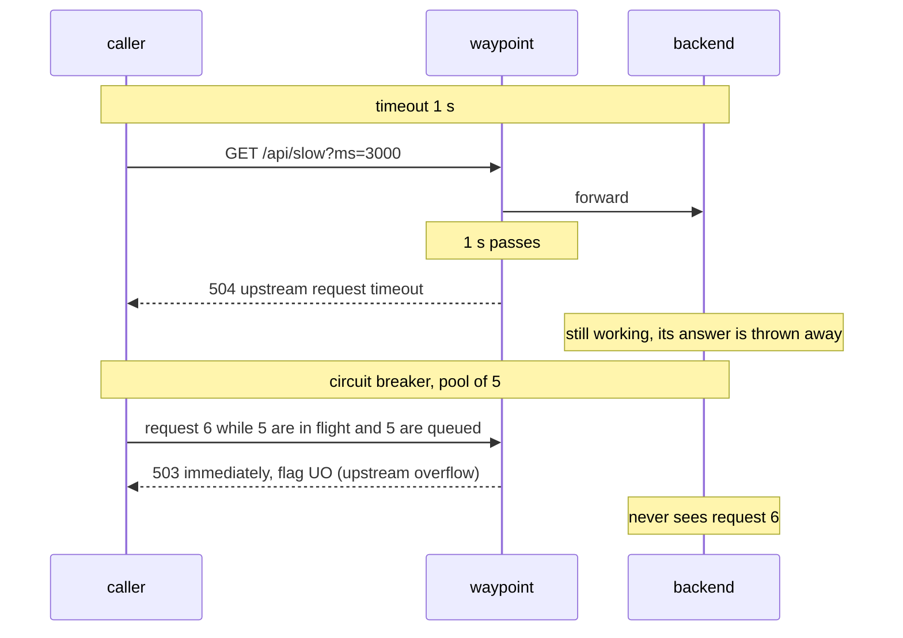

# Module 5: resilience

> New to a term here, like VirtualService or waypoint? The [glossary](glossary.md) explains every Istio resource and term in this course.

Networks fail and services slow down. This module adds timeouts, fault injection, circuit breaking and rate limiting, and uses Grafana, Jaeger and the waypoint's access log to see each one act.

## Concept: four tools for four failure modes

| Failure | Tool | Where it lives | What the caller sees |
|---|---|---|---|
| A call hangs | Timeout | HTTPRoute `timeouts.request` | `504` after the budget |
| You want to know if callers cope with failure | Fault injection | VirtualService `fault` | Delays and errors you chose |
| A slow backend drags everyone down | Circuit breaker | DestinationRule `connectionPool` | Immediate `503` once the pool is full |
| One client floods the service | Rate limit | the backend itself, in this lab | `429` over the limit |



## Why this way

**Why put these in the mesh, not in the code?** Every team would otherwise implement timeouts and retries in its own language, with its own bugs and its own defaults. In the waypoint they are configured once, look the same for every service, and show up in the same metrics.

**Why a timeout in the route, not in the client?** The waypoint is the one place that sees every caller. A route timeout protects the backend's callers even if one of them forgot to set its own.

**Why fail fast with a circuit breaker?** Without one, requests to a slow backend pile up in queues, each holding a connection and memory in every hop in front of it, until the whole chain is slow. Rejecting the excess immediately keeps the callers responsive and gives the backend room to recover. That is the "UO" response flag you will see: Envoy refused to send the request because the upstream pool overflowed.

**Why fault injection?** You cannot test how the frontend handles a slow backend by waiting for the backend to become slow. Injecting a delay in the waypoint tests the real code paths with real traffic, and you can switch it off in seconds.

**Why is rate limiting in the app and not the waypoint?** Envoy has a local rate limiter, but Istio exposes it only through `EnvoyFilter`, which waypoints do not support in 1.24. A global limiter needs a separate rate-limit service. For a lab, a token bucket in the backend (`RATE_LIMIT_RPS`) shows the behaviour with no extra component.

**Why does fault injection need a VirtualService?** Gateway API has no fault injection field. Istio still supports its own API for features the standard lacks. An HTTPRoute and a VirtualService must not both target the same Service, or the result is undefined, so you delete the route first.

## The bigger picture: how one slow service takes down ten

Failures in distributed systems rarely stay where they start. Picture the backend slowing from 50 ms to 5 seconds per request. The frontend keeps sending at the same rate, so requests pile up. Each one holds a connection, a thread or a slice of memory in every hop in front of the backend. Soon the frontend runs out of those as well, and users see the frontend fail, not just the backend. Engineers call this a cascading failure.

Careless retries make it worse. Say the gateway, the frontend and the waypoint each make up to 3 attempts. One click turns into as many as 27 requests at the backend, at the exact moment it struggles most. That's a retry storm. The rule of thumb: retry in one layer only, and only for errors where a second try makes sense, like a reset connection. Never blindly retry a POST that creates an order.

Timeouts need the same care. The outer layer has to wait longer than the inner one. Imagine the frontend gives up after 1 second while the waypoint waits 3 seconds for the backend. The frontend has already shown the user an error, and the backend keeps working on a request nobody wants. Think of it as a budget. Each layer spends part of the time its caller gave it.

Istio puts two different features under the name "circuit breaking", and people mix them up:

- **Connection pool limits** (`connectionPool` in a DestinationRule) cap how many connections and waiting requests go to a service. Above the limit, Envoy rejects the request at once with the `UO` flag. The exercise below uses this one.
- **Outlier detection** (`outlierDetection`) watches each backend pod separately. When a pod returns several 5xx errors in a row, Envoy takes it out of the load-balancing pool for a while. Each time Envoy ejects the same pod again, the break grows longer.

The first protects a service from too much traffic. The second protects callers from one bad pod.

## Do it

Turn on the waypoint's access log for this module. It is off by default because it is verbose:

```bash
cat course/manifests/06-waypoint-access-logs.yaml
kubectl apply -f course/manifests/06-waypoint-access-logs.yaml
```

Keep a terminal open on it:

```bash
kubectl -n shop logs deploy/waypoint -f | grep -v "Envoy proxy"
```

### 1. Timeout

```bash
kubectl apply -f course/manifests/05-timeout.yaml
curl -s -o /dev/null -w "%{http_code} in %{time_total}s\n" "http://localhost:8080/api/slow?ms=300"
curl -s -w " %{http_code} in %{time_total}s\n" "http://localhost:8080/api/slow?ms=3000"
```

```text
200 in 0.318s
upstream request timeout 504 in 1.016s
```

The access log shows the reason in its fourth and fifth fields:

```text
"GET /api/slow?ms=3000 HTTP/1.1" 504 UT response_timeout
```

`UT` is Envoy's response flag for "upstream request timeout".

### 2. Fault injection

```bash
kubectl -n shop delete httproute backend-route
kubectl apply -f manifests/scenarios/b-fault-injection.yaml
./scripts/traffic-test.sh 200 10
./scripts/traffic-test.sh 40 5 /api/version
```

About 10% of `/api/orders` requests return `503` and every one takes over 500 ms. `/api/version` is untouched: the fault rule matches only the `/api/orders` prefix.

In the access log, the response flags show what the waypoint did: `DI` (delay injected) on every request, and `DI,FI` (delayed, then fault injected) on the 503s:

```text
"GET /api/orders HTTP/1.1" 200 DI ...
"GET /api/orders HTTP/1.1" 503 DI,FI ...
```

### 3. Circuit breaking

First without a breaker, to see the baseline:

```bash
./course/reset.sh
./scripts/traffic-test.sh 200 50 "/api/slow?ms=300"
```

All `200`, but slow: 50 requests at a time queue up in front of three backend pods.

Now with a pool of 5 connections and 5 queued requests:

```bash
kubectl apply -f manifests/scenarios/c-circuit-breaker.yaml
./scripts/traffic-test.sh 200 50 "/api/slow?ms=300"
```

Most requests now return `503`, and they return fast. The access log shows `503 UO upstream_reset_before_response_started{overflow}`.

### 4. Rate limiting

```bash
./course/reset.sh
kubectl -n shop set env deploy/backend-v1 deploy/backend-v2 RATE_LIMIT_RPS=20
kubectl -n shop rollout status deploy/backend-v1
./scripts/traffic-test.sh 400 40
```

Most of the 400 return `429`. Each pod has its own bucket of 20 per second, so the total allowed rate grows with the number of pods. That is the main weakness of local rate limiting, and the reason production systems use a shared rate-limit service.

## Investigate

Run each step again with `./course/load.sh 120 <path> 10` in a second terminal, so the graphs have a full minute of data.

1. **Grafana**, dashboard "Shop mesh and traffic experiments". During fault injection, which panel shows the errors, and which shows the delay? Why does "Backend p95 latency measured in the app" not show the 500 ms?
2. **Grafana, Explore, Prometheus.** Run this query during the circuit breaker step:

   ```promql
   sum by (response_code, response_flags) (rate(istio_requests_total{reporter="waypoint", destination_service_name=~"backend.*"}[1m]))
   ```

   Which `response_flags` value appears with the 503s? Compare it with the fault injection step.
3. **Jaeger**, service `shop-gateway-istio.shop-ingress`, Tags `http.status_code=504`. Open a timed-out trace. The waypoint's span lasts about 1 s, but the backend's `GET /api/slow` span lasts about 3 s. What does that tell you about what a timeout does and does not do? What could go wrong if the slow request had been a `POST` that a client retried after the 504?
4. **Kiali**, Traffic Graph with "Response Time" edge labels. During the circuit breaker step, which edge turns red?
5. During rate limiting, which component returned the 429: the waypoint or the backend? Prove it with the access log or Jaeger.

## Clean up

```bash
./course/reset.sh
```
