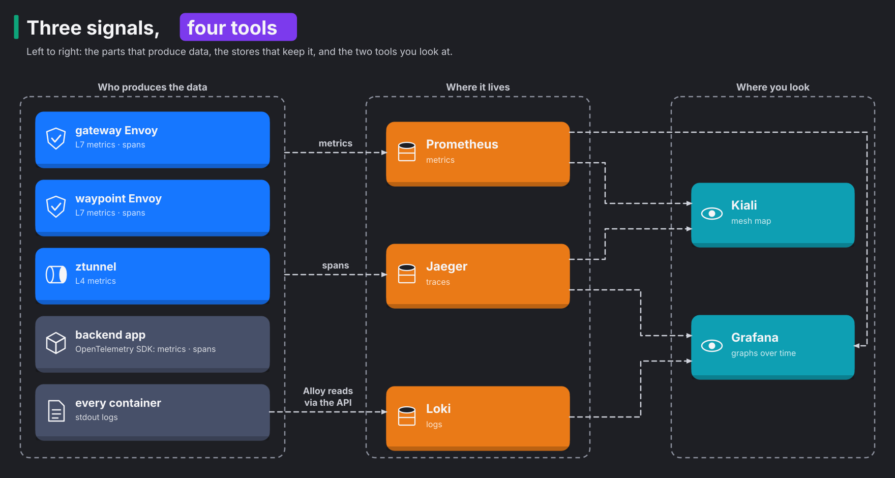

# Module 6: observability

> New to a term here, like VirtualService or waypoint? The [glossary](glossary.md) explains every Istio resource and term in this course.

**Before this module:** modules 4 and 5.

**You need:** the lab running (`./scripts/start.sh` starts or repairs it), and `./scripts/port-forward.sh` running in a spare terminal for Jaeger (http://localhost:16686), Grafana and Kiali.

When something breaks, you need to see what happened. The mesh helps here, because it measures every request it carries, with no code in the application. This module shows three things:

- what the mesh records
- where each kind of data lives
- how to follow a single request across metrics, traces and logs

## Concept: three signals, four tools



The diagram reads from left to right. On the left are the parts that produce data. In the middle are the stores that keep it. On the right are the two tools you look at. The table sums up the three kinds of data, called signals.

| Signal | Answers | Produced by |
|---|---|---|
| Metrics | How many, how fast, how many failed, over time | ztunnel (TCP bytes and connections), waypoint and gateway (HTTP requests, codes, latency), the app (its own counters) |
| Traces | Where did this one request spend its time | gateway and waypoint spans, plus the backend's own spans |
| Logs | What did the code say while it happened | every container's stdout, collected into Loki |

## Concept: which proxy reports what

Each proxy only reports what it understands. ztunnel never reads HTTP, so it reports only TCP facts: connections opened and closed, and bytes sent and received. HTTP metrics come from the two Envoy proxies, the gateway and the waypoint. HTTP metrics are request counts by status code and latency histograms.

You will see the result in the exercises. **Traffic to a Service without a waypoint has no HTTP metrics.** The frontend's traffic to Redis is TCP only, which is fine for Redis. If you needed HTTP metrics for the frontend, you would give it a waypoint.

One request often passes two proxies, and both record it. The `reporter` label says which proxy recorded a metric:

| `reporter` | Recorded by |
|---|---|
| `source` | the client side, here the ingress gateway |
| `waypoint` | the waypoint |
| `destination` | the server side, in sidecar mode |

That table holds for the HTTP metric `istio_requests_total`. ztunnel's TCP metrics carry `reporter` too. ztunnel sets it to `source` or `destination`, depending on which end of the connection it sat on. So one connection often shows up twice, once from each side. Always filter or group by `reporter`. Otherwise you count the same traffic twice.

The diagram's arrows show where data ends up, not who sends it. Metrics and spans travel in opposite directions:

- Nobody pushes metrics. Each proxy and app serves its numbers on a metrics port. Prometheus pulls them every 15 seconds. PodMonitors, small resources that list which pods to scrape, tell Prometheus where to look.
- Spans travel the other way. The gateway, the waypoint and the backend push them to Jaeger.

This difference explains the lag you saw in module 4. A metric only moves after the next scrape, and once the `rate()` window fills.

## Concept: how one trace crosses three processes

A single request passes through the gateway, the frontend, the waypoint and the backend. To see its whole path, each process has to record its part and tag it with the same id.

A span is one timed piece of work, such as "the waypoint handled this request". A trace is a tree of spans that share a trace id. The id travels between processes in the W3C `traceparent` HTTP header:

```text
traceparent: 00-261b80c9d5032cc2619778fe9c1881c4-4f834e4ebc2759f7-01
                 trace id (32 hex)                 parent span id   sampled
```

Here is how one trace grows, hop by hop:

1. The gateway sees no `traceparent`, so it starts a trace, records a span and adds the header.
2. The frontend records nothing, but it copies the header onto its call to the backend. That's the only thing an app must do to keep a trace connected.
3. The waypoint records a span as a child of the gateway's span and passes the header on.
4. The backend's OpenTelemetry SDK, a tracing library inside the app, continues the same trace. It adds its own spans, including the Redis calls.
5. The backend writes the trace id into its log lines.

## Why this way

**Why do proxies record metrics, not the apps?** When the proxies record them, every service reports the same metrics with the same labels, whatever its language. You build a dashboard once, and it works for every service in the mesh.

**Why must the app forward headers?** A proxy has no way to know which incoming request caused the frontend's outgoing call. Only the application knows that. When the app forwards `traceparent`, it tells the mesh "these two belong together".

**Why does the backend still use an SDK?** Proxies see the request enter and leave the backend. They don't see the Redis calls inside it. The SDK adds those spans to the same trace.

**Why put the trace id in log lines?** The trace id links a trace to its logs, like an order number on both a receipt and a delivery note. Grafana uses it to jump from a span to the log lines it produced, and from a log line back to its trace.

**Why 100% sampling here?** Sampling means keeping only some traces. The lab keeps all of them, so every request you send shows up in Jaeger. In production you would trace 1 to 5% of requests, because storing every trace is expensive.

## The bigger picture: what to measure first

Three signal types and four tools make it easy to drown. So start with three numbers per service. People call them the RED method, after their first letters:

- Rate, the number of requests per second
- Errors, the number of requests that fail
- Duration, how long requests take

The mesh gives you all three for every service without a line of code. They come from `istio_requests_total` and `istio_request_duration_milliseconds`.

Look at percentiles, not averages. Say 99 requests take 10 ms and one takes 5 seconds. The average comes out at about 60 ms and hides the problem completely. The 99th percentile, p99, is the time that 99% of requests stay under. Here it shows the 5 seconds. Real users remember the slow requests, so p95 and p99 tell you far more than the mean.

Each signal answers a different question:

| Signal | What it tells you | Cost |
|---|---|---|
| Metrics | *that* something is wrong | cheap, so you keep them for weeks |
| Traces | *where* in the chain the time went | higher, so you sample them |
| Logs | *why*: the error message, the stack trace, the order id | |

A good investigation moves in that order:

1. A dashboard turns red.
2. A trace points at one service.
3. That service's logs explain the failure.

The exercises in this module follow the same path.

Watch out for one trap: labels with too many values. Prometheus stores one time series for every unique combination of label values. If you add a label like `user_id` or the full URL, one metric explodes into millions of series. Prometheus then runs out of memory. Istio avoids this on purpose. Its metrics carry labels for the source and destination workloads, the response code and the response flags. They never carry the request path. Check it yourself in Prometheus. No label on `istio_requests_total` holds a path.

## Do it

### 1. Follow one request from trace to log and back

```bash
curl -s -X POST -H 'content-type: application/json' -d '{"item":"find-me","quantity":1}' http://localhost:8080/api/orders
```

**What you should see.** You see the new order as JSON, created by v1:

```text
{"version":"v1","order":{"id":"2","item":"find-me","quantity":"1","created_at":"2026-11-12T19:15:42.309483+00:00","created_by":"v1"}}
```

The `id` counts up from earlier orders, because Redis keeps them across resets.

1. Open **Jaeger** (http://localhost:16686). Pick service `backend` and operation `POST /api/orders`, then click **Find Traces**. Open the newest trace.
2. You see spans from three services: `shop-gateway-istio.shop-ingress`, `waypoint.shop` and `backend`. Expand them. The backend's spans include `INCRBY` and `HSET LPUSH LTRIM`, which are the Redis commands. Each span sits inside the one above it. In the lab's trace, the spans took these times:
   - the gateway span: 47 ms
   - the waypoint span: 7 ms
   - the backend's `POST /api/orders`: 4 ms
   - the two Redis calls: about 0.4 and 1.1 ms
3. Copy the trace id from the top of the page.
4. Open **Grafana**, Explore, data source **Loki**, and run:

   ```logql
   {namespace="shop", app="backend"} |= "<paste the trace id>"
   ```

   **What you should see.** You see exactly one line, the backend's "request handled" log line for that request. It has `"method":"POST"`, `"path":"/api/orders"` and the same `trace_id`.
5. To go back, copy the `trace_id` value from the log line. Paste it into the search box at the top of the Jaeger page, which looks up a trace by id. You land on the same trace.
6. Grafana also does both jumps with one click. In Explore, pick the **Jaeger** data source and find the same trace. Click a `backend` span and choose **Logs for this span**. Grafana runs the Loki query from step 4 for you. In a Loki result, the `trace_id` field carries an **Open trace in Jaeger** link back. Module 24 explains how these links work, and why they once came out empty.

### 2. Read the mesh's metrics

In Grafana, open Explore and pick the data source **Prometheus**. Run these queries:

```promql
# requests per second through the waypoint, by destination and status
sum by (destination_workload, response_code) (rate(istio_requests_total{reporter="waypoint"}[1m]))

# p95 latency in milliseconds, per backend version
histogram_quantile(0.95, sum by (le, destination_workload) (rate(istio_request_duration_milliseconds_bucket{reporter="waypoint"}[1m])))

# TCP connections ztunnel opened, per destination
sum by (destination_workload) (rate(istio_tcp_connections_opened_total[1m]))
```

Send traffic first with `./course/load.sh 120` so the `rate()` window has data.

**What you should see.** With `load.sh` running at its default 5 requests per second, the three queries return this.

The first query shows `backend-v1` with `response_code="200"` at about 5 per second. A `201` series appears too, near 0. It's left over from the `POST` in step 1.

The second query shows `backend-v1` at `10`. That's an estimate sitting on a bucket edge, not a measurement. Istio's histogram buckets run 0.5, 1, 5, 10, 25, 50 ms and up. Prometheus only knows how many requests fell into each bucket, not their exact times. In other words, it knows a request took between 5 and 10 ms, but not whether it took 6 or 9.

The third query lists many workloads, not only the shop: `frontend`, `backend-v1`, `redis`, Grafana, Loki, istiod and more. ztunnel counts every connection of every pod in an ambient namespace, and that includes Prometheus's own scrapes.

### Concept: who decides to keep a trace

With sampling below 100%, someone must decide which traces to keep. If each hop decided alone, you would get broken traces with missing spans. So the first hop decides for everyone, and the decision travels in the header.

The last two digits of `traceparent` carry the decision. `01` means "sampled, record this trace", and `00` means "don't". The decision happens in three steps:

1. The first proxy that sees a request without a `traceparent` makes the choice. Here that's the ingress gateway.
2. The gateway rolls the dice once, using its `randomSamplingPercentage`, and writes the result into the header.
3. The waypoint and the backend's SDK follow the flag they receive.

So 10% sampling keeps 10% of whole traces. Sampling never gives you a trace with the gateway span but no backend span.

The Telemetry resource sets the sampling rate. It follows the same layering as PeerAuthentication:

- A Telemetry in `istio-system` covers the whole mesh.
- A Telemetry in a namespace overrides it for that namespace.
- A Telemetry with `targetRefs` or a `selector` overrides it for a single proxy.

A common mistake follows from the first-hop decision. You lower the sampling rate on the waypoint alone and see no change. The gateway already decided for every request that reaches the waypoint.

### 3. Change the sampling rate

```bash
kubectl -n istio-system patch telemetry mesh-default --type merge \
  -p '{"spec":{"tracing":[{"providers":[{"name":"jaeger-otlp"}],"randomSamplingPercentage":10}]}}'
./scripts/traffic-test.sh 200 10 /api/version
```

**What you should see.** You see `telemetry.telemetry.istio.io/mesh-default patched`, then 200 `200` answers. Jaeger now holds about 20 new traces for the 200 requests. The lab counted 19 in one run and 25 in another. The gateway rolls the dice for each new request, so the count wobbles around 10%. Put it back with `./course/reset.sh`, which restores `randomSamplingPercentage: 100`.

### 4. Turn on access logs for one proxy

```bash
kubectl apply -f course/manifests/06-waypoint-access-logs.yaml
curl -s -o /dev/null http://localhost:8080/api/orders
kubectl -n shop logs deploy/waypoint --tail=1
```

**What you should see.** You see one access log line for your request:

```text
[2026-11-12T19:19:00.868Z] "GET /api/orders HTTP/1.1" 200 - via_upstream - "-" 0 290 4 4 "-" "node" "21e5901f-..." "backend.shop.svc.cluster.local:8000" "envoy://connect_originate/10.42.0.91:8000" inbound-vip|8000|http|backend-v1.shop.svc.cluster.local ...
```

The line holds a few fields worth reading:

- The user agent reads `node`. The frontend, a Node.js app, made the call, not your curl.
- `290` is the response size in bytes.
- The two `4`s are the total time and the backend's time, in milliseconds.

A `Telemetry` resource with `targetRefs` changes one proxy. The mesh-wide one in `istio-system` changes all of them.

### 5. Read the logs as data

Logs are text, but you often want numbers from them, such as how many requests failed. Three parts make that work in this lab:

- Alloy collects every pod's output and sends it to Loki.
- Loki stores the logs. To keep storage cheap, it indexes only a few labels per stream, `namespace`, `app` and `pod`. It never indexes the text itself.
- LogQL is Loki's query language. You use it to filter the text at query time.

The backend writes one JSON line per request. So LogQL parses each line and turns its fields into numbers.

Send some traffic with errors in it, then open Grafana, Dashboards, **Shop logs**:

```bash
for i in $(seq 1 30); do curl -s -o /dev/null localhost:8080/api/orders; curl -s -o /dev/null localhost:8080/api/nope; done
curl -s -o /dev/null "localhost:8080/api/slow?ms=400"
```

**What you should see.** You see seven panels, all built from log lines:

| Panel | LogQL behind it | What it teaches |
|---|---|---|
| Log lines per second, by app | `sum by (app) (rate({namespace="shop"}[1m]))` | `rate()` works on log streams too |
| Backend responses by status | `count_over_time({...app="backend"} \| json \| message="request handled" [1m])` by `status` | `\| json` turns each JSON field into a label you group by |
| Log lines by level | the same, by `level` | `INFO` from the backend, `error` from the frontend |
| Backend p95 duration per path | `quantile_over_time(0.95, ... \| unwrap duration_ms ...) by (path)` | `unwrap` turns a field into a number: percentiles from text |
| Top failing paths | `topk(10, ... \| json \| status >= 400 ...)` | `/api/nope` with `404` |
| Errors in shop | `{namespace="shop"} \| json \| level=~"(?i)error\|warning" or status >= 500` | raw lines, filtered |
| Live logs | `{namespace="shop", app=~"$app"} \|= "$search"` | pick apps at the top, type into **Search text**, like a `grep` across every pod |

In the test run, the status panel showed `200`, `201`, `404`, `429` and `503`. The last two were left over from the module 5 and 15 checks a few minutes earlier. The p95 panel put `/api/slow` near 400 ms and `/api/nope` below 1 ms. Click any line in a logs panel to open its fields, including the `trace_id` link to Jaeger.

Sometimes logs and metrics answer the same question. The dashboard's status panel and Prometheus' `istio_requests_total` usually agree. When they don't, the difference tells you something. Investigate question 4 shows a case. Counting from logs reads every line, so it's slower and costs more at scale. Keep it for apps that have no metrics, or for questions that metrics leave open, like "which order ids failed?".

## Investigate

1. In Grafana Explore, run `sum by (reporter) (rate(istio_requests_total[5m]))`. Which reporters appear? Which do not, and why?
2. Run `sum by (destination_workload) (rate(istio_requests_total[5m]))`. Is `redis` in the result? Now run the same with `istio_tcp_sent_bytes_total`. Explain the difference.
3. Send one slow request with `curl -s -o /dev/null http://localhost:8080/api/slow?ms=1500`. In Kiali, open **Workloads**, then `waypoint`, then the **Traces** tab. These traces come from Jaeger. Which dot sits highest in the scatter plot, and why?
4. In Loki, compare `{namespace="shop", app="backend"} | json | status >= 400` with the "Backend responses by status code" panel during the module 5 fault injection. Why do the injected 503s appear in the panel but not in the backend's logs?
5. Find a trace with only two spans, from the gateway and the waypoint, and none from the backend. What kind of request produces that?

<details>
<summary>Answers</summary>

1. Two reporters appear, `source` and `waypoint`.
   - `source` comes from the ingress gateway. It reports the requests it sends to the frontend.
   - `waypoint` comes from the waypoint. It reports the frontend's calls to the backend.

   `destination` never appears. Only a sidecar on the receiving side reports that, and the shop runs no sidecars. ztunnel reports no HTTP metrics at all.
2. No. `istio_requests_total` lists only `frontend` and `backend-v1`, plus `unknown` for requests that no backend answered. The bytes metric does list `redis`, along with `frontend`, the backends and `waypoint`. Redis has no waypoint, so only ztunnel sees its traffic. ztunnel counts bytes and connections, never requests. The same holds for any Service without a waypoint.
3. The dot for your slow request sits highest, at about 1500 ms. Every other dot sits near the bottom, at a few milliseconds. Its root span comes from the gateway, `frontend.shop.svc.cluster.local:3000/*`, because the trace started there. The backend's `/api/slow` endpoint sleeps on purpose for the number of milliseconds you pass. So the time went into the backend, not into the mesh. Open the trace to see the backend's `GET /api/slow` span fill almost the whole bar.
4. The waypoint invented those 503s. It answered in place of the backend, so the request never reached the app, and the app had nothing to log. The panel reads `istio_requests_total`. The waypoint writes that metric for every response it sends, its own included. In the lab, `load.sh` counted 90 `503` and 690 `200` during a fault injection run. Loki held 690 backend log lines for `/api/orders` in that window, and zero with `status >= 400`.
5. A request that the waypoint answered by itself produces it. Turn on the module 5 fault injection. Then search Jaeger for service `waypoint.shop` with tag `http.status_code=503`. Each trace has exactly two spans, `shop-gateway-istio.shop-ingress` and `waypoint.shop`. The waypoint's span carries `response_flags` `DI,FI`.

</details>

## Clean up

```bash
./course/reset.sh
```
