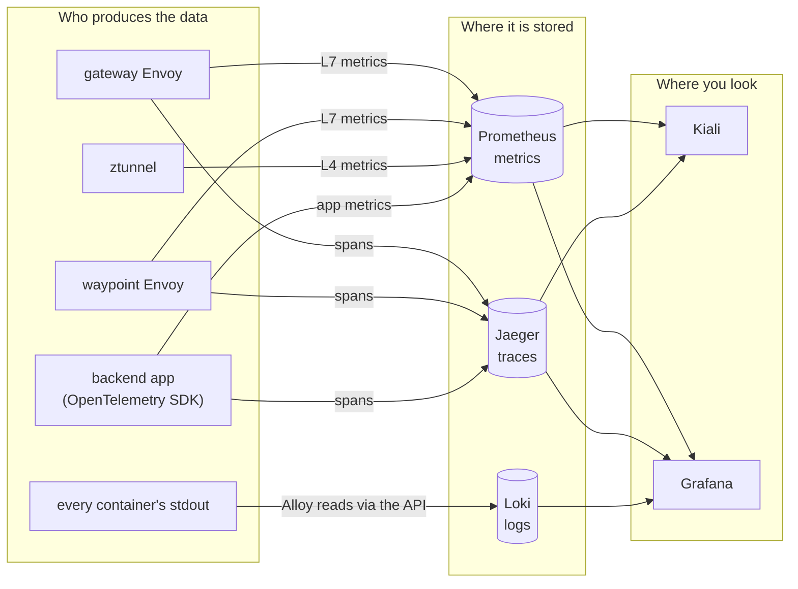

# Module 6: observability

The mesh measures every request it carries, with no code in the application. This module shows what it records, where each signal lives, and how to follow a single request across metrics, traces and logs.

## Concept: three signals, four tools



| Signal | Answers | Produced by |
|---|---|---|
| Metrics | How many, how fast, how many failed, over time | ztunnel (TCP bytes and connections), waypoint and gateway (HTTP requests, codes, latency), the app (its own counters) |
| Traces | Where did this one request spend its time | gateway and waypoint spans, plus the backend's own spans |
| Logs | What did the code say while it happened | every container's stdout, collected into Loki |

## Concept: which proxy reports what

ztunnel never parses HTTP, so it reports only TCP: connections opened and closed, bytes sent and received. HTTP metrics (request counts by status code, latency histograms) come from the Envoy proxies: the gateway and the waypoint. That has a consequence you will see in the exercises: **traffic to a Service without a waypoint has no HTTP metrics**. Frontend to Redis is TCP only, which is fine for Redis. If you needed HTTP metrics for the frontend, you would give it a waypoint.

The `reporter` label says which proxy recorded a metric:

| `reporter` | Recorded by |
|---|---|
| `source` | the client side, here the ingress gateway |
| `waypoint` | the waypoint |
| `destination` | the server side, in sidecar mode |

## Concept: how one trace crosses three processes

A trace is a tree of spans that share a trace id. The id travels in the W3C `traceparent` HTTP header:

```text
traceparent: 00-261b80c9d5032cc2619778fe9c1881c4-4f834e4ebc2759f7-01
                 trace id (32 hex)                 parent span id   sampled
```

1. The gateway sees no `traceparent`, so it starts a trace, records a span and adds the header.
2. The frontend does not trace, but it copies the header onto its call to the backend. That is the only thing an app must do to keep a trace connected.
3. The waypoint records a span as a child and passes the header on.
4. The backend's OpenTelemetry SDK continues the same trace with its own spans, including the Redis calls, and writes the trace id into its log lines.

## Why this way

**Why do proxies record metrics, not the apps?** Every service then reports the same metrics with the same labels, whatever language it is written in. A dashboard built once works for every service in the mesh.

**Why must the app forward headers?** A proxy cannot know that the frontend's outgoing call was caused by a particular incoming request. Only the application knows that. Forwarding `traceparent` is the app telling the mesh "these two belong together".

**Why does the backend still use an SDK?** Proxies see the request enter and leave. They cannot see the Redis calls inside the backend. The SDK adds those spans to the same trace.

**Why put the trace id in log lines?** It is the join key between a trace and its logs. Grafana uses it to jump from a span to the log lines it produced, and from a log line back to its trace.

**Why 100% sampling here?** So every request you send is in Jaeger. In production you would trace 1 to 5% of requests, because storing every trace is expensive.

## Do it

### 1. Follow one request from trace to log and back

```bash
curl -s -X POST -H 'content-type: application/json' -d '{"item":"find-me","quantity":1}' http://localhost:8080/api/orders
```

1. Open **Jaeger** (http://localhost:16686). Service `backend`, operation `POST /api/orders`, **Find Traces**. Open the newest.
2. You see spans from three services: `shop-gateway-istio.shop-ingress`, `waypoint.shop` and `backend`. Expand them. The backend's spans include `INCRBY` and `HSET LPUSH LTRIM`: the Redis commands.
3. Copy the trace id from the top of the page.
4. Open **Grafana**, Explore, data source **Loki**, and run:

   ```logql
   {namespace="shop", app="backend"} |= "<paste the trace id>"
   ```

   You get the backend's "request handled" log line for that request.
5. Expand the log line. Next to `trace_id`, Grafana shows a link **Open trace in Jaeger**. Click it and you are back on the trace.

You can also start in Grafana: Explore, data source **Jaeger**, search for the trace, open a span, and click **Logs for this span**.

### 2. Read the mesh's metrics

In Grafana, Explore, data source **Prometheus**:

```promql
# requests per second through the waypoint, by destination and status
sum by (destination_workload, response_code) (rate(istio_requests_total{reporter="waypoint"}[1m]))

# p95 latency in milliseconds, per backend version
histogram_quantile(0.95, sum by (le, destination_workload) (rate(istio_request_duration_milliseconds_bucket{reporter="waypoint"}[1m])))

# TCP connections ztunnel opened, per destination
sum by (destination_workload) (rate(istio_tcp_connections_opened_total[1m]))
```

Send traffic first with `./course/load.sh 120` so the `rate()` window has data.

### 3. Change the sampling rate

```bash
kubectl -n istio-system patch telemetry mesh-default --type merge \
  -p '{"spec":{"tracing":[{"providers":[{"name":"jaeger-otlp"}],"randomSamplingPercentage":10}]}}'
./scripts/traffic-test.sh 200 10 /api/version
```

Jaeger now holds about 20 new traces for the 200 requests (the lab measured 19). Put it back with `./course/reset.sh`.

### 4. Turn on access logs for one proxy

```bash
kubectl apply -f course/manifests/06-waypoint-access-logs.yaml
curl -s -o /dev/null http://localhost:8080/api/orders
kubectl -n shop logs deploy/waypoint --tail=1
```

A `Telemetry` resource with `targetRefs` changes one proxy. The mesh-wide one in `istio-system` changes all of them.

## Investigate

1. In Grafana Explore, run `sum by (reporter) (rate(istio_requests_total[5m]))`. Which reporters appear? Which do not, and why?
2. Run `sum by (destination_workload) (rate(istio_requests_total[5m]))`. Is `redis` in the result? Now run the same with `istio_tcp_sent_bytes_total`. Explain the difference.
3. In Kiali, open **Workloads**, `backend-v1`, tab **Traces**. These come from Jaeger. Click a dot in the scatter plot. Which request is slowest, and why?
4. In Loki, compare `{namespace="shop", app="backend"} | json | status >= 400` with the "Backend responses by status code" panel during the module 5 fault injection. Why do the injected 503s appear in the panel but not in the backend's logs?
5. Find a trace with only two spans (gateway and waypoint, no backend). What kind of request produces that?

## Clean up

```bash
./course/reset.sh
```
