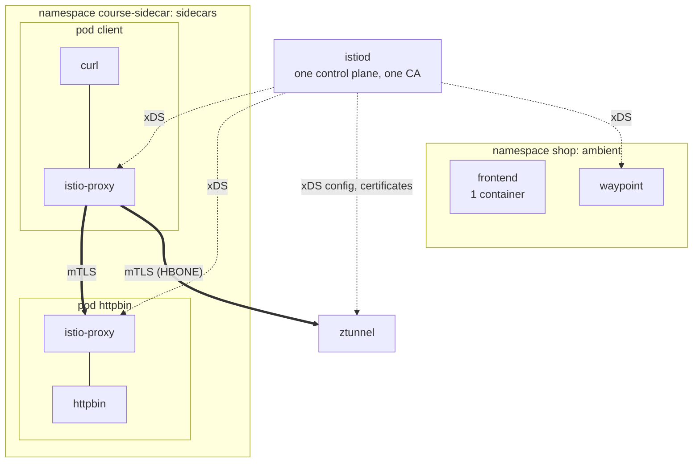
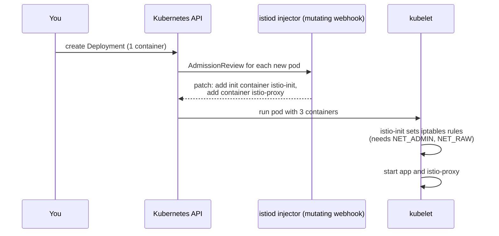

# Module 7: sidecar mode

Most Istio installations in production still use sidecars, and most Istio documentation assumes them. This module runs sidecar mode next to ambient in the same cluster, with the same istiod, so you can compare them directly.

## Concept: both modes, one control plane

The lab installed Istio with the ambient profile, but istiod still contains the sidecar injector. A namespace chooses its mode with a label:

| Label on the namespace | Mode |
|---|---|
| `istio.io/dataplane-mode: ambient` | ambient, ztunnel and optional waypoints |
| `istio-injection: enabled` | sidecar, an Envoy in every pod |
| neither | not in the mesh |



## Concept: how a sidecar gets into the pod



You know mutating admission webhooks from CKA. This is one: istiod rewrites every pod spec in a labelled namespace before it is stored.

## Why this way, and why ambient exists

| | Sidecar | Ambient |
|---|---|---|
| Join the mesh | Restart every pod (the webhook only runs on create) | Label the namespace, no restart |
| Who applies routing rules | The **client's** sidecar | The **destination's** waypoint |
| Memory | One Envoy per pod | One ztunnel per node, one waypoint per namespace or service |
| Pod security | Init container needs `NET_ADMIN` and `NET_RAW` | Nothing extra in the pod |
| Upgrade Istio | Restart every pod to get the new proxy | Upgrade ztunnel and waypoints, pods untouched |
| Maturity | Since 2017, every feature | GA since Istio 1.24, some features still missing (for example `EnvoyFilter` on waypoints) |

**Why does the client apply the rules in sidecar mode?** Each sidecar is a full Envoy that knows the whole mesh, so the client side can pick the destination pod itself and skip a hop. The cost is that every sidecar holds config for every service, and a rule change must reach every pod.

**Why did ambient move L7 to the destination?** A waypoint holds config for the services it fronts, not the whole mesh. And a rule about "traffic to the backend" is enforced at the backend's door, whoever the caller is, even a caller that is not in the mesh at all.

**Why does `course-sidecar` not enforce Pod Security `baseline`?** The `istio-init` container needs the `NET_ADMIN` and `NET_RAW` capabilities, which `baseline` forbids. Ambient needs neither, because the CNI agent does the redirection from outside the pod. Istio can also run sidecars with its CNI plugin to drop that requirement. The lab keeps the classic setup so you see it.

## Do it

### 1. Create a sidecar namespace

```bash
cat course/manifests/07-sidecar-namespace.yaml
kubectl apply -f course/manifests/07-sidecar-namespace.yaml -f course/manifests/07-sidecar-apps.yaml
kubectl -n course-sidecar rollout status deploy/httpbin
kubectl -n course-sidecar get pods
```

`READY 2/2`: the app and `istio-proxy`.

```bash
kubectl -n course-sidecar get pod -l app=httpbin \
  -o jsonpath='{range .spec.initContainers[*]}init: {.name}{"\n"}{end}{range .spec.containers[*]}container: {.name}{"\n"}{end}'
```

`init: istio-init`, `container: httpbin`, `container: istio-proxy`. The Deployment you applied has one container.

### 2. Look at the proxies

```bash
istioctl proxy-status
```

The two sidecars appear next to the gateway, the waypoint and ztunnel. Note the column "SUBSCRIBED TYPES": sidecars and waypoints receive `CDS, LDS, EDS, RDS` (Envoy's clusters, listeners, endpoints, routes), ztunnel receives `WADS, WDS` (workloads and addresses), a much smaller protocol made for it.

```bash
istioctl x describe pod -n course-sidecar $(kubectl -n course-sidecar get pod -l app=httpbin -o name | cut -d/ -f2)
```

It shows the Service, the port and the effective mTLS mode: `PERMISSIVE`.

### 3. mTLS identity, seen by the app

```bash
kubectl -n course-sidecar exec deploy/client -c curl -- curl -s http://httpbin:8000/headers
```

The header `X-Forwarded-Client-Cert` contains `URI=spiffe://cluster.local/ns/course-sidecar/sa/client`. The server-side sidecar adds it, so the app can see who called even though the app never touched TLS.

### 4. PERMISSIVE, then STRICT

```bash
kubectl apply -f course/manifests/02-outside-client.yaml
kubectl -n course-outside exec deploy/client -- curl -s -o /dev/null -w "%{http_code}\n" http://httpbin.course-sidecar:8000/status/200
```

`200`: a plaintext client from outside the mesh gets in. That is PERMISSIVE, the default for sidecars.

```bash
kubectl apply -f course/manifests/07-sidecar-strict-mtls.yaml
kubectl -n course-outside exec deploy/client -- curl -s -m 5 -o /dev/null -w "%{http_code}\n" http://httpbin.course-sidecar:8000/status/200
kubectl -n course-sidecar exec deploy/client -c curl -- curl -s -o /dev/null -w "%{http_code}\n" http://httpbin:8000/status/200
```

The outside client now gets `000`. The sidecar client still gets `200`.

### 5. Retries, applied by the client's sidecar

`/unstable?failure_rate=0.5` fails half of the time.

```bash
kubectl -n course-sidecar exec deploy/client -c curl -- sh -c 'ok=0; for i in $(seq 1 40); do c=$(curl -s -o /dev/null -w "%{http_code}" "http://httpbin:8000/unstable?failure_rate=0.5"); [ "$c" = 200 ] && ok=$((ok+1)); done; echo "$ok of 40"'
kubectl apply -f course/manifests/07-sidecar-retries.yaml
# run the same loop again
```

The lab measured 22 of 40 without retries and 33 of 40 with 3 retries. The curl command did nothing different: the client's sidecar retried for it.

### 6. Fault injection on the client side

```bash
kubectl apply -f course/manifests/07-sidecar-fault.yaml
kubectl -n course-sidecar exec deploy/client -c curl -- curl -s -o /dev/null -w "%{http_code} in %{time_total}s\n" http://httpbin:8000/status/200
kubectl -n course-sidecar delete virtualservice httpbin
```

`200 in 2.0s`. httpbin answered at once. The client's own sidecar held the request for two seconds.

### 7. Compare the memory

```bash
kubectl top pod -n course-sidecar --containers
kubectl top pod -n istio-system | grep ztunnel
kubectl top pod -n shop | grep waypoint
```

The lab measured 35 to 38 MiB per sidecar, about 12 MiB for ztunnel, and about 50 MiB for the waypoint. Two sidecars already cost more than ztunnel and the waypoint together, and the sidecar cost grows with every pod.

### 8. Cross-mode traffic

```bash
kubectl -n course-sidecar exec deploy/client -c curl -- curl -s -o /dev/null -w "frontend %{http_code}\n" http://frontend.shop:3000/healthz
kubectl -n course-sidecar exec deploy/client -c curl -- curl -s -w " backend %{http_code}\n" http://backend.shop:8000/api/version
```

The frontend answers `200`: sidecars and ztunnel speak the same mTLS. The backend refuses. A sidecar sends traffic straight to the backend pods, skipping the waypoint. The L4 policy `backend-only-from-waypoint` admits only the waypoint, so ztunnel drops the connection. Module 3 explains why that policy exists.

## Investigate

1. In Kiali, open **Workloads** in `course-sidecar`. Which badge or label tells you a workload has a sidecar? Open `httpbin`, tab **Logs**: you can now choose the `istio-proxy` container.
2. In Kiali **Traffic Graph** for `course-sidecar`, run step 5 again with `./course/load.sh` off and the retry loop running. Where does Kiali count the failed attempts that the retries hid from curl?
3. In Grafana Explore, run `sum by (reporter) (rate(istio_requests_total{destination_workload="httpbin"}[5m]))`. Sidecars report from both ends. Which `reporter` values appear?
4. Why does step 6's delay not appear in httpbin's own latency at all, while module 5's fault delay did appear at the waypoint?

## Clean up

```bash
./course/reset.sh          # removes the VirtualService and PeerAuthentication
./course/reset.sh --all    # also deletes course-sidecar and course-outside
```
