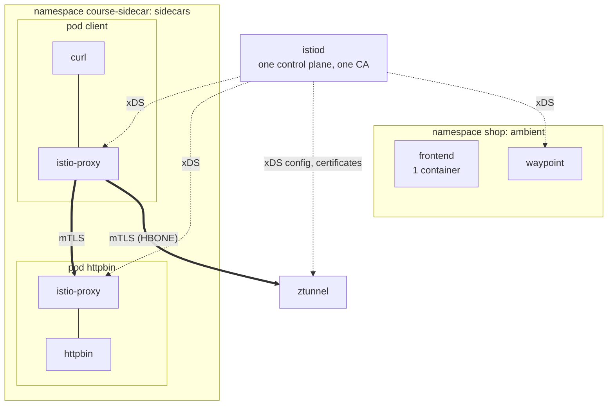
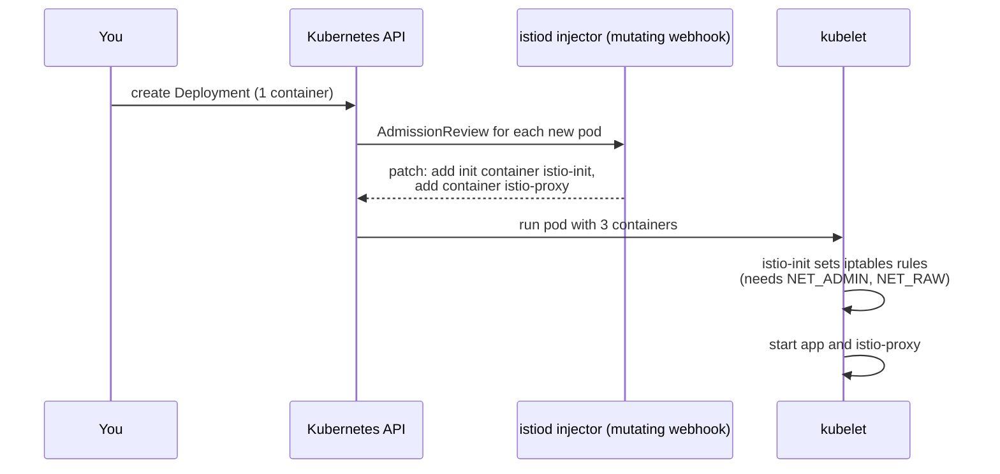

# Module 7: sidecar mode

> New to a term here, like VirtualService or waypoint? The [glossary](glossary.md) explains every Istio resource and term in this course.

**Before this module:** modules 1 to 3.

Most Istio installations in production still use sidecars, and most Istio documentation assumes them. This module runs sidecar mode next to ambient in the same cluster, with the same istiod, so you compare them directly.

## Concept: both modes, one control plane

The lab installed Istio with the ambient profile, but istiod still contains the sidecar injector. A namespace chooses its mode with a label:

| Label on the namespace | Mode |
|---|---|
| `istio.io/dataplane-mode: ambient` | ambient, ztunnel and optional waypoints |
| `istio-injection: enabled` | sidecar, an Envoy in every pod |
| neither | not in the mesh |



## Concept: how a sidecar gets into the pod



You know mutating admission webhooks from CKA. This is one: istiod rewrites every pod spec in a labelled namespace before the API server stores it.

## Why this way, and why ambient exists

| | Sidecar | Ambient |
|---|---|---|
| Join the mesh | Restart every pod (the webhook only runs on create) | Label the namespace, no restart |
| Who applies routing rules | The **client's** sidecar | The **destination's** waypoint |
| Memory | One Envoy per pod | One ztunnel per node, one waypoint per namespace or service |
| Pod security | Init container needs `NET_ADMIN` and `NET_RAW` | Nothing extra in the pod |
| Upgrade Istio | Restart every pod to get the new proxy | Upgrade ztunnel and waypoints, pods untouched |
| Maturity | Since 2017, every feature | GA since Istio 1.24, some features still missing (for example `EnvoyFilter` on waypoints) |

**Why does the client apply the rules in sidecar mode?** Each sidecar is a full Envoy that knows the whole mesh, so the client side picks the destination pod itself and skips a hop. The cost is that every sidecar holds config for every service, and a rule change must reach every pod.

**Why did ambient move L7 to the destination?** A waypoint holds config for the services it fronts, not the whole mesh. And the backend's own door enforces a rule about "traffic to the backend", whoever the caller is, even a caller that is not in the mesh at all.

**Why does `course-sidecar` not enforce Pod Security `baseline`?** The `istio-init` container needs the `NET_ADMIN` and `NET_RAW` capabilities, which `baseline` forbids. Ambient needs neither, because the CNI agent does the redirection from outside the pod. Istio also runs sidecars with its CNI plugin to drop that requirement. The lab keeps the classic setup so you see it.

## The bigger picture: what living with sidecars feels like

On paper, a sidecar is one more container. In practice, it brings a handful of everyday headaches, and those headaches pushed the Istio team towards ambient.

**Start order.** Kubernetes starts a pod's containers without waiting for each other. If your app starts first and makes a network call before Envoy is ready, the call fails. Istio added a setting, `holdApplicationUntilProxyStarts`, that makes the app wait. Shutdown has the mirror problem: Envoy sometimes stops before the app finishes its last requests.

**Jobs that never finish.** A Job completes when all its containers exit. The app exits, the sidecar keeps running, and the Job hangs forever. For years people worked around it with scripts that called Envoy's `/quitquitquit` endpoint. Kubernetes finally fixed it with native sidecars: an init container with `restartPolicy: Always`, beta and on by default since Kubernetes 1.29. Kubernetes starts that container before the app and stops it after.

**Upgrades.** A new Istio version brings a new Envoy, and the only way into a running pod is a restart. In a big cluster, every Istio upgrade turns into a rolling restart of every workload.

**Cost at scale.** Every sidecar reserves CPU and memory, holds configuration for every service in the mesh by default, and takes updates from istiod. A thousand pods mean a thousand Envoys to feed.

Ambient swaps these problems for different ones. ztunnel runs once per node, so a ztunnel crash hits every mesh pod on that node at the same time, while a sidecar crash hits one pod. And a noisy workload shares ztunnel with its neighbours. Neither model wins everywhere. That's why Istio keeps both, and why this lab runs them side by side.

## Do it

### 1. Create a sidecar namespace

```bash
cat course/manifests/07-sidecar-namespace.yaml
kubectl apply -f course/manifests/07-sidecar-namespace.yaml -f course/manifests/07-sidecar-apps.yaml \
  -f course/manifests/07-sidecar-podmonitor.yaml
kubectl -n course-sidecar rollout status deploy/httpbin
kubectl -n course-sidecar get pods
```

**What you should see.** The namespace with the label `istio-injection: enabled`, then `created` for the namespace, two service accounts, two Deployments, the Service and the PodMonitor. Both pods show `READY 2/2`: the app and `istio-proxy`.

```text
NAME                      READY   STATUS    RESTARTS   AGE
client-588f9f56c-9p5k5    2/2     Running   0          5s
httpbin-fb884c77d-m5tkz   2/2     Running   0          5s
```

The PodMonitor asks Prometheus to scrape the sidecars. The lab only scrapes the gateway, the waypoint and ztunnel by default, so without it no sidecar metric reaches Grafana or Kiali. Prometheus needs a few minutes to load it, which is why you apply it now, long before the questions at the end.

```bash
kubectl -n course-sidecar get pod -l app=httpbin \
  -o jsonpath='{range .items[0].spec.initContainers[*]}init: {.name}{"\n"}{end}{range .items[0].spec.containers[*]}container: {.name}{"\n"}{end}'
```

**What you should see.**

```text
init: istio-init
container: httpbin
container: istio-proxy
```

The Deployment you applied has one container. The injector added the other two when the API server created the pod. (The `.items[0]` matters: `get pod -l` returns a list, even for one pod.)

### 2. Look at the proxies

```bash
istioctl proxy-status
```

**What you should see.** Five rows now:

```text
NAME                                               ...  VERSION  SUBSCRIBED TYPES
client-588f9f56c-9p5k5.course-sidecar              ...  1.24.2   4 (CDS,LDS,EDS,RDS)
httpbin-fb884c77d-m5tkz.course-sidecar             ...  1.24.2   4 (CDS,LDS,EDS,RDS)
shop-gateway-istio-858774d7cd-fcnqh.shop-ingress   ...  1.24.2   4 (CDS,LDS,EDS,RDS)
waypoint-b9b76876f-pwzjr.shop                      ...  1.24.2   4 (CDS,LDS,EDS,WDS)
ztunnel-ttgf9.istio-system                         ...  1.24.2   2 (WADS,WDS)
```

The two sidecars appear next to the gateway, the waypoint and ztunnel. Look at the column "SUBSCRIBED TYPES". Sidecars and the gateway receive `CDS, LDS, EDS, RDS` (Envoy's clusters, listeners, endpoints, routes). The waypoint takes `WDS` instead of `RDS`: it carries its routes inside its listeners, and it reads workload data like ztunnel does. ztunnel receives `WADS, WDS` (workloads and addresses), a much smaller protocol made for it.

```bash
istioctl x describe pod -n course-sidecar $(kubectl -n course-sidecar get pod -l app=httpbin -o name | cut -d/ -f2)
```

**What you should see.**

```text
Pod: httpbin-fb884c77d-m5tkz
   Pod Revision: default
   Pod Ports: 8080 (httpbin), 15090 (istio-proxy)
--------------------
Service: httpbin
   Port: http 8000/HTTP targets pod port 8080
--------------------
Effective PeerAuthentication:
   Workload mTLS mode: PERMISSIVE
```

It shows the Service, the port and the effective mTLS mode: `PERMISSIVE`, because nothing in `course-sidecar` says otherwise yet. Port 15090 on `istio-proxy` is where Envoy serves its metrics, and the PodMonitor scrapes it.

### 3. mTLS identity, seen by the app

```bash
kubectl -n course-sidecar exec deploy/client -c curl -- curl -s http://httpbin:8000/headers
```

**What you should see.** httpbin echoes the request headers it received, as JSON. Among them:

```text
"X-Forwarded-Client-Cert": [
  "By=spiffe://cluster.local/ns/course-sidecar/sa/httpbin;Hash=130e...;Subject=\"\";URI=spiffe://cluster.local/ns/course-sidecar/sa/client"
],
```

`URI=` names the caller, `By=` names the receiver. The server-side sidecar adds this header, so the app sees who called even though it never touched TLS. You also find `Traceparent` and `X-Envoy-Attempt-Count: 1`: the sidecars added them, curl didn't.

### 4. PERMISSIVE, then STRICT

```bash
kubectl apply -f course/manifests/02-outside-client.yaml
kubectl -n course-outside exec deploy/client -- curl -s -o /dev/null -w "%{http_code}\n" http://httpbin.course-sidecar:8000/status/200
```

**What you should see.** `200`: a plaintext client from outside the mesh gets in. That is PERMISSIVE, the default for sidecars. (If you kept `course-outside` from module 2, `kubectl apply` reports `unchanged`.)

```bash
kubectl apply -f course/manifests/07-sidecar-strict-mtls.yaml
kubectl -n course-outside exec deploy/client -- curl -s -m 5 -o /dev/null -w "%{http_code}\n" http://httpbin.course-sidecar:8000/status/200
kubectl -n course-sidecar exec deploy/client -c curl -- curl -s -o /dev/null -w "%{http_code}\n" http://httpbin:8000/status/200
```

**What you should see.** `peerauthentication.security.istio.io/default created`. The outside client now gets `000` with `command terminated with exit code 56`: httpbin's sidecar reset the plaintext connection. The sidecar client still gets `200`, because its own sidecar speaks mTLS for it. Run step 2's `istioctl x describe` again and it reports `Workload mTLS mode: STRICT`.

### 5. Retries, applied by the client's sidecar

`/unstable?failure_rate=0.5` fails half of the time.

```bash
kubectl -n course-sidecar exec deploy/client -c curl -- sh -c 'ok=0; for i in $(seq 1 40); do c=$(curl -s -o /dev/null -w "%{http_code}" "http://httpbin:8000/unstable?failure_rate=0.5"); [ "$c" = 200 ] && ok=$((ok+1)); done; echo "$ok of 40"'
kubectl apply -f course/manifests/07-sidecar-retries.yaml
# run the same loop again
```

**What you should see.** Without retries, about half: the lab got `27 of 40` and `19 of 40` in two runs. With 3 retries, almost all: `38 of 40` and `39 of 40`. Each request now gets up to four tries, and four failures in a row happen about one time in 16. The curl command did nothing different: the client's sidecar retried for it.

### 6. Fault injection on the client side

```bash
kubectl apply -f course/manifests/07-sidecar-fault.yaml
kubectl -n course-sidecar exec deploy/client -c curl -- curl -s -o /dev/null -w "%{http_code} in %{time_total}s\n" http://httpbin:8000/status/200
kubectl -n course-sidecar delete virtualservice httpbin
```

**What you should see.** `virtualservice.networking.istio.io/httpbin configured` (it replaces the retry rule, same name), then `200 in 2.005436s` or close to it, then `deleted`. httpbin answered at once. The client's own sidecar held the request for two seconds.

### 7. Compare the memory

```bash
kubectl top pod -n course-sidecar --containers
kubectl top pod -n istio-system | grep ztunnel
kubectl top pod -n shop | grep waypoint
```

**What you should see.**

```text
POD                       NAME          CPU(cores)   MEMORY(bytes)
client-588f9f56c-9p5k5    curl          0m           6Mi
client-588f9f56c-9p5k5    istio-proxy   3m           35Mi
httpbin-fb884c77d-m5tkz   httpbin       1m           8Mi
httpbin-fb884c77d-m5tkz   istio-proxy   3m           39Mi
ztunnel-ttgf9            5m           16Mi
waypoint-b9b76876f-pwzjr        2m           29Mi
```

The lab measured 35 to 39 MiB per sidecar, 12 to 16 MiB for ztunnel, and 29 to 36 MiB for the waypoint. Each sidecar weighs about five times the app it serves. Two sidecars already cost more than ztunnel and the waypoint together, and the sidecar cost grows with every pod.

### 8. Cross-mode traffic

```bash
kubectl -n course-sidecar exec deploy/client -c curl -- curl -s -o /dev/null -w "frontend %{http_code}\n" http://frontend.shop:3000/healthz
kubectl -n course-sidecar exec deploy/client -c curl -- curl -s -w " backend %{http_code}\n" http://backend.shop:8000/api/version
```

**What you should see.**

```text
frontend 200
upstream connect error or disconnect/reset before headers. reset reason: connection termination backend 503
```

The frontend answers `200`: sidecars and ztunnel speak the same mTLS. The backend refuses. The sidecar sends traffic straight to a backend pod, skipping the waypoint. The L4 policy `backend-only-from-waypoint` admits only the waypoint, so the backend's ztunnel closes the connection, and the client's sidecar turns that into a `503`. ztunnel's log shows it: `src.identity="spiffe://cluster.local/ns/course-sidecar/sa/client"`, `dst.service="backend-v1.shop.svc.cluster.local"`, `error="connection closed due to policy rejection: allow policies exist, but none allowed"`. Module 3 explains why that policy exists.

## Investigate

1. How does Kiali tell a sidecar workload from an ambient one? Open **Workloads** for `course-sidecar` and `shop`, then open `httpbin`, tab **Logs**. Which containers does it offer?
2. In Kiali **Traffic Graph** for `course-sidecar`, run step 5's loop again with the retry rule in place. How many errors does the edge from `client` to `httpbin` show, compared with what curl saw?
3. In Grafana Explore, run `sum by (reporter) (rate(istio_requests_total{destination_workload="httpbin"}[5m]))`. Sidecars report from both ends. Which `reporter` values appear?
4. Why does step 6's delay not appear in httpbin's own latency at all, while module 5's fault delay did appear at the waypoint?

<details>
<summary>Answers</summary>

1. Kiali looks at the pods. For `httpbin` and `client` it finds an `istio-proxy` container and marks them `istioSidecar: true`. The shop's workloads have one container each and an ambient-mode namespace, so Kiali marks them `isAmbient: true` instead (check it with `curl -s "http://localhost:20001/api/clusters/workloads?namespaces=course-sidecar,shop"`). The Logs tab for `httpbin` offers two containers, `httpbin` and `istio-proxy`. For `frontend` in module 2 it offered one container plus the `ztunnel` checkbox.
2. Many more than curl saw. In the lab, curl reported `38 of 40`, so two failures. In the same two minutes the edge showed about 61% errors: `500` with no flag on 57% of the requests, and `500` with `URX` (retry limit exceeded) on about 4%. The sidecar at httpbin records every attempt, the failed ones included, and Kiali counts them. The `URX` ones are the few requests where all four tries failed and curl saw the error. Retries hide failures from users, not from your metrics.
3. `source` and `destination`. `source` comes from the client's sidecar and counts what the caller finally got. `destination` comes from httpbin's sidecar and counts every attempt that arrived. In the lab, after all of step 5, `destination` held 161 `500` responses while `source` held 34 plain `500` (from the runs without retries) and 9 with `URX`. You only see this once Prometheus scrapes the sidecars, which the PodMonitor from step 1 arranges.
4. The client's sidecar applies the VirtualService, so it waits two seconds before it even sends the request. httpbin's sidecar measures from the moment the request arrives. In the lab, `istio_request_duration_milliseconds` averaged about 2050 ms for `reporter="source"` (flag `DI`) and about 2 ms for `reporter="destination"`. In module 5, the waypoint injected the delay, and the waypoint is also the proxy that reports the metric, so its latency included the wait.

</details>

## Clean up

```bash
./course/reset.sh          # removes the VirtualService and PeerAuthentication
./course/reset.sh --all    # also deletes course-sidecar (with its PodMonitor) and course-outside
```
