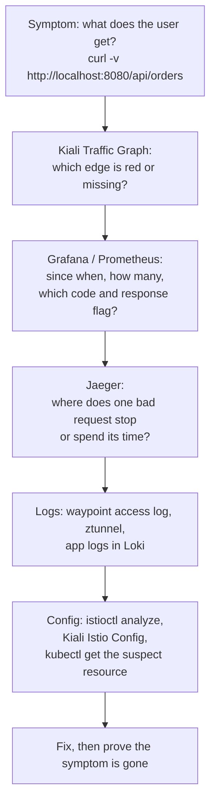

# Module 8: incidents

Four broken setups. For each one, `./course/incident.sh` changes something in the cluster and tells you only what the users see. Find the cause with the tools, prove it, then fix it. The answers are folded away at the end of each incident. Try for at least 15 minutes before you open one.

## How to investigate

Work from symptoms to cause, and from the outside in:



Keep traffic flowing during each incident so the graphs have data:

```bash
./course/load.sh 600 /api/orders 5
```

Turn on the waypoint's access log once, it helps in every incident:

```bash
kubectl apply -f course/manifests/06-waypoint-access-logs.yaml
```

Envoy's response flags in the access log and in `istio_requests_total{response_flags=...}` are the fastest clue:

| Flag | Meaning |
|---|---|
| `-` | no flag, Envoy passed the response through |
| `UO` | upstream overflow: circuit breaker rejected the request |
| `UT` | upstream request timeout |
| `UF` | upstream connection failure |
| `UH` | no healthy upstream |
| `NR` | no route configured |
| `DI`, `FI` | delay or fault injected on purpose |

---

## Incident 1: "Every page says access denied"

```bash
./course/incident.sh 1
```

**Users report.** The shop loads but shows no orders. Creating an order fails.

**Your questions.**

1. What status code does `curl -i http://localhost:8080/api/orders` return, and which component wrote the body?
2. Does the request reach the backend? Check Jaeger: how many spans do the new traces have?
3. In Grafana Explore, which `response_code` and `destination_workload` does `istio_requests_total{reporter="waypoint"}` show?
4. What does the waypoint access log give as the reason?
5. Which resource is wrong, and what is wrong with it?

<details>
<summary>Evidence the lab produced, and the answer</summary>

- `curl` returns `403` with body `RBAC: access denied`. That body is Envoy's, not the app's.
- New traces have 2 spans: the gateway and the waypoint. The backend never sees the request.
- Prometheus: `response_code="403"`, `destination_workload="unknown"`. The waypoint refused it before choosing a backend pod, so there is no destination workload.
- Access log: `403 - rbac_access_denied_matched_policy[none]`. No ALLOW rule matched.
- Cause: `backend-allow-frontend` now names `cluster.local/ns/shop/sa/front-end`. The service account is `frontend`, without a hyphen. A one-character typo in a principal locks out the only real caller.

```bash
kubectl -n shop get authorizationpolicy backend-allow-frontend -o jsonpath='{.spec.rules[0].from[0].source.principals}'
kubectl -n shop get pod -l app=frontend -o jsonpath='{.items[0].spec.serviceAccountName}'
```

**Fix.** `./course/incident.sh stop`, or `kubectl apply -f manifests/istio/security.yaml`.

**Lesson.** Principals are strings. Istio does not check that the service account exists. Kiali flags some such references in **Istio Config**. Testing every policy change with a real request is the reliable check.

</details>

---

## Incident 2: "Slow pages fail, fast ones work"

```bash
./course/incident.sh 2
./course/load.sh 300 "/api/slow?ms=300" 12
```

**Users report.** The shop works for some requests and returns errors for others, more often when it is busy.

**Your questions.**

1. What proportion of requests fail, and with which code?
2. Do the failed requests take long, or do they fail at once?
3. Which `response_flags` value do the failures carry in Prometheus?
4. Which Istio resource could produce that flag? Look for it in every namespace.

<details>
<summary>Evidence the lab produced, and the answer</summary>

- With 12 requests per second to a 300 ms endpoint, 596 of 708 requests failed with `503`.
- The failures took 5 to 6 ms: the waypoint rejected them without calling the backend.
- Prometheus: `response_code="503", response_flags="UO"`. The access log: `503 UO upstream_reset_before_response_started{overflow}`.
- `UO` means a connection pool overflowed, which only a DestinationRule's `connectionPool` sets. `kubectl get destinationrule -A` finds `course-incident` on `backend-v1` with `maxConnections: 1`, `http1MaxPendingRequests: 1`.
- Jaeger: the failed traces have 2 spans, gateway and waypoint, with the tag `response_flags=UO`.

**Fix.** `kubectl -n shop delete destinationrule course-incident`, or `./course/incident.sh stop`.

**Lesson.** A pool far below the normal number of concurrent requests behaves like an outage under load and like a healthy service at low traffic. Size limits from measured concurrency, which Grafana shows you.

</details>

---

## Incident 3: "No errors, but the shop got slow"

```bash
./course/incident.sh 3
```

**Users report.** No errors at all. The shop is noticeably slower than yesterday.

**Your questions.**

1. Is every request slow, or only some? Look at the spread in `./scripts/traffic-test.sh 100 5`.
2. In Grafana, which panel shows the problem? Which backend version is slow?
3. Is the slowness in the network, the waypoint or the app? Compare "p95 latency at the waypoint" with "p95 latency measured in the app".
4. Why is more traffic going to the slow version than usual?
5. Open a slow trace in Jaeger. Which span has the time?

<details>
<summary>Evidence the lab produced, and the answer</summary>

- All 295 requests returned 200: 97 to v1, 198 to v2.
- Waypoint p95: v1 about 10 ms, v2 about 975 ms. App p95: v1 5 ms, v2 975 ms. The app itself is slow, the mesh adds almost nothing.
- Two changes together: `backend-route` now sends 70% to v2 (the baseline is 0%), and v2 runs with `EXTRA_LATENCY_MS=700`.

```bash
kubectl -n shop get httproute backend-route -o jsonpath='{.spec.rules[0].backendRefs[*].weight}{"\n"}'
kubectl -n shop get deploy backend-v2 -o jsonpath='{.spec.template.spec.containers[0].env[?(@.name=="EXTRA_LATENCY_MS")].value}{"\n"}'
```

- ArgoCD shows `istio-config` as OutOfSync: the route differs from Git. That is the fastest way to see that someone changed it.

**Fix.** `./course/incident.sh stop`.

**Lesson.** A canary that got promoted too far looks like a general slowdown. Per-version latency, which the mesh gives you for free, separates "v2 is slow" from "everything is slow".

</details>

---

## Incident 4: "Bad gateway"

```bash
./course/incident.sh 4
```

**Users report.** Every API request fails with 502. The shop's page itself still loads.

**Your questions.**

1. Which component returns the 502? Look at the response body and at the frontend's logs in Loki: `{namespace="shop", app="frontend"}`.
2. What does Kiali's Traffic Graph show between `frontend` and the backend?
3. How many spans do the new traces have? Which proxy is missing from them?
4. What do `istioctl waypoint list -n shop` and `istioctl ztunnel-config services | grep backend` say?
5. Why does the frontend not fall back to calling the backend pods directly?

<details>
<summary>Evidence the lab produced, and the answer</summary>

- The frontend returns 502 itself: its logs show `"message":"backend unreachable"`, and the body is the frontend's own error JSON.
- New traces have 1 span, the gateway's. Nothing after the frontend reports.
- `istioctl waypoint list -n shop` says `No waypoints found`. `ztunnel-config services` still lists `backend` with WAYPOINT `None` while the Service keeps its `istio.io/use-waypoint: waypoint` label.
- Prometheus has no waypoint metrics at all for the period. ztunnel's log is full of errors for connections to the backend.
- Cause: the `waypoint` Gateway was deleted. The backend Services still say "use the waypoint", ztunnel has nowhere to send the traffic, and the connection fails. The L4 policy would refuse a direct connection anyway, because it only admits the waypoint's identity.

**Fix.** `./course/incident.sh stop`, which re-applies `manifests/istio/waypoint.yaml`. ArgoCD would also show `istio-config` as OutOfSync with the Gateway missing.

**Lesson.** A waypoint is a real dependency on the request path. Monitor it like one: alert on its pods' readiness and on `istio_requests_total{reporter="waypoint"}` dropping to zero.

</details>

---

## After all four

```bash
./course/incident.sh stop
./course/verify.sh 8
```

The verify script reproduces each incident and checks its symptom, so it also tells you whether the lab is back to normal.
