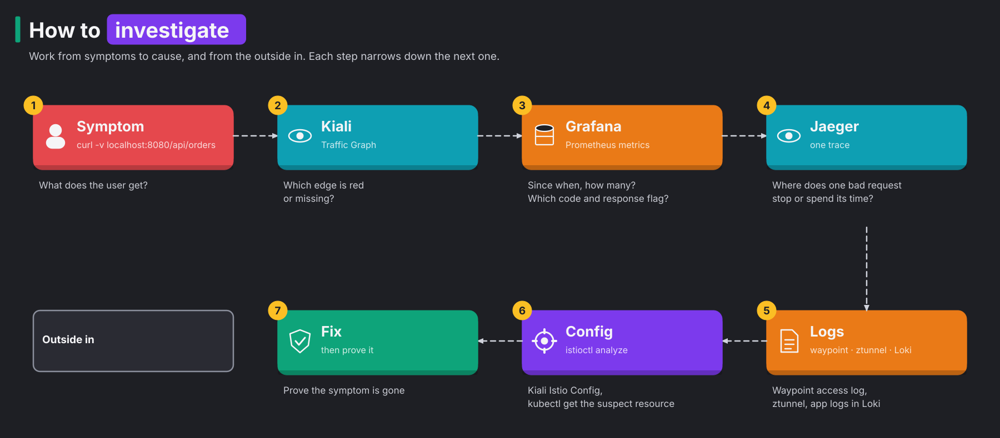

# Module 8: incidents

> New to a term here, like VirtualService or waypoint? The [glossary](glossary.md) explains every Istio resource and term in this course.

**Before this module:** modules 1 to 7: the incidents mix everything.

This module gives you four broken setups to fix, like real on-call shifts. For each one, `./course/incident.sh` breaks something in the cluster. It tells you only what the users see, not what it changed. Your job has three parts:

1. Find the cause with the tools.
2. Prove it with evidence.
3. Fix it.

The answers are folded away at the end of each incident. Try for at least 15 minutes before you open one.

## How to investigate

Work from symptoms to cause, and from the outside in:



Keep traffic flowing during each incident so the graphs have data:

```bash
./course/load.sh 600 /api/orders 5
```

Turn on the waypoint's access log once. It helps in every incident:

```bash
kubectl apply -f course/manifests/06-waypoint-access-logs.yaml
```

When Envoy fails a request, it adds a short code, a response flag, that says why. You find the flag in the access log and in `istio_requests_total{response_flags=...}`. It is the fastest clue you have:

| Flag | Meaning |
|---|---|
| `-` | no flag, Envoy passed the response through |
| `UO` | upstream overflow: circuit breaker rejected the request |
| `UT` | upstream request timeout |
| `UF` | upstream connection failure |
| `UH` | no healthy upstream |
| `NR` | no route configured |
| `DI`, `FI` | delay or fault injected on purpose |

## Concept: who wrote the error?

An error page in a mesh has many possible authors, so first find out who wrote it. Without a mesh, an error came from your app or your ingress controller. In the shop, a request passes three more components on its way:

- the gateway's Envoy, at the entrance,
- ztunnel, on every hop between pods,
- the waypoint's Envoy, in front of the backend.

Each of them writes errors of its own, and each leaves a different kind of evidence. Ask "which component answered?" before you ask "why?". Otherwise you search the wrong logs.

| What curl shows | Who wrote it | Where to look next |
|---|---|---|
| A status with a short plain-text body, such as `RBAC: access denied` or `no healthy upstream` | An Envoy: the gateway or the waypoint | That proxy's access log and its `response_flags` |
| `503` with `upstream connect error or disconnect/reset before headers` | An Envoy whose connection to the next hop failed or got reset, often by ztunnel | The ztunnel log on the node |
| `000`, a reset, no HTTP status at all | Nothing at L7 answered: ztunnel closed the connection, or nothing listens | The ztunnel log |
| The app's own JSON error | The app | The app's logs in Loki |

Traces give a second clue. Each component that handles a request adds a span to the trace, like a stamp in a passport. In this lab the gateway, the waypoint and the backend write spans. ztunnel writes none. A trace that ends early shows you the last component that saw the request. So count the spans before you read them.

One case leaves almost no trace at all. Sometimes ztunnel refuses a connection at L4 and no Envoy sits in front of it. Then the refusal shows up in no trace and in no HTTP metric. Only the ztunnel log records it.

---

## Incident 1: "Every page says access denied"

```bash
./course/incident.sh 1
```

**Users report.** The shop loads but shows no orders. Creating an order fails.

**Your questions.**

1. What status code does `curl -i http://localhost:8080/api/orders` return, and which component wrote the body?
2. Does the request reach the backend? Check Jaeger: how many spans do the new traces have?
3. In Grafana Explore, which `response_code` and `destination_workload` does `istio_requests_total{reporter="waypoint"}` show?
4. What does the waypoint access log give as the reason?
5. Which resource is wrong, and what is wrong with it?

<details>
<summary>Evidence the lab produced, and the answer</summary>

- `curl` returns `403` with body `RBAC: access denied`. That body is Envoy's, not the app's.
- New traces have 2 spans, from the gateway and the waypoint. The backend never sees the request.
- Prometheus shows `response_code="403"` and `destination_workload="unknown"`. The waypoint refused the request before it chose a backend pod. That's why there is no destination workload.
- The access log shows `403 - rbac_access_denied_matched_policy[none]`. No ALLOW rule matched.
- The cause is a typo. `backend-allow-frontend` now names `cluster.local/ns/shop/sa/front-end`. The real service account is `frontend`, without a hyphen. One wrong character in a principal locks out the only real caller.

```bash
kubectl -n shop get authorizationpolicy backend-allow-frontend -o jsonpath='{.spec.rules[0].from[0].source.principals}'
kubectl -n shop get pod -l app=frontend -o jsonpath='{.items[0].spec.serviceAccountName}'
```

**Fix.** `./course/incident.sh stop`, or `kubectl apply -f manifests/istio/security.yaml`.

**Lesson.** A principal is a plain string to Istio. Istio does not check that the service account exists. Kiali flags some of these broken references in **Istio Config**. The reliable check is to test every policy change with a real request.

</details>

---

## Incident 2: "Slow pages fail, fast ones work"

```bash
./course/incident.sh 2
./course/load.sh 300 "/api/slow?ms=300" 12
```

**Users report.** The shop works for some requests and returns errors for others, more often when it is busy.

**Your questions.**

1. What proportion of requests fail, and with which code?
2. Do the failed requests take long, or do they fail at once?
3. Which `response_flags` value do the failures carry in Prometheus?
4. Which Istio resource produces that flag? Look for it in every namespace.

<details>
<summary>Evidence the lab produced, and the answer</summary>

- With 12 requests per second to a 300 ms endpoint, 596 of 708 requests failed with `503`.
- The failures took 5 to 6 ms. That is too fast for a real call, so the waypoint rejected them without calling the backend.
- Prometheus shows `response_code="503", response_flags="UO"`. The access log shows `503 UO upstream_reset_before_response_started{overflow}`.
- `UO` means a connection pool overflowed. A pool limits how many requests wait for the backend at once, and only a DestinationRule's `connectionPool` sets one. `kubectl get destinationrule -A` finds `course-incident` on `backend-v1`, with `maxConnections: 1` and `http1MaxPendingRequests: 1`.
- In Jaeger, the failed traces have 2 spans, from the gateway and the waypoint. They carry the tag `response_flags=UO`.

**Fix.** `kubectl -n shop delete destinationrule course-incident`, or `./course/incident.sh stop`.

**Lesson.** A pool limit that is too small hides at quiet times and breaks at busy times. Under load, it behaves like an outage. At low traffic, the service looks healthy. Set limits from the number of concurrent requests you measured. Grafana shows you that number.

</details>

---

## Incident 3: "No errors, but the shop got slow"

```bash
./course/incident.sh 3
```

**Users report.** No errors at all. The shop is noticeably slower than yesterday.

**Your questions.**

1. Is every request slow, or only some? Look at the spread in `./scripts/traffic-test.sh 100 5`.
2. In Grafana, which panel shows the problem? Which backend version is slow?
3. Is the slowness in the network, the waypoint or the app? Compare "p95 latency at the waypoint" with "p95 latency measured in the app".
4. Why is more traffic going to the slow version than usual?
5. Open a slow trace in Jaeger. Which span has the time?

<details>
<summary>Evidence the lab produced, and the answer</summary>

- All 295 requests returned 200. 97 went to v1, and 198 went to v2.
- p95 latency is the time that 95% of requests stay under. At the waypoint it was about 10 ms for v1 and about 975 ms for v2. Inside the app it was 5 ms for v1 and 975 ms for v2. So the app itself is slow, and the mesh adds almost nothing.
- Two changes work together here:
  - `backend-route` now sends 70% of traffic to v2. The baseline is 0%.
  - v2 runs with `EXTRA_LATENCY_MS=700`.

```bash
kubectl -n shop get httproute backend-route -o jsonpath='{.spec.rules[0].backendRefs[*].weight}{"\n"}'
kubectl -n shop get deploy backend-v2 -o jsonpath='{.spec.template.spec.containers[0].env[?(@.name=="EXTRA_LATENCY_MS")].value}{"\n"}'
```

- ArgoCD shows `istio-config` as OutOfSync, because the route in the cluster differs from Git. That is the fastest way to see that someone changed it.

**Fix.** `./course/incident.sh stop`.

**Lesson.** A canary that got promoted too far looks like a general slowdown. The mesh measures latency per version for free. That measurement tells "v2 is slow" apart from "everything is slow".

</details>

---

## Incident 4: "Bad gateway"

```bash
./course/incident.sh 4
```

**Users report.** Every API request fails with 502. The shop's page itself still loads.

**Your questions.**

1. Which component returns the 502? Look at the response body and at the frontend's logs in Loki: `{namespace="shop", app="frontend"}`.
2. What does Kiali's Traffic Graph show between `frontend` and the backend?
3. How many spans do the new traces have? Which proxy is missing from them?
4. What do `istioctl waypoint list -n shop` and `istioctl ztunnel-config services | grep backend` say?
5. Why does the frontend not fall back to calling the backend pods directly?

<details>
<summary>Evidence the lab produced, and the answer</summary>

- The frontend returns the 502 itself. Its logs show `"message":"backend unreachable"`, and the body is the frontend's own error JSON.
- New traces have 1 span, the gateway's. Nothing after the frontend reports.
- `istioctl waypoint list -n shop` says `No waypoints found`. `ztunnel-config services` still lists `backend` with WAYPOINT `None`. Meanwhile the Service keeps its `istio.io/use-waypoint: waypoint` label.
- Prometheus has no waypoint metrics at all for the period. ztunnel's log is full of errors for connections to the backend.
- The cause is a missing waypoint. Someone deleted the `waypoint` Gateway. The chain of failure goes like this:
  1. The backend Services still say "use the waypoint".
  2. ztunnel has nowhere to send the traffic.
  3. The connection fails.

  A direct connection to the backend pods would fail too. The L4 policy only admits the waypoint's identity, so it would refuse the frontend.

**Fix.** Run `./course/incident.sh stop`, which re-applies `manifests/istio/waypoint.yaml`. ArgoCD would also show `istio-config` as OutOfSync, with the Gateway missing.

**Lesson.** A waypoint is a real dependency on the request path. If it disappears, requests stop. Monitor it like any other service. Alert on its pods' readiness and on `istio_requests_total{reporter="waypoint"}` dropping to zero.

</details>

---

## After all four

```bash
./course/incident.sh stop
./course/verify.sh 8
```

The verify script reproduces each incident and checks its symptom, so it also tells you whether the lab is back to normal.
