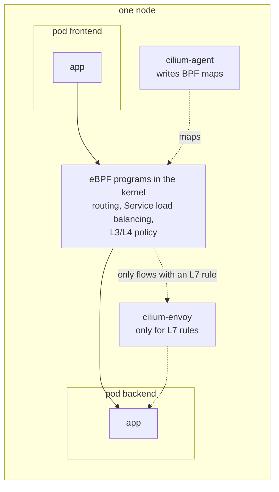
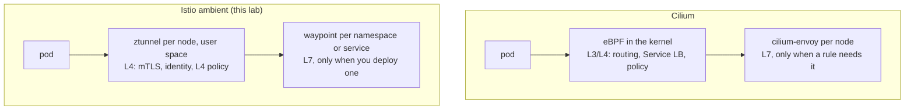

# Module 10: eBPF and Cilium, the other sidecarless design

> New to a term here, like VirtualService or waypoint? The [glossary](glossary.md) explains every Istio resource and term in this course.

You will read claims like this one:

> Tools built on eBPF, such as Cilium, dominate new deployments by handling networking, security policies and observability directly in the Linux kernel without sidecar proxies.

Part of it is true. This module explains what eBPF is, what Cilium does with it, and how that compares with the Istio ambient mesh you have used for nine modules. It is a theory module: Cilium needs its own cluster, so it does not run in this lab. The "Look at your own lab" section still gives you commands that show the difference in your cluster.

Time: about 30 minutes.

## Concept: what eBPF is

eBPF lets you load small programs into the Linux kernel at runtime, without a kernel module and without a reboot. The kernel checks each program before it runs (it must terminate, and it may only touch memory it is allowed to), then compiles it to machine code. Programs attach to hooks: a network interface receiving a packet, a socket being opened, a system call.

For networking, the hooks that matter are:

| Hook | Runs when | Used for |
|---|---|---|
| XDP | a packet reaches the network driver, before the kernel builds its packet structure | very fast drops, load balancing |
| tc (traffic control) | a packet enters or leaves an interface, such as a pod's veth | per-pod policy, NAT, routing |
| socket hooks | a program calls `connect()` or `sendmsg()` | rewriting a Service IP to a pod IP before any packet exists |

Programs keep state in BPF maps: key-value tables in the kernel that user-space programs can read and write. A Cilium agent writes "Service 10.43.191.63:8000 has these endpoints" into a map, and the eBPF program reads it for every connection.

## Concept: what Cilium does with it

Cilium is a CNI plugin, the same role flannel has in this lab. It gives pods their IPs and connects them. On top of that, it can take over three other jobs:



| Job | Without Cilium | With Cilium |
|---|---|---|
| Pod networking | flannel (this lab) | eBPF on each pod's interface |
| Service load balancing | kube-proxy writes iptables rules | eBPF socket and tc programs read a BPF map. kube-proxy can be removed. |
| L3/L4 policy | NetworkPolicy, enforced by the CNI | NetworkPolicy and CiliumNetworkPolicy, enforced in eBPF |
| L7 policy (HTTP methods and paths) | not possible with plain Kubernetes | an Envoy per node, not eBPF |
| Flow visibility | none built in | Hubble reads flow events from the eBPF programs |

## Why the quote is only partly right

**"Directly in the Linux kernel."** True for L3 and L4. False for L7. Parsing HTTP, matching paths and retrying requests are too complex for the eBPF verifier's limits, so Cilium sends any flow that has an L7 rule to Envoy, the same proxy Istio uses. It runs once per node (embedded in the agent or as the `cilium-envoy` DaemonSet), not as a sidecar. The [Cilium L7 policy docs](https://docs.cilium.io/en/latest/security/policy/layer7/) describe this.

**"Without sidecar proxies."** True, but not special to eBPF. Istio ambient, which this lab runs, also has no sidecars. Module 1 showed the design: ztunnel per node for L4, and a waypoint Envoy only where you ask for L7.

**"Dominate new deployments."** No published source supports it. What can be checked:

- GKE Dataplane V2 is built on Cilium. It is the default for new Autopilot clusters, not for Standard clusters ([GKE docs](https://cloud.google.com/kubernetes-engine/docs/concepts/dataplane-v2)).
- AKS Automatic uses Azure CNI powered by Cilium by default. On AKS Standard it is opt-in ([Microsoft docs](https://learn.microsoft.com/en-us/azure/aks/azure-cni-powered-by-cilium)).
- EKS defaults to the Amazon VPC CNI.

A fair version: Cilium is the most widely used eBPF CNI, and it is the default data plane on some managed offerings.

## Why this way: the two designs share one idea

Put Cilium and Istio ambient side by side and the architecture is the same. Both split the work into a cheap per-node layer for L4 and an Envoy for L7. They differ in what the L4 layer is made of.



| | Cilium | Istio ambient |
|---|---|---|
| Is a CNI | yes, replaces flannel or Calico | no, runs on top of any CNI |
| L4 layer | eBPF programs in the kernel | ztunnel, a Rust proxy in user space |
| L7 layer | Envoy per node | Envoy waypoint per namespace or service |
| Encryption between pods | opt-in: WireGuard or IPsec, node to node | on by default: mTLS for every connection |
| Workload identity | a numeric security identity derived from pod labels | a SPIFFE ID with a certificate, derived from the service account |
| Policy written as | CiliumNetworkPolicy, by labels | AuthorizationPolicy, by service account identity |
| Traffic routing (canary, faults, retries) | limited, through Gateway API on its Envoy | full: HTTPRoute, VirtualService, DestinationRule |
| Flow view | Hubble CLI and UI | Kiali, plus Envoy metrics in Prometheus |

The identity row matters most. In module 2 you saw a SPIFFE ID inside a certificate: the receiving side can prove who called it, even across clusters. A Cilium identity is a number the agents agree on from labels. It works inside one cluster without certificates, but the packet carries no cryptographic proof of who sent it unless you add encryption, and even then the WireGuard tunnel proves which node sent the packet, not which workload. Cilium offers mutual authentication with SPIRE certificates as an optional feature.

The routing row matters next. Modules 4 and 5 (weighted canary, fault injection, timeouts, circuit breaking) are where a service mesh earns its keep. Cilium's service mesh features cover part of that through Gateway API, but they are thinner than Istio's.

## When people pick which

| Need | Usual choice |
|---|---|
| A fast CNI, kube-proxy replacement, network policy and flow logs | Cilium alone |
| mTLS with workload identity, L7 authorization, canaries and fault injection | a service mesh (Istio ambient or sidecar) |
| Both | Cilium as the CNI with Istio on top. Istio documents the settings Cilium needs for this ([Istio platform prerequisites](https://istio.io/latest/docs/ambient/install/platform-prerequisites/)). |

The third row is common in production, and it explains why "Cilium or Istio" is often the wrong question. They mostly do different jobs.

## Look at your own lab

These commands use `docker exec` into the k3d node container, which is safe and needs no extra rights.

**1. kube-proxy's iptables rules.** In your lab, Services are implemented with iptables. Cilium would replace these rules with a BPF map.

```bash
docker exec k3d-k8s-lab-server-0 sh -c 'iptables-save | grep -c "^-A KUBE-SVC"'
docker exec k3d-k8s-lab-server-0 sh -c 'iptables-save | grep "^-A KUBE-SVC" | head -3'
```

You should see several dozen rules (77 when this module was written) and lines like `-A KUBE-SVC-... -d 10.43.x.x/32 ... --dport 8000 -j KUBE-SEP-...`. Each Service adds rules, and the kernel walks them in order for new connections. Removing that cost on clusters with thousands of Services is one of Cilium's real advantages.

**2. No eBPF file system.** Cilium pins its maps in a `bpf` file system at `/sys/fs/bpf`. Your node has none mounted:

```bash
docker exec k3d-k8s-lab-server-0 sh -c 'mount | grep " type bpf" || echo "no bpffs mounted"'
```

This is one reason Cilium cannot simply be added to this lab: the cluster would need to be created without flannel, and each node container would need bpffs mounted on every start.

**3. The kernel is new enough.** Cilium needs a recent kernel. Check yours:

```bash
kubectl get nodes -o jsonpath='{.items[0].status.nodeInfo.kernelVersion}{"\n"}'
```

OrbStack ships a 7.x kernel, far above Cilium's minimum. The kernel is not the blocker; the cluster setup is.

**4. What the ambient L4 layer costs.** Compare with the sidecar numbers from module 7:

```bash
kubectl top pods -n istio-system
kubectl top pods -n shop | grep waypoint
```

ztunnel used 7 to 10 MiB when this was written, and the waypoint about 29 MiB. Each sidecar in module 7 used 35 to 38 MiB. Cilium's agent typically uses more than ztunnel, because it also does the CNI and Service work that flannel and kube-proxy do here.

## Investigate

1. A packet from frontend to backend is dropped by policy. Where would you see the drop with Cilium, and where with ambient?
2. Is traffic between pods encrypted by default with Cilium? With ambient?
3. The backend runs in one cluster and its caller in another. Which design lets the backend prove which workload called it?
4. Why can't eBPF parse HTTP and match `GET /api/orders`?
5. In this lab, which component does the job that Cilium's socket-level load balancing would do?

<details>
<summary>Answers</summary>

1. Cilium: `hubble observe --verdict DROPPED`, or the Hubble UI, because the eBPF program that drops it emits a flow event. Ambient: the ztunnel log on the node (`kubectl -n istio-system logs ds/ztunnel`) shows the denial with `401 Unauthorized`, or the waypoint access log for an L7 denial. You did this in module 3.
2. Cilium: no. WireGuard or IPsec must be turned on. Ambient: yes, every connection between enrolled pods uses mTLS through HBONE on port 15008.
3. Istio. The caller presents a certificate holding its SPIFFE ID, and the backend verifies it against the shared root CA, so the proof travels with the connection. A Cilium identity is a number agreed inside a cluster (Cluster Mesh shares them between clusters), and the packet carries no proof of it. Cilium has an optional mutual authentication feature built on SPIRE that adds certificates, but it is not on by default. Note that neither design stops someone who may create pods in a namespace: they can copy the labels (Cilium) or pick the service account (Istio). Kubernetes RBAC guards both.
4. The eBPF verifier limits program size and loops, and a program sees packets, not a reassembled byte stream. HTTP needs reassembly across packets, parsing of variable-length headers and often TLS termination. That is why both designs hand L7 to Envoy.
5. kube-proxy, through the iptables rules you counted in step 1. ztunnel does not replace it: the Service IP is still resolved through kube-proxy's rules before ztunnel sees the connection.

</details>

## Going further

A hands-on version of this module would build a second k3d cluster with flannel and network policy turned off (`--flannel-backend=none`, `--disable-network-policy`), mount bpffs in the node containers, and install Cilium 1.18 (it supports Kubernetes 1.30 to 1.33, which covers this lab's 1.31). It would add about 1 to 1.4 GiB of memory. Whether Cilium runs inside k3d on OrbStack has not been tested, so that work starts with a short trial.

Running Cilium under this lab's Istio ambient install is not recommended for learning. It needs a full rebuild, extra Cilium settings (`cni.exclusive=false`, `socketLB.hostNamespaceOnly=true`), and it puts a second traffic-redirection layer under every exercise in modules 0 to 9.

Reading:

- [Cilium: introduction and concepts](https://docs.cilium.io/en/stable/overview/intro/)
- [ebpf.io: what is eBPF](https://ebpf.io/what-is-ebpf/)
- [Istio ambient: platform prerequisites, Cilium section](https://istio.io/latest/docs/ambient/install/platform-prerequisites/)

## Clean up

Nothing to clean up. This module changes nothing in the cluster.
