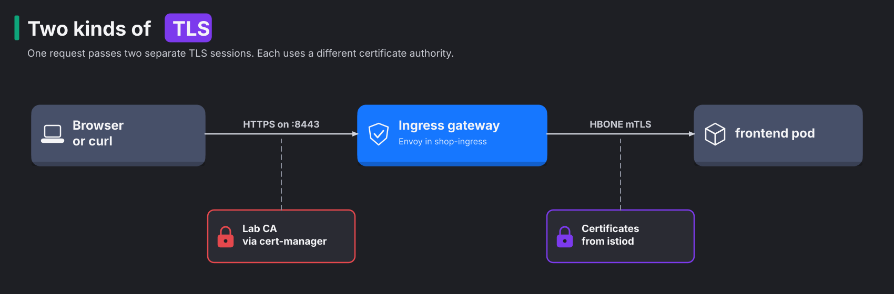
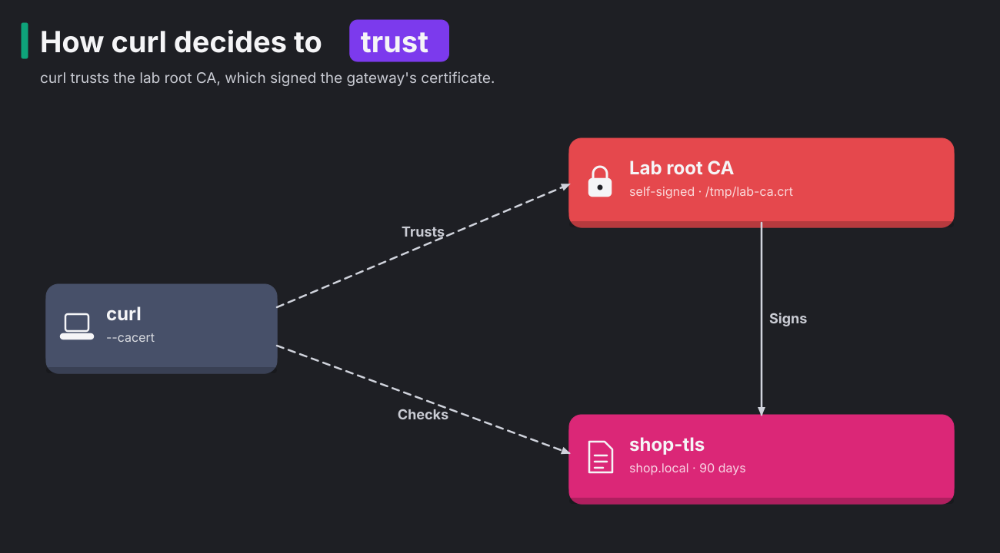
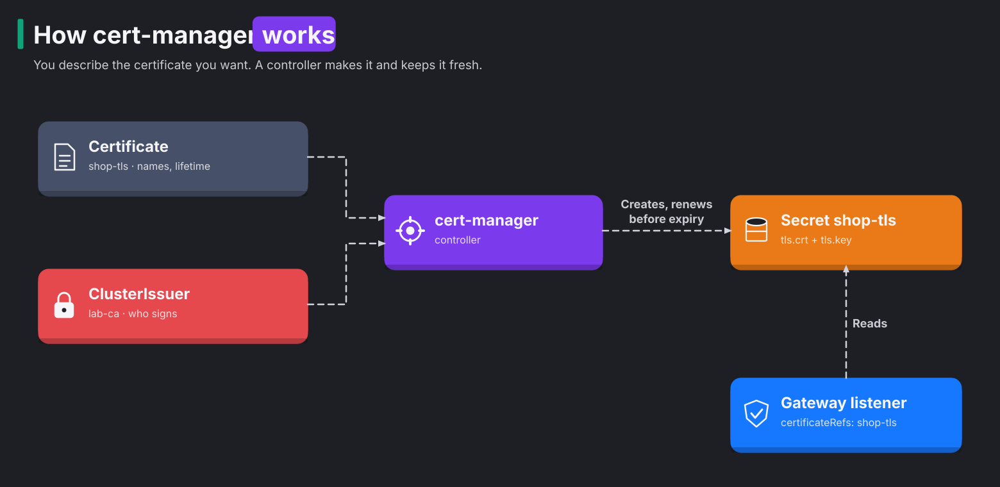

# Module 11: TLS at the edge

> New to a term here, like VirtualService or waypoint? The [glossary](glossary.md) explains every Istio resource and term in this course.

**Before this module:** modules 1 to 4.

So far the shop speaks plain HTTP on `localhost:8080`. Inside the mesh that's fine, because ztunnel wraps every hop in mTLS. But the first hop, from your browser to the ingress gateway, travels unencrypted. Anyone on the network path reads it. In this module you close that gap in three steps:

1. You give the gateway an HTTPS listener.
2. You let cert-manager issue and renew its certificate.
3. You send every HTTP visitor over to HTTPS.

Time: about 45 minutes.

## Concept: two kinds of TLS in one request

One request now passes through two separate TLS sessions, and each one uses a different certificate authority.



| | Edge TLS (this module) | Mesh mTLS (module 2) |
|---|---|---|
| Who connects | Any client, usually a browser | Only workloads inside the mesh |
| Who proves its identity | Only the server | Both sides |
| Who signs the certificate | A CA the client trusts: Let's Encrypt, a company CA, or here the lab CA | istiod, a CA only the mesh trusts |
| Name in the certificate | A DNS name, like `shop.local` | A SPIFFE ID, like `spiffe://cluster.local/ns/shop/sa/frontend` |
| Who manages it | You, with cert-manager | istiod, fully automatic |

The gateway sits between the two sessions, like a translator between two phone calls. It does four things in order:

1. It ends the browser's TLS session. The usual word for this is "terminates".
2. It reads the HTTP request.
3. It picks a route.
4. It opens a fresh mTLS connection into the mesh.

The frontend never sees the edge certificate.

## Concept: how a client decides to trust a certificate

A certificate is like an ID card. It holds a public key, some names and some dates, and an issuer signs it. The private key never leaves the Secret. The gateway sends only the certificate. During the handshake, it proves that it holds the matching private key. Before curl sends a single byte of HTTP, it runs three checks:

1. Signature. A CA in curl's trust store signed the certificate. curl and browsers ship a list of public CAs, and the lab CA is not on it. That's why step 3 passes `--cacert /tmp/lab-ca.crt`.
2. Name. The host name in the URL appears in the certificate's Subject Alternative Name (SAN) list. Modern clients ignore the older Common Name field.
3. Dates. The current time lies between "not before" and "not after".



You rely on the same chain every day. Your kubeconfig holds `certificate-authority-data`, and kubectl checks the API server's certificate against it, exactly the way curl checks the gateway here.

## Concept: how cert-manager works

cert-manager turns certificates into ordinary Kubernetes resources. You describe the certificate you want, and a controller makes it happen and keeps it fresh.



The diagram above shows the flow. You write a Certificate, the controller reads it with the ClusterIssuer, and the controller writes a Secret for the gateway. Three resources do the work:

- An **Issuer** or **ClusterIssuer** says who signs. In real life that's usually Let's Encrypt through the ACME protocol, or a company CA. Let's Encrypt needs a public DNS name, and a laptop lab has none. So the lab runs its own CA, called `lab-ca`. A self-signed root that cert-manager created during provisioning backs it.
- A **Certificate** says what you want: DNS names, lifetime, when to renew, key type.
- A **Secret** of type `kubernetes.io/tls` holds the result. cert-manager writes it, and the gateway reads it.

You never touch the Secret yourself. Delete it, and cert-manager simply issues a new one.

## The bigger picture: why certificates break production

Ask any operations team about their worst outages, and an expired certificate shows up on the list sooner or later. Big names have gone down this way, including whole mobile networks, cloud consoles and payment systems. The pattern always looks the same:

1. Someone created the certificate by hand two years ago.
2. They set a reminder, then changed jobs.
3. Nobody owned the renewal.
4. One morning the certificate expired, and every client started refusing the connection.

The industry answer is short-lived certificates that renew automatically. Renewal then happens so often that it becomes routine, and a machine does it. Let's Encrypt issues certificates for 90 days. The browser makers and certificate authorities went further. In 2025 they voted to cut the maximum lifetime of public certificates step by step, down to 47 days by 2029. At that pace, nobody renews by hand any more. A tool like cert-manager stops being nice to have and becomes the only sane way.

That's also why this module's certificate lives for 90 days and renews 30 days early. You set the policy once, and from then on nobody thinks about it.

## Why this way

**Why end TLS at the gateway, and not pass it through to the frontend?** The gateway needs to read the request to route it. Routing uses the path, the host and the headers. While the traffic is still encrypted, the gateway sees nothing but bytes. Istio supports passthrough with `mode: Passthrough`, for apps that must hold their own keys. In that mode the gateway only routes by the server name and loses every HTTP feature.

**Why does the Secret live in `shop-ingress`?** By default, a Gateway reads certificates only from its own namespace. That rule stops a team from pointing its gateway at another team's private key. To use a Secret from another namespace, the owner of that namespace allows it with a `ReferenceGrant`.

**Why does the gateway pick up a new certificate without a restart?** Envoy gets certificates from a live feed, not from a file it reads once at start. That feed is SDS, the Secret Discovery Service. It is part of the same xDS protocol from module 1. The update works like this:

1. istiod watches the Secret.
2. cert-manager rewrites the Secret.
3. istiod pushes the new certificate to Envoy.

Open connections keep their old session. New connections get the new certificate.

**Why a 301 redirect and not just turning HTTP off?** People type `localhost:8080` or follow old links. A redirect sends them to the right place instead of showing an error. Production sites also add HTTP Strict Transport Security (HSTS). HSTS is a header that tells the browser to use HTTPS on its own next time.

## Do it

You need port 8443 on your machine. Clusters that `provision.sh` built after this module arrived publish it already. For an older cluster, add it once. k3d rebuilds its load balancer, and the cluster keeps running:

```bash
docker port k3d-k8s-lab-serverlb | grep 8443 || k3d cluster edit k8s-lab --port-add 8443:8443@loadbalancer
```

### 1. Meet the lab CA

```bash
kubectl get clusterissuer
kubectl -n cert-manager get certificate lab-root-ca
```

**What you should see.** Two issuers, `selfsigned` and `lab-ca`, both `READY True`. The root CA certificate also shows `READY True`. Save the root's public certificate. curl needs it in a moment to trust the gateway:

```bash
kubectl -n cert-manager get secret lab-root-ca -o jsonpath='{.data.ca\.crt}' | base64 -d > /tmp/lab-ca.crt
```

### 2. Ask for a certificate

```bash
kubectl apply -f course/manifests/11-certificate.yaml
kubectl -n shop-ingress get certificate shop-tls -w      # wait for READY True, then Ctrl-C
kubectl -n shop-ingress get secret shop-tls -o jsonpath='{.data.tls\.crt}' | base64 -d \
  | openssl x509 -noout -issuer -ext subjectAltName -dates
```

**What you should see.** The issuer is `CN=k8s-lab root CA`. The names are `shop.local` and `localhost`. The two dates are 90 days apart. It took cert-manager a second or two.

### 3. Open an HTTPS listener

```bash
kubectl apply -f course/manifests/11-gateway-https.yaml
kubectl -n shop-ingress get gateway shop-gateway
curl --cacert /tmp/lab-ca.crt https://localhost:8443/api/version
curl https://localhost:8443/api/version
```

**What you should see.** The first curl returns the version JSON. The second fails with `SSL certificate problem: unable to get local issuer certificate`. curl doesn't know the lab CA, so it refuses the connection. Your browser behaves the same way and shows a warning page. That's TLS doing its job.

Now look at the handshake itself:

```bash
openssl s_client -connect 127.0.0.1:8443 -servername shop.local -CAfile /tmp/lab-ca.crt </dev/null 2>/dev/null \
  | grep -E "subject=|issuer=|Verify return code"
```

One gateway serves many sites from one IP address, so it needs to know which site you want before it picks a certificate. The client tells it during the handshake, with a field called Server Name Indication (SNI). `-servername` sets that field.

### 4. Send HTTP visitors to HTTPS

```bash
kubectl apply -f course/manifests/11-redirect.yaml
curl -sI http://localhost:8080/api/orders | grep -iE "^HTTP|^location"
curl -sL --cacert /tmp/lab-ca.crt -o /dev/null -w "%{http_code} %{url_effective}\n" http://localhost:8080/api/orders
```

**What you should see.** First `HTTP/1.1 301 Moved Permanently` with `location: https://localhost:8443/api/orders`. Then `200`, once curl follows the redirect. The redirect route answers on the `http` listener by itself. The request never reaches the frontend.

### 5. Renew the certificate with no downtime

Note the certificate's serial number. Then throw the Secret away and watch cert-manager replace it:

```bash
serial() { openssl s_client -connect 127.0.0.1:8443 -servername localhost </dev/null 2>/dev/null | openssl x509 -noout -serial; }
serial
kubectl -n shop-ingress get pods          # note RESTARTS
kubectl -n shop-ingress delete secret shop-tls
sleep 5; serial
kubectl -n shop-ingress get pods          # RESTARTS has not changed
```

**What you should see.** A new serial number appears within a few seconds, and the gateway pod stays untouched. A real renewal works the same way. cert-manager writes a new Secret 30 days before expiry, and SDS carries it into Envoy.

## Investigate

1. Which certificate does the frontend see when a request arrives through HTTPS?
2. Delete both the Certificate and the Secret (`kubectl -n shop-ingress delete certificate,secret shop-tls`). What does the Gateway report for the `https` listener, and what happens to `https://localhost:8443`? Re-apply step 2 afterwards.
3. In Grafana, open Explore with Prometheus and run `sum by (response_code, destination_service) (istio_requests_total{source_workload="shop-gateway-istio"})` after you call `http://localhost:8080` a few times. Wait 30 seconds for Prometheus to scrape. Do the 301 responses show up, and which service do they name?
4. Why does the certificate in step 2 list `localhost` as well as `shop.local`?

<details>
<summary>Answers</summary>

1. The frontend sees none of the edge certificates. The gateway ends the browser's TLS session. Towards the frontend, it opens an HBONE mTLS connection with its own mesh identity, `spiffe://cluster.local/ns/shop-ingress/sa/shop-gateway-istio`. To check, send one HTTPS request, then read the ztunnel log with `kubectl -n istio-system logs ds/ztunnel --since=1m | grep shop-gateway | grep frontend | tail -1`. The `src.identity` field holds that SPIFFE ID.
2. The Secret no longer exists, so the listener's `ResolvedRefs` condition turns `False` with the reason `InvalidCertificateRef`. The gateway stops offering a certificate, and `curl` fails during the handshake. The `http` listener on 8080 keeps answering, with the redirect if you applied step 4. One broken listener doesn't take down the others.
3. They do, but with `destination_service="unknown"`. The gateway answered those requests itself. No backend took part, so the metric has no service to name. The 200s from HTTPS requests carry `destination_service="frontend.shop.svc.cluster.local"`. Remember that "unknown" label for real incidents. A jump in `unknown` responses from a gateway often means one of two things:
   - A route matched nothing.
   - A redirect or a direct response answered instead of your service.
4. A certificate only covers the names listed in it. curl and your browser connect to `localhost:8443`. Without `localhost` in the list, the name check fails, even though the lab CA signed the certificate.

</details>

## Clean up

```bash
./course/reset.sh
```

This removes the redirect, the HTTPS listener, the Certificate and its Secret. The lab CA and cert-manager stay, because they belong to the lab.
