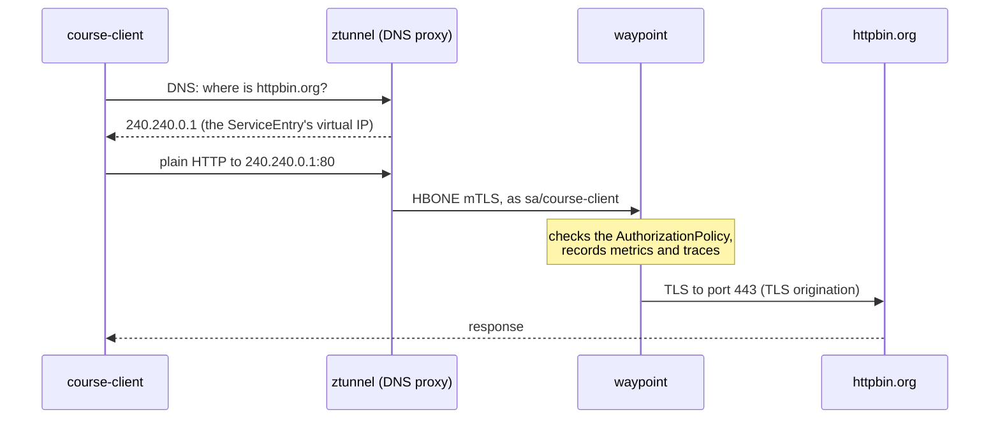

# Module 12: egress, traffic that leaves the mesh

> New to a term here, like VirtualService or waypoint? The [glossary](glossary.md) explains every Istio resource and term in this course.

Modules 2 to 5 controlled traffic between your own services. This module looks the other way: calls from your pods out to the internet. You find out what the mesh knows about them by default (almost nothing), register an external host so the mesh treats it like one of its own services, put L7 rules on it, and lock a pod in so the mesh is its only way out.

Time: about 45 minutes. You need internet access, because the exercises call `example.com` and `httpbin.org`.

## Concept: what the mesh sees by default

Run a call from a mesh pod to an outside website and look at ztunnel's log line for it:

```text
src.workload="course-client-..." dst.addr=104.20.23.154:443 direction="outbound"
```

That's all. An IP address and a port. No hostname, no HTTP method, no path, no response code. ztunnel only knows what the packet tells it, and the packet carries an IP. Kubernetes has no Service for `example.com`, so the mesh has nothing to match it against. It lets the connection through and writes down the address.

For most teams this is the first uncomfortable surprise. Ask "which of our services call the internet, and where to?" and the honest answer is "we don't know".

## Concept: how a ServiceEntry gives the mesh a name to work with

A ServiceEntry adds an external host to the mesh's service registry, the same list that holds your Kubernetes Services. Once the host is in that list, the mesh routes, secures and measures its traffic like any other service.

Ambient mode needs one more piece. ztunnel matches traffic by IP, and `httpbin.org` has many IPs that change. So istiod hands the ServiceEntry a stable virtual IP from `240.240.0.0/16`, and ztunnel answers the pod's DNS queries itself. The pod asks for `httpbin.org`, gets `240.240.0.1` back, and connects there. ztunnel recognises the address and sends the connection to the waypoint.



Two settings in the lab's Istio install make this work: `ambient.dnsCapture` on istio-cni and `PILOT_ENABLE_IP_AUTOALLOCATE` on istiod. Istio 1.24 ships with both off, and newer releases turn them on by default. The lab sets them in `helm/`.

## Concept: TLS origination

Look at the diagram again. The app speaks plain HTTP, and the waypoint opens the TLS connection to the real server. That trick has a name: TLS origination. It sounds backwards at first. Why would you want your app to send plain text?

Because the mesh only enforces rules on what it reads. If the app opens TLS itself, the waypoint sees an encrypted stream and knows only the server name. With origination, the waypoint reads the method and the path, applies L7 rules, records the response code, and only then encrypts. The hop from the app to the waypoint still travels inside HBONE mTLS, so nothing crosses the network in clear text.

## The bigger picture: why egress control matters

Most security work points inwards: who may call my service? Egress asks the opposite question, and attackers love that it often goes unasked.

Think about what happens after a break-in. Malware inside a pod wants two things: to download its next stage, and to send your data somewhere. Both need an outbound connection. A cluster that lets every pod reach every address on the internet makes both easy. Some of the most damaging supply-chain attacks of recent years, where a compromised build tool or library phoned home, worked exactly like this.

Auditors ask about it too. Standards such as PCI DSS expect you to list and limit outbound connections from systems that handle card data. "We allow everything" doesn't pass.

The usual pattern has three layers, and this module builds all three:

1. **Know** where traffic goes: register the external hosts you depend on as ServiceEntries, so they show up by name in metrics and logs.
2. **Funnel** it through one controlled exit: the waypoint here, or a dedicated egress gateway in bigger setups.
3. **Block** everything else at the network layer, so nothing slips past the exit.

## Why this way

**Why does the lock-down use a Kubernetes NetworkPolicy and not an Istio rule?** An AuthorizationPolicy runs on a proxy, and a proxy only sees traffic that reaches it. A connection to an address the mesh doesn't know never touches the waypoint, so no Istio rule ever runs on it. A NetworkPolicy works one level lower, in the node's packet filter, and drops the packets wherever they go. Istio and Kubernetes each do the part they're good at.

**Why does the NetworkPolicy allow the whole pod network?** In ambient mode, the pod's traffic to the waypoint leaves as HBONE to the waypoint's pod IP on port 15008. The policy has to let that through. Allowing `10.42.0.0/16` (pods) and `10.43.0.0/16` (Services, including DNS) keeps the cluster reachable and closes everything outside it.

**Why does `https://httpbin.org` fail after the lock-down, when `http://httpbin.org` works?** The ServiceEntry only declares port 80. A call to port 443 on the virtual IP matches nothing, so ztunnel treats it as unknown traffic, and the NetworkPolicy blocks the real IP. That's deliberate: the only way to httpbin.org now runs through the waypoint, where the rules apply.

**Why not just block the internet for every pod?** Many apps need it: payment providers, email APIs, package mirrors. The goal is a short, named list of allowed destinations with rules on each, not a wall.

## Do it

If your lab existed before this module, run `./scripts/provision.sh` once, after `git pull`. It turns on DNS capture and virtual IPs and restarts istio-cni. Pods pick up DNS capture only when they start, so the exercises restart the course client.

```bash
kubectl apply -f course/manifests/03-course-client.yaml
kubectl -n shop rollout restart deploy/course-client
kubectl -n shop rollout status deploy/course-client
```

### 1. See what the mesh knows by default

```bash
kubectl -n shop exec deploy/course-client -- curl -s -o /dev/null -w "%{http_code}\n" https://example.com
kubectl -n istio-system logs ds/ztunnel --since=1m | grep course-client | grep outbound | tail -1
```

**What you should see.** `200`, and a log line with `dst.addr=` followed by an IP and port 443. No hostname anywhere.

### 2. Register httpbin.org

```bash
kubectl apply -f course/manifests/12-serviceentry.yaml
kubectl -n shop get serviceentry httpbin-org -o jsonpath='{.status.addresses}{"\n"}'
kubectl -n shop exec deploy/course-client -- nslookup httpbin.org
```

**What you should see.** istiod gave the ServiceEntry the address `240.240.0.1`, and DNS inside the pod now returns that address instead of httpbin's real ones.

### 3. Watch the waypoint add TLS

```bash
kubectl -n shop exec deploy/course-client -- curl -s http://httpbin.org/get | grep '"url"'
kubectl -n istio-system logs ds/ztunnel --since=1m | grep course-client | grep httpbin | tail -1
```

**What you should see.** The app asked for `http://`, yet httpbin reports `"url": "https://httpbin.org/get"`: the request reached it over TLS. The ztunnel line shows `dst.service="httpbin.org"` and `dst.workload="waypoint-..."`. The call went through the waypoint.

### 4. Lock the course client in

```bash
kubectl apply -f course/manifests/12-egress-lockdown.yaml
kubectl -n shop exec deploy/course-client -- curl -sS -m 8 -o /dev/null https://example.com
kubectl -n shop exec deploy/course-client -- curl -s -o /dev/null -w "%{http_code}\n" http://httpbin.org/get
```

**What you should see.** example.com fails with `curl: (35) TLS connect error` or `Connection reset by peer`, and httpbin.org through the waypoint still returns `200`. Notice the error type: not a timeout, but a reset. ztunnel runs inside the pod's network namespace, accepts the connection locally, then fails to reach the real server and closes it. You met the same effect with Redis in module 3.

### 5. Put L7 rules on the way out

```bash
kubectl apply -f course/manifests/12-egress-policy.yaml
for p in get headers ip; do
  kubectl -n shop exec deploy/course-client -- curl -s -o /dev/null -w "GET /$p -> %{http_code}\n" http://httpbin.org/$p
done
kubectl -n shop exec deploy/course-client -- curl -s -o /dev/null -w "POST /post -> %{http_code}\n" -X POST http://httpbin.org/post
```

**What you should see.** `200` for `/get` and `/headers`, `403` for `/ip` and for the POST. The waypoint read each request and checked it against the rule, on traffic bound for the internet.

### 6. Find the egress traffic in Prometheus

Wait 30 seconds for a scrape, then open Grafana, Explore, Prometheus, and run:

```text
sum by (source_workload, response_code) (istio_requests_total{reporter="waypoint", destination_service="httpbin.org"})
```

**What you should see.** One line per workload and response code, for example `course-client 200` and `course-client 403`. Compare that with step 1, where all you had was an IP.

## Investigate

1. The rule in step 5 only allows the course client. Call httpbin.org from the frontend: `kubectl -n shop exec deploy/frontend -- node -e 'fetch("http://httpbin.org/get").then(r => console.log(r.status))'`. What status do you get? Now restart the frontend (`kubectl -n shop rollout restart deploy/frontend`) and try again. Explain the difference.
2. After step 4, `curl -m 8 https://example.com` fails at once instead of waiting 8 seconds. Why doesn't it time out?
3. The course client calls `https://httpbin.org/get` after step 4. It fails. Which two changes would let it work, and which one keeps the L7 rules?
4. Where in Kiali does the egress traffic appear after step 3?

<details>
<summary>Answers</summary>

1. If your frontend started before DNS capture was on, the first call returns `200`. That pod still resolves httpbin.org to its real IP, so ztunnel never connects it to the ServiceEntry, the call skips the waypoint, and the rule never runs. After the restart, the new pod gets DNS capture, resolves `240.240.0.1`, goes through the waypoint, and gets `403`, because the rule only allows the course client. The lesson repeats module 3: an L7 rule only binds traffic that reaches the proxy enforcing it. On a lab built from scratch with this module in place, both calls return `403`.
2. The connection never leaves the pod as a TCP handshake to example.com. ztunnel inside the pod's network namespace accepts it, tries the real server, runs into the NetworkPolicy, and resets the client's connection straight away.
3. Add port 443 to the ServiceEntry (with `protocol: TLS`), or allow the real IPs in the NetworkPolicy. The first keeps traffic on the waypoint, but the waypoint then sees only TLS, so it checks the server name and nothing more: no paths, no methods. The second skips the mesh entirely. TLS origination, the setup in this module, keeps the full L7 rules.
4. In the traffic graph for the `shop` namespace, httpbin.org shows up as a service node of its own, reached through the waypoint. Turn on "Service nodes" in the Display menu if you don't see it. Before step 2, the mesh had no name for those calls, so no httpbin.org node existed.

</details>

## Clean up

```bash
./course/reset.sh
```

This removes the ServiceEntry, the AuthorizationPolicy and the NetworkPolicy. DNS capture and virtual IPs stay on, because they belong to the lab's Istio install.
