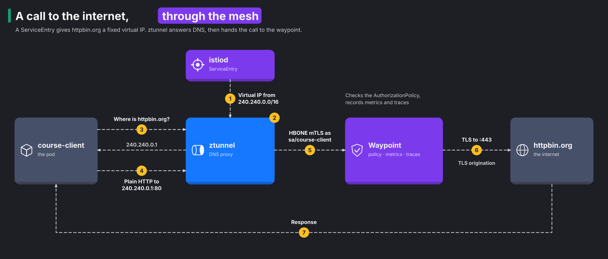

# Module 12: egress, traffic that leaves the mesh

> New to a term here, like VirtualService or waypoint? The [glossary](glossary.md) explains every Istio resource and term in this course.

**Before this module:** modules 1 to 3, and 11 helps.

Modules 2 to 5 controlled traffic between your own services. This module looks the other way, at calls from your pods out to the internet. Here is the plan:

1. You find out what the mesh knows about these calls by default. The answer is almost nothing.
2. You register an external host, so the mesh treats it like one of its own services.
3. You put L7 rules on that host.
4. You lock a pod in, so the mesh is its only way out.

Time: about 45 minutes. You need internet access, because the exercises call `example.com` and `httpbin.org`.

## Concept: what the mesh sees by default

Run a call from a mesh pod to an outside website and look at ztunnel's log line for it:

```text
src.workload="course-client-..." dst.addr=104.20.23.154:443 direction="outbound"
```

That's all the mesh records, an IP address and a port. The log has no hostname, no HTTP method, no path and no response code. ztunnel only knows what the packet tells it, and the packet carries an IP. Kubernetes has no Service for `example.com`, so the mesh has nothing to match the IP against. It lets the connection through and writes down the address.

For most teams this is the first uncomfortable surprise. Ask "which of our services call the internet, and where to?" and the honest answer is "we don't know".

## Concept: how a ServiceEntry gives the mesh a name to work with

To control a call, the mesh first needs a name for the place it goes. A ServiceEntry gives it one. It adds an external host to the mesh's service registry, the same list that holds your Kubernetes Services. Once the host is in that list, the mesh routes, secures and measures its traffic like any other service.

Ambient mode needs one more piece. The diagram below walks through it. ztunnel matches traffic by IP, but `httpbin.org` has many IPs, and they change. So the mesh gives the host a fixed address of its own, like a forwarding address for mail. Here is how it works:

1. istiod gives the ServiceEntry a stable virtual IP from `240.240.0.0/16`. No real machine has this address.
2. ztunnel answers the pod's DNS queries itself.
3. The pod asks for `httpbin.org` and gets `240.240.0.1` back.
4. The pod connects to that address.
5. ztunnel recognises the address and sends the connection to the waypoint.



Two settings in the lab's Istio install make this work:

- `ambient.dnsCapture` on istio-cni lets ztunnel answer DNS queries.
- `PILOT_ENABLE_IP_AUTOALLOCATE` on istiod hands out the virtual IPs.

Istio 1.24 ships with both off, and newer releases turn them on by default. The lab sets them in `helm/`.

## Concept: TLS origination

Look at the diagram again. The app speaks plain HTTP, and the waypoint opens the TLS connection to the real server. That trick is called TLS origination. It sounds backwards at first, because you normally want apps to encrypt their own traffic.

The reason is simple. The mesh only enforces rules on what it reads. If the app opens TLS itself, the waypoint sees a sealed envelope and knows only the server name. With origination, the waypoint does four things in order:

1. It reads the method and the path.
2. It applies the L7 rules.
3. It records the response code.
4. Only then does it encrypt the request for the real server.

The plain HTTP never crosses the network bare. The hop from the app to the waypoint still travels inside HBONE mTLS.

## Concept: three resources, one external host

The manifests for this module hold three Istio resources for httpbin.org. Each does one job:

| Resource | Its job here | Closest thing in plain Kubernetes |
|---|---|---|
| ServiceEntry `httpbin-org` | Puts `httpbin.org` in the registry on port 80 and sends it on to port 443 (`targetPort`). Its label `istio.io/use-waypoint: waypoint` sends the traffic through the waypoint. | A Service of type `ExternalName`, which only adds a DNS alias: no policy, no metrics |
| DestinationRule `httpbin-org-tls` | `tls.mode: SIMPLE` tells the waypoint to open TLS to the real server. This is the origination. | none |
| AuthorizationPolicy `httpbin-org-read-only` (step 5) | Attaches to the ServiceEntry through `targetRefs` and allows only GET on two paths, only for the course client | none: a NetworkPolicy stops at IPs and ports |

`resolution: DNS` tells the waypoint to look up httpbin.org's real addresses itself when it connects. The `240.240.0.1` address only matters between the pod and ztunnel.

A common mistake is to treat a ServiceEntry as a firewall rule. It allows nothing and blocks nothing. It only gives the mesh a name. Blocking needs the NetworkPolicy in step 4. Rules per request need the AuthorizationPolicy in step 5.

## The bigger picture: why egress control matters

Most security work points inwards and asks who may call your service. Egress asks the opposite question, where your services may call out to. Teams often never ask it, and attackers count on that.

Think about what happens after a break-in. Malware inside a pod wants two things:

- to download its next stage,
- to send your data somewhere.

Both need an outbound connection. A cluster that lets every pod reach every address on the internet makes both easy. Some of the most damaging supply-chain attacks of recent years worked exactly like this. A compromised build tool or library phoned home to its owner.

Auditors ask about egress too. Standards such as PCI DSS expect you to list and limit outbound connections from systems that handle card data. "We allow everything" doesn't pass.

The usual pattern has three layers, and this module builds all three:

1. Know where traffic goes. Register the external hosts you depend on as ServiceEntries, so they show up by name in metrics and logs.
2. Send it through one controlled exit. Here that exit is the waypoint. Bigger setups use a dedicated egress gateway.
3. Block everything else at the network layer, so nothing slips past the exit.

## Why this way

**Why does the lock-down use a Kubernetes NetworkPolicy and not an Istio rule?** An Istio rule only sees traffic that walks past it. An AuthorizationPolicy runs on a proxy, and a proxy only sees traffic that reaches it. A connection to an address the mesh doesn't know never touches the waypoint. So no Istio rule ever runs on it. A NetworkPolicy works one level lower, in the node's packet filter. It drops the packets wherever they go. Istio and Kubernetes each do the part they're good at.

**Why does the NetworkPolicy allow the whole pod network?** The pod still needs to reach the waypoint, or the controlled exit is blocked too. In ambient mode, that traffic leaves as HBONE to the waypoint's pod IP on port 15008. So the policy allows two ranges:

- `10.42.0.0/16`, the pods.
- `10.43.0.0/16`, the Services, including DNS.

This keeps the cluster reachable and closes everything outside it.

**Why does `https://httpbin.org` fail after the lock-down, when `http://httpbin.org` works?** The ServiceEntry only declares port 80. Here is what happens to a call on port 443:

1. The call to port 443 on the virtual IP matches nothing.
2. So ztunnel treats it as unknown traffic.
3. The NetworkPolicy blocks the real IP.

That's deliberate. The only way to httpbin.org now runs through the waypoint, where the rules apply.

**Why not just block the internet for every pod?** Many apps need it, for example to reach payment providers, email APIs and package mirrors. The goal is not a wall. The goal is a short, named list of allowed destinations, with rules on each one.

## Do it

If your lab existed before this module, run `./scripts/provision.sh` once, after `git pull`. It turns on DNS capture and virtual IPs, then restarts istio-cni. Pods pick up DNS capture only when they start. That's why the exercises restart the course client.

```bash
kubectl apply -f course/manifests/03-course-client.yaml
kubectl -n shop rollout restart deploy/course-client
kubectl -n shop rollout status deploy/course-client
```

### 1. See what the mesh knows by default

```bash
kubectl -n shop exec deploy/course-client -- curl -s -o /dev/null -w "%{http_code}\n" https://example.com
kubectl -n istio-system logs ds/ztunnel --since=1m | grep course-client | grep outbound | tail -1
```

**What you should see.** `200`, and a log line with `dst.addr=` followed by an IP and port 443. No hostname anywhere.

### 2. Register httpbin.org

```bash
kubectl apply -f course/manifests/12-serviceentry.yaml
kubectl -n shop get serviceentry httpbin-org -o jsonpath='{.status.addresses}{"\n"}'
kubectl -n shop exec deploy/course-client -- nslookup httpbin.org
```

**What you should see.** istiod gave the ServiceEntry the address `240.240.0.1`. DNS inside the pod now returns that address instead of httpbin's real ones.

### 3. Watch the waypoint add TLS

```bash
kubectl -n shop exec deploy/course-client -- curl -s http://httpbin.org/get | grep '"url"'
kubectl -n istio-system logs ds/ztunnel --since=1m | grep course-client | grep httpbin | tail -1
```

**What you should see.** The app asked for `http://`, yet httpbin reports `"url": "https://httpbin.org/get"`. So the request reached httpbin over TLS. The ztunnel line shows `dst.service="httpbin.org"` and `dst.workload="waypoint-..."`. The call went through the waypoint.

### 4. Lock the course client in

```bash
kubectl apply -f course/manifests/12-egress-lockdown.yaml
kubectl -n shop exec deploy/course-client -- curl -sS -m 8 -o /dev/null https://example.com
kubectl -n shop exec deploy/course-client -- curl -s -o /dev/null -w "%{http_code}\n" http://httpbin.org/get
```

**What you should see.** example.com fails with `curl: (35) TLS connect error` or `Connection reset by peer`. httpbin.org, through the waypoint, still returns `200`.

Notice the error type. It is a reset, not a timeout. Here is why:

1. ztunnel listens inside the pod's network namespace, so it accepts the connection locally.
2. ztunnel then tries the real server and fails to reach it.
3. ztunnel closes the pod's connection.

You met the same effect with Redis in module 3.

### 5. Put L7 rules on the way out

```bash
kubectl apply -f course/manifests/12-egress-policy.yaml
for p in get headers ip; do
  kubectl -n shop exec deploy/course-client -- curl -s -o /dev/null -w "GET /$p -> %{http_code}\n" http://httpbin.org/$p
done
kubectl -n shop exec deploy/course-client -- curl -s -o /dev/null -w "POST /post -> %{http_code}\n" -X POST http://httpbin.org/post
```

**What you should see.** `200` for `/get` and `/headers`, and `403` for `/ip` and for the POST. The waypoint read each request and checked it against the rule. It did this on traffic bound for the internet.

### 6. Find the egress traffic in Prometheus

Wait 30 seconds for a scrape, then open Grafana, Explore, Prometheus, and run:

```text
sum by (source_workload, response_code) (istio_requests_total{reporter="waypoint", destination_service="httpbin.org"})
```

**What you should see.** One line per workload and response code, for example `course-client 200` and `course-client 403`. Compare that with step 1, where all you had was an IP.

## Investigate

1. The rule in step 5 only allows the course client. Call httpbin.org from the frontend: `kubectl -n shop exec deploy/frontend -- node -e 'fetch("http://httpbin.org/get").then(r => console.log(r.status))'`. What status do you get? Now restart the frontend (`kubectl -n shop rollout restart deploy/frontend`) and try again. Explain the difference.
2. After step 4, `curl -m 8 https://example.com` fails at once instead of waiting 8 seconds. Why doesn't it time out?
3. The course client calls `https://httpbin.org/get` after step 4. It fails. Which two changes would let it work, and which one keeps the L7 rules?
4. Where in Kiali does the egress traffic appear after step 3?

<details>
<summary>Answers</summary>

1. The answer depends on when your frontend pod started.
   - If it started before DNS capture was on, the first call returns `200`. That pod still resolves httpbin.org to its real IP. So ztunnel never links the call to the ServiceEntry. The call skips the waypoint, and the rule never runs.
   - After the restart, the new pod gets DNS capture. It resolves `240.240.0.1` and goes through the waypoint. It gets `403`, because the rule only allows the course client.

   The lesson repeats module 3. An L7 rule only applies to traffic that reaches the proxy enforcing it. On a lab built from scratch with this module in place, both calls return `403`.
2. The connection never leaves the pod as a TCP handshake to example.com. ztunnel answers it inside the pod's network namespace. Then it happens in this order:
   1. ztunnel accepts the connection.
   2. ztunnel tries the real server and runs into the NetworkPolicy.
   3. ztunnel resets the client's connection straight away.
3. Two changes would work:
   - Add port 443 to the ServiceEntry, with `protocol: TLS`. Traffic stays on the waypoint. But the waypoint then sees only TLS, so it checks the server name and nothing more. It sees no paths and no methods.
   - Allow the real IPs in the NetworkPolicy. This skips the mesh entirely.

   Neither keeps the full L7 rules. Only TLS origination, the setup in this module, does that.
4. Look in the traffic graph for the `shop` namespace. httpbin.org shows up as a service node of its own, reached through the waypoint. Turn on "Service nodes" in the Display menu if you don't see it. Before step 2, the mesh had no name for those calls, so no httpbin.org node existed.

</details>

## Clean up

```bash
./course/reset.sh
```

This removes the ServiceEntry, the AuthorizationPolicy and the NetworkPolicy. DNS capture and virtual IPs stay on, because they belong to the lab's Istio install.
