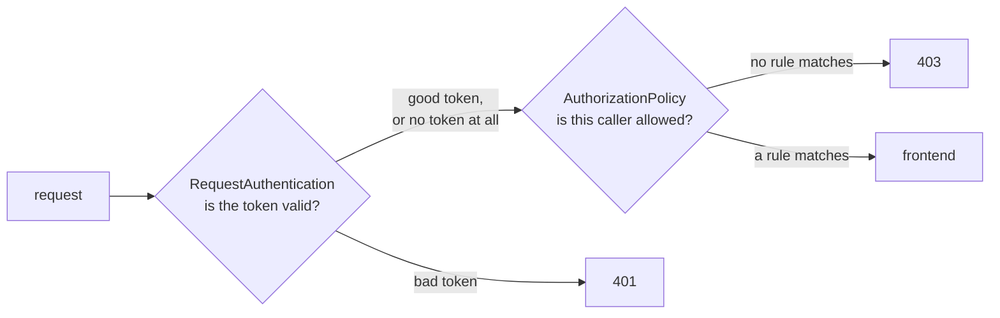

# Module 13: end-user authentication with JWT

> New to a term here, like VirtualService or waypoint? The [glossary](glossary.md) explains every Istio resource and term in this course.

Modules 2 and 3 answered "which workload is calling?" with certificates. That's enough between services, but a shop also has people: Alice browsing orders, Bob the admin creating them. Their identity doesn't live in a certificate. It arrives in each request as a token. This module teaches the ingress gateway to check those tokens and to decide on what they say.

Time: about 40 minutes.

## Concept: what a JWT is

A JSON Web Token is three base64 strings joined by dots: a header, a payload with claims, and a signature.

```text
eyJhbGciOiJSUzI1NiIs...  .  eyJpc3MiOiJodHRwczov...  .  kM3x9Qf...
        header                     claims                  signature
```

Decode the middle part of the lab's admin token and you get plain JSON:

```json
{
  "iss": "https://idp.k8s-lab.local",
  "aud": "shop",
  "sub": "bob",
  "groups": ["customers", "admin"],
  "exp": 2109855144
}
```

`iss` names the issuer, the identity provider that signed the token. `aud` names the audience, the system it's meant for. `sub` names the user. `exp` sets the expiry time. `groups` is a custom claim, and you decide what it means.

Anyone reads a JWT with a base64 decoder, so it holds no secrets. Its value comes from the signature: the identity provider signs with its private key, and anyone with the matching public key checks that nobody changed a single character. The provider publishes its public keys as a JWKS, a JSON Web Key Set, usually at a URL like `https://idp.example.com/.well-known/jwks.json`.

## Concept: two resources, two jobs

Istio splits token handling into two resources, and mixing them up causes most of the confusion people hit.



- **RequestAuthentication** checks the token's signature, issuer, audience and expiry. A bad token gets `401 Unauthorized`. A request **with no token passes straight through**. That surprises almost everyone.
- **AuthorizationPolicy** decides. It reads the checked identity as `requestPrincipals` (issuer and subject) and any claim as `request.auth.claims[...]`. Requests that match no rule get `403 Forbidden`.

The split mirrors module 3 exactly. Authentication answers "who are you?", authorization answers "may you do this?".

## The bigger picture: who issues the tokens

In production nobody writes tokens by hand. An identity provider does it: Keycloak, Okta, Auth0, Microsoft Entra ID, Google, or Dex inside the cluster. The user logs in there, usually through OpenID Connect, and the provider hands the browser or app a signed token. Every later request carries it in the `Authorization: Bearer ...` header.

That design lets the mesh check identity without ever talking to the provider per request. The gateway downloads the JWKS once, caches it, and checks each signature locally in microseconds. The provider only appears again when it rotates its keys.

The lab has no identity provider, so it fakes one. `course/jwt/make-tokens.sh` made a key pair, published the public half as `course/jwt/jwks.json`, and signed four tokens that sit next to it:

| Token | Subject | Groups | Signed by |
|---|---|---|---|
| `alice.jwt` | alice | customers | the lab key |
| `admin.jwt` | bob | customers, admin | the lab key |
| `expired.jwt` | alice | customers | the lab key, expired an hour after creation |
| `forged.jwt` | mallory | admin | a different key that nobody trusts |

The private key `course/jwt/signing-key.pem` sits in Git too. In real life that key is the most precious secret in the whole system: whoever holds it mints admin tokens at will. It's committed here only because this lab runs on your laptop.

## Why this way

**Why check tokens at the ingress gateway and not in every service?** The gateway is the one door every outside request walks through. One check there covers the whole shop, and the services behind it never see a forged token. Teams that need finer rules add a RequestAuthentication on a waypoint too, closer to each service.

**Why does a missing token pass RequestAuthentication?** Because many sites serve public and private pages from the same host. The home page needs no login, `/api/orders` does. Istio keeps "check tokens" and "demand tokens" apart so you decide per path in the AuthorizationPolicy. The page `/` stays open in this module for exactly that reason.

**Why put the JWKS inline?** Real setups use `jwksUri`, and istiod fetches the keys. The lab keeps them inline so the module works offline and gives the same result every time.

**Why groups in the token and not a list of admins in the policy?** People join and leave teams every week. With groups in the token, the identity provider owns that list, and the mesh policy stays the same for years.

Istio does more with checked tokens than this module shows. `outputClaimToHeaders`, for example, copies a claim like `sub` into a request header, so services read the user's name without parsing the token themselves.

## Do it

### 1. Read a token

```bash
python3 -c 'import sys,base64,json; p=open(sys.argv[1]).read().strip().split(".")[1]; print(json.dumps(json.loads(base64.urlsafe_b64decode(p+"==")),indent=2))' course/jwt/admin.jwt
```

**What you should see.** The claims from the concept section. Try `alice.jwt` and `forged.jwt` too. The forged one claims to be an admin, and its JSON looks just as convincing. Only the signature tells it apart.

### 2. Check tokens, but don't demand them yet

```bash
kubectl apply -f course/manifests/13-request-authentication.yaml
for t in alice expired forged; do
  curl -s -o /dev/null -w "$t -> %{http_code}\n" -H "Authorization: Bearer $(cat course/jwt/$t.jwt)" http://localhost:8080/api/orders
done
curl -s -o /dev/null -w "no token -> %{http_code}\n" http://localhost:8080/api/orders
curl -s -H "Authorization: Bearer $(cat course/jwt/expired.jwt)" http://localhost:8080/api/orders; echo
```

**What you should see.** `alice -> 200`, `expired -> 401`, `forged -> 401`, and `no token -> 200`. The last line prints Envoy's reason: `Jwt is expired`. The gateway stopped the bad tokens, yet still let anonymous requests in.

### 3. Demand a token for the API, and admin rights for writes

```bash
kubectl apply -f course/manifests/13-require-jwt.yaml
curl -s -o /dev/null -w "page without token -> %{http_code}\n" http://localhost:8080/
curl -s -o /dev/null -w "API without token -> %{http_code}\n" http://localhost:8080/api/orders
curl -s -o /dev/null -w "alice reads -> %{http_code}\n" -H "Authorization: Bearer $(cat course/jwt/alice.jwt)" http://localhost:8080/api/orders
```

**What you should see.** The page answers `200`, the API without a token `403`, and Alice `200`.

Now try to create an order, first as Alice, then as Bob the admin:

```bash
for t in alice admin; do
  curl -s -o /dev/null -w "$t creates -> %{http_code}\n" -X POST \
    -H "Content-Type: application/json" -d '{"item":"book","quantity":1}' \
    -H "Authorization: Bearer $(cat course/jwt/$t.jwt)" http://localhost:8080/api/orders
done
```

**What you should see.** `alice creates -> 403` and `admin creates -> 201`. The third rule in `13-require-jwt.yaml` matched on `request.auth.claims[groups]` containing `admin`. Open the file and read the three rules again. Each one is a door, and a request needs one open door to pass.

### 4. Find the refusals in Prometheus

Send a few requests without a token and a few with `expired.jwt`, wait 30 seconds, then run this in Grafana, Explore, Prometheus:

```text
sum by (response_code, destination_service) (istio_requests_total{source_workload="shop-gateway-istio", response_code=~"401|403"})
```

**What you should see.** Lines for `401` and `403`, both with `destination_service="frontend.shop.svc.cluster.local"`, even though the frontend never received those requests.

## Investigate

1. A client reports `401` and another reports `403`. Without looking at the policies, what does each code tell you?
2. Why does the metric in step 4 name the frontend as the destination, when module 11's redirects showed `unknown`?
3. Remove the `notPaths: ["/api/*"]` rule from `13-require-jwt.yaml` and apply it again. What happens to `http://localhost:8080/` in the browser, and why?
4. The forged token claims `"groups": ["admin"]`. Why doesn't the third rule let it create orders?

<details>
<summary>Answers</summary>

1. `401` means the request carried a token and the gateway rejected the token itself: wrong signature, wrong issuer or audience, or expired. Fix the token. `403` means the token was fine (or absent), but no ALLOW rule matched. Fix the permissions, or send a token where the API demands one.
2. The gateway picks the route first, then runs the security checks for that route. These requests matched the route to the frontend, so the metric names it, and the gateway refused them on the frontend's behalf. A redirect never selects a backend at all, so module 11's 301s had no destination to name.
3. Every request without a token now gets `403`, including the home page, the CSS and the JavaScript, because no rule allows them anymore. In an ALLOW policy, anything not listed is refused. That first rule kept the public part of the site public.
4. RequestAuthentication rejects it before the AuthorizationPolicy ever runs: the signature doesn't match the lab's JWKS, so the gateway answers `401`. Claims only count once the signature checks out.

</details>

## Clean up

```bash
./course/reset.sh
```

This removes the RequestAuthentication and the AuthorizationPolicy from `shop-ingress`. The API answers without a token again.
