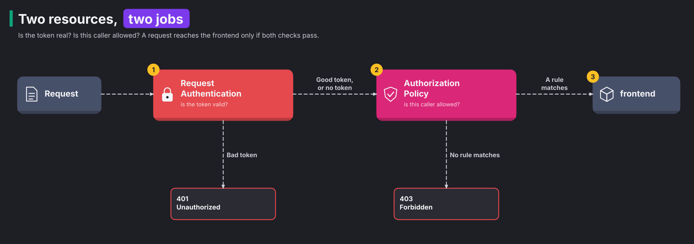

# Module 13: end-user authentication with JWT

> New to a term here, like VirtualService or waypoint? The [glossary](glossary.md) explains every Istio resource and term in this course.

**Before this module:** modules 3 and 11.

Modules 2 and 3 answered "which workload is calling?" with certificates. That's enough between services. But a shop also has people. Alice browses orders, and Bob the admin creates them. A person has no mesh certificate. So their identity arrives in each request as a token instead. In this module, the ingress gateway learns two things:

1. The gateway checks each token and rejects fakes.
2. The gateway decides what each person may do, based on what the token says.

Time: about 40 minutes.

## Concept: what a JWT is

A gateway needs proof of who a person is, and that proof must survive a trip through the browser untouched. A JSON Web Token (JWT) gives it that proof. A JWT is a short text string that carries facts about a user, plus a signature. It is three base64 strings joined by dots:

- a header,
- a payload with claims, the facts about the user,
- a signature.

```text
eyJhbGciOiJSUzI1NiIs...  .  eyJpc3MiOiJodHRwczov...  .  kM3x9Qf...
        header                     claims                  signature
```

Decode the middle part of the lab's admin token and you get plain JSON:

```json
{
  "iss": "https://idp.k8s-lab.local",
  "aud": "shop",
  "sub": "bob",
  "groups": ["customers", "admin"],
  "exp": 2109855144
}
```

Each field is a claim:

- `iss` names the issuer, the identity provider that signed the token.
- `aud` names the audience, the system the token is meant for.
- `sub` names the user.
- `exp` sets the expiry time.
- `groups` is a custom claim, and you decide what it means.

Anyone reads a JWT with a base64 decoder, so it holds no secrets. Its value comes from the signature. Think of a wax seal on a letter. Everyone reads the letter, but only the sender owns the seal, and a broken seal shows tampering. The process works like this:

1. The identity provider signs the token with its private key.
2. The identity provider publishes the matching public key.
3. The gateway uses the public key to check that nobody changed a single character.

The provider publishes its public keys as a JSON Web Key Set (JWKS). A JWKS is a JSON file that lists the provider's public keys. It usually lives at a URL like `https://idp.example.com/.well-known/jwks.json`.

## Concept: two resources, two jobs

Two separate questions arise for every request. Is the token real? And is this person allowed in? Istio answers them with two resources. Mixing them up causes most of the confusion people hit. The diagram below shows the order:

1. RequestAuthentication checks whether the token is valid.
2. AuthorizationPolicy checks whether the caller is allowed.
3. The request reaches the frontend only if both checks pass.



RequestAuthentication is the ticket checker. It checks the token's signature, issuer, audience and expiry. A bad token gets `401 Unauthorized`. A request **with no token passes straight through**. That surprises almost everyone. In other words, RequestAuthentication rejects fake tickets, but it never asks for a ticket.

AuthorizationPolicy is the bouncer who decides. It reads the checked identity as `requestPrincipals`, which joins the issuer and the subject. It reads any single claim as `request.auth.claims[...]`. A request that matches no rule gets `403 Forbidden`.

The split mirrors module 3 exactly. Authentication answers "who are you?". Authorization answers "may you do this?".

## Concept: two identities on one request

You already know one kind of JWT from CKA. A ServiceAccount token is a JWT. It is the file at `/var/run/secrets/kubernetes.io/serviceaccount/token`. The API server checks its signature, issuer, audience and expiry. RequestAuthentication runs the same four checks at the gateway.

After this module, a request carries two separate identities. One says which pod sent it, and one says which person it acts for. An AuthorizationPolicy matches each one with its own field:

| | Workload identity (modules 2 and 3) | End-user identity (this module) |
|---|---|---|
| Says | which pod sent the request | which person the request acts for |
| Comes from | the mTLS certificate, signed by istiod | a JWT in the `Authorization` header, signed by an identity provider |
| Policy field | `principals` | `requestPrincipals`, and `request.auth.claims[...]` for single claims |
| Looks like | `cluster.local/ns/shop/sa/frontend` | `https://idp.k8s-lab.local/bob` (issuer, a slash, then subject) |

At the ingress gateway, the caller is curl on your Mac. curl has no mesh certificate, so the JWT is the only identity there. That's why every rule in `13-require-jwt.yaml` uses `requestPrincipals`, and none uses `principals`.

## The bigger picture: who issues the tokens

In production nobody writes tokens by hand. An identity provider is a login service that creates and signs them. Common ones are Keycloak, Okta, Auth0, Microsoft Entra ID, Google, or Dex inside the cluster. The flow looks like this:

1. The user logs in at the identity provider, usually through OpenID Connect.
2. The provider hands the browser or app a signed token.
3. The browser sends the token with every later request, in the `Authorization: Bearer ...` header.

To keep requests fast, the gateway never calls the provider per request. It downloads the JWKS once and caches it. Then it checks each signature locally, in microseconds. The gateway only fetches keys again when the provider rotates them.

The lab has no identity provider, so it fakes one. The script `course/jwt/make-tokens.sh` did three things:

1. The script made a key pair.
2. The script published the public half as `course/jwt/jwks.json`.
3. The script signed four tokens, which sit next to the JWKS:

| Token | Subject | Groups | Signed by |
|---|---|---|---|
| `alice.jwt` | alice | customers | the lab key |
| `admin.jwt` | bob | customers, admin | the lab key |
| `expired.jwt` | alice | customers | the lab key, expired an hour after creation |
| `forged.jwt` | mallory | admin | a different key that nobody trusts |

The private key `course/jwt/signing-key.pem` sits in Git too. In real life that key is the most precious secret in the whole system. Whoever holds it mints admin tokens at will. It's committed here only because this lab runs on your laptop.

## Why this way

**Why check tokens at the ingress gateway and not in every service?** The gateway is the one door every outside request walks through. One check there covers the whole shop. The services behind it never see a forged token. Teams that need finer rules also add a RequestAuthentication on a waypoint, closer to each service.

**Why does a missing token pass RequestAuthentication?** Many sites serve public and private pages from the same host. In the shop, the home page needs no login, but `/api/orders` does. So Istio keeps "check tokens" and "demand tokens" apart. You decide per path, in the AuthorizationPolicy. The page `/` stays open in this module for exactly that reason.

**Why put the JWKS inline?** Real setups use `jwksUri`, and istiod fetches the keys from that URL. The lab keeps the keys inline, so the module works offline and gives the same result every time.

**Why groups in the token and not a list of admins in the policy?** People join and leave teams every week. With groups in the token, the identity provider owns that list. The mesh policy then stays the same for years.

Istio does more with checked tokens than this module shows. For example, `outputClaimToHeaders` copies a claim like `sub` into a request header. Services then read the user's name without parsing the token themselves.

## Do it

### 1. Read a token

```bash
python3 -c 'import sys,base64,json; p=open(sys.argv[1]).read().strip().split(".")[1]; print(json.dumps(json.loads(base64.urlsafe_b64decode(p+"==")),indent=2))' course/jwt/admin.jwt
```

**What you should see.** The claims from the concept section. Try `alice.jwt` and `forged.jwt` too. The forged token claims to be an admin, and its JSON looks just as convincing. Only the signature tells it apart.

### 2. Check tokens, but don't demand them yet

```bash
kubectl apply -f course/manifests/13-request-authentication.yaml
for t in alice expired forged; do
  curl -s -o /dev/null -w "$t -> %{http_code}\n" -H "Authorization: Bearer $(cat course/jwt/$t.jwt)" http://localhost:8080/api/orders
done
curl -s -o /dev/null -w "no token -> %{http_code}\n" http://localhost:8080/api/orders
curl -s -H "Authorization: Bearer $(cat course/jwt/expired.jwt)" http://localhost:8080/api/orders; echo
```

**What you should see.**

- `alice -> 200`
- `expired -> 401`
- `forged -> 401`
- `no token -> 200`

The last line prints Envoy's reason, `Jwt is expired`. The gateway stopped the bad tokens, yet still let anonymous requests in.

### 3. Demand a token for the API, and admin rights for writes

```bash
kubectl apply -f course/manifests/13-require-jwt.yaml
curl -s -o /dev/null -w "page without token -> %{http_code}\n" http://localhost:8080/
curl -s -o /dev/null -w "API without token -> %{http_code}\n" http://localhost:8080/api/orders
curl -s -o /dev/null -w "alice reads -> %{http_code}\n" -H "Authorization: Bearer $(cat course/jwt/alice.jwt)" http://localhost:8080/api/orders
```

**What you should see.** The page answers `200`. The API without a token answers `403`. Alice gets `200`.

Now try to create an order, first as Alice, then as Bob the admin:

```bash
for t in alice admin; do
  curl -s -o /dev/null -w "$t creates -> %{http_code}\n" -X POST \
    -H "Content-Type: application/json" -d '{"item":"book","quantity":1}' \
    -H "Authorization: Bearer $(cat course/jwt/$t.jwt)" http://localhost:8080/api/orders
done
```

**What you should see.** `alice creates -> 403` and `admin creates -> 201`. Bob passed because the third rule in `13-require-jwt.yaml` matched. That rule looks for `admin` in `request.auth.claims[groups]`. Open the file and read the three rules again. Each rule is a door, and a request needs one open door to pass.

### 4. Find the refusals in Prometheus

Send a few requests without a token and a few with `expired.jwt`. Wait 30 seconds, then run this in Grafana, Explore, Prometheus:

```text
sum by (response_code, destination_service) (istio_requests_total{source_workload="shop-gateway-istio", response_code=~"401|403"})
```

**What you should see.** Lines for `401` and `403`, both with `destination_service="frontend.shop.svc.cluster.local"`. The frontend never received those requests, yet the metric names it. Investigate question 2 explains why.

## Investigate

1. A client reports `401` and another reports `403`. Without looking at the policies, what does each code tell you?
2. Why does the metric in step 4 name the frontend as the destination, when module 11's redirects showed `unknown`?
3. Remove the `notPaths: ["/api/*"]` rule from `13-require-jwt.yaml` and apply it again. What happens to `http://localhost:8080/` in the browser, and why?
4. The forged token claims `"groups": ["admin"]`. Why doesn't the third rule let it create orders?

<details>
<summary>Answers</summary>

1. Each code points at a different problem.
   - `401` means the request carried a token, and the gateway rejected the token itself. The signature was wrong, the issuer or audience was wrong, or the token expired. Fix the token.
   - `403` means the token was fine, or there was no token, but no ALLOW rule matched. Fix the permissions, or send a token where the API demands one.
2. The gateway works in this order:
   1. The gateway picks the route.
   2. The gateway runs the security checks for that route.

   These requests matched the route to the frontend, so the metric names the frontend. The gateway refused them on the frontend's behalf. A redirect never selects a backend at all. So module 11's 301s had no destination to name.
3. Every request without a token now gets `403`. That includes the home page, the CSS and the JavaScript, because no rule allows them anymore. In an ALLOW policy, the gateway refuses anything not listed. That first rule kept the public part of the site public.
4. RequestAuthentication rejects the forged token before the AuthorizationPolicy ever runs. The signature doesn't match the lab's JWKS, so the gateway answers `401`. Claims only count once the signature checks out.

</details>

## Clean up

```bash
./course/reset.sh
```

This removes the RequestAuthentication and the AuthorizationPolicy from `shop-ingress`. The API answers without a token again.
