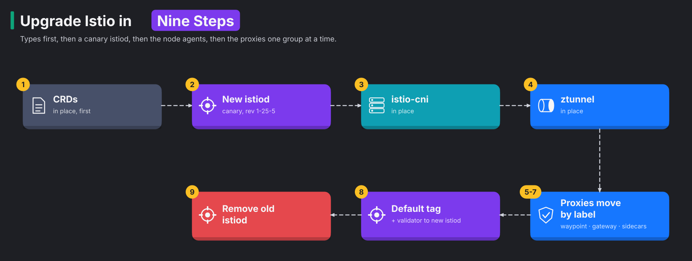
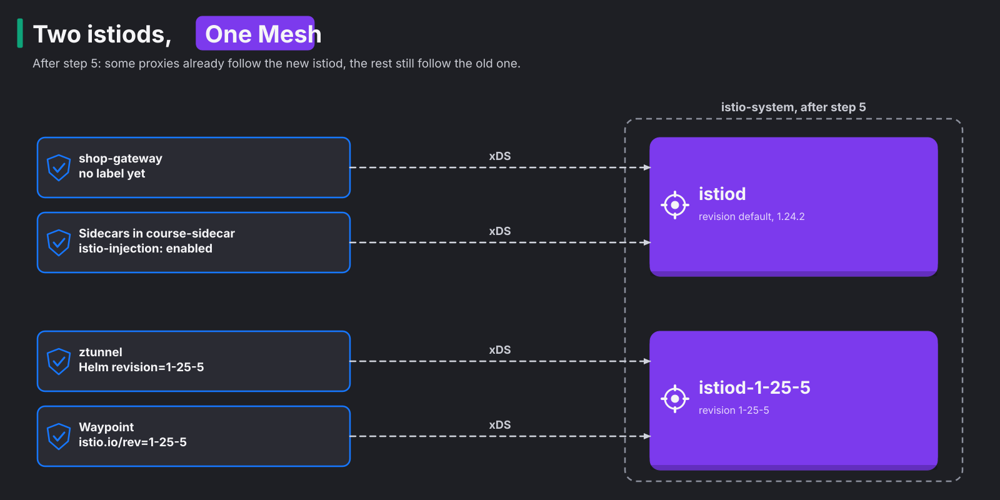

# Module 14: upgrading Istio

> New to a term here, like VirtualService or waypoint? The [glossary](glossary.md) explains every Istio resource and term in this course.

**Before this module:** modules 1, 2 and 7.

Every Istio release gets security fixes for about six months. After that you're on your own. So a team that runs Istio upgrades it two or three times a year. In this module you upgrade the lab from Istio 1.24.2 to 1.25.5. You follow the steps Istio recommends for ambient mode. Meanwhile, a stream of requests checks that the shop keeps answering.

**This module is one-way.** Istio has no clean downgrade, so after this module your lab runs 1.25.5. The rest of the course still works on it. To return to the course version, rebuild with `./scripts/teardown.sh --yes && ./scripts/provision.sh`. `provision.sh` notices an upgraded mesh and leaves it alone, so it never mixes two versions.

Time: about 45 minutes.

## Concept: what has to move

You don't upgrade Istio with one command, because an Istio install isn't one thing. It's five pieces, and each one upgrades differently. Here they are, with one-line jobs:

- CRDs, the Custom Resource Definitions: define the Istio resource types.
- istiod: the control plane that sends config to every proxy.
- istio-cni: the node agent that sets up traffic redirection.
- ztunnel: the node proxy for every ambient pod.
- Waypoints, gateways and sidecars: the Envoy proxies.

The table shows how each piece upgrades:

| Piece | What it is | How it upgrades |
|---|---|---|
| CRDs (`istio-base` chart) | The resource types: ServiceEntry, AuthorizationPolicy and so on | In place, first, because the new control plane needs the new types |
| istiod | The control plane | **Canary**: a second istiod with a revision name runs next to the old one |
| istio-cni | The node agent that sets up traffic redirection | In place only. Running pods keep working; new pods wait until the agent is back |
| ztunnel | The node proxy for every ambient pod | In place only. It restarts, and long-lived connections on the node reset |
| Waypoints, gateways, sidecars | Envoy proxies | Move one group at a time to the new istiod, by label |



The diagram above shows the order of the steps. The order follows one rule from Istio's version policy. istio-cni and ztunnel at version 1.x work with a control plane at 1.x or 1.x+1, but not the other way round. In other words, the node pieces may lag one version behind istiod, but never run ahead of it. So the new control plane goes in before the node pieces.

## Concept: revisions and tags

During an upgrade, two control planes run side by side. Each proxy needs a way to say which one it follows. Istio solves this with revisions.

A **revision** is a name for one installed control plane, like `1-25-5`. The lab's original istiod has no name, so Istio calls it `default`. A proxy picks its control plane with the label `istio.io/rev`. Where that label lives depends on the proxy:

- For waypoints and gateways, it is the label on the Gateway resource.
- For sidecars, it is the label on the namespace. The old `istio-injection: enabled` label means "the default one".
- For ztunnel, it is the `revision` value of its Helm chart.

Relabelling hundreds of namespaces at every upgrade is slow work. Tags avoid it. A **tag** is a nickname that points at a revision, such as `default`, `stable` or `canary`. It works like a shortcut on your desktop. You move the shortcut, and everything that uses it opens the new target. Large teams label their workloads with tags instead of revisions. An upgrade then means moving the tag, and every workload that uses it follows at once.

In this module you move single workloads with revision labels, because watching them move one by one teaches more. At the end you point the `default` tag at the new revision.

## Concept: how a proxy finds its istiod

A label does nothing by itself. Some component has to read it and point the proxy at one istiod. That component differs per proxy:

| Proxy | What reads the label | Result |
|---|---|---|
| Sidecar | The revision's own injection webhook, which matches namespaces labelled `istio.io/rev=1-25-5` | The injected `istio-proxy` connects to `istiod-1-25-5` |
| Waypoint, gateway | Each istiod, which only manages the Gateways whose `istio.io/rev` names its revision | That istiod writes the proxy's Deployment and points it at itself |
| ztunnel | Helm, when you install or upgrade the chart | The DaemonSet connects to `istiod-1-25-5` |

A tag uses the same trick one level up. Under the hood, a tag is one more mutating webhook. Here is how it works:

1. `istioctl` or the Helm chart creates a webhook named `istio-revision-tag-<tag>`.
2. The webhook matches pods labelled `istio.io/rev=<tag>`.
3. The webhook calls the revision behind the tag.

The `default` tag also matches `istio-injection: enabled`. Moving a tag rewrites that webhook. Running pods keep their proxy until they restart.

The diagram below shows the lab after step 5. Some proxies already follow the new istiod, and the rest still follow the old one:



A common misconception is that the canary istiod receives a share of the traffic, like a canary Deployment does. It doesn't. No request ever passes through istiod. The new control plane only sends configuration, and only to proxies that connect to it. So installing it in step 2 changes nothing for users.

## The bigger picture: why upgrades are scary, and how teams make them boring

Ask platform engineers what they dread, and "upgrading the mesh" comes up fast. The mesh sits in every request path. A bad upgrade doesn't break one service. It breaks all of them at the same moment.

So teams build five habits that make upgrades dull:

1. Teams move one minor version at a time. An in-place upgrade goes one minor version per step, for example 1.24 to 1.25. A canary upgrade with revisions may jump two minor versions, for example 1.24 to 1.26, but no further. A team that falls behind faces several upgrades in a row. Falling behind is the real risk.
2. Teams read the release notes first. Every release lists "upgrade notes", such as changed defaults and removed features. Ten minutes of reading beats an hour of debugging.
3. Teams canary the control plane, then move the least important workloads first. If the new istiod misbehaves, only a test namespace notices.
4. Teams watch real signals. They keep a steady stream of requests running and watch dashboards with error rates. They also agree on a clear rule, like "more than 1% errors, roll back".
5. Teams make rollback a label change. As long as the old istiod runs, moving a workload back takes one `kubectl label`.

The node pieces stay the hard part, because ztunnel and istio-cni have no canary. Production teams often upgrade them together with the nodes themselves:

1. The team adds a new node pool with the new version.
2. The team drains the old nodes.
3. Kubernetes moves the workloads to the new nodes.

This lab has one node, so you watch the in-place path instead.

## Why this way

**Why does the new istiod need a different name?** Two control planes run side by side for a while. Each needs its own Deployment, Service and webhooks. The revision name keeps them apart, so you get `istiod` and `istiod-1-25-5`.

**Why does ztunnel get `--set revision`?** The setting tells ztunnel to fetch config and certificates from `istiod-1-25-5`. Without it, ztunnel keeps talking to the Service called `istiod`. That Service disappears with the old control plane, and ztunnel would lose its config source.

**Why do sidecars need a restart, but waypoints don't?** The sidecar sits inside your pod. The injector added it when Kubernetes created the pod, so only a new pod gets the new proxy. Waypoints work differently. Istio creates waypoint and gateway Deployments itself. So when you relabel the Gateway, Istio rolls its Deployment for you.

**Why touch the base chart a second time in step 8?** Istio checks every Istio resource you create, so a typo fails at `kubectl apply` time. The base chart owns the webhook that does this check, `istiod-default-validator`. The webhook points at the Service of the `default` revision, `istiod`. If you delete the old control plane without moving the webhook, every `kubectl apply` of an Istio resource fails with `service "istiod" not found`. That happened during the test run for this module. Setting `defaultRevision` moves the webhook first.

## Do it

Start with a lab on the course version of Istio. `istioctl version` shows 1.24.2 for the control plane. Keep one terminal for commands, and open a second one for the traffic.

Here is the whole upgrade at a glance. The steps below follow the same order as the first diagram:

1. You upgrade the CRDs in place.
2. You install the new istiod next to the old one.
3. You upgrade istio-cni in place.
4. You upgrade ztunnel in place.
5. You move the waypoint, the gateway and the sidecars to the new istiod, one group at a time.
6. You point the `default` tag and the validator at the new istiod.
7. You remove the old istiod.

The Istio team recommends an optional extra step. Run the **new** version's precheck first. Download `istioctl` 1.25.5 from the [Istio releases page](https://github.com/istio/istio/releases/tag/1.25.5) and run `istioctl x precheck`. The lab's automated test skips this step, because it doesn't download binaries.

### 0. Start the traffic and a sidecar workload

In the second terminal, send a request every 0.1 seconds and print anything that isn't a `200`:

```bash
while true; do c=$(curl -s -o /dev/null -m 3 -w '%{http_code}' http://localhost:8080/api/orders); [ "$c" = 200 ] || echo "$(date +%T) $c"; sleep 0.1; done
```

Back in the first terminal, make sure module 7's sidecar namespace exists, so you upgrade a sidecar too:

```bash
kubectl apply -f course/manifests/07-sidecar-namespace.yaml -f course/manifests/07-sidecar-apps.yaml
helm repo update istio
helm -n istio-system list
```

**What you should see.** Four releases, `istio-base`, `istiod`, `istio-cni` and `ztunnel`, all on 1.24.2.

### 1. Upgrade the CRDs

```bash
helm upgrade istio-base istio/base -n istio-system --version 1.25.5 \
  -f helm/istio-base-values.yaml --force-conflicts --wait
```

### 2. Install the new control plane as a canary

```bash
helm install istiod-1-25-5 istio/istiod -n istio-system --version 1.25.5 \
  --set revision=1-25-5 --set profile=ambient --set global.platform=k3s \
  -f helm/istiod-values.yaml --wait
kubectl -n istio-system get deploy -l app=istiod -L istio.io/rev
istioctl proxy-status
```

**What you should see.** Two istiod Deployments, `default` and `1-25-5`. `proxy-status` asks the default control plane. It still lists the waypoint, the gateway, ztunnel and the sidecars, because nothing moved yet. The second terminal stays quiet.

### 3. Upgrade istio-cni in place

```bash
BIN=$(helm -n istio-system get values istio-cni -o json | python3 -c 'import json,sys; print(json.load(sys.stdin)["cni"]["cniBinDir"])')
helm upgrade istio-cni istio/cni -n istio-system --version 1.25.5 \
  -f helm/istio-cni-values.yaml --set global.platform=k3s --set cni.cniBinDir="$BIN" \
  --force-conflicts --wait
```

The first line reuses the plugin directory that `provision.sh` detected on your node.

### 4. Upgrade ztunnel in place

```bash
helm upgrade ztunnel istio/ztunnel -n istio-system --version 1.25.5 \
  -f helm/ztunnel-values.yaml --set revision=1-25-5 --force-conflicts --wait
istioctl proxy-status --revision 1-25-5
```

**What you should see.** ztunnel now reports to `istiod-1-25-5` with version 1.25.5. Watch the second terminal. In the test run for this module, it stayed silent. Every request is a short new connection, and the restart took well under a second. Long-lived connections would have reset, for example a database pool or a WebSocket.

### 5. Move the waypoint

```bash
kubectl -n shop label gateway waypoint istio.io/rev=1-25-5
kubectl -n shop rollout status deploy/waypoint
istioctl proxy-status --revision 1-25-5
```

**What you should see.** The waypoint now shows up under the new revision with version 1.25.5. Istio rolled its Deployment the moment the label changed.

### 6. Move the ingress gateway

```bash
kubectl -n shop-ingress label gateway shop-gateway istio.io/rev=1-25-5
kubectl -n shop-ingress rollout status deploy/shop-gateway-istio
```

**What you should see.** This time the second terminal prints a burst of `000` lines, about two seconds' worth. In the test run for this module, 17 out of 1,563 requests failed here, and nowhere else. The gateway runs a single replica. For a moment, the load balancer had no ready pod to send new connections to. To avoid this gap, production gateways run at least two replicas with a PodDisruptionBudget.

### 7. Move the sidecars

```bash
kubectl label ns course-sidecar istio-injection- istio.io/rev=1-25-5
kubectl -n course-sidecar get pods -o jsonpath='{range .items[*]}{.metadata.name} {.spec.containers[1].image}{"\n"}{end}'
kubectl -n course-sidecar rollout restart deploy
kubectl -n course-sidecar rollout status deploy/client
kubectl -n course-sidecar get pods -o jsonpath='{range .items[*]}{.metadata.name} {.spec.containers[1].image}{"\n"}{end}'
istioctl proxy-status
```

**What you should see.** The label alone changes nothing, and the pods keep `proxyv2:1.24.2`. After the restart they carry `proxyv2:1.25.5`. Give the old pods a few seconds to go. Then `istioctl proxy-status`, which asks the old control plane, lists nothing at all.

### 8. Point the defaults at the new control plane

```bash
helm template istiod istio/istiod --version 1.25.5 -s templates/revision-tags.yaml \
  --set revisionTags="{default}" --set revision=1-25-5 -n istio-system | kubectl apply -f -
helm upgrade istio-base istio/base -n istio-system --version 1.25.5 \
  -f helm/istio-base-values.yaml --set defaultRevision=1-25-5 --force-conflicts --wait
kubectl get validatingwebhookconfiguration istiod-default-validator -o jsonpath='{.webhooks[0].clientConfig.service.name}{"\n"}'
```

**What you should see.** `istiod-1-25-5`. The two commands do different jobs:

- The first command creates the `default` tag. Anything without a revision label now lands on 1.25.5, for example a new namespace with `istio-injection: enabled`, or a new Gateway.
- The second command moves the validating webhook.

### 9. Remove the old control plane

```bash
helm -n istio-system delete istiod
kubectl -n istio-system get deploy -l app=istiod
kubectl apply --dry-run=server -f course/manifests/12-serviceentry.yaml
```

**What you should see.** Only `istiod-1-25-5` is left. The dry run succeeds, so Istio still validates new resources. Stop the traffic loop with Ctrl-C. The upgrade is done.

## Investigate

1. Before step 9, how would you roll the waypoint back to 1.24?
2. Why did the ingress gateway lose requests in step 6, while the waypoint, also a single replica, lost none in step 5?
3. Open Kiali's Mesh page (http://localhost:20001, menu Mesh). Which control plane does it show now, and how did Kiali find it without any change to its settings?
4. Your company runs 400 namespaces with sidecars. Step 7 asked you to relabel and restart one. What would you do instead?

<details>
<summary>Answers</summary>

1. Relabel it with `kubectl -n shop label gateway waypoint istio.io/rev=default --overwrite`. Istio rolls the waypoint back onto the old control plane. That only works while the old istiod still runs. That's why step 9 comes last, and only after you've watched the new version for a while.
2. The two proxies sit behind different components, and those components notice a new pod at different speeds.
   - The waypoint sits behind ztunnel. ztunnel knows the moment a new waypoint pod is ready and moves traffic over inside the mesh.
   - The ingress gateway sits behind the node's load balancer, k3s's ServiceLB, and then k3d's proxy on your Mac. Those catch up a little later.

   Requests that arrived in that gap failed. With two gateway replicas, one keeps serving while the other restarts.
3. Kiali shows one control plane, `istiod-1-25-5`. Kiali finds control planes by their labels. It also reads the mesh config, where `discoveryAddress` now says `istiod-1-25-5.istio-system.svc:15012`. During the switch itself, Kiali's log shows a few errors, `Failed to call Istiod endpoint /debug/syncz`, while proxies move between control planes. The errors stop once the old istiod is gone. Tools around the mesh belong on the upgrade checklist, for example Kiali, dashboards and alert rules. Check each one after the switch.
4. Use a tag. Label all 400 namespaces `istio.io/rev=stable` once, ahead of time, with `stable` pointing at the current revision. An upgrade then takes three steps:
   1. You install the canary istiod.
   2. You move `stable` to the canary with one command.
   3. You restart workloads in waves, the least important first.

</details>

## Clean up

Nothing to clean up: the upgrade stays. To return to Istio 1.24.2 for the rest of the course, rebuild the lab:

```bash
./scripts/teardown.sh --yes && ./scripts/provision.sh
```
