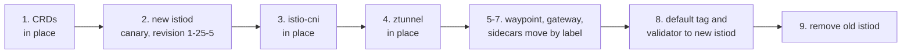

# Module 14: upgrading Istio

> New to a term here, like VirtualService or waypoint? The [glossary](glossary.md) explains every Istio resource and term in this course.

Every Istio release gets security fixes for about six months. After that you're on your own, so a team that runs Istio upgrades it two or three times a year. This module walks through a real upgrade of the lab from Istio 1.24.2 to 1.25.5, the way Istio recommends for ambient mode, while a stream of requests checks that the shop keeps answering.

**This module is one-way.** Istio has no clean downgrade, so after it your lab runs 1.25.5. The rest of the course still works on it. To return to the course version, rebuild: `./scripts/teardown.sh --yes && ./scripts/provision.sh`. `provision.sh` notices an upgraded mesh and leaves it alone rather than mixing two versions.

Time: about 45 minutes.

## Concept: what has to move

An Istio install isn't one thing. It's five pieces, and each one upgrades differently.

| Piece | What it is | How it upgrades |
|---|---|---|
| CRDs (`istio-base` chart) | The resource types: ServiceEntry, AuthorizationPolicy and so on | In place, first, because the new control plane needs the new types |
| istiod | The control plane | **Canary**: a second istiod with a revision name runs next to the old one |
| istio-cni | The node agent that sets up traffic redirection | In place only. Running pods keep working; new pods wait until the agent is back |
| ztunnel | The node proxy for every ambient pod | In place only. It restarts, and long-lived connections on the node reset |
| Waypoints, gateways, sidecars | Envoy proxies | Move one group at a time to the new istiod, by label |



The order follows one rule from Istio's version policy: istio-cni and ztunnel at version 1.x work with a control plane at 1.x or 1.x+1, but not the other way round. So the new control plane goes in before the node pieces.

## Concept: revisions and tags

A **revision** is a name for one installed control plane, like `1-25-5`. The lab's original istiod has no name, so Istio calls it `default`. Proxies pick their control plane with the label `istio.io/rev`:

- Waypoints and gateways: the label on the Gateway resource.
- Sidecars: the label on the namespace. The old `istio-injection: enabled` label means "the default one".
- ztunnel: the `revision` value of its Helm chart.

A **tag** is a nickname that points at a revision, such as `default`, `stable` or `canary`. Large teams label their workloads with tags instead of revisions. Then an upgrade means moving the tag, and every workload that uses it follows at once. In this module you move single workloads with revision labels, because watching them move one by one teaches more. At the end you point the `default` tag at the new revision.

## The bigger picture: why upgrades are scary, and how teams make them boring

Ask platform engineers what they dread, and "upgrading the mesh" comes up fast. The mesh sits in every request path. A bad upgrade doesn't break one service. It breaks all of them at the same moment.

So teams build habits that make upgrades dull:

- **One minor version at a time.** Istio only supports skipping one version (1.24 to 1.25, not 1.24 to 1.27), and even that skip only works for the canary path. A team that falls behind faces several upgrades in a row. Falling behind is the real risk.
- **Read the release notes first.** Every release lists "upgrade notes": changed defaults, removed features. Ten minutes of reading beats an hour of debugging.
- **Canary the control plane, then move the least important workloads first.** If the new istiod misbehaves, only a test namespace notices.
- **Watch real signals.** A steady stream of requests, dashboards with error rates, and a clear rule like "more than 1% errors, roll back".
- **Make rollback a label change.** As long as the old istiod runs, moving a workload back takes one `kubectl label`.

The node pieces stay the hard part. ztunnel and istio-cni have no canary. Production teams often upgrade them together with the nodes themselves: new node pool, drain the old nodes, workloads move over. This lab has one node, so you watch the in-place path instead.

## Why this way

**Why does the new istiod need a different name?** Two control planes run side by side for a while. Each needs its own Deployment, Service and webhooks, and the revision name keeps them apart: `istiod` and `istiod-1-25-5`.

**Why does ztunnel get `--set revision`?** It tells ztunnel to fetch config and certificates from `istiod-1-25-5`. Without it, ztunnel keeps talking to the Service called `istiod`, and that Service disappears with the old control plane.

**Why do sidecars need a restart, but waypoints don't?** The sidecar sits inside your pod: the injector added it when Kubernetes created the pod. Only a new pod gets the new proxy. Istio creates waypoint and gateway Deployments itself, so when you relabel the Gateway, Istio rolls its Deployment for you.

**Why touch the base chart a second time in step 8?** The base chart owns a webhook, `istiod-default-validator`, that checks every Istio resource you create. It points at the Service of the `default` revision: `istiod`. Delete the old control plane without moving it, and every `kubectl apply` of an Istio resource fails with `service "istiod" not found`. That happened during the test run for this module. Setting `defaultRevision` moves the webhook first.

## Do it

Start with a lab on the course version of Istio (`istioctl version` shows 1.24.2 for the control plane). Keep one terminal for commands and open a second one for the traffic.

Optional: the Istio team recommends running the **new** version's precheck first. Download `istioctl` 1.25.5 from the [Istio releases page](https://github.com/istio/istio/releases/tag/1.25.5) and run `istioctl x precheck`. The lab's automated test skips this step, because it doesn't download binaries.

### 0. Start the traffic and a sidecar workload

In the second terminal, send a request every 0.1 seconds and print anything that isn't a `200`:

```bash
while true; do c=$(curl -s -o /dev/null -m 3 -w '%{http_code}' http://localhost:8080/api/orders); [ "$c" = 200 ] || echo "$(date +%T) $c"; sleep 0.1; done
```

Back in the first terminal, make sure module 7's sidecar namespace exists, so you upgrade a sidecar too:

```bash
kubectl apply -f course/manifests/07-sidecar-namespace.yaml -f course/manifests/07-sidecar-apps.yaml
helm repo update istio
helm -n istio-system list
```

**What you should see.** Four releases (`istio-base`, `istiod`, `istio-cni`, `ztunnel`), all on 1.24.2.

### 1. Upgrade the CRDs

```bash
helm upgrade istio-base istio/base -n istio-system --version 1.25.5 \
  -f helm/istio-base-values.yaml --force-conflicts --wait
```

### 2. Install the new control plane as a canary

```bash
helm install istiod-1-25-5 istio/istiod -n istio-system --version 1.25.5 \
  --set revision=1-25-5 --set profile=ambient --set global.platform=k3s \
  -f helm/istiod-values.yaml --wait
kubectl -n istio-system get deploy -l app=istiod -L istio.io/rev
istioctl proxy-status
```

**What you should see.** Two istiod Deployments, `default` and `1-25-5`. `proxy-status` asks the default control plane and still lists the waypoint, the gateway, ztunnel and the sidecars: nothing moved yet. The second terminal stays quiet.

### 3. Upgrade istio-cni in place

```bash
BIN=$(helm -n istio-system get values istio-cni -o json | python3 -c 'import json,sys; print(json.load(sys.stdin)["cni"]["cniBinDir"])')
helm upgrade istio-cni istio/cni -n istio-system --version 1.25.5 \
  -f helm/istio-cni-values.yaml --set global.platform=k3s --set cni.cniBinDir="$BIN" \
  --force-conflicts --wait
```

The first line reuses the plugin directory that `provision.sh` detected on your node.

### 4. Upgrade ztunnel in place

```bash
helm upgrade ztunnel istio/ztunnel -n istio-system --version 1.25.5 \
  -f helm/ztunnel-values.yaml --set revision=1-25-5 --force-conflicts --wait
istioctl proxy-status --revision 1-25-5
```

**What you should see.** ztunnel now reports to `istiod-1-25-5` with version 1.25.5. Watch the second terminal. In the test run for this module, it stayed silent: every request is a short new connection, and the restart took well under a second. Long-lived connections, like a database pool or a WebSocket, would have reset.

### 5. Move the waypoint

```bash
kubectl -n shop label gateway waypoint istio.io/rev=1-25-5
kubectl -n shop rollout status deploy/waypoint
istioctl proxy-status --revision 1-25-5
```

**What you should see.** The waypoint now shows up under the new revision with version 1.25.5. Istio rolled its Deployment the moment the label changed.

### 6. Move the ingress gateway

```bash
kubectl -n shop-ingress label gateway shop-gateway istio.io/rev=1-25-5
kubectl -n shop-ingress rollout status deploy/shop-gateway-istio
```

**What you should see.** This time the second terminal prints a burst of `000` lines, about two seconds' worth. In the test run for this module, 17 out of 1,563 requests failed here, and nowhere else. The gateway runs a single replica: for a moment, the load balancer had no ready pod to send new connections to. Production gateways run at least two replicas with a PodDisruptionBudget for exactly this reason.

### 7. Move the sidecars

```bash
kubectl label ns course-sidecar istio-injection- istio.io/rev=1-25-5
kubectl -n course-sidecar get pods -o jsonpath='{range .items[*]}{.metadata.name} {.spec.containers[1].image}{"\n"}{end}'
kubectl -n course-sidecar rollout restart deploy
kubectl -n course-sidecar rollout status deploy/client
kubectl -n course-sidecar get pods -o jsonpath='{range .items[*]}{.metadata.name} {.spec.containers[1].image}{"\n"}{end}'
istioctl proxy-status
```

**What you should see.** The label alone changes nothing: the pods keep `proxyv2:1.24.2`. After the restart they carry `proxyv2:1.25.5`. Give the old pods a few seconds to go, and `istioctl proxy-status` (the old control plane) lists nothing at all.

### 8. Point the defaults at the new control plane

```bash
helm template istiod istio/istiod --version 1.25.5 -s templates/revision-tags.yaml \
  --set revisionTags="{default}" --set revision=1-25-5 -n istio-system | kubectl apply -f -
helm upgrade istio-base istio/base -n istio-system --version 1.25.5 \
  -f helm/istio-base-values.yaml --set defaultRevision=1-25-5 --force-conflicts --wait
kubectl get validatingwebhookconfiguration istiod-default-validator -o jsonpath='{.webhooks[0].clientConfig.service.name}{"\n"}'
```

**What you should see.** `istiod-1-25-5`. The first command creates the `default` tag, so anything without a revision label (a new namespace with `istio-injection: enabled`, a new Gateway) lands on 1.25.5. The second moves the validating webhook.

### 9. Remove the old control plane

```bash
helm -n istio-system delete istiod
kubectl -n istio-system get deploy -l app=istiod
kubectl apply --dry-run=server -f course/manifests/12-serviceentry.yaml
```

**What you should see.** Only `istiod-1-25-5` is left, and the dry run succeeds, so Istio still validates new resources. Stop the traffic loop with Ctrl-C. The upgrade is done.

## Investigate

1. Before step 9, how would you roll the waypoint back to 1.24?
2. Why did the ingress gateway lose requests in step 6, while the waypoint, also a single replica, lost none in step 5?
3. Open Kiali's Mesh page (http://localhost:20001, menu Mesh). Which control plane does it show now, and how did Kiali find it without any change to its settings?
4. Your company runs 400 namespaces with sidecars. Step 7 asked you to relabel and restart one. What would you do instead?

<details>
<summary>Answers</summary>

1. Relabel it: `kubectl -n shop label gateway waypoint istio.io/rev=default --overwrite`. Istio rolls the waypoint back onto the old control plane. That only works while the old istiod still runs, which is why step 9 comes last and only after you've watched the new version for a while.
2. The waypoint sits behind ztunnel, which knows the moment a new waypoint pod is ready and moves traffic over inside the mesh. The ingress gateway sits behind the node's load balancer (k3s's ServiceLB, then k3d's proxy on your Mac), and those catch up a little later. Requests that arrived in that gap failed. With two gateway replicas, one keeps serving while the other restarts.
3. Kiali shows one control plane, `istiod-1-25-5`. It finds control planes by their labels and reads the mesh config, where `discoveryAddress` now says `istiod-1-25-5.istio-system.svc:15012`. During the switch itself, its log shows a few errors (`Failed to call Istiod endpoint /debug/syncz`) while proxies move between control planes, and they stop once the old istiod is gone. Tools around the mesh, like Kiali, dashboards and alert rules, belong on the upgrade checklist: check each one after the switch.
4. Use a tag. Label all 400 namespaces `istio.io/rev=stable` once, ahead of time, with `stable` pointing at the current revision. An upgrade then means: install the canary, move `stable` to it with one command, and restart workloads in waves, the least important first.

</details>

## Clean up

Nothing to clean up: the upgrade stays. To return to Istio 1.24.2 for the rest of the course, rebuild the lab:

```bash
./scripts/teardown.sh --yes && ./scripts/provision.sh
```
