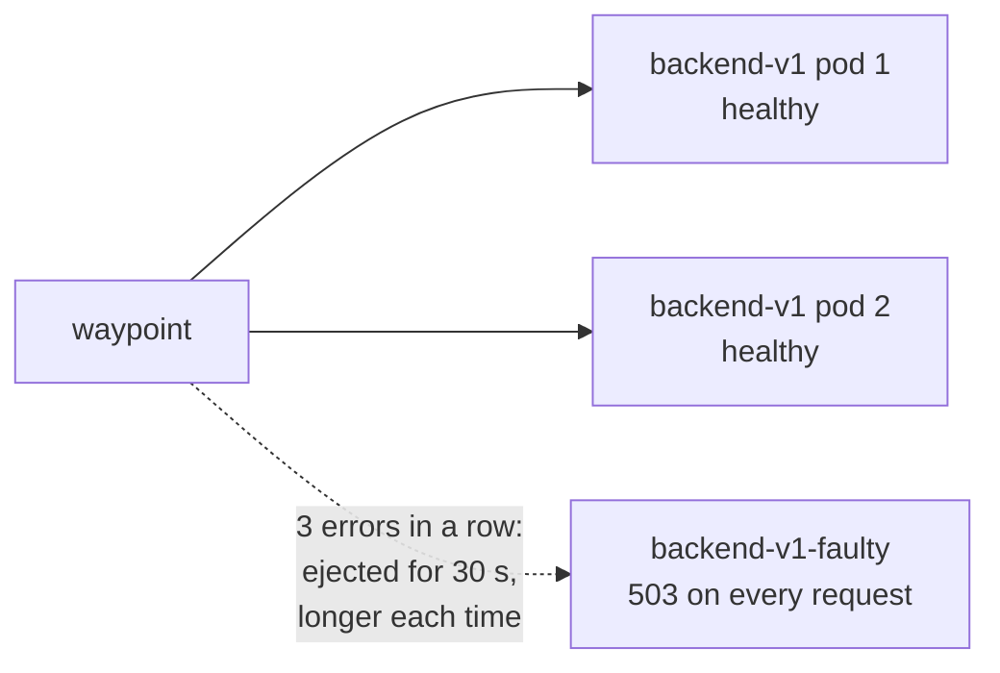

# Module 15: outlier detection, retries and failover

> New to a term here, like VirtualService or waypoint? The [glossary](glossary.md) explains every Istio resource and term in this course.

Module 5 broke the whole backend at once: a delay, a fault, a full connection pool. Real outages often look different. One pod out of three goes bad: a full disk, a broken config after a node problem, a memory leak. The Service keeps sending it its share of traffic, and a third of your users see errors. This module adds a misbehaving pod and fixes the damage two ways, then compares them.

Time: about 40 minutes.

## Concept: two different fixes

**Retries** send a failed request again, hopefully to a different pod. The user never sees the first failure.

**Outlier detection** watches each pod's answers. When a pod fails several times in a row, the proxy takes it out of load balancing for a while, so nobody sends it requests at all.



They sound alike, but they do different jobs. A retry hides one failure from one user. Outlier detection stops the failures from happening in the first place. The exercise puts numbers on that difference.

## The bigger picture: failing gracefully

Large systems never run fully healthy. With hundreds of pods across dozens of nodes, something is always broken somewhere. The goal isn't zero failures. It's making sure a broken part doesn't turn into a broken product.

That idea has a name in the industry: graceful degradation. And it changes how you think about health checks. A Kubernetes readiness probe asks the pod "are you OK?", and a broken pod often answers "yes": its `/readyz` works fine while every real request fails. Outlier detection asks a better question, "how are your real answers going?", and it judges the pod by what users actually get. That's why big platforms rely on both: probes for pods that are clearly dead, outlier detection for pods that are quietly wrong.

Retries come with a warning label, which module 5's "bigger picture" explained: retry in one layer only, cap the attempts, and only retry what's safe to repeat. A GET is safe. A POST that charges a credit card twice isn't.

## Concept: failover between zones

Cloud regions consist of zones: separate data centres a few kilometres apart, with their own power and network. Kubernetes labels every node with its zone (`topology.kubernetes.io/zone`), and Istio reads that label. With a little configuration, a proxy prefers pods in its own zone, which is faster and cheaper, and only sends traffic to another zone when the local pods fail:

```yaml
apiVersion: networking.istio.io/v1
kind: DestinationRule
metadata:
  name: backend-v1-locality
spec:
  host: backend-v1.shop.svc.cluster.local
  trafficPolicy:
    loadBalancer:
      localityLbSetting:
        enabled: true
        failover:
          - from: eu-west-1a
            to: eu-west-1b
    outlierDetection:          # required: it decides when local pods count as failed
      consecutive5xxErrors: 3
      interval: 5s
      baseEjectionTime: 30s
```

Notice the `outlierDetection` block. Failover depends on it: Istio only moves traffic to another zone once outlier detection has ejected the local pods. Everything this module teaches about ejection is the engine behind zone failover.

This lab runs on one node in one zone, so it has nothing to fail over to, and the course doesn't run this example. The k3s operations module adds a second node, and with nodes labelled as different zones the same rule applies.

## Why this way

**Why consecutive errors and not an error percentage?** Consecutive errors react fast and need no statistics: three 5xx answers in a row from one pod rarely happen by chance. Envoy also supports percentage-based ejection (`failurePercentageThreshold`) for pods that fail only sometimes.

**Why does the ejection time grow?** A pod that comes back and fails again is probably still broken. Envoy multiplies `baseEjectionTime` by the number of times it ejected that pod, so a flapping pod spends less and less time hurting users.

**Why `maxEjectionPercent: 50`?** If every pod failed at once, the cause is probably shared, like a database outage, and ejecting all of them would leave nothing to serve even the requests that might succeed. The cap keeps at least half the pods in rotation.

**Why does the retry need a VirtualService?** The Gateway API version in this lab (v1.2) has no retry field on HTTPRoute in its standard channel. Istio's VirtualService has had retries since the start. As in module 5, delete the HTTPRoute for the same host first.

**Why `retryOn: 5xx,connect-failure,refused-stream`?** It lists the failures worth a second try: a server error, a connection that never opened, a stream the server refused. Timeouts aren't in the list on purpose, so a slow backend doesn't receive every request three times.

## Do it

### 1. Add a faulty pod

```bash
kubectl apply -f course/manifests/15-faulty-pod.yaml
kubectl -n shop get pods -l app=backend,version=v1
```

**What you should see.** Three `backend-v1` pods: the two usual ones and `backend-v1-faulty-...`. All three show `Running` and `1/1` Ready. Kubernetes thinks everything is fine.

Now send 90 requests and count the answers:

```bash
for i in $(seq 1 90); do curl -s -o /dev/null -w "%{http_code}\n" http://localhost:8080/api/orders; done | sort | uniq -c
```

**What you should see.** About 60 `200` and 30 `503`. One pod in three fails, so one request in three fails. In the test run for this module it was 34 out of 90.

### 2. Eject the bad pod

```bash
kubectl apply -f course/manifests/15-outlier-detection.yaml
for i in $(seq 1 30); do curl -s -o /dev/null -w "%{http_code}\n" http://localhost:8080/api/orders; done | sort | uniq -c
for i in $(seq 1 90); do curl -s -o /dev/null -w "%{http_code}\n" http://localhost:8080/api/orders; done | sort | uniq -c
```

**What you should see.** The first 30 requests still show about three `503`: those are the "3 errors in a row" the rule waits for. The next 90 return `200` without exception. The waypoint stopped sending the faulty pod anything.

Wait 40 seconds and repeat the 90 requests. You'll see about three `503` again: the ejection time ran out, the pod got another chance, failed three more times, and went straight back out, for longer this time.

### 3. Retries instead

Remove the outlier detection and try retries on their own:

```bash
kubectl -n shop delete destinationrule backend-v1-outlier
kubectl -n shop delete httproute backend-route
kubectl apply -f course/manifests/15-retries.yaml
calls() { kubectl -n shop logs deploy/backend-v1-faulty --since=30m | grep -c /api/orders; }
before=$(calls)
for i in $(seq 1 90); do curl -s -o /dev/null -w "%{http_code}\n" http://localhost:8080/api/orders; done | sort | uniq -c
echo "the faulty pod got $(( $(calls) - before )) of those requests"
```

**What you should see.** All 90 return `200`. Users notice nothing. But the faulty pod still got about 30 of those requests and failed every one. Each of those cost a wasted call, extra latency for that user, and a retry. Retries hid the problem. They didn't fix it.

### 4. Both together

```bash
kubectl apply -f course/manifests/15-outlier-detection.yaml
before=$(calls)
for i in $(seq 1 90); do curl -s -o /dev/null -w "%{http_code}\n" http://localhost:8080/api/orders; done | sort | uniq -c
echo "the faulty pod got $(( $(calls) - before )) of those requests"
```

**What you should see.** 90 `200`, and the faulty pod got about three requests, the ones it took to eject it. Retries covered those three, outlier detection handled the rest. That pairing is what production setups use.

| Setup | Failures users saw (of 90) | Requests the faulty pod still got |
|---|---|---|
| Nothing | about 30 | about 30 |
| Outlier detection only | about 3 at the start, then none | about 3 |
| Retries only | none | about 30 |
| Retries and outlier detection | none | about 3 |

## Investigate

1. The faulty pod shows `1/1 Ready` the whole time. Why doesn't Kubernetes take it out of the Service?
2. In step 2, why do exactly about three requests fail before the ejection, and not one?
3. Change `maxEjectionPercent` to `0` and repeat step 2. What happens, and why would anyone set it that way?
4. Your team adds retries everywhere: the gateway retries 2 times, the frontend 2 times, the waypoint 2 times. The backend goes down. How many requests reach it for each click?

<details>
<summary>Answers</summary>

1. Its readiness probe calls `/readyz`, which still works: `ERROR_RATE` only breaks `/api/` paths. Kubernetes trusts the probe, so the pod stays in the Service's endpoints. Outlier detection judges the pod by its real answers instead. This gap between "the probe says fine" and "users say broken" is the whole reason outlier detection exists.
2. `consecutive5xxErrors: 3`: Envoy ejects a pod once it has returned three 5xx answers in a row, and the third one still reached a user. Fewer would eject pods after a single unlucky error.
3. Envoy ejects nothing, and the 503 rate goes back to about one in three. With `0`, outlier detection still counts errors but never acts on them. Teams set it during a rollout to watch which pods it would eject, without risking an unexpected change.
4. Each layer makes up to 3 attempts (1 plus 2 retries), so 3 × 3 × 3 = 27 requests per click, at the moment the backend struggles most. That's a retry storm. Retry in one layer, usually the one closest to the failing service, here the waypoint.

</details>

## Clean up

```bash
./course/reset.sh
```

This deletes the faulty pod, the VirtualService and the DestinationRule, and restores the HTTPRoute.
