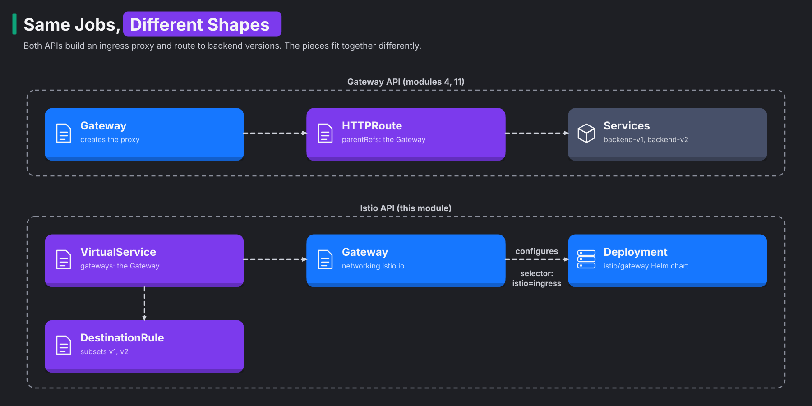
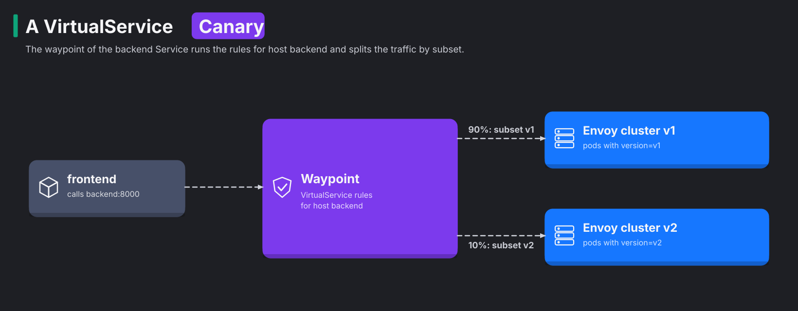

# Module 16: the Istio API, Gateway and VirtualService

> New to a term here, like VirtualService or waypoint? The [glossary](glossary.md) explains every Istio resource and term in this course.

**Before this module:** modules 4 and 5.

Most of this course routes traffic with the Gateway API, the Kubernetes standard made of Gateway and HTTPRoute resources. Istio had its own routing API for years before that standard existed. Huge numbers of clusters, blog posts and Helm charts still use the older Istio API, and so does the Istio Certified Associate exam. This module builds two things from module 4 again, the Istio way: an ingress gateway and a canary. By the end, you'll read both styles and translate between them.

Time: about 40 minutes.

## Concept: the same jobs, different shapes



Both APIs do the same jobs: they create a gateway, attach routes, and split traffic between versions. The diagram puts the two styles side by side. On the left, the Gateway API's Gateway creates the proxy, and the HTTPRoute sends traffic to one Service per version. On the right, a Helm chart creates the proxy, the Istio Gateway configures it, and the VirtualService sends traffic to subsets that a DestinationRule defines.

Three differences stand out:

| | Gateway API | Istio API |
|---|---|---|
| Who creates the gateway proxy | Istio, from the Gateway resource | You, with the `istio/gateway` Helm chart. The Gateway only configures it |
| How routes attach | The route names its parent in `parentRefs` | The VirtualService names its Gateway in `gateways`. Without that field, it applies inside the mesh |
| How versions are named | One Service per version | Subsets: named groups of one Service's pods, picked by labels in a DestinationRule |

## Concept: how a VirtualService finds its traffic

The two APIs pick the traffic they control in different ways. An HTTPRoute attaches to a named object. In its `parentRefs` field, it names a Gateway or a Service. A VirtualService attaches to a host name instead. `hosts: [backend.shop.svc.cluster.local]` means "every request addressed to this name", from any client in the mesh. It works like a rule for every letter sent to one address, no matter who posts it.

The `gateways` field then says where the rules run:

- If you list a gateway, the rules run on that gateway's pods.
- If you leave the field out, the rules run inside the mesh. In ambient mode, "inside the mesh" means the waypoint of the backend Service.

istiod reads all three resources (Gateway, VirtualService and DestinationRule) and turns them into Envoy config. It works the same way as in module 4, where it turned HTTPRoutes into config. The diagram follows one request from step 3:



For a canary, Istio needs a way to say "the v1 pods" and "the v2 pods" while both versions sit behind one Service. A subset does that job. It is a filter on the Service's endpoints, the list of pod addresses behind the Service.

1. The `backend` Service selects pods with the label `app: backend`, so its list holds the pods of both versions.
2. The DestinationRule narrows that list with a second label, `version`.
3. Envoy treats each subset as its own group of pods.

The result looks exactly like module 4, where `backend-v1` and `backend-v2` were two separate Services. Only the way you name the groups differs.

One consequence matters for step 3. A VirtualService that names a subset needs a DestinationRule that defines it. Without that DestinationRule, the subset matches no pods and requests fail. It is like a letter to a mailing list that nobody created: it reaches no one.

## The bigger picture: why two APIs exist

Istio launched in 2017, before Kubernetes had any good answer for routing. The old Ingress resource only understood hosts and paths. So every project invented its own routing resource, for example Istio's VirtualService, Contour's HTTPProxy and Traefik's IngressRoute. A team that switched tools had to rewrite all its routes.

The Kubernetes networking group answered with the Gateway API, which reached version 1.0 in 2023. It splits the work by role. Platform teams own the Gateway, with its ports and certificates. Application teams own their routes. Istio, Cilium, Envoy Gateway, NGINX and others all implement the Gateway API, so your routes move with you when you change tools.

Istio now recommends the Gateway API for new setups, and ambient mode builds on it. The Istio API isn't going away soon, though, for two reasons. First, it still covers features the standard lacks, like fault injection and the retries from module 15. Second, a huge amount of existing config uses it. In practice, you'll read both every week.

## Why this way

**Why does Istio's Gateway need a separate Deployment?** It came from the sidecar era. Back then, gateways were plain Envoy pods that platform teams ran and scaled themselves. The Gateway resource tells those pods which ports and hosts to accept. Its `selector` picks the pods by label, the way a Service picks pods.

**Why `--skip-schema-validation` in the install command?** The Istio 1.24 `gateway` chart carries a values schema, a file that lists the settings the chart accepts. Helm 4 reads that schema more strictly than Helm 3 did, and it rejects the chart's own defaults. The flag tells Helm to skip that check. With Helm 3, you leave the flag out.

**Why do subsets live in a DestinationRule?** The two resources split the work. The VirtualService decides *where* a request goes. The DestinationRule describes *what* the destinations are and *how* to talk to them. Subsets describe the destinations, so they sit next to connection pools and TLS settings. The split also lets one DestinationRule serve many VirtualServices.

**Why does the header test call the backend from the course client, not through the gateway?** The waypoint matches headers on the request it receives. But when the frontend calls the backend, it forwards only tracing headers. So a header you send to the gateway stops at the frontend and never reaches the waypoint. Real apps that use header routing have to pass the header along, just like `traceparent` in module 6.

## Do it

### 1. Deploy a classic ingress gateway

```bash
helm repo update istio
helm install istio-ingress istio/gateway -n istio-ingress --create-namespace \
  --version 1.24.2 --skip-schema-validation --set service.type=ClusterIP --wait
kubectl -n istio-ingress get pods -l istio=ingress -o jsonpath='{.items[0].spec.containers[0].image}{"\n"}'
```

**What you should see.** `docker.io/istio/proxyv2:1.24.2-distroless`. The chart deployed a plain pod, and Istio's injector filled in the Envoy image. The `ClusterIP` setting keeps the gateway off your machine's ports, because the lab's own gateway already uses 8080.

### 2. Route outside traffic with a Gateway and a VirtualService

```bash
kubectl apply -f course/manifests/16-istio-gateway.yaml -f course/manifests/16-ingress-virtualservice.yaml
kubectl -n istio-ingress port-forward svc/istio-ingress 9080:80 &
curl -s http://localhost:9080/api/version; echo
```

**What you should see.** You get the backend's version JSON, this time through the classic gateway on port 9080. Open both manifests to see how they split the work:

- The Gateway says "accept HTTP on port 80 for any host".
- The VirtualService says "for traffic arriving at that Gateway, send everything to the frontend".

### 3. Build the canary with subsets

```bash
kubectl -n shop delete httproute backend-route
kubectl apply -f course/manifests/16-subsets.yaml -f course/manifests/16-canary-virtualservice.yaml
for i in $(seq 1 200); do curl -s -o /dev/null -w "%header{x-app-version}\n" http://localhost:9080/api/orders; done | sort | uniq -c
```

**What you should see.** About 180 `v1` and 20 `v2`. In the test run for this module, the counts were 174 and 26. You deleted the HTTPRoute first because an HTTPRoute and a VirtualService for the same host would compete. Istio doesn't define which one wins.

### 4. Send testers to v2 with a header

```bash
kubectl apply -f course/manifests/03-course-client.yaml -f course/manifests/03-allow-course-client.yaml
kubectl -n shop rollout status deploy/course-client
kubectl -n shop exec deploy/course-client -- sh -c \
  'for i in $(seq 1 20); do curl -s -o /dev/null -w "%header{x-app-version}\n" -H "x-version: v2" http://backend:8000/api/version; done' | sort | uniq -c
```

**What you should see.** `20 v2`. The first rule in the VirtualService matched the header. Run the command again without `-H "x-version: v2"`, and the 90/10 split returns. This step uses `GET /api/version` because module 3's policy only lets the course client call that path.

### 5. Translate one into the other

Put the two styles next to each other. Module 4's split:

```yaml
kind: HTTPRoute
spec:
  parentRefs: [{group: "", kind: Service, name: backend}]
  rules:
    - backendRefs:
        - {name: backend-v1, port: 8000, weight: 90}
        - {name: backend-v2, port: 8000, weight: 10}
```

This module's split:

```yaml
kind: VirtualService
spec:
  hosts: [backend.shop.svc.cluster.local]
  http:
    - route:
        - {destination: {host: backend.shop.svc.cluster.local, subset: v1}, weight: 90}
        - {destination: {host: backend.shop.svc.cluster.local, subset: v2}, weight: 10}
```

Both do the same job in two shapes. The HTTPRoute uses `parentRefs` where the VirtualService uses `hosts`. The HTTPRoute uses one Service per version where the VirtualService uses subsets.

## Investigate

1. Remove the `gateways:` field from `16-ingress-virtualservice.yaml` in your head. Where would that VirtualService apply then?
2. Delete the DestinationRule `backend-subsets` while the canary VirtualService stays. What happens to the shop, and which command tells you why?
3. Your company runs 300 VirtualServices. Should you convert them all to HTTPRoutes next quarter?

<details>
<summary>Answers</summary>

1. It would apply inside the mesh, as if `gateways: [mesh]` were set. It would then try to route traffic sent to the host `*` between mesh workloads, which makes little sense. Leave `gateways` out only for VirtualServices meant for traffic between services, like the canary in step 3.
2. Every request to the backend gets a `503`, because the VirtualService routes to subsets that no longer exist. `istioctl analyze -n shop` explains the problem straight away: `Error [IST0101] ... Referenced host+subset in destinationrule not found: "backend.shop.svc.cluster.local+v1"`. Run `istioctl analyze` whenever routing breaks after a change. It catches most of these mistakes before you go hunting in logs.
3. Probably not in one go. Both APIs work, and VirtualServices still cover features HTTPRoute lacks, like fault injection. A common plan has three parts:
   - Write new routes as HTTPRoutes.
   - Convert old VirtualServices when you touch them anyway.
   - Keep VirtualServices where they need Istio-only features.

</details>

## Clean up

```bash
kill %1 2>/dev/null       # the port-forward from step 2
./course/reset.sh
```

This deletes the `istio-ingress` namespace with the classic gateway, the VirtualService and the DestinationRule, and restores the HTTPRoute.
