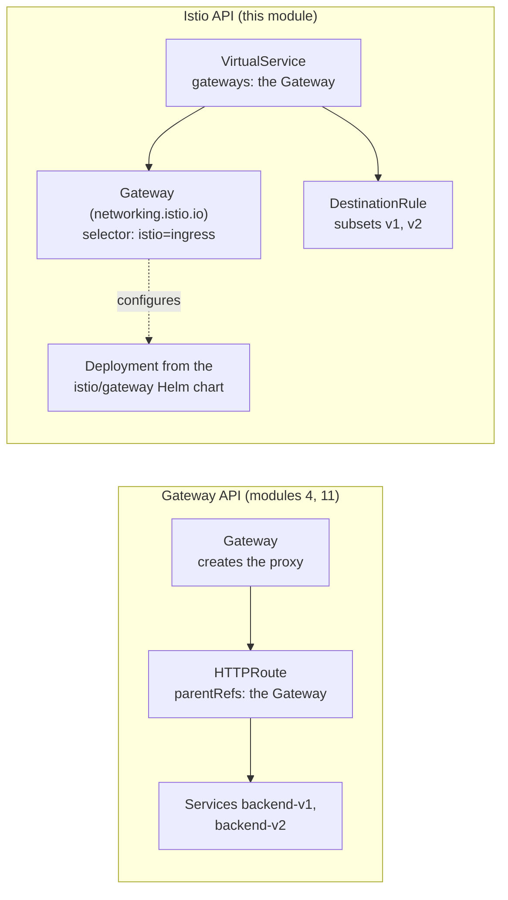

# Module 16: the Istio API, Gateway and VirtualService

> New to a term here, like VirtualService or waypoint? The [glossary](glossary.md) explains every Istio resource and term in this course.

Most of this course routes traffic with the Gateway API: Gateway and HTTPRoute. Istio had its own API for years before that standard existed, and huge numbers of clusters, blog posts, Helm charts and the Istio Certified Associate exam still use it. This module builds two things from module 4 again, the Istio way: an ingress gateway and a canary. You'll finish able to read both styles and translate between them.

Time: about 40 minutes.

## Concept: the same jobs, different shapes



Three differences stand out:

| | Gateway API | Istio API |
|---|---|---|
| Who creates the gateway proxy | Istio, from the Gateway resource | You, with the `istio/gateway` Helm chart. The Gateway only configures it |
| How routes attach | The route names its parent in `parentRefs` | The VirtualService names its Gateway in `gateways`. Without that field, it applies inside the mesh |
| How versions are named | One Service per version | Subsets: named groups of one Service's pods, picked by labels in a DestinationRule |

## The bigger picture: why two APIs exist

Istio launched in 2017, before Kubernetes had any good answer for routing. The old Ingress resource only knew hosts and paths, so every project invented its own: Istio's VirtualService, Contour's HTTPProxy, Traefik's IngressRoute, and more. A team that switched tools rewrote everything.

The Kubernetes networking group answered with the Gateway API, which reached version 1.0 in 2023. It splits the job by role: platform teams own the Gateway (ports, certificates), application teams own their routes. Istio, Cilium, Envoy Gateway, NGINX and others all implement it, so routes move between them.

Istio now recommends the Gateway API for new setups, and ambient mode builds on it. The Istio API isn't going away soon, though. It still covers features the standard lacks, like fault injection and the retries from module 15, and a huge amount of existing config uses it. In practice you'll read both every week.

## Why this way

**Why does Istio's Gateway need a separate Deployment?** It came from the sidecar era, where gateways were just Envoy pods that platform teams ran and scaled themselves. The Gateway resource tells those pods which ports and hosts to accept. Its `selector` picks the pods by label, the way a Service picks pods.

**Why `--skip-schema-validation` in the install command?** The Istio 1.24 `gateway` chart carries a values schema that Helm 4 reads more strictly than Helm 3 did, and Helm 4 rejects the chart's own defaults. The flag tells Helm to skip that check. With Helm 3 you leave it out.

**Why do subsets live in a DestinationRule?** The VirtualService decides *where* a request goes, and the DestinationRule describes *what* the destinations are and *how* to talk to them. Subsets describe the destinations, so they sit next to connection pools and TLS settings. The split also lets one DestinationRule serve many VirtualServices.

**Why does the header test call the backend from the course client, not through the gateway?** The waypoint matches headers on the request it receives, and the frontend forwards only tracing headers when it calls the backend. A header you send to the gateway never reaches the waypoint. Real apps that use header routing have to pass the header along, just like `traceparent` in module 6.

## Do it

### 1. Deploy a classic ingress gateway

```bash
helm repo update istio
helm install istio-ingress istio/gateway -n istio-ingress --create-namespace \
  --version 1.24.2 --skip-schema-validation --set service.type=ClusterIP --wait
kubectl -n istio-ingress get pods -l istio=ingress -o jsonpath='{.items[0].spec.containers[0].image}{"\n"}'
```

**What you should see.** `docker.io/istio/proxyv2:1.24.2-distroless`. The chart deployed a plain pod, and Istio's injector filled in the Envoy image. `ClusterIP` keeps it off your machine's ports, since the lab's own gateway already uses 8080.

### 2. Route outside traffic with a Gateway and a VirtualService

```bash
kubectl apply -f course/manifests/16-istio-gateway.yaml -f course/manifests/16-ingress-virtualservice.yaml
kubectl -n istio-ingress port-forward svc/istio-ingress 9080:80 &
curl -s http://localhost:9080/api/version; echo
```

**What you should see.** The backend's version JSON, now through the classic gateway on port 9080. Open both manifests: the Gateway says "accept HTTP on port 80 for any host", and the VirtualService says "for traffic arriving at that Gateway, send everything to the frontend".

### 3. Build the canary with subsets

```bash
kubectl -n shop delete httproute backend-route
kubectl apply -f course/manifests/16-subsets.yaml -f course/manifests/16-canary-virtualservice.yaml
for i in $(seq 1 200); do curl -s -o /dev/null -w "%header{x-app-version}\n" http://localhost:9080/api/orders; done | sort | uniq -c
```

**What you should see.** About 180 `v1` and 20 `v2`. In the test run for this module it was 174 and 26. You deleted the HTTPRoute first because an HTTPRoute and a VirtualService for the same host would compete, and Istio doesn't define which one wins.

### 4. Send testers to v2 with a header

```bash
kubectl apply -f course/manifests/03-course-client.yaml -f course/manifests/03-allow-course-client.yaml
kubectl -n shop rollout status deploy/course-client
kubectl -n shop exec deploy/course-client -- sh -c \
  'for i in $(seq 1 20); do curl -s -o /dev/null -w "%header{x-app-version}\n" -H "x-version: v2" http://backend:8000/api/version; done' | sort | uniq -c
```

**What you should see.** `20 v2`. The first rule in the VirtualService matched the header. Run it again without `-H "x-version: v2"` and the 90/10 split returns. The course client may only call `GET /api/version`, because of module 3's policy, which is why this step uses that path.

### 5. Translate one into the other

Put the two styles next to each other. Module 4's split:

```yaml
kind: HTTPRoute
spec:
  parentRefs: [{group: "", kind: Service, name: backend}]
  rules:
    - backendRefs:
        - {name: backend-v1, port: 8000, weight: 90}
        - {name: backend-v2, port: 8000, weight: 10}
```

This module's split:

```yaml
kind: VirtualService
spec:
  hosts: [backend.shop.svc.cluster.local]
  http:
    - route:
        - {destination: {host: backend.shop.svc.cluster.local, subset: v1}, weight: 90}
        - {destination: {host: backend.shop.svc.cluster.local, subset: v2}, weight: 10}
```

Same job, two shapes: `parentRefs` against `hosts`, Services per version against subsets.

## Investigate

1. Remove the `gateways:` field from `16-ingress-virtualservice.yaml` in your head. Where would that VirtualService apply then?
2. Delete the DestinationRule `backend-subsets` while the canary VirtualService stays. What happens to the shop, and which command tells you why?
3. Your company runs 300 VirtualServices. Should you convert them all to HTTPRoutes next quarter?

<details>
<summary>Answers</summary>

1. Inside the mesh, as if `gateways: [mesh]` were set. It would then try to route traffic sent to the host `*` between mesh workloads, which makes little sense. Leave `gateways` out only for VirtualServices meant for traffic between services, like the canary in step 3.
2. Every request to the backend gets a `503`: the VirtualService routes to subsets that no longer exist. `istioctl analyze -n shop` explains it straight away: `Error [IST0101] ... Referenced host+subset in destinationrule not found: "backend.shop.svc.cluster.local+v1"`. Run `istioctl analyze` whenever routing breaks after a change. It catches most of these mistakes before you go hunting in logs.
3. Probably not in one go. Both APIs work, and VirtualServices still cover features HTTPRoute lacks, like fault injection. A common plan: write new routes as HTTPRoutes, convert old ones when you touch them anyway, and keep VirtualServices where they need Istio-only features.

</details>

## Clean up

```bash
kill %1 2>/dev/null       # the port-forward from step 2
./course/reset.sh
```

This deletes the `istio-ingress` namespace with the classic gateway, the VirtualService and the DestinationRule, and restores the HTTPRoute.
