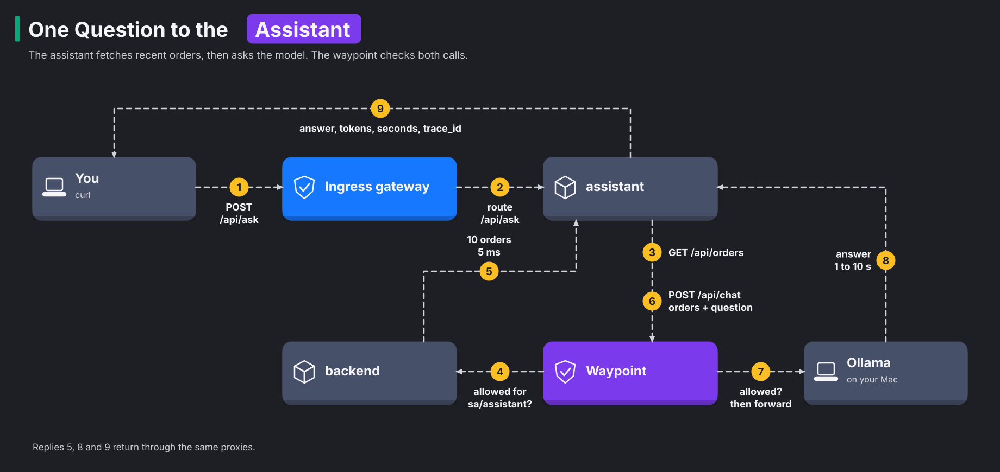

# Module 17: an LLM as a mesh service

> New to a term here, like VirtualService or waypoint? The [glossary](glossary.md) explains every Istio resource and term in this course.

**Before this module:** modules 3, 5, 6 and 12.

AI features are the fastest-growing kind of traffic on Kubernetes right now. Most of them follow one pattern:

1. A normal service gathers some data.
2. It sends the data to a language model, together with a question.
3. It returns the model's answer.

This module adds exactly that to the shop: an **assistant** that answers questions about orders. The model runs in Ollama on your own machine. Then you use the mesh the way platform teams handle AI traffic in production. You give the assistant an identity, lock down what it may call, watch its calls, and size its timeouts.

Time: about 50 minutes. This is the first of three AI modules. While the model answers, it uses about 2.4 GB of extra memory on your Mac.

## What you need

- [Ollama](https://ollama.com) running on your machine with `qwen2.5:3b`. Install the model with `ollama pull qwen2.5:3b` (1.9 GB on disk). The module's numbers come from this model.
- Enough memory. The lab uses about 5 GB, and `qwen2.5:3b` adds about 2.4 GB while it answers. The whole test run peaked at 16.5 GB on a 24 GB Mac. A 14-billion-parameter model gives better answers but needs about 9 GB, which doesn't fit next to the lab on 24 GB. Ollama unloads a model after 5 idle minutes and gives the memory back.
- macOS with OrbStack or Docker Desktop. Both let containers reach your machine under the name `host.docker.internal`. On Linux, start Ollama with `OLLAMA_HOST=0.0.0.0` and point that name at your Docker host's IP. The test run for this module covered macOS only.

## Concept: what the assistant does



The diagram follows one question from your terminal to the model and back:

1. You send a question with `curl` to `POST /api/ask` on the ingress gateway.
2. The gateway routes the request to the assistant.
3. The assistant asks the backend for 10 recent orders, through the waypoint. This takes about 5 ms.
4. The assistant sends the orders and your question to Ollama on your Mac, again through the waypoint.
5. Ollama returns the answer and the token counts after about 1 to 10 seconds.
6. The assistant returns the answer, the tokens, the seconds and a `trace_id` to you.

The pattern has a name: retrieval-augmented generation, or RAG. The model knows nothing about your shop. So the assistant fetches real data first and puts it into the prompt, the text it sends to the model. The model then answers from that data, not from what it remembers of the internet.

## Concept: why LLM traffic is different

Put the numbers from this module next to the rest of the shop:

| | A normal API call | A model call |
|---|---|---|
| Duration | milliseconds | seconds, sometimes minutes |
| Cost | close to nothing | real money, counted in tokens |
| Retry if it fails? | usually harmless | doubles the cost and the wait |
| What to measure | requests, errors, latency | the same, plus tokens in and out |
| What leaks if someone reads it | an order list | whatever went into the prompt |

**Tokens** are the units a model reads and writes. A token is a piece of a word, roughly four characters of English. Every hosted model bills by tokens, with separate prices for input and output. On your own GPU, tokens are what the GPU spends its time on. So token counts belong next to latency on every dashboard.

## Concept: how a model writes an answer

One model call goes through up to three phases. Once you know them, every timing in this module makes sense:

| Phase | What happens | What drives its time |
|---|---|---|
| Load | Ollama reads the model file from disk into memory | Only on the first call, or after 5 idle minutes. It's the gap between 1.34 and 0.34 seconds in step 2 |
| Prefill | The model reads the whole prompt in one pass | The number of input tokens, but each one is cheap |
| Decode | The model writes the answer one token at a time. Every new token needs a full pass through the model | The number of output tokens, times the time per token |

The length of the answer decides how long the user waits. At about 66 tokens per second, the 20 output tokens in step 2 take about 0.3 seconds. That is most of the 0.34 seconds you'll measure. This is why the assistant caps the answer length with `max_tokens`. It also explains why a timeout during decode hurts so much: it throws away every token written so far.

The input side decides the bill. A model keeps no memory between calls. So the assistant sends the order data and the question again with every request. You pay for those input tokens every time, even when the question repeats.

## The bigger picture: AI gateways

As AI traffic grew, a new kind of product appeared: the AI gateway. An AI gateway sits between apps and models, like a toll booth on the only road to the model. Examples are agentgateway, kgateway and Envoy AI Gateway. They add features that a classic proxy lacks:

- rate limits counted in tokens instead of requests
- switching between model providers
- caching repeated prompts
- filtering what goes into a prompt and what comes out

Underneath, most of them do what you'll do in this module with plain Istio:

- They put the model behind a proxy.
- They give each caller an identity.
- They decide who may call which endpoint.
- They record every call.

Recent Istio releases add more AI-specific features on top. One is LLM-aware load balancing through the Gateway API Inference Extension (module 18). Another is agentgateway running as a waypoint. The lab's Istio 1.24 is older than these features, but the basics carry over.

There's also a security problem. Ollama, like many model servers, has **no authentication at all**. Anyone who reaches its port may chat with it, download new models, or delete existing ones. Inside a cluster, "anyone who reaches its port" means every pod. That's the first thing this module fixes.

## Why this way

**Why call Ollama on your Mac instead of running it in the cluster?** Your Mac's GPU runs `qwen2.5:3b` at about 66 tokens per second. It also runs a 14B model, if you have the memory. The lab's Kubernetes node is a Linux VM with no access to the GPU. Only tiny models run at a usable speed there. Module 18 runs one there anyway, to show the difference. Calling an outside model is also the most common real setup. In production, that model is usually a hosted API from OpenAI, Anthropic or Google, reached through egress, the mesh's exit for outbound traffic.

**Why does the assistant need its own AuthorizationPolicy for the backend?** Module 3's policy allows only `sa/frontend`. The assistant runs as `sa/assistant`, which is a different identity. So the backend refuses it until you add a rule. That is deny-by-default working as intended. A new AI feature doesn't quietly gain access to your data.

**Why put Ollama behind a ServiceEntry?** The reason is the same as in module 12. Without a ServiceEntry, the mesh sees an IP address and nothing more. A ServiceEntry gives that outside address a name, like a contact entry for a phone number. With it, every model call has a name in metrics, logs and traces, and the waypoint applies rules to it.

**Why no retries on model calls?** A retry repeats the whole generation. The user waits twice as long, and you pay for the tokens twice. If a model call fails, return the error fast and let the user decide.

**Why does the timeout matter so much?** An LLM call that hangs ties up a GPU. A timeout that's too long wastes GPU time. A timeout that's too short throws away work in progress. Step 6 shows what happens at the moment a timeout fires.

## Do it

### 1. Deploy the assistant

```bash
kubectl apply -f course/manifests/17-assistant.yaml
kubectl -n shop set env deploy/assistant OLLAMA_MODEL=qwen2.5:3b
kubectl -n shop rollout status deploy/assistant
curl -s http://localhost:8080/api/model; echo
```

**What you should see.** `{"model":"qwen2.5:3b","ollama":"http://host.docker.internal:11434","max_tokens":120}`. The output shows the model, the Ollama URL, and a cap on answer length. On a Mac with more memory, set any other model from `ollama list` by name. If you get `no healthy upstream` right after the rollout, wait a few seconds. The gateway hasn't received the new pod's address yet.

### 2. Ask a question, and meet a 403

```bash
ask() { curl -s -m 180 -X POST http://localhost:8080/api/ask -H 'Content-Type: application/json' -d "{\"question\":\"$1\"}"; echo; }
ask "How many orders are there?"
```

**What you should see.** You get an error: `backend call failed: Client error '403 Forbidden'`. The assistant asked the backend for orders, and the backend's waypoint refused `sa/assistant`. Allow the assistant, for `GET /api/orders` only:

```bash
kubectl apply -f course/manifests/17-allow-assistant.yaml
ask "How many orders are there, and what was ordered?"
```

**What you should see.** You get a real answer, plus three numbers: `input_tokens`, `output_tokens` and `model_seconds`. In the test run for this module, the call used 197 input tokens and 20 output tokens. The first call took 1.34 seconds, because Ollama loaded the model into memory. The same question right after took 0.34 seconds.

Read the answers critically. When asked which item was ordered most, the model replied that "book" was. It added: "There is no item named verify in the order data". In fact, one order was for `verify`. A small model contradicts its own context now and then. Module 27 looks at that problem in depth.

### 3. See what the mesh knows about the model

```bash
kubectl -n istio-system logs ds/ztunnel --since=5m | grep 'src.workload="assistant' | grep 11434 | tail -1
```

**What you should see.** You see `dst.addr=` followed by an IP and port 11434, something like `0.250.250.254:11434`. The log shows no name. Now register Ollama with the mesh:

```bash
kubectl apply -f course/manifests/17-ollama-serviceentry.yaml
kubectl -n shop rollout restart deploy/assistant && kubectl -n shop rollout status deploy/assistant
ask "Which item was ordered most?"
kubectl -n istio-system logs ds/ztunnel --since=1m | grep 'src.workload="assistant' | grep host.docker | tail -1
```

**What you should see.** You see `dst.service="host.docker.internal"` and `dst.workload="waypoint-..."`. Model calls now pass through the waypoint, under a name. You restarted the assistant so that it gets a fresh pod. The new pod resolves the name to the ServiceEntry's virtual IP, as in module 12.

### 4. Protect Ollama's admin API

Ollama listens for more than chat requests:

- `/api/tags` lists your models.
- `/api/pull` downloads new ones.
- `/api/delete` removes them.

Allow only the assistant, and only chat and read-only calls:

```bash
kubectl apply -f course/manifests/17-ollama-policy.yaml -f course/manifests/03-course-client.yaml
kubectl -n shop rollout status deploy/course-client
kubectl -n shop exec deploy/course-client -- curl -s -o /dev/null -w "list models -> %{http_code}\n" http://host.docker.internal:11434/api/tags
kubectl -n shop exec deploy/course-client -- curl -s -o /dev/null -w "delete a model -> %{http_code}\n" \
  -X DELETE -d '{"model":"lab-model-that-does-not-exist"}' http://host.docker.internal:11434/api/delete
ask "How many orders are there?"
```

**What you should see.** The course client gets `403` for both calls, and the assistant gets a normal answer. The delete call uses a model name that doesn't exist, so nothing would break even without the policy. Don't test this with a real model name.

### 5. Read the model call in a trace

The `trace_id` field in each answer points to the full trace. Open Jaeger (http://localhost:16686), paste the ID into the search box at the top, and look at the spans.

**What you should see.** The spans look about like this one from the test run:

| Span | Time |
|---|---|
| ingress gateway to assistant | 247 ms |
| assistant: `GET` the orders, through the waypoint, to the backend and Redis | 5 ms |
| assistant: `chat qwen2.5:3b` | 233 ms |
| waypoint: `host.docker.internal:11434` | 230 ms |

Click the `chat ...` span. Its tags follow the OpenTelemetry conventions for generative AI: `gen_ai.system`, `gen_ai.request.model`, `gen_ai.usage.input_tokens`, `gen_ai.usage.output_tokens`. Almost the whole request time goes to the model. The rest of the shop barely shows up.

Prometheus counts the tokens too. In Grafana, open Explore, pick Prometheus, and run this query:

```text
sum by (type) (assistant_llm_tokens_total)
```

**What you should see.** You see far more input tokens than output tokens: 1,152 against 55 in the test run. The order data in every prompt costs much more than the short answers.

### 6. Watch a timeout cut a model call off

```bash
kubectl apply -f course/manifests/17-llm-timeout.yaml
ask "How many orders are there?"
```

**What you should see.** You get `model call failed: Server error '504 Gateway Timeout'` after a tenth of a second. The route allows 100 ms, and even a two-word answer took more than twice that in step 5. So the route timeout on the waypoint fired before the model finished. If you run Homebrew's Ollama on a Mac, look at its log:

```bash
tail -n 5 /opt/homebrew/var/log/ollama.log
```

In the test run, the log showed the call ending with status `500` after 3 seconds. That run used a 3-second timeout. Next, the log showed `srv stop: cancel task`. When the waypoint closed the connection, Ollama stopped generating. Not every model server does that. A server that keeps going after the client left burns GPU time for nobody.

## Investigate

1. A teammate suggests `retries: {attempts: 3}` for model calls "because models sometimes fail". What does that cost, in time and in tokens, when the model is slow rather than broken?
2. Step 5 showed far more input tokens than output tokens. Name two ways to cut the input side.
3. Without the policy from step 4, what does Ollama let a compromised pod anywhere in the `shop` namespace do?
4. Your company switches from Ollama to a hosted model API that charges per token. Which parts of this module stay exactly the same, and which change?

<details>
<summary>Answers</summary>

1. Each retry starts the generation again from the beginning. A slow model that runs into a timeout gets three more chances to run into the same timeout. So the user waits up to four times longer, and you pay for every partial answer the model produced. Retries help with failures that happen fast, like a refused connection. They don't help with slow generations.
2. There are three ways:
   - Send less data. Fetch fewer orders (`limit` in the backend call), or only the fields the question needs.
   - Pick the data smartly. First search for the orders that match the question. A real RAG system does this with a vector database, a store that finds text by meaning.
   - Cache answers to repeated questions. A cached answer skips the model entirely.
3. Ollama checks nothing, so the pod gets four powers:
   - It lists your models.
   - It chats with them as much as it likes, on your GPU.
   - It downloads huge new models until your disk fills up.
   - It deletes the models you have.

   The waypoint rule is the only lock. That's why the rule allows named identities and named endpoints rather than "the namespace".
4. The identity, the policies, the ServiceEntry pattern, the traces and the token metrics all stay. Three things change:
   - The ServiceEntry gets a public host name and port 443, with TLS origination as in module 12.
   - An API key enters the picture. The key belongs in a Secret, not in the image.
   - Timeouts and token counts start to matter for the bill, not just for the GPU.

</details>

## Clean up

```bash
./course/reset.sh
```

This removes the assistant, its route and policies, the ServiceEntry and the timeout. Ollama on your machine keeps running.
