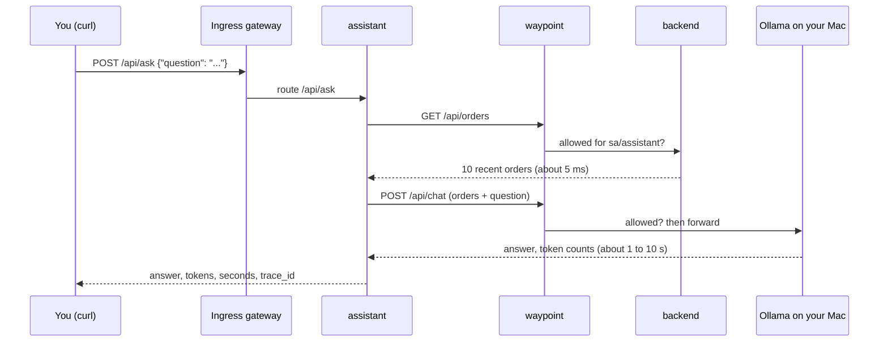

# Module 17: an LLM as a mesh service

> New to a term here, like VirtualService or waypoint? The [glossary](glossary.md) explains every Istio resource and term in this course.

AI features are the fastest-growing kind of traffic on Kubernetes right now, and most of them follow one pattern: a normal service gathers some data, sends it to a language model with a question, and returns the answer. This module adds exactly that to the shop: an **assistant** that answers questions about orders. The model runs in Ollama on your own machine. Then you use the mesh to do what platform teams do with AI traffic in production: give it identity, lock it down, watch it, and size its timeouts.

Time: about 50 minutes. First of three AI modules.

## What you need

- [Ollama](https://ollama.com) running on your machine with at least one model. `ollama list` shows your models. Small and fast works well here: `ollama pull qwen2.5:3b` (about 2 GB). Bigger models answer better but slower. This module was tested with `qwen2.5-14b-64k`, a 14-billion-parameter model, at about 13 tokens per second on an Apple silicon Mac.
- macOS with OrbStack or Docker Desktop. Both let containers reach your machine as `host.docker.internal`. On Linux, start Ollama with `OLLAMA_HOST=0.0.0.0` and give the name to your Docker host's IP; the test run for this module covered macOS only.

## Concept: what the assistant does



The pattern has a name: retrieval-augmented generation, or RAG. The model knows nothing about your shop, so the assistant fetches real data first and puts it into the prompt. The model then answers from that data, not from what it remembers of the internet.

## Concept: why LLM traffic is different

Put the numbers from this module next to the rest of the shop:

| | A normal API call | A model call |
|---|---|---|
| Duration | milliseconds | seconds, sometimes minutes |
| Cost | close to nothing | real money, counted in tokens |
| Retry if it fails? | usually harmless | doubles the cost and the wait |
| What to measure | requests, errors, latency | the same, plus tokens in and out |
| What leaks if someone reads it | an order list | whatever went into the prompt |

**Tokens** are the units a model reads and writes: pieces of words, roughly four characters of English each. Every hosted model bills by them, input and output separately, and your own GPU spends its time on them. So token counts belong next to latency on every dashboard.

## The bigger picture: AI gateways

As AI traffic grew, a new kind of product appeared: the AI gateway. agentgateway, kgateway, Envoy AI Gateway and similar tools sit between apps and models and add things a classic proxy lacks: rate limits counted in tokens instead of requests, switching between model providers, caching repeated prompts, filtering what goes into a prompt and what comes out.

Underneath, most of them do what you'll do in this module with stock Istio: put the model behind a proxy, give each caller an identity, decide who may call which endpoint, and record every call. Recent Istio releases add more AI-specific features on top, such as LLM-aware load balancing through the Gateway API Inference Extension (module 18) and agentgateway as a waypoint. The lab's Istio 1.24 predates them, but the basics carry over.

There's also a security story. Ollama, like many model servers, has **no authentication at all**. Anyone who reaches its port may chat with it, download new models, or delete existing ones. Inside a cluster, "anyone who reaches its port" means every pod. That's the first thing this module fixes.

## Why this way

**Why call Ollama on your Mac instead of running it in the cluster?** Your Mac's GPU runs a 14B model at usable speed. The lab's Kubernetes node is a Linux VM without GPU access, where only tiny models run, slowly. Module 18 runs one there anyway, to show the difference. Calling an outside model is also the most common real setup: a hosted API from OpenAI, Anthropic or Google, reached through egress.

**Why does the assistant need its own AuthorizationPolicy for the backend?** Module 3's policy allows only `sa/frontend`. The assistant runs as `sa/assistant`, a different identity, so the backend refuses it until you add a rule. That's deny-by-default working as intended: a new AI feature doesn't quietly gain access to your data.

**Why put Ollama behind a ServiceEntry?** Same reason as module 12: without it the mesh sees an IP address and nothing more. With it, every model call has a name in metrics, logs and traces, and the waypoint applies rules to it.

**Why no retries on model calls?** A retry repeats the whole generation: the user waits twice as long, and you pay for the tokens twice. If a model call fails, return the error fast and let the user decide.

**Why does the timeout matter so much?** An LLM call that hangs ties up a GPU. A timeout that's too long wastes it; one that's too short throws away work in progress. Step 6 shows what happens at the moment a timeout fires.

## Do it

### 1. Deploy the assistant

```bash
kubectl apply -f course/manifests/17-assistant.yaml
kubectl -n shop set env deploy/assistant OLLAMA_MODEL="$(ollama list | awk 'NR==2 {print $1}')"
kubectl -n shop rollout status deploy/assistant
curl -s http://localhost:8080/api/model; echo
```

**What you should see.** The model the assistant will use, the Ollama URL, and `max_tokens: 120`, a cap on answer length. The second command picks the first model from your `ollama list`. Choose another one by name if you like.

### 2. Ask a question, and meet a 403

```bash
ask() { curl -s -m 180 -X POST http://localhost:8080/api/ask -H 'Content-Type: application/json' -d "{\"question\":\"$1\"}"; echo; }
ask "How many orders are there?"
```

**What you should see.** An error: `backend call failed: Client error '403 Forbidden'`. The assistant asked the backend for orders, and the backend's waypoint refused `sa/assistant`. Allow it, for `GET /api/orders` only:

```bash
kubectl apply -f course/manifests/17-allow-assistant.yaml
ask "How many orders are there, and what was ordered?"
```

**What you should see.** A real answer, plus `input_tokens`, `output_tokens` and `model_seconds`. In the test run for this module: 325 input tokens, 24 output tokens, 3.1 seconds. Ask a few more questions. The first one after a pause takes longer, while Ollama loads the model into memory.

### 3. See what the mesh knows about the model

```bash
kubectl -n istio-system logs ds/ztunnel --since=5m | grep 'src.workload="assistant' | grep 11434 | tail -1
```

**What you should see.** `dst.addr=` followed by an IP and port 11434, something like `0.250.250.254:11434`. No name. Now register Ollama with the mesh:

```bash
kubectl apply -f course/manifests/17-ollama-serviceentry.yaml
kubectl -n shop rollout restart deploy/assistant && kubectl -n shop rollout status deploy/assistant
ask "Which item was ordered most?"
kubectl -n istio-system logs ds/ztunnel --since=1m | grep 'src.workload="assistant' | grep host.docker | tail -1
```

**What you should see.** `dst.service="host.docker.internal"` and `dst.workload="waypoint-..."`: model calls now pass through the waypoint, under a name. The restart gives the assistant a fresh pod that resolves the name to the ServiceEntry's virtual IP, as in module 12.

### 4. Protect Ollama's admin API

Ollama listens for more than chat. `/api/tags` lists your models, `/api/pull` downloads new ones, `/api/delete` removes them. Allow only the assistant, and only chat and read-only calls:

```bash
kubectl apply -f course/manifests/17-ollama-policy.yaml -f course/manifests/03-course-client.yaml
kubectl -n shop rollout status deploy/course-client
kubectl -n shop exec deploy/course-client -- curl -s -o /dev/null -w "list models -> %{http_code}\n" http://host.docker.internal:11434/api/tags
kubectl -n shop exec deploy/course-client -- curl -s -o /dev/null -w "delete a model -> %{http_code}\n" \
  -X DELETE -d '{"model":"lab-model-that-does-not-exist"}' http://host.docker.internal:11434/api/delete
ask "How many orders are there?"
```

**What you should see.** `403` for both calls from the course client, and a normal answer for the assistant. The delete uses a model name that doesn't exist, so even without the policy nothing would break. Don't test this with a real model name.

### 5. Read the model call in a trace

The `trace_id` field in each answer points at the full trace. Open Jaeger (http://localhost:16686), paste the ID into the search box at the top, and look at the spans.

**What you should see.** About this, from the test run:

| Span | Time |
|---|---|
| ingress gateway to assistant | 947 ms |
| assistant: `GET` the orders, through the waypoint, to the backend and Redis | 8 ms |
| assistant: `chat qwen2.5-14b-64k:latest` | 924 ms |
| waypoint: `host.docker.internal:11434` | 919 ms |

Click the `chat ...` span. Its tags follow the OpenTelemetry conventions for generative AI: `gen_ai.system`, `gen_ai.request.model`, `gen_ai.usage.input_tokens`, `gen_ai.usage.output_tokens`. Almost the whole request is the model. The rest of the shop barely registers.

Prometheus counts the tokens too. In Grafana, Explore, Prometheus:

```text
sum by (type) (assistant_llm_tokens_total)
```

**What you should see.** Far more input than output: 1,278 against 57 in the test run. The order data in every prompt costs much more than the short answers.

### 6. Watch a timeout cut a model call off

```bash
kubectl apply -f course/manifests/17-llm-timeout.yaml
ask "How many orders are there?"
```

**What you should see.** `model call failed: Server error '504 Gateway Timeout'` after half a second. The route timeout on the waypoint fired before the model finished. On a Mac with Homebrew's Ollama, look at its log:

```bash
tail -n 5 /opt/homebrew/var/log/ollama.log
```

In the test run it showed the call ending with status `500` after 3 seconds (that run used a 3-second timeout), followed by `srv stop: cancel task`. When the waypoint closed the connection, Ollama stopped generating. Not every model server does that. A server that keeps going after the client left burns GPU time for nobody.

## Investigate

1. A teammate suggests `retries: {attempts: 3}` for model calls "because models sometimes fail". What does that cost, in time and in tokens, when the model is slow rather than broken?
2. Step 5 showed far more input tokens than output tokens. Name two ways to cut the input side.
3. Without the policy from step 4, what does Ollama let a compromised pod anywhere in the `shop` namespace do?
4. Your company switches from Ollama to a hosted model API that charges per token. Which parts of this module stay exactly the same, and which change?

<details>
<summary>Answers</summary>

1. Each retry starts the generation again from the beginning. A slow model that runs into a timeout gets three more chances to run into the same timeout, so the user waits up to four times longer, and you pay for every partial answer the model produced. Retries help with failures that happen fast, like a refused connection, not with slow generations.
2. Send less data: fewer orders (`limit` in the backend call), or only the fields the question needs. Or pick the data smartly: search for the orders that match the question first, which is what a real RAG system does with a vector database. Caching answers to repeated questions also skips the model entirely.
3. List your models, chat with them as much as it likes using your GPU, download huge new models until your disk fills up, or delete the ones you have. Ollama checks nothing. The waypoint rule is the only lock, which is why it allows named identities and named endpoints rather than "the namespace".
4. The identity, the policies, the ServiceEntry pattern, the traces and the token metrics all stay. The ServiceEntry gets a public host name and port 443, with TLS origination as in module 12, and an API key enters the picture, which belongs in a Secret, not in the image. Timeouts and token counts start to matter for the bill, not just for the GPU.

</details>

## Clean up

```bash
./course/reset.sh
```

This removes the assistant, its route and policies, the ServiceEntry and the timeout. Ollama on your machine keeps running.
