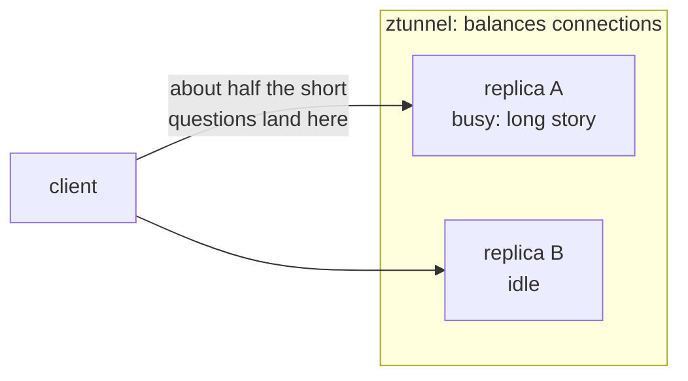

# Module 18: serving models inside the cluster

> New to a term here, like VirtualService or waypoint? The [glossary](glossary.md) explains every Istio resource and term in this course.

**Before this module:** modules 1, 4 and 5, and 17 for the AI basics.

Module 17 called a model that ran outside the cluster. Plenty of teams run models inside Kubernetes instead: for privacy, for cost, or because a GPU cluster is what they have. This module puts two small model servers into the lab and shows three problems that make model serving different from serving a normal API. One of them has driven a whole new Kubernetes standard.

Time: about 50 minutes. Second of three AI modules. It downloads about 900 MB of models, once per run.

## Concept: a model server is an odd workload

| | A normal web service | A model server |
|---|---|---|
| Container image | tens of MB | hundreds of MB to several GB |
| Data it needs before it starts | none | the model file: 0.4 GB here, 5 to 150 GB in production |
| Time to become ready | seconds | until the model sits in memory: seconds to minutes |
| Cost of one request | about the same for every request | from milliseconds to minutes, depending on prompt and answer length |
| Requests at once | hundreds | a handful per GPU, often one |

The lab runs **llama.cpp**, a fast open-source model server, with two tiny models: **Qwen2.5 0.5B Instruct** (490 MB) on two replicas, and **SmolLM2 360M Instruct** (390 MB) on one. Each replica answers one request at a time (`--parallel 1`) and queues the rest, the way a busy GPU does. llama.cpp speaks the OpenAI-compatible API, `/v1/chat/completions`, which almost every AI tool understands.

## Concept: why LLM load balancing is hard

A normal load balancer assumes requests cost about the same. For language models that's false. "Say hi" takes 30 milliseconds. "Write a long story" keeps the server busy for 25 seconds. If a short question lands behind a long story, it waits the full 25 seconds, while another replica sits idle.



Each balancing method knows a different amount:

| Method | Decides by | Knows about request cost? |
|---|---|---|
| ztunnel (L4) | connection, round robin or random | no |
| Waypoint, Istio's default `LEAST_REQUEST` | number of requests in progress: picks two pods at random, takes the less busy one | a little: it counts requests, not their size |
| Gateway API Inference Extension | the model server's own metrics: queue length, memory cache use | yes |

You'll measure the first two. The third needs a newer Istio than the lab's.

## The bigger picture: the Gateway API Inference Extension

In 2025 the Kubernetes networking group published an extension to the Gateway API for exactly this problem. It adds an **InferencePool**: a group of model server pods, plus an **endpoint picker**, a small service the gateway asks "which pod should take this request?". The endpoint picker reads each server's metrics, the same kind you'll see in this module (`llamacpp:requests_deferred`, the queue), and answers with the pod that will respond fastest. A companion feature reads the model name from the JSON body, so one address serves many models.

Istio supports it from version 1.27 onwards, and big serving stacks like llm-d, KServe and NVIDIA Dynamo build on it. The lab's Istio 1.24 is older, so this module shows the problem the extension solves and the metrics it relies on, not the extension itself.

Autoscaling has the same issue. CPU use says little about a model server: a GPU at full load often sits next to a quiet CPU. Teams scale on queue length or tokens per second instead, often with KEDA reading those metrics from Prometheus.

## Why this way

**Why llama.cpp and not Ollama, like module 17?** The official Ollama image weighs 2.8 GB. llama.cpp's server image is 300 MB, and it publishes the queue metrics this module needs. Both serve the same model files (GGUF format).

**Why does an init container download the model?** Model files don't belong in the image: they're large, and teams swap models without rebuilding. The init container fetches the file into a volume before the server starts. Each pod writes to its own temporary file and renames it when done, so two pods starting at once never read half a file. They both download it, though, which wastes bandwidth. Production setups pre-load models into a shared cache or use an image volume.

**Why a startup probe on `/health`?** llama.cpp answers `503` on `/health` while it loads the model, and `200` once it's ready to serve. Without the probe, Kubernetes would send traffic to a pod that isn't ready yet.

**Why route by a header, when the request names its model in the body?** HTTP routing in Gateway API and Istio reads headers and paths, never the body. Reading JSON bodies on every request costs time and memory, so proxies avoid it. That's why the Inference Extension needed a separate body-based router.

## Do it

### 1. Deploy the model servers

```bash
kubectl apply -f course/manifests/18-namespace.yaml
kubectl apply -f course/manifests/18-llm-qwen.yaml -f course/manifests/03-course-client.yaml
kubectl -n ai get pods -w          # Init, then Running 0/1, then 1/1. Ctrl-C when both are 1/1
kubectl -n ai logs deploy/llm-qwen -c fetch-model
```

**What you should see.** Each pod first runs `fetch-model` (download), then starts the server, which stays `0/1` until the model sits in memory. In the test run both were ready after 39 seconds.

Ask a question through the mesh:

```bash
kubectl -n shop exec deploy/course-client -- curl -s http://llm-qwen.ai.svc.cluster.local:8080/v1/chat/completions \
  -H 'Content-Type: application/json' -d '{"messages":[{"role":"user","content":"What is Kubernetes?"}],"max_tokens":60}'
```

**What you should see.** JSON with `"model":"qwen2.5-0.5b"`, an answer, and a `timings` block. Compare it with module 17:

| | Module 17: your Mac's GPU | This module: the cluster's CPU |
|---|---|---|
| Model size | 14 billion parameters | 0.5 billion |
| Speed, warm | about 13 tokens per second | about 90 tokens per second |
| Answer quality | accurate, follows instructions | often vague or slightly wrong |

The small model is fast because it's tiny. That's the trade-off every team makes: a big model gives better answers and needs expensive hardware, a small one runs anywhere and answers worse.

### 2. Get stuck behind a long request

```bash
./course/llm-load.sh
```

The script starts one long generation (2,000 tokens, about 25 seconds), then sends 10 short questions, half a second apart, all from inside the mesh. It prints each short question's time.

**What you should see.** Most short questions take 0.0 to 0.1 seconds. Some take about 20 seconds: they landed on the replica busy with the long story and waited in its queue. In the test runs, 4, 6, 4, 4 and 5 out of 10 got stuck. ztunnel balances connections and knows nothing about what each request costs.

### 3. Balance per request with a waypoint

```bash
kubectl apply -f course/manifests/18-waypoint.yaml
kubectl label ns ai istio.io/use-waypoint=waypoint
kubectl -n ai wait --for=condition=Programmed gateway/waypoint
./course/llm-load.sh
./course/llm-load.sh
./course/llm-load.sh
```

**What you should see.** Fewer stuck questions, but rarely none. The test runs gave 3, 0, 1, 1 and 5 out of 10, an average of 2 against 4.6 before. The waypoint's `LEAST_REQUEST` picks two pods at random and sends the request to the one with fewer requests in progress. With only two replicas, both picks sometimes land on the busy one. And it counts requests, not their size. To do better, a balancer must read the servers' queues, which is what the Inference Extension's endpoint picker does.

Find the queue yourself. In Grafana, Explore, Prometheus, run while `llm-load.sh` runs:

```text
llamacpp:requests_deferred
```

**What you should see.** One line per pod, labelled `model="qwen"`. Watch for values above 0: that's a question waiting in a pod's queue.

### 4. Two models behind one address

```bash
kubectl apply -f course/manifests/18-llm-smol.yaml
kubectl -n ai rollout status deploy/llm-smol
kubectl apply -f course/manifests/18-route-by-model.yaml
ask() { kubectl -n shop exec deploy/course-client -- curl -s http://llm.ai.svc.cluster.local:8080/v1/chat/completions \
  -H 'Content-Type: application/json' "$@" | grep -o '"model":"[^"]*"'; }
ask -d '{"messages":[{"role":"user","content":"Name a colour."}],"max_tokens":12}'
ask -H 'x-model: smollm2' -d '{"messages":[{"role":"user","content":"Name a colour."}],"max_tokens":12}'
ask -d '{"model":"smollm2-360m","messages":[{"role":"user","content":"Name a colour."}],"max_tokens":12}'
```

**What you should see.** `qwen2.5-0.5b`, then `smollm2-360m`, then `qwen2.5-0.5b` again. The third request asked for SmolLM2 in its body, the standard OpenAI way, and the route ignored it, because it only reads headers.

## Investigate

1. You run four replicas instead of two. How would that change the results of step 3, and why?
2. A teammate proposes `loadBalancer: {simple: ROUND_ROBIN}` in a DestinationRule for the model servers, "to be fair". What happens to the stuck questions?
3. Your model servers sit at 30% CPU, but users complain about slow answers. Which metric from this module would you scale on instead, and why does CPU mislead?
4. Why does the second model need its own Deployment, rather than loading both models into one server?

<details>
<summary>Answers</summary>

1. Expect fewer stuck questions (the test run for this module didn't try it). With four replicas and one busy, two random picks both land on the busy pod far less often (1 in 16 instead of 1 in 4), and `LEAST_REQUEST` takes the less busy pod in every other case. More replicas also give the balancer more room. The underlying weakness stays: it still doesn't know a long request from a short one.
2. Expect more of them to get stuck: try it and count. Round robin sends every other request to the busy replica, whether it's free or not. `LEAST_REQUEST` at least avoids pods that already hold requests.
3. Queue length (`llamacpp:requests_deferred`) or time spent waiting. A model server spends most of its time in the matrix maths on the GPU, or here on a fixed number of CPU threads, so its CPU number stays flat while requests pile up. The queue shows the users' wait directly.
4. Each llama.cpp process serves one model, and the model fills that process's memory. Separate Deployments also let you scale and update each model on its own, which is exactly what the A/B route in step 4 relies on. Some servers load several models or adapters into one process, and the Inference Extension routes between them, but that adds complexity a lab doesn't need.

</details>

## Clean up

```bash
./course/reset.sh
```

This deletes the `ai` namespace, the models in it and the ServiceMonitor.
