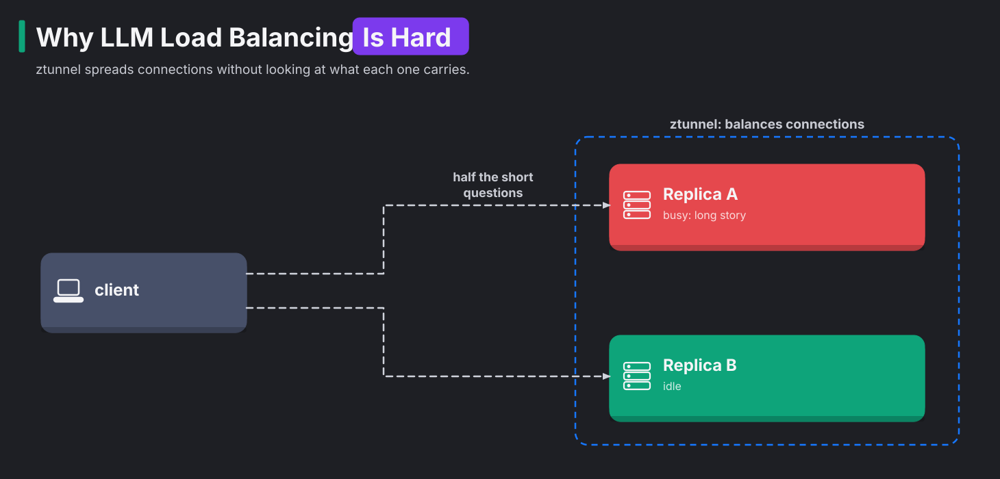

# Module 18: serving models inside the cluster

> New to a term here, like VirtualService or waypoint? The [glossary](glossary.md) explains every Istio resource and term in this course.

**Before this module:** modules 1, 4 and 5, and 17 for the AI basics.

Module 17 called a model that ran outside the cluster. Plenty of teams run models inside Kubernetes instead. They do it for privacy, for cost, or because a GPU cluster is what they have. This module puts two small model servers into the lab. It then shows three problems that make model serving different from serving a normal API:

1. A model server is a heavy workload that starts slowly.
2. Requests differ hugely in cost, and that confuses load balancers.
3. A request names its model in the body, where routers don't look.

The second problem has driven a whole new Kubernetes standard.

Time: about 50 minutes. This is the second of three AI modules. It downloads about 900 MB of models, once per run.

## Concept: a model server is an odd workload

| | A normal web service | A model server |
|---|---|---|
| Container image | tens of MB | hundreds of MB to several GB |
| Data it needs before it starts | none | the model file: 0.4 GB here, 5 to 150 GB in production |
| Time to become ready | seconds | until the model sits in memory: seconds to minutes |
| Cost of one request | about the same for every request | from milliseconds to minutes, depending on prompt and answer length |
| Requests at once | hundreds | a handful per GPU, often one |

The lab runs **llama.cpp**, a fast open-source model server. It serves two tiny models:

- Qwen2.5 0.5B Instruct (490 MB) runs on two replicas.
- SmolLM2 360M Instruct (390 MB) runs on one replica.

Each replica answers one request at a time (`--parallel 1`) and queues the rest, the way a busy GPU does. llama.cpp speaks the OpenAI-compatible API, `/v1/chat/completions`. Almost every AI tool understands that API.

## Concept: why LLM load balancing is hard

A normal load balancer assumes that all requests cost about the same. For language models, that assumption is false. "Say hi" takes 30 milliseconds. "Write a long story" keeps the server busy for 25 seconds. If a short question lands behind a long story, it waits the full 25 seconds while another replica sits idle. It's like a supermarket queue: one customer with a full trolley holds up everyone behind them, while the next till stands empty.

The diagram shows this case with ztunnel, which spreads connections without looking at what each one carries:



Each balancing method knows a different amount:

| Method | Decides by | Knows about request cost? |
|---|---|---|
| ztunnel (L4) | connection, round robin or random | no |
| Waypoint, Istio's default `LEAST_REQUEST` | number of requests in progress: picks two pods at random, takes the less busy one | a little: it counts requests, not their size |
| Gateway API Inference Extension | the model server's own metrics: queue length, memory cache use | yes |

You'll measure the first two. The third needs a newer Istio than the lab's.

Predict the results before you measure. Three facts drive the prediction:

- Each replica has one slot (`--parallel 1`). One request runs, and the others wait in that replica's queue.
- `llm-load.sh` opens a new connection for every short question.
- One of the two replicas is busy with the long story the whole time.

ztunnel picks a pod for each new connection without looking at how busy the pod is. So every short question has about a one-in-two chance of landing behind the long story. Expect about 5 of 10 questions to get stuck.

The waypoint works differently. It looks at every HTTP request and counts the requests it has in progress for each pod. Its `LEAST_REQUEST` method picks two pods at random and takes the less busy one. It only fails when both random picks hit the busy pod. That happens one in two times one in two, so one time in four. Expect about 2 or 3 of 10 questions to get stuck. Compare these predictions with the test runs in steps 2 and 3.

This is the same difference between layer 4 (L4) and layer 7 (L7) balancing that you know from plain Kubernetes. L4 balancing sees only connections. L7 balancing reads the HTTP requests inside them. kube-proxy and ztunnel both choose a pod once per connection. Only a proxy that reads HTTP, like the waypoint, sees each request.

## The bigger picture: the Gateway API Inference Extension

A balancer that guesses by counting requests will keep sending short questions behind long ones. In 2025, the Kubernetes networking group published an extension to the Gateway API for exactly this problem. The extension adds two pieces:

- An **InferencePool** is a group of model server pods.
- An **endpoint picker** is a small service that the gateway asks "which pod should take this request?"

With the extension, each request goes through three steps:

1. The gateway receives a request for the pool and asks the endpoint picker for a pod.
2. The endpoint picker reads each server's metrics, such as the queue length `llamacpp:requests_deferred` from this module.
3. The endpoint picker answers with the pod that will respond fastest, and the gateway sends the request there.

A companion feature reads the model name from the JSON body, so one address serves many models.

Istio supports the extension from version 1.27 onwards. Big serving stacks like llm-d, KServe and NVIDIA Dynamo build on it. The lab's Istio 1.24 is older. So this module shows the problem the extension solves and the metrics it relies on, not the extension itself.

Autoscaling has the same problem. CPU use says little about how busy a model server is, because a GPU at full load often sits next to a quiet CPU. So teams scale on queue length or tokens per second instead. They often use KEDA, an autoscaler that reads those metrics from Prometheus.

## Why this way

**Why llama.cpp and not Ollama, like module 17?** The official Ollama image weighs 2.8 GB. llama.cpp's server image is 300 MB, and it publishes the queue metrics this module needs. Both serve the same model files, in the GGUF format.

**Why does an init container download the model?** Model files don't belong in the image. They're large, and teams swap models without rebuilding the image. So an init container fetches the file into a volume before the server starts. Two pods often start at the same time. To keep them from reading half a file, each pod writes to its own temporary file and renames it when the download is done. Both pods still download the file, though, which wastes bandwidth. Production setups pre-load models into a shared cache or use an image volume.

**Why a startup probe on `/health`?** llama.cpp answers `503` on `/health` while it loads the model, and `200` once it's ready to serve. The startup probe waits for that `200`. Without the probe, Kubernetes would send traffic to a pod that isn't ready yet.

**Why route by a header, when the request names its model in the body?** HTTP routing in Gateway API and Istio reads headers and paths, never the body. Proxies avoid reading JSON bodies, because that costs time and memory on every request. That's why the Inference Extension needed a separate body-based router.

## Do it

### 1. Deploy the model servers

```bash
kubectl apply -f course/manifests/18-namespace.yaml
kubectl apply -f course/manifests/18-llm-qwen.yaml -f course/manifests/03-course-client.yaml
kubectl -n ai get pods -w          # Init, then Running 0/1, then 1/1. Ctrl-C when both are 1/1
kubectl -n ai logs deploy/llm-qwen -c fetch-model
```

**What you should see.** Each pod goes through three stages:

1. The `fetch-model` init container downloads the model.
2. The server starts and shows `0/1` while it loads the model into memory.
3. The pod turns `1/1` once the model sits in memory.

In the test run, both pods were ready after 39 seconds.

Ask a question through the mesh:

```bash
kubectl -n shop exec deploy/course-client -- curl -s http://llm-qwen.ai.svc.cluster.local:8080/v1/chat/completions \
  -H 'Content-Type: application/json' -d '{"messages":[{"role":"user","content":"What is Kubernetes?"}],"max_tokens":60}'
```

**What you should see.** You get JSON with `"model":"qwen2.5-0.5b"`, an answer, and a `timings` block. Compare it with module 17:

| | Module 17: your Mac's GPU | This module: the cluster's CPU |
|---|---|---|
| Model size | 3 billion parameters (`qwen2.5:3b`) | 0.5 billion |
| Hardware | the Mac's GPU | two CPU cores (`--threads 2`, limit `cpu: "2"`) |
| Speed, warm | about 66 tokens per second | about 90 tokens per second |
| Answer quality | mostly right, follows instructions | often vague or slightly wrong |

The cluster's model is faster without any GPU, because it's six times smaller. Every team makes this trade-off:

- A bigger model gives better answers, but needs more memory and better hardware.
- A small model runs anywhere, but answers worse.

In an earlier test run, a 14-billion-parameter model on the same Mac GPU managed about 13 tokens per second.

### 2. Get stuck behind a long request

```bash
./course/llm-load.sh
```

The script works in three steps:

1. It starts one long generation (2,000 tokens, about 25 seconds).
2. It sends 10 short questions, half a second apart, all from inside the mesh.
3. It prints how long each short question took.

**What you should see.** Most short questions take 0.0 to 0.1 seconds. Some take about 20 seconds. Those questions landed on the replica busy with the long story and waited in its queue. In the test runs, 4, 6, 4, 4 and 5 out of 10 got stuck. ztunnel balances connections and knows nothing about what each request costs.

### 3. Balance per request with a waypoint

```bash
kubectl apply -f course/manifests/18-waypoint.yaml
kubectl label ns ai istio.io/use-waypoint=waypoint
kubectl -n ai wait --for=condition=Programmed gateway/waypoint
./course/llm-load.sh
./course/llm-load.sh
./course/llm-load.sh
```

**What you should see.** You see fewer stuck questions, but rarely none. The test runs gave 3, 0, 1, 1 and 5 out of 10. That is an average of 2, against 4.6 before. The waypoint's `LEAST_REQUEST` picks two pods at random and sends the request to the one with fewer requests in progress. Two things keep the number above zero:

- With only two replicas, both random picks sometimes land on the busy pod.
- `LEAST_REQUEST` counts requests, not their size.

To do better, a balancer must read the servers' queues. The Inference Extension's endpoint picker does exactly that.

Find the queue yourself. While `llm-load.sh` runs, open Explore in Grafana, pick Prometheus, and run this query:

```text
llamacpp:requests_deferred
```

**What you should see.** You see one line per pod, labelled `model="qwen"`. Watch for values above 0. A value above 0 means a question is waiting in that pod's queue.

### 4. Two models behind one address

```bash
kubectl apply -f course/manifests/18-llm-smol.yaml
kubectl -n ai rollout status deploy/llm-smol
kubectl apply -f course/manifests/18-route-by-model.yaml
ask() { kubectl -n shop exec deploy/course-client -- curl -s http://llm.ai.svc.cluster.local:8080/v1/chat/completions \
  -H 'Content-Type: application/json' "$@" | grep -o '"model":"[^"]*"'; }
ask -d '{"messages":[{"role":"user","content":"Name a colour."}],"max_tokens":12}'
ask -H 'x-model: smollm2' -d '{"messages":[{"role":"user","content":"Name a colour."}],"max_tokens":12}'
ask -d '{"model":"smollm2-360m","messages":[{"role":"user","content":"Name a colour."}],"max_tokens":12}'
```

**What you should see.** You see `qwen2.5-0.5b`, then `smollm2-360m`, then `qwen2.5-0.5b` again. The third request asked for SmolLM2 in its body, the standard OpenAI way. The route ignored that, because it only reads headers.

## Investigate

1. You run four replicas instead of two. How would that change the results of step 3, and why?
2. A teammate proposes `loadBalancer: {simple: ROUND_ROBIN}` in a DestinationRule for the model servers, "to be fair". What happens to the stuck questions?
3. Your model servers sit at 30% CPU, but users complain about slow answers. Which metric from this module would you scale on instead, and why does CPU mislead?
4. Why does the second model need its own Deployment, rather than loading both models into one server?

<details>
<summary>Answers</summary>

1. Expect fewer stuck questions, although the test run for this module didn't try it. With four replicas and one busy, both random picks land on the busy pod far less often: 1 in 16 instead of 1 in 4. In every other case, `LEAST_REQUEST` takes the less busy pod. More replicas also give the balancer more room. The underlying weakness stays, because the balancer still doesn't know a long request from a short one.
2. Expect more questions to get stuck. Try it and count. Round robin sends every other request to the busy replica, whether that replica is free or not. `LEAST_REQUEST` at least avoids pods that already hold requests.
3. Scale on queue length (`llamacpp:requests_deferred`) or on time spent waiting. A model server spends most of its time on matrix maths. That work runs on the GPU, or here on a fixed number of CPU threads. So the CPU number stays flat while requests pile up. The queue shows the users' wait directly.
4. Each llama.cpp process serves one model, and the model fills that process's memory. Separate Deployments also let you scale and update each model on its own. The route by model in step 4 relies on exactly that. Some servers load several models or adapters into one process, and the Inference Extension routes between them. That setup adds complexity a lab doesn't need.

</details>

## Clean up

```bash
./course/reset.sh
```

This deletes the `ai` namespace, the models in it and the ServiceMonitor.
