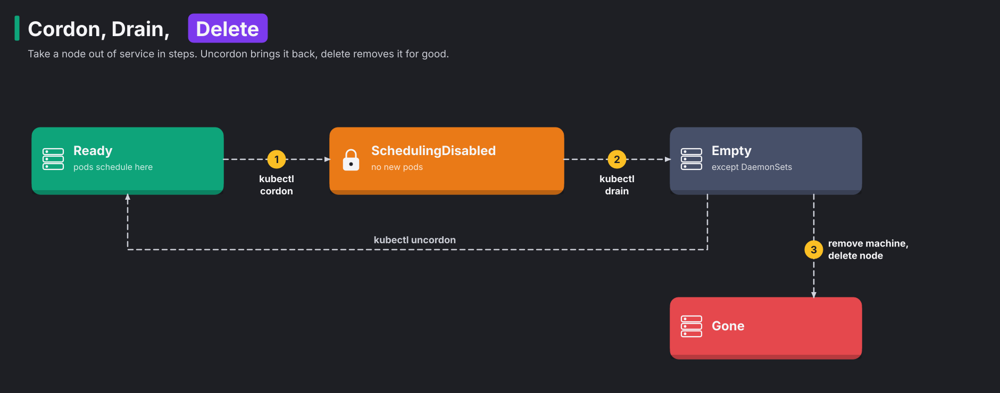

# Module 20: nodes, drains and cleanup

> New to a term here, like VirtualService or waypoint? The [glossary](glossary.md) explains every Istio resource and term in this course.

**Before this module:** module 0 only. This module covers plain Kubernetes operations. The mesh just keeps running underneath.

Day-to-day cluster work isn't glamorous. A node needs a kernel patch, a disk fills up, or a node dies and leaves its leftovers behind. This module walks through that work in four parts:

1. You add a second node to the lab.
2. You drain the node under live traffic.
3. You see how a PodDisruptionBudget protects you, and how it blocks you.
4. You clean up the things that pile up in every cluster: finished Jobs, old ReplicaSets and images.

Time: about 45 minutes. The second node uses about 300 MB of memory while it runs.

## Concept: cordon, drain, delete



To take a node out of service, you go through up to three steps. The diagram shows them from left to right:

1. You cordon the node. Cordoning marks the node unschedulable, so no new pods land there. Nothing moves yet.
2. You drain the node. A drain cordons it, then *evicts* every pod, one by one, through the Eviction API. The pods' controllers, such as Deployments and StatefulSets, create replacements on other nodes.
3. You remove the machine, then delete the Node object. Taking the machine away doesn't delete the Node object on its own.

DaemonSet pods stay on the node during a drain, and the `--ignore-daemonsets` flag says that you accept this. They have to stay, because ztunnel and istio-cni must run on every node. If you want the node back instead of removing it, `kubectl uncordon` makes it schedulable again.

## Concept: PodDisruptionBudgets

Without protection, a drain may evict every replica of an app at once, and the app goes down. A PodDisruptionBudget (PDB) prevents that. A PDB is a rule that says how many pods of an app must stay up. An eviction is polite: before it removes a pod, Kubernetes checks every PDB that selects the pod. `minAvailable: 1` on a two-replica app means "keep at least one pod running". With that budget, the drain works like this:

1. The drain evicts one pod.
2. The drain waits until the replacement pod is ready.
3. The drain evicts the next pod.

A PDB only covers *voluntary* disruptions, such as drains, upgrades, or a cluster autoscaler that removes a node. A node that crashes doesn't ask anyone.

Under the hood, the budget is a number. Think of it as a counter of pods you may take away right now. The disruption controller writes that counter as `status.disruptionsAllowed` on every PDB. It equals the healthy pods minus the pods the budget demands. `kubectl get pdb` shows it as `ALLOWED DISRUPTIONS`. Each eviction goes through these steps:

1. `kubectl drain` asks the API server to evict a pod.
2. While the counter is 0, the API server refuses with `429 Too Many Requests`.
3. `kubectl drain` treats the refusal as "not yet" and waits 5 seconds.
4. `kubectl drain` asks again, until the eviction passes or `--timeout` runs out.

| Budget on the two `web` pods | Healthy pods | Allowed disruptions | The drain |
|---|---|---|---|
| `minAvailable: 1` | 2 | 1 | evicts one pod |
| `minAvailable: 1` | 1, the replacement isn't Ready yet | 0 | retries every 5 seconds |
| `minAvailable: 2` | 2 | 0 | retries until `--timeout`, and forever without it |

Many people believe that a PDB guards your pods against everything. It only guards the Eviction API. Three things ignore it: `kubectl delete pod`, a Deployment's own rolling update, and a crashing node.

## The bigger picture: what fills a cluster up

A cluster that runs for months collects leftovers. They cost disk space, memory in the API server, and your time when you search for the real problem:

| Leftover | Why it stays | The fix |
|---|---|---|
| Finished Jobs and their pods | Kubernetes keeps them so you still have the logs | `ttlSecondsAfterFinished` on the Job, or `successfulJobsHistoryLimit` on a CronJob |
| Old ReplicaSets | every Deployment change creates one, kept for `kubectl rollout undo` | `revisionHistoryLimit` (default 10) |
| Images on nodes | the kubelet keeps them for the next start | the kubelet deletes unused images when disk use passes 85% (`imageGCHighThresholdPercent`). `crictl rmi --prune` does it by hand |
| Failed and evicted pods | they stay for inspection | `kubectl delete pods -A --field-selector=status.phase=Failed` |
| Nodes that no longer exist | removing a machine doesn't remove its Node object | `kubectl delete node` |

Container logs live on the node too. The kubelet rotates them at 10 MB per container by default and keeps 5 files.

## Why this way

**Why does the second node get the lab's images imported?** The lab builds `k8s-lab/backend`, `frontend` and `assistant` locally. It imports them straight into each node, with no registry in between. A new node starts without them, so `k3d image import` copies them over. The same gap bites you in step 6. Pruning removes the images again, and nothing brings them back.

**Why don't pods move back after an uncordon?** Kubernetes only places pods when they start. It never moves running pods to balance load. To spread them again, restart them (`kubectl rollout restart`) or use a tool like the descheduler.

**Why `whenUnsatisfiable: ScheduleAnyway` in the spread constraint?** `DoNotSchedule` would leave pods Pending whenever spreading isn't possible, for example with one node. `ScheduleAnyway` treats spreading as a preference, not a rule. Step 4 shows the cost: sometimes both replicas end up on the same node.

**Why does the mesh need nothing special during a drain?** In ambient mode, ztunnel runs on every node, and the pods carry no proxy of their own. When a pod moves, two things happen:

- istio-cni on the new node gives the pod its traffic rules.
- ztunnel on the old node keeps serving the pods that are still there.

Sidecar mode works too, but every moved pod starts a new Envoy.

## Do it

### 1. Add a node

```bash
k3d node create agent --cluster k8s-lab --role agent --wait
k3d image import k8s-lab/backend:1.0.3 k8s-lab/frontend:1.0.3 k8s-lab/assistant:1.0.3 -c k8s-lab
kubectl get nodes
kubectl -n istio-system get pods -o wide | grep -E "ztunnel|cni"
```

**What you should see.** `k3d-agent-0` joins as `Ready` within seconds. A second ztunnel pod and a second istio-cni pod start on it by themselves, because they're DaemonSets.

### 2. Deploy an app over both nodes

```bash
kubectl apply -f course/manifests/20-ops-app.yaml -f course/manifests/03-course-client.yaml
kubectl -n course-ops rollout status deploy/web
kubectl -n course-ops get pods -o wide
kubectl -n shop exec deploy/course-client -- sh -c 'for i in $(seq 1 20); do curl -s -o /dev/null -w "%{http_code}\n" http://web.course-ops:8000/status/200; done' | sort | uniq -c
kubectl -n istio-system logs -l app=ztunnel --since=1m --prefix | grep 'dst.workload="web' | tail -2
```

**What you should see.** You see one `web` pod per node and 20 times `200`. You also see log lines from the ztunnel pods on both nodes. Traffic to the pod on `k3d-agent-0` arrives through the ztunnel on that node.

### 3. Drain under traffic

In a second terminal, send a request every 0.1 seconds and print anything that isn't a `200`:

```bash
kubectl -n shop exec deploy/course-client -- sh -c 'while true; do c=$(curl -s -o /dev/null -m 3 -w "%{http_code}" http://web.course-ops:8000/status/200); [ "$c" = 200 ] || echo "$(date +%T) $c"; sleep 0.1; done'
```

Back in the first terminal:

```bash
kubectl apply -f course/manifests/20-pdb.yaml
kubectl drain k3d-agent-0 --ignore-daemonsets --delete-emptydir-data
kubectl -n course-ops get pods -o wide
```

**What you should see.** The drain evicts the `web` pod on the agent node in about two seconds. A replacement starts on the server node, and the second terminal prints nothing. In the test run, 348 requests passed during the drain without a single failure.

### 4. Uncordon, and a budget that blocks you

```bash
kubectl uncordon k3d-agent-0
kubectl -n course-ops get pods -o wide            # both pods stay where they are
kubectl -n course-ops rollout restart deploy/web
kubectl -n course-ops rollout status deploy/web
kubectl -n course-ops get pods -o wide            # spread again, maybe both on one node
kubectl apply -f course/manifests/20-pdb-too-strict.yaml
kubectl drain k3d-agent-0 --ignore-daemonsets --delete-emptydir-data --timeout=30s
```

**What you should see.** After the uncordon, nothing moves. After the restart, the pods spread out again. In the test run, both pods landed on the agent node. During the rollout, the old pods still counted, and `ScheduleAnyway` let the scheduler break the spread.

Then the drain repeats `Cannot evict pod as it would violate the pod's disruption budget` until it gives up. The node stays `SchedulingDisabled`. A PDB that demands every replica is a classic reason why node maintenance hangs for hours.

If no `web` pod sits on the agent node after the restart, the drain finishes at once. In that case, restart again until a pod lands there.

Put the sensible budget back:

```bash
kubectl apply -f course/manifests/20-pdb.yaml
```

### 5. Jobs and ReplicaSets that pile up

```bash
kubectl apply -f course/manifests/20-job-ttl.yaml
kubectl -n course-ops get jobs -w          # Complete, then gone after 30 s. Ctrl-C
kubectl get rs -A | awk '$3==0' | wc -l     # ReplicaSets scaled to 0, kept for rollbacks
kubectl get deploy -A -o custom-columns=NAME:.metadata.name,HISTORY:.spec.revisionHistoryLimit | head
```

**What you should see.** The Job disappears 30 seconds after it finishes. Dozens of ReplicaSets sit at 0 replicas, because most Deployments keep the default 10 old versions.

### 6. Images on the node

```bash
docker exec k3d-agent-0 crictl images
docker exec k3d-agent-0 sh -c 'du -sh /var/lib/rancher/k3s/agent/containerd'
docker exec k3d-agent-0 crictl rmi --prune
docker exec k3d-agent-0 crictl images
```

**What you should see.** In the test run, `crictl rmi --prune` cut the agent node from 1.1 GB to 459 MB. Look at what it deleted: `k8s-lab/frontend` and `k8s-lab/assistant`. Nothing on that node ran them, so the prune treated them as unused. Those images came from `k3d image import`, not from a registry. So if a frontend pod now lands on this node, it fails with `ErrImageNeverPull` or `ImagePullBackOff`. Pruning is safe with a registry and risky without one.

### 7. Remove the node

```bash
kubectl drain k3d-agent-0 --ignore-daemonsets --delete-emptydir-data
k3d node delete k3d-agent-0
kubectl get nodes                  # still listed, soon NotReady
kubectl delete node k3d-agent-0
kubectl get nodes
```

**What you should see.** After `k3d node delete`, the machine is gone, but Kubernetes keeps listing the node. After about 40 seconds, the node shows `NotReady`. Only `kubectl delete node` removes it. Cloud providers do this step for you through their cloud controller. On bare metal and in k3d, you do it yourself.

## Investigate

1. You drain a node that runs the only replica of a Deployment, with a PDB of `minAvailable: 1`. What happens?
2. Why does `kubectl drain` ignore DaemonSet pods instead of evicting them?
3. A node shows `DiskPressure`, and the kubelet starts evicting pods. What would you check first, in what order?
4. Your teammate sets `revisionHistoryLimit: 0` on every Deployment to keep things tidy. What do they lose?

<details>
<summary>Answers</summary>

1. The drain hangs, as in step 4. Evicting the only pod would break the budget, and the replacement only starts once the old pod goes. Scale to two replicas first. Otherwise the budget blocks every drain of that node. Many teams use `maxUnavailable: 1` instead of `minAvailable` to avoid this trap with single replicas.
2. A cordon doesn't stop DaemonSets. So the DaemonSet controller would put the evicted pods straight back on the same node. DaemonSet pods also tend to be node-level plumbing, like ztunnel, istio-cni and log shippers. The node needs them until the very end.
3. Check in this order:
   1. Run `kubectl describe node` to see the condition and the eviction events.
   2. On the node, check the container images (`crictl images`, then prune).
   3. Check the container logs (`/var/log/pods`).
   4. Check the emptyDir volumes of running pods.

   Images and logs are the usual suspects.
4. They lose `kubectl rollout undo`. With no old ReplicaSets, Kubernetes has nothing to roll back to. In a GitOps setup like this lab, you'd roll back by reverting the commit instead. So some teams accept that trade.

</details>

## Clean up

```bash
./course/reset.sh
```

This deletes the `course-ops` namespace and, if it still exists, drains and removes the agent node.
