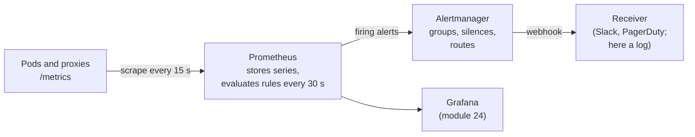

# Module 23: Prometheus and alerting

> New to a term here, like recording rule or burn rate? The [glossary](glossary.md) explains every term in this course.

**Before this module:** module 0, and module 6 helps. You need `./scripts/port-forward.sh` running for Prometheus (http://localhost:9090) and Alertmanager (http://localhost:9093).

Module 6 used Prometheus to look at things. Production uses it to *wake people up*, and that's a different skill: you decide what counts as broken, write it as a query, and route the alert to the person who fixes it. This module goes from raw PromQL to a service-level objective (SLO) with a burn-rate alert, the approach Google's SRE books describe and most SRE interviews ask about. Then you break the backend, get paged, fix it, and watch the alert clear.

Time: about 60 minutes.

## Concept: from scrape to page



Prometheus only *decides* that something is wrong. Alertmanager decides *who hears about it, and how often*: it groups ten alerts from one outage into one message, holds back repeats, and drops alerts during a planned silence.

## Concept: four things PromQL does

| You want | PromQL | Why |
|---|---|---|
| A counter's per-second speed | `rate(x_total[1m])` | Counters only go up. Their raw value means nothing; how fast they grow does. |
| One number per group | `sum by (response_code) (...)` | Every distinct label set is its own series. `sum by` adds them up and keeps only the labels you name. |
| A percentile | `histogram_quantile(0.95, sum by (le) (rate(x_bucket[5m])))` | A histogram counts requests into buckets (`le` = "less than or equal"). The function estimates the value 95% of requests stay under. |
| A ratio | `sum(rate(errors[5m])) / sum(rate(all[5m]))` | Error rate in percent, the basis of most SLOs. |

## Concept: SLOs, error budgets and burn rate

An **SLO** sets a target for what users experience: "99% of backend requests succeed". The missing 1% is the **error budget**. You're *allowed* to fail that much, which takes the panic out of single errors and gives teams room to ship.

**Burn rate** says how fast you're spending the budget. At a burn rate of 1, you use exactly the whole budget over the SLO period. At 14.4, a 30-day budget would last about two days, and a 1-hour window at that rate spends 2% of a month's budget. That's the classic threshold for paging someone.

| Alert rule | What happens |
|---|---|
| Error ratio above 1%, right now | Pages on every blip. People learn to ignore it. |
| Error ratio over 5 min above 14.4% | Pages on real trouble, but keeps paging minutes after the fix, because the 5-minute window still remembers the errors. |
| Error ratio over 5 min **and** over 1 min above 14.4% | Pages on real trouble, and clears soon after the fix. The long window proves it's serious, the short one that it's still happening. |

Production uses windows of 1 hour and 5 minutes for this fast-burn alert, plus a slower ticket-level alert (burn rate 6 over 6 hours, for example). The lab shrinks the windows to 5 minutes and 1 minute, so you see the whole cycle in a few minutes.

## The bigger picture: alert on symptoms

Old monitoring alerted on causes: CPU above 90%, disk above 80%, a pod restarted. Most of those alerts fire when users notice nothing, and many real outages trip none of them. Teams drowned in noise and missed the incidents that mattered.

The SRE approach alerts on **symptoms**, on what users feel: errors and latency, measured as close to the user as possible, compared with an SLO. Causes still belong on dashboards, where you look *after* the page. In this lab, the waypoint's `istio_requests_total` measures exactly that symptom for every backend request, without any code in the backend.

## Why this way

**Why recording rules for the error ratio?** The alert, the dashboard in module 24 and anyone debugging all want the same ratio. A recording rule computes it once every 30 seconds and stores it as a cheap new series, `shop:backend_error_ratio:rate5m`. The name follows the convention `level:metric:operation`.

**Why `for: 1m` on the alert?** The condition must hold for a minute before the alert fires. It filters out a single bad evaluation. The cost is a minute of delay; the test run measured it.

**Why an AlertmanagerConfig instead of editing Alertmanager's config file?** The Prometheus operator merges every AlertmanagerConfig into Alertmanager's configuration. Each team keeps its own route and receiver in its own namespace, next to its app, without touching a shared file. The lab tells the operator not to add a namespace matcher to these routes (`alertmanagerConfigMatcherStrategy: None`), so the route from `course-alerts` sees alerts about `shop`.

**Why does the waypoint measure the SLO and not the backend?** The waypoint sees every request to the backend, with the response code, and labels it with the caller's and the backend's identity. No library, no code change, the same metric for every service in the mesh.

## Do it

### 1. Read a counter

In Prometheus (http://localhost:9090), run:

```text
istio_requests_total{reporter="waypoint", destination_canonical_service="backend"}
```

**What you should see.** One line per distinct label set: response code, source workload, destination workload and about 30 more labels. The value is a counter, the total number of requests since the waypoint started, like `1903`. On its own that number tells you nothing.

### 2. Turn counters into answers

Start some traffic in a second terminal, `./course/load.sh 300`, then run these one by one:

```text
rate(istio_requests_total{reporter="waypoint", destination_canonical_service="backend"}[1m])
sum by (response_code) (rate(istio_requests_total{reporter="waypoint", destination_canonical_service="backend"}[1m]))
histogram_quantile(0.95, sum by (le) (rate(istio_request_duration_milliseconds_bucket{reporter="waypoint", destination_canonical_service="backend"}[5m])))
```

**What you should see.** The first query gives requests per second for each series, about `4.9` for the `200` series with `load.sh` at 5 per second. The second collapses everything into one line per status code. The third gives the backend's 95th-percentile latency in milliseconds: `18.5` in the test run.

### 3. Add the SLO rules and a receiver

```bash
cat course/manifests/23-shop-slo.yaml
kubectl apply -f course/manifests/23-alert-receiver.yaml -f course/manifests/23-shop-slo.yaml
kubectl -n course-alerts rollout status deploy/alert-receiver
```

Then open http://localhost:9090/rules and http://localhost:9093/#/status.

**What you should see.** Within about 75 seconds, Prometheus lists two groups, `shop-slo-recording` and `shop-slo-alerts`. Alertmanager's config shows a new route, `course-alerts/shop-pager/pager`, for alerts with `severity="page"`, next to the chart's default `null` receiver. In Prometheus, query `shop:backend_error_ratio:rate5m`: a value of `0`, since nothing fails.

### 4. Break it, get paged

Add module 15's faulty backend pod, which fails every request, and keep traffic flowing:

```bash
kubectl apply -f course/manifests/15-faulty-pod.yaml
./course/load.sh 600 &
```

Watch http://localhost:9090/alerts, and the receiver:

```bash
kubectl -n course-alerts logs deploy/alert-receiver -f | grep -o '"status":"[a-z]*"\|"alertname":"[A-Za-z]*"'
```

**What you should see.** In the test run:

| Time after the fault | Alert state | 5m error ratio |
|---|---|---|
| 0 s | inactive | 0 |
| 61 s | **pending** | 32.6% |
| 121 s | **firing** | 31.9% |

One pod in three fails, so about a third of requests fail: 33 times the budget. The alert sat in `pending` for one minute (`for: 1m`), then fired, and the receiver logged `"status":"firing"` with `"alertname":"ShopBackendErrorBudgetBurn"`. That webhook is what Slack or PagerDuty would get.

### 5. Fix it, and watch it clear

```bash
kubectl delete -f course/manifests/15-faulty-pod.yaml
```

Keep the receiver's log open, and query `shop:backend_error_ratio:rate5m` in Prometheus every half minute.

**What you should see.** In the test run, the alert cleared **60 seconds** after the fix, while the 5-minute ratio still read 26.5%. The 1-minute window had dropped below the threshold, and the `and` needs both. The 5-minute ratio alone took **201 seconds** to fall below 14.4%: a single-window alert would have kept paging for more than three minutes after the problem was gone. The receiver then logged `"status":"resolved"`, because the route sets `sendResolved: true`.

Stop the load with `kill %1`.

### 6. Count what you store

Run in Prometheus:

```text
count({__name__=~".+"})
topk(6, count by (__name__) ({__name__=~".+"}))
count(istio_request_duration_milliseconds_bucket)
```

**What you should see.** About 136,000 series in total in the test run. The six biggest metrics all come from the Kubernetes API server and etcd, histograms with many buckets times many resource types: `apiserver_request_duration_seconds_bucket` alone had 21,600 series. The whole shop's latency histogram had 240. On a single-node lab the API server's own metrics make up most of what Prometheus stores.

Also note: query `istio_requests_total{destination_workload="backend-v1-faulty"}` right after step 5, and the faulty pod's series is still there. A series stays until Prometheus marks it stale, about 5 minutes after the last scrape that included it.

## Investigate

1. A deploy goes out every Tuesday at 10:00 and causes 30 seconds of errors. With `for: 1m`, does the alert fire? What would you change if the team wants to know about it anyway, but not at 3 a.m.?
2. Your SLO alert never fired in six months. Is that good news? How would you find out whether the alert works at all?
3. A developer adds a `user_id` label to a request counter. The service has 2 million users. What happens to Prometheus, and what should the label be instead?
4. During a planned database migration, you expect the backend's error rate to spike. How do you stop the page without deleting the rule?

<details>
<summary>Answers</summary>

1. Probably not: the condition must hold for a full minute, and 30 seconds of errors lifts the 5-minute ratio only briefly. If the team wants to see it, add a slow-burn alert with `severity: ticket`, routed to a ticket queue or a chat channel rather than a pager, over longer windows. The error budget then shows the true cost of those Tuesday deploys over a month.
2. Not necessarily. Test the alert path on purpose, the way step 4 did, in staging or with a game day. Also keep a "dead man's switch": the chart's `Watchdog` alert always fires, and an outside service pages you if it *stops* arriving, which catches a dead Prometheus or Alertmanager. And add `absent()` checks for the metrics your SLO depends on, so a renamed metric doesn't silently turn the ratio into nothing.
3. Every distinct label value creates a new series, multiplied by every other label. Two million users times the existing combinations means tens of millions of series: Prometheus runs out of memory, and queries slow to a crawl. Per-user detail belongs in logs and traces, which handle high cardinality. In metrics, use a bounded label like `plan="free"|"pro"`, or none.
4. Create a **silence** in Alertmanager (http://localhost:9093, "New Silence", or `amtool silence add`) that matches `alertname=ShopBackendErrorBudgetBurn` for the migration window. Prometheus keeps evaluating the rule and the alert still fires, but Alertmanager drops the notifications until the silence ends. Afterwards the alert pages again on its own, which a disabled rule wouldn't.

</details>

## Clean up

```bash
./course/reset.sh
```

This deletes the `course-alerts` namespace, and with it the receiver, the AlertmanagerConfig and the SLO rules, plus module 15's faulty pod if it's still there. Alertmanager itself stays: it's part of the lab now.
