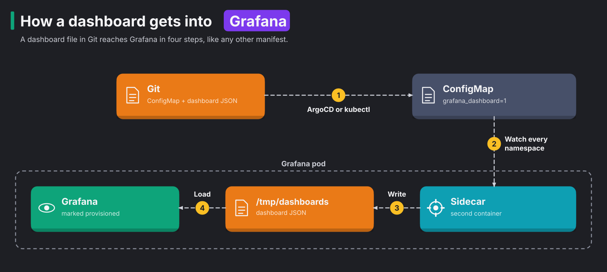

# Module 24: Grafana as code

> New to a term here, like provisioned dashboard or contact point? The [glossary](glossary.md) explains every term in this course.

**Before this module:** module 23 for the SLO ideas, and module 22 helps.

**You need:** the lab running (`./scripts/start.sh` starts or repairs it), and `./scripts/port-forward.sh` running in a spare terminal for Grafana (http://localhost:3000, `admin` / `k8s-lab-admin`).

Most teams start with Grafana by clicking. They add a panel here and a dashboard there, and Grafana saves them in its own database. A year later, three things have gone wrong:

- Nobody knows which of the 200 dashboards still work.
- A Grafana upgrade loses half of them.
- Every environment looks different.

This module does it the way platform teams do it. Dashboards live as files in Git, and they reach the cluster like any other manifest. In this module you:

1. build an SLO dashboard with variables
2. find out why Grafana refuses to save it
3. compare Grafana's own alerting with Prometheus' alerting
4. follow one request from a trace to its log lines

Time: about 45 minutes.

## Concept: how a dashboard gets into Grafana



A dashboard file in Git reaches Grafana in four steps, and the diagram follows the same path:

1. ArgoCD or kubectl applies a ConfigMap that holds the dashboard JSON and the label `grafana_dashboard: "1"`.
2. A sidecar, a small second container in the Grafana pod, watches every namespace for ConfigMaps with that label.
3. The sidecar writes the JSON from each ConfigMap into the folder `/tmp/dashboards`.
4. Grafana loads that folder. Dashboards loaded this way are called **provisioned** dashboards.

Delete the ConfigMap, and the dashboard disappears. The lab's own "Shop mesh and traffic experiments" dashboard arrives this way, from `manifests/observability/grafana-dashboard.yaml` through ArgoCD.

## Concept: what a dashboard is made of

| Piece | What it does | In this module |
|---|---|---|
| **Panel** | One visualisation: a time series, a single big number (stat), a table, logs | availability, burn rate, requests per second, latency |
| **Query** | What the panel asks a data source, here PromQL | the error ratio from module 23 |
| **Variable** | A dropdown at the top. Panels use it as `$name`, so one dashboard serves many services | `$service` and `$window` |
| **Threshold** | Colours a value: green below a number, red above it | red below 99% availability, red above burn rate 14.4 |

A dashboard is only JSON. Export any dashboard from the UI (Share, Export) and you get the same format the ConfigMap holds.

## The bigger picture: two places to alert from

Grafana also sends alerts, so you have two places to alert from. Grafana's alerting engine queries data sources on a schedule, much like Prometheus evaluates rules. It sends notifications through **contact points**, which say where a message goes, like Alertmanager's receivers. **Notification policies** decide which alert goes to which contact point, like Alertmanager's routes.

| | Prometheus rules + Alertmanager (module 23) | Grafana-managed alerts |
|---|---|---|
| Where the rule runs | Inside Prometheus, next to the data | In Grafana, which queries the data source |
| Data sources | Prometheus only | Prometheus, Loki, SQL databases, cloud monitoring, anything Grafana reads |
| Keeps working when Grafana is down | yes | no |
| Lives as code | PrometheusRule resources | provisioning files or the provisioning API, Terraform |

Many teams split the work like this:

- Alert on metrics in Prometheus. The rule runs next to the data and keeps working when Grafana breaks.
- Use Grafana alerting when the condition needs logs or a data source other than Prometheus.

Whichever you choose, check where the notification actually goes. Step 4 shows why.

## Why this way

**Why a ConfigMap instead of the Grafana API or Terraform?** In this lab, everything else is a Kubernetes manifest that ArgoCD delivers. So dashboards follow the same path, and people review them in the same pull requests. The Grafana Terraform provider and the Grafana Operator are the other common choices. Both keep dashboards in Git too.

**Why does Grafana refuse to save a provisioned dashboard?** Your change would not last. The next sync would silently overwrite it with the file. So Grafana says no up front. To change the dashboard, you edit the JSON in Git. To experiment, you use "Save as" to make a copy, then export it and put it in Git.

**Why variables for the service and the window?** Without them, every service needs its own copy of the dashboard, and the copies drift apart. `$window` also lets you see the module 23 lesson for yourself. The 1-minute burn rate reacts fast and is noisy. The 30-minute burn rate reacts slowly.

**Why `or vector(0)` in the availability query?** Without it, a healthy service looks like a dead one. With no 5xx responses at all, the error part of the query returns no data. Then the whole division returns nothing, and the panel shows "no traffic" while traffic flows fine. `or vector(0)` turns "no errors" into a real zero.

## Do it

### 1. Look at the dashboard as code

```bash
less course/manifests/24-slo-dashboard.yaml
kubectl apply -f course/manifests/24-slo-dashboard.yaml
```

Open Grafana, Dashboards, and find **Shop SLO**.

**What you should see.** The ConfigMap holds the whole dashboard as JSON. The `templating` section holds the two variables. The `panels` section holds the panels with their queries and thresholds. Grafana shows the dashboard within a few seconds. In the test run, the sidecar had loaded it before the next command ran. With no traffic, the stat panels read "no traffic".

### Concept: what happens when a panel draws

Grafana stores no metrics. Each time the dashboard loads or refreshes, Grafana works through these steps:

1. It fills the variable dropdowns. For `$service`, it asks Prometheus for every value of one label, with `label_values(istio_requests_total{...}, destination_canonical_service)`. `$window` is a fixed list, `1m,5m,30m`, so it needs no query.
2. It replaces `$service` and `$window` in each panel's PromQL with plain text. `[$window]` becomes `[5m]` before Prometheus ever sees it.
3. It sends each panel's query to Prometheus, with the dashboard's time range and a step. The step is the gap between two points on the graph.
4. It draws what comes back. A stat panel reduces each series to one number, here the last value (`lastNotNull`). Then it colours that number with the thresholds. When the query returns nothing, the panel shows its `noValue` text, "no traffic".

So switching `Window` only sends new queries, and nothing changes in Prometheus. When a panel looks wrong, check its query in Prometheus directly. Open the panel's Inspect menu and the Query view, which shows the query with the variables filled in. Copy it and run it in Prometheus. The numbers there are the truth.

Grafana also offers a built-in variable, `$__rate_interval`. It picks a safe range for `rate()` from the scrape interval. This dashboard uses its own `$window` instead, so you choose the window and see the module 23 trade-off.

### 2. Feed it traffic, then break the backend

```bash
./course/load.sh 300 &
```

Wait a minute, then look at the dashboard. Then:

```bash
kubectl apply -f course/manifests/15-faulty-pod.yaml
```

Switch `Window` between `1m`, `5m` and `30m` while the fault runs.

**What you should see.** While the backend is healthy, the panels show:

- availability 100%, in green
- burn rate 0
- about 5 requests per second
- a p95 latency around 15 to 20 ms

With the faulty pod, the test run showed 89.7% availability and a burn rate of 10.3 over 5 minutes, still climbing. The 503 responses appear as their own line in the status-code panel. The `1m` window jumps first, and `30m` barely moves. Remove the fault and keep the load running:

```bash
kubectl delete -f course/manifests/15-faulty-pod.yaml
```

### 3. Try to change it in the UI

Edit any panel, change its title, and click Save.

**What you should see.** Grafana refuses with "Cannot save provisioned dashboard". The API gives the same answer, and the module's check uses the API. Use "Save as" if you'd like a copy to play with. The copy lives only in Grafana's database, and nobody else gets it.

### 4. A Grafana-managed alert

```bash
cat course/manifests/24-grafana-rule.json
P=k8s-lab-admin
curl -s -u admin:$P -H 'Content-Type: application/json' -X POST localhost:3000/api/folders -d '{"uid":"course","title":"Course"}'
curl -s -u admin:$P -H 'Content-Type: application/json' -X POST localhost:3000/api/v1/provisioning/alert-rules -d @course/manifests/24-grafana-rule.json
```

The rule has the same condition as module 23's, but with one 5-minute window only. Open Alerting, Alert rules in Grafana and watch it for a few minutes. Then open Alerting, Contact points.

**What you should see.** This step shows two problems. The first is a late alert. In the test run, the faulty pod from step 2 had been gone for about four minutes when the rule appeared. Even so, the rule went `pending`, then `firing` 20 seconds later, and stayed firing for about three minutes. It paged about a problem that was already fixed, because the 5-minute window still held the old errors. Module 23's two-window rule doesn't do that.

The second problem is that the alert reaches nobody. Contact points shows the default, `grafana-default-email`, which sends to `example@email.com`. The lab has no mail server. Every minute, Grafana's log says `Sending alerts to local notifier`, and the alert goes nowhere. Out of the box, Grafana alerting looks like it works, but it reaches nobody.

### Concept: how the trace-to-logs links work

Step 5 jumps from a trace to the log lines of the same request, and back. Jaeger stores the traces and Loki stores the logs, but they know nothing about each other. Grafana builds both links from text templates in the data source settings, in `helm/kube-prometheus-stack-values.yaml`:

| Direction | Setting | What it does |
|---|---|---|
| trace to logs | `tracesToLogsV2` on the Jaeger data source | fills the span's trace id into the Loki query `{namespace="shop"} \|= "<trace id>"`, over the span's time plus and minus 5 minutes |
| logs to trace | `derivedFields` on the Loki data source | runs the regex `"trace_id":"(\w+)"` over each log line and turns the match into a link to the Jaeger data source |

Both links depend on one thing outside Grafana. The backend writes the current trace id into every log line it prints during a request. An app that doesn't log its trace id gets a "Logs for this span" button that finds nothing.

### 5. From a trace to its logs

Follow these steps:

1. Send a request with `curl -s localhost:8080/api/orders`.
2. In Grafana, open Explore and pick the **Jaeger** data source.
3. Search for the service `backend`, and open the newest trace.
4. Click a `backend` span, then **Logs for this span**.

**What you should see.** Grafana switches to Loki with the query `{namespace="shop"} |= "<trace id>"`. It shows the backend's log line for that request, with the same `trace_id` in its JSON. In a Loki result, the `trace_id` field has an **Open trace in Jaeger** link that goes back the other way.

These two links broke earlier in the course's life. The data source settings had `${__trace.traceId}`. Grafana's provisioning reads `${...}` as an environment variable, so it replaced the templates with empty strings. The fix in `helm/kube-prometheus-stack-values.yaml` writes `$${...}`, which provisioning turns into a literal `${...}`.

## Investigate

1. A teammate built a great dashboard by clicking in Grafana and asks you to "add it to Git". What are the steps, and what changes about how they work with it afterwards?
2. Your dashboard has a `$namespace` variable with 300 values, and it loads slowly. What makes it slow, and how would you fix it?
3. The team wants an alert when the backend logs more than 10 `ERROR` lines per minute. Prometheus rule or Grafana-managed rule, and why?
4. After step 4, how would you make sure Grafana's alerts actually reach the module 23 receiver?

<details>
<summary>Answers</summary>

1. Follow these steps:
   1. Export the dashboard as JSON with Share, Export. Turn "Export for sharing externally" off, so data source references stay as uids.
   2. Put the JSON in a ConfigMap with the `grafana_dashboard: "1"` label.
   3. Commit it, and let ArgoCD deliver it.
   4. Delete the clicked original. Otherwise two copies with the same title confuse everyone.

   From then on, changes go through Git. Your teammate uses "Save as" for experiments, then exports and commits the result. Some teams keep a "scratch" folder in Grafana. Clicking is fine there, and nobody relies on anything in it.
2. Every variable value comes from a query. When you use "repeat" or "All", the panels also run once per selected value. A variable query like `label_values(namespace)` looks at every metric, so it scans a lot of series. Three changes help:
   - Narrow the query to one metric and a filter, as `$service` does with `istio_requests_total{reporter="waypoint", ...}`.
   - Refresh the variable on dashboard load rather than on every time range change.
   - Avoid "All" on variables with many values.
3. Use a Grafana-managed rule. The condition needs Loki, and Prometheus doesn't read Loki. Use a query like `sum(count_over_time({namespace="shop", app="backend"} |= "ERROR" [1m]))` with a threshold of 10. Loki also has its own ruler. The ruler evaluates LogQL rules and sends the alerts to Alertmanager, the same pattern as module 23. That option keeps working when Grafana is down.
4. There are two options.
   - Add a contact point of type webhook that points at `http://alert-receiver.course-alerts.svc.cluster.local:8080/`. Then route `severity=page` to it in the notification policy.
   - Send Grafana-managed alerts to the lab's Alertmanager. The Alertmanager data source has a setting to receive Grafana's alerts. Then module 23's routes handle both kinds in one place.

   Either way, test it the way module 23 did. Break something and wait for the message.

</details>

## Clean up

```bash
kill %1 2>/dev/null
./course/reset.sh
```

This deletes the `course-dashboards` namespace, and with it the dashboard. It also deletes the Grafana-managed rule and the `Course` folder, which live only in Grafana's database.
