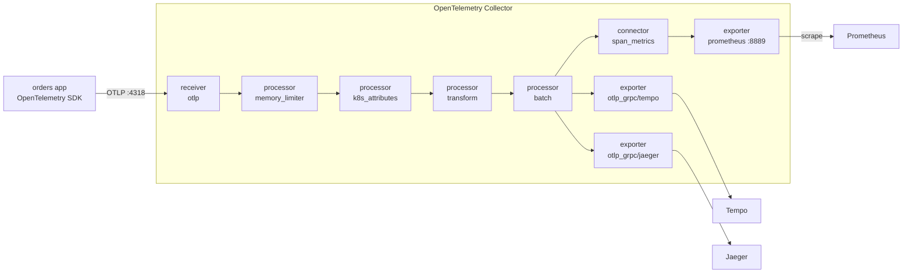

# Module 25: OpenTelemetry Collector and Grafana Tempo

> New to a term here, like span or OTLP? The [glossary](glossary.md) explains every term in this course.

**Before this module:** module 0. Module 6 helps, because it explains traces and spans. No Istio needed: this module runs its own app outside the mesh.

In the lab so far, every app sends its traces straight to Jaeger. That works until you have 50 services, three tracing back ends, and a security team that wants every trace scrubbed of customer data. Then you want one place in the middle that receives all telemetry, cleans it, adds context, and sends it wherever it needs to go. That place is the **OpenTelemetry Collector**, and it's become the standard way to run telemetry in Kubernetes. This module installs one, puts **Grafana Tempo** behind it as the trace store, and has you query traces with **TraceQL**.

Time: about 50 minutes. Adds about 250 MB of memory while it runs.

## Concept: the Collector pipeline



Everything in the Collector is one of four kinds of component, wired together in **pipelines**:

| Kind | Job | Here |
|---|---|---|
| Receiver | Takes data in | `otlp`: the OpenTelemetry protocol, on gRPC 4317 and HTTP 4318 |
| Processor | Changes data on the way | protect memory, add Kubernetes labels, fix the service name, batch |
| Exporter | Sends data out | to Tempo, to Jaeger, and a `/metrics` page for Prometheus |
| Connector | Ends one pipeline and starts another | `span_metrics`: reads traces, writes metrics |

**OTLP** is the protocol every OpenTelemetry SDK speaks. Because the app only knows "send OTLP to this address", you swap or add back ends in the Collector without touching a single app.

## Concept: Tempo and TraceQL

Tempo stores traces cheaply: it doesn't index every attribute, it writes traces to object storage (here a local folder) and scans them when you search. You search with **TraceQL**, which selects spans the way PromQL selects series:

| TraceQL | Finds |
|---|---|
| `{ resource.service.name = "orders" }` | every trace with a span from `orders` |
| `{ ... && span.http.status_code >= 500 }` | traces where a span failed |
| `{ ... && duration > 400ms }` | traces with a slow span |
| `{ resource.service.name = "orders" } >> { span.db.system = "redis" }` | `orders` spans that have a Redis span somewhere below them |

`resource.` attributes describe who sent the span (service, pod, node). `span.` attributes describe the operation (HTTP status, database statement).

## The bigger picture: why everyone moved to OpenTelemetry

A few years ago, each tracing vendor shipped its own agent and library: switching from one to another meant changing every app. OpenTelemetry, a CNCF project, gave the industry one set of SDKs, one protocol and one Collector, and nearly every vendor and open-source back end now accepts OTLP. Teams instrument once and choose back ends freely. The Collector then does platform work that used to live in each app: sampling, dropping sensitive attributes, routing by tenant, and turning traces into metrics.

Grafana's open-source stack builds on it: Tempo for traces, Loki for logs, Prometheus or Mimir for metrics, Pyroscope for profiles (module 28), all linked in Grafana. Job adverts for platform and observability roles ask for OpenTelemetry more often each year.

## Why this way

**Why the Collector as a Deployment, not a DaemonSet?** A single "gateway" Deployment is the simplest setup and enough for one cluster. Large clusters often add a DaemonSet ("agent" mode) on every node, which collects node-local data and forwards it to gateway Collectors. Same component, two placements.

**Why the contrib image?** The core Collector image has only the basic components. `k8s_attributes`, `transform` and `span_metrics` live in the `contrib` build. Production teams often build their own image with exactly the components they use, with the OpenTelemetry Collector Builder.

**Why `memory_limiter` first?** If a back end goes down, data piles up in the Collector. The memory limiter starts refusing data before the pod runs out of memory, so the Collector survives an outage instead of crashing in the middle of it.

**Why rename the service in the Collector?** The orders app is the shop's backend image, and its code hard-codes `service.name = "backend"`, ignoring the usual `OTEL_SERVICE_NAME` setting. You'll meet apps like that everywhere. Fixing names centrally, here from the Kubernetes Deployment name, beats chasing every team to change code.

**Why keep sending to Jaeger too?** Moving between back ends is a migration, and a Collector lets you run old and new side by side, compare them, then switch off the old one. That's exactly how teams move from Jaeger to Tempo.

## Do it

### 1. Install Tempo

Install the back ends first, then the apps that send to them. In the test run, an app started before its Collector existed took about two and a half minutes to deliver its first trace: its exporter failed, then waited longer and longer between retries. In this order, the first trace was searchable 22 seconds after the app started.

```bash
helm repo add grafana https://grafana.github.io/helm-charts && helm repo update grafana
cat course/manifests/25-tempo-values.yaml
helm install tempo grafana/tempo --version 1.24.4 -n course-otel --create-namespace \
  -f course/manifests/25-tempo-values.yaml --wait
```

**What you should see.** `STATUS: deployed` after about 50 seconds, and a `tempo-0` pod. Tempo listens for OTLP on 4317 and 4318 and answers queries on 3200. Its memory limit is 768 MiB: in the test run, 384 MiB got Tempo OOM-killed three times in a row by one structural query from step 5.

### 2. Install the Collector

```bash
helm repo add open-telemetry https://open-telemetry.github.io/opentelemetry-helm-charts && helm repo update open-telemetry
cat course/manifests/25-collector-values.yaml
helm install otel-collector open-telemetry/opentelemetry-collector --version 0.178.0 -n course-otel \
  -f course/manifests/25-collector-values.yaml --wait
kubectl -n course-otel logs deploy/otel-collector | grep "Everything is ready"
kubectl get clusterrole otel-collector
```

**What you should see.** The install takes seconds, and the log ends with `Everything is ready. Begin running and processing data.` Read the values file top to bottom: the receivers, processors, connector and exporters from the diagram, and the two pipelines at the end that wire them. The `kubernetesAttributes` preset also created a **ClusterRole**, so the Collector may read pod metadata cluster-wide.

This chart version renamed some components. With the older names `otlp`, `k8sattributes` and `spanmetrics`, it still installs, but prints `[DEPRECATION]` warnings and rewrites them. The values file already uses the new names: `otlp_grpc`, `k8s_attributes`, `span_metrics`.

### 3. Deploy an app that sends traces to the Collector

```bash
kubectl apply -f course/manifests/25-orders-app.yaml
kubectl -n course-otel get pods
grep -B2 -A1 OTEL_EXPORTER course/manifests/25-orders-app.yaml
```

**What you should see.** `orders` (the shop's backend image), `redis` and a `traffic` pod that sends a few requests every second. The app's only tracing setting is `OTEL_EXPORTER_OTLP_ENDPOINT`, the Collector's address.

### Concept: how the Collector knows which pod sent a span

The SDK in the app sends spans with a few resource attributes, such as `service.name`, and no Kubernetes context. The `k8s_attributes` processor adds it in two halves:

1. In the background, it watches pods through the API server and keeps a table from pod IP to pod name, namespace, node, Deployment and image. That watch is why the chart created a ClusterRole.
2. For each incoming batch, it takes the source IP of the network connection, looks it up in the table, and adds the matching attributes.

Order in the pipeline matters. `memory_limiter` goes first, so it refuses data before anything else spends memory on it. `k8s_attributes` must come before `batch`, because a batch mixes data from many connections, and the source IP gets lost. A common mistake in bigger setups: a node agent forwards data to a gateway Collector, and the gateway then sees only the agent's IP. There, the agent adds the attributes, or passes the pod IP along as an attribute.

### 4. See what the Collector added

```bash
kubectl -n course-otel port-forward svc/tempo 3200:3200 >/dev/null 2>&1 &
sleep 30      # the first trace took 22 seconds in the test run
curl -s "localhost:3200/api/search/tag/service.name/values"; echo
curl -s "localhost:3200/api/search/tags?scope=resource"; echo
```

**What you should see.** The service is `orders`, not `backend`: the `transform` processor renamed it. And the resource attributes include `k8s.deployment.name`, `k8s.namespace.name`, `k8s.node.name`, `k8s.pod.name` and `container.image.name`: the app never sent those. `k8s_attributes` looked up the sending pod by its IP and added them. Every trace now tells you exactly which pod, image and node produced it.

### Concept: how spans join into one trace

Every span carries three ids: the **trace id**, shared by all spans of one request, its own **span id**, and the **parent span id** of the span that caused it. Nobody sends a finished trace anywhere. Each process sends its own spans, and the back end groups them by trace id and rebuilds the tree from the parent ids.

The ids travel in two ways:

| Where | How the parent gets passed on |
|---|---|
| inside one process | The SDK keeps the current span in a context object. When `orders` calls Redis through an instrumented client, the Redis span takes the current span as its parent. |
| across the network | The SDK writes a W3C `traceparent` header into the outgoing request: `00-<trace id>-<parent span id>-<flags>`. The receiving service's SDK reads it and continues the same trace. |

This is **context propagation**. If any hop drops the header, for example a proxy that strips unknown headers or a service without instrumentation, the trace splits into two unrelated traces. TraceQL's `>>` in step 5 works only because the parent ids are there: it walks the tree from the `orders` span down to its Redis span.

### 5. Query with TraceQL

Open Grafana (http://localhost:3000), Explore, data source **Tempo**, switch the query type to **TraceQL**, and run one at a time:

```text
{ resource.service.name = "orders" && span.http.status_code >= 500 }
{ resource.service.name = "orders" && duration > 400ms }
{ resource.service.name = "orders" } >> { span.db.system = "redis" }
```

**What you should see.** The first finds failed requests: the app fails 5% of `/api/` requests on purpose. The second finds `GET /api/slow` traces of 450 to 600 ms in the test run. The third finds `GET` and `POST /api/orders`, the requests that called Redis. Open one: Grafana draws the span tree, and the button **Logs for this span** opens the matching lines in Loki, by trace id.

Note `http.status_code`: this app uses the older attribute name. Newer OpenTelemetry semantic conventions call it `http.response.status_code`. When a query finds nothing, check the attribute names on a real span first.

### 6. Metrics from spans

Prometheus scrapes the `span_metrics` connector's output. Apply the PodMonitor and the Grafana data source if you haven't yet, then wait a few minutes: a new PodMonitor reaches Prometheus through a Secret update, which took up to four minutes in the test runs.

```bash
kubectl apply -f course/manifests/25-collector-podmonitor.yaml -f course/manifests/25-tempo-datasource.yaml
```

In Grafana Explore, Prometheus:

```text
sum by (span_name, http_status_code) (rate(traces_span_metrics_calls_total{service_name="orders", span_kind="SPAN_KIND_SERVER"}[2m]))
histogram_quantile(0.95, sum by (le, span_name) (rate(traces_span_metrics_duration_milliseconds_bucket{service_name="orders", span_kind="SPAN_KIND_SERVER"}[5m])))
```

**What you should see.** About 1.2 requests per second per endpoint with `200` or `201`, and about 5% of that with `503`: in the test run, `GET /api/orders` showed 1.15 per second `200` and 0.09 `503`. The p95 for `GET /api/slow` sat around 860 ms. These are RED metrics (rate, errors, duration) for an app that exports no metrics of its own.

### 7. The same traces in Jaeger

Open Jaeger (http://localhost:16686) and pick the service `orders`.

**What you should see.** The same traces as in Tempo. One Collector, two back ends, no change in the app.

## Investigate

1. Your security team says traces must never contain the `db.statement` attribute, because it may hold customer data. Where do you remove it, and why there?
2. Tempo goes down for ten minutes. What happens to the traces the app sends during that time, in this setup?
3. You have 200 services and want only 10% of traces, but every trace with an error. Why is that hard to do in the app's SDK, and where would you do it?
4. Why does `span_metrics` give you request rates for `orders`, while Istio's `istio_requests_total` (module 6) doesn't know about `orders` at all?

<details>
<summary>Answers</summary>

1. In the Collector, with a processor such as `attributes` (action `delete` on `db.statement`) or a `transform` statement, placed before the exporters. One change covers every app and every back end at once, and nobody depends on 200 teams remembering to configure their SDKs.
2. The `otlp_grpc/tempo` exporter retries with a queue in memory, so a short outage loses nothing. A long one fills the queue, and the Collector drops the oldest data; `memory_limiter` makes sure the Collector itself survives. Jaeger still gets everything, because each exporter has its own queue. For outages measured in hours, teams add a persistent queue on disk.
3. The SDK decides at the start of a request, before it knows whether the request will fail. Keeping every error trace means deciding at the end, with the whole trace in view: that's **tail sampling**, done by the Collector's `tail_sampling` processor. With several Collector pods, all spans of one trace must reach the same pod, usually with a `loadbalancing` exporter in front.
4. `orders` runs outside the mesh, so no Istio proxy sees its traffic. Istio's metrics come from proxies; span metrics come from the app's own instrumentation. The two complement each other: the mesh covers every service without code, the SDK sees inside the app, including the Redis calls.

</details>

## Clean up

```bash
kill %1 2>/dev/null
./course/reset.sh
```

This uninstalls the Collector and Tempo (Helm uninstall first, because the Collector's ClusterRole outlives its namespace), deletes `course-otel`, and removes the Tempo data source from Grafana. That last step is less simple than it sounds: a provisioned data source is read-only and survives the deletion of its ConfigMap, so `reset.sh` first swaps in a file that tells Grafana to delete it.
