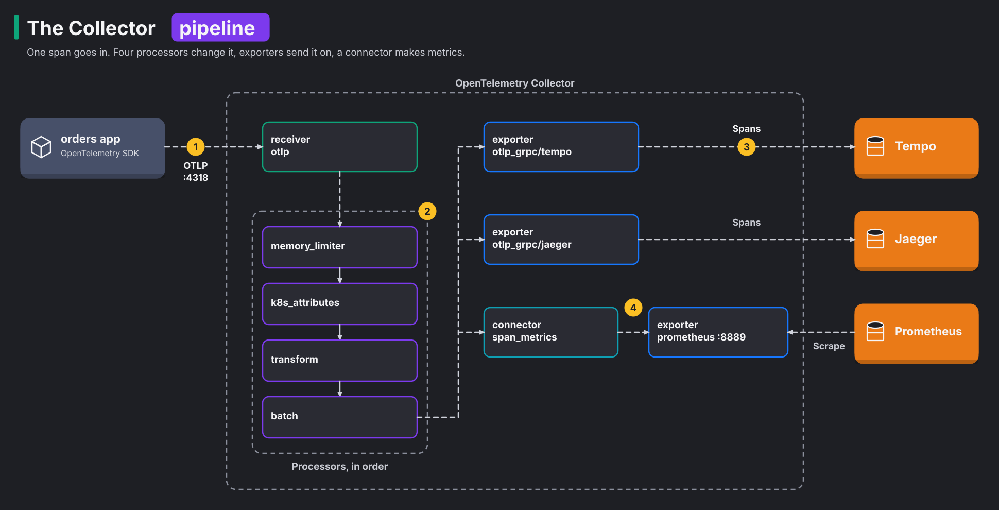

# Module 25: OpenTelemetry Collector and Grafana Tempo

> New to a term here, like span or OTLP? The [glossary](glossary.md) explains every term in this course.

**Before this module:** module 0. Module 6 helps, because it explains traces and spans. No Istio needed: this module runs its own app outside the mesh.

**You need:** the lab running (`./scripts/start.sh` starts or repairs it), `helm`, internet access for the charts, about 250 MB of free memory, and `./scripts/port-forward.sh` running in a spare terminal for Grafana.

In the lab so far, every app sends its traces straight to Jaeger. That stops working well once you have 50 services, three tracing back ends, and a security team that wants every trace scrubbed of customer data. At that point you want one place in the middle that does four jobs:

1. It receives all telemetry from the apps.
2. It cleans the data.
3. It adds context, such as the name of the pod that sent it.
4. It sends the data wherever it needs to go.

The **OpenTelemetry Collector** is that place. It's become the standard way to run telemetry in Kubernetes. In this module you install one and put **Grafana Tempo** behind it. Tempo is a database for traces. Then you query the traces with **TraceQL**, Tempo's query language.

Time: about 50 minutes. Adds about 250 MB of memory while it runs.

## Concept: the Collector pipeline

The diagram follows one span from the orders app to the back ends:

1. The orders app sends spans to the Collector's receiver, over OTLP on port 4318.
2. Four processors change the spans, one after the other.
3. Two exporters send the spans to Tempo and to Jaeger.
4. A connector turns the spans into metrics, and Prometheus scrapes them from port 8889.



Everything in the Collector is one of four kinds of component. A **pipeline** is a chain of these components that the data flows through:

| Kind | Job | Here |
|---|---|---|
| Receiver | Takes data in | `otlp`: the OpenTelemetry protocol, on gRPC 4317 and HTTP 4318 |
| Processor | Changes data on the way | protect memory, add Kubernetes labels, fix the service name, batch |
| Exporter | Sends data out | to Tempo, to Jaeger, and a `/metrics` page for Prometheus |
| Connector | Ends one pipeline and starts another | `span_metrics`: reads traces, writes metrics |

The OpenTelemetry Protocol (**OTLP**) is the format every OpenTelemetry SDK uses to send data. The SDK is the library inside the app that creates spans. The app knows only "send OTLP to this address". So you swap or add back ends in the Collector without touching a single app.

## Concept: Tempo and TraceQL

Many trace stores build an index of every attribute, and that index takes a lot of storage. Tempo stores traces cheaply because it skips that index. It writes traces to object storage, here a local folder, and scans them when you search. In other words, Tempo saves storage by doing the work at search time. You search with **TraceQL**, a query language that selects spans the way PromQL selects series:

| TraceQL | Finds |
|---|---|
| `{ resource.service.name = "orders" }` | every trace with a span from `orders` |
| `{ ... && span.http.status_code >= 500 }` | traces where a span failed |
| `{ ... && duration > 400ms }` | traces with a slow span |
| `{ resource.service.name = "orders" } >> { span.db.system = "redis" }` | `orders` spans that have a Redis span somewhere below them |

`resource.` attributes describe who sent the span, such as the service, pod or node. `span.` attributes describe the operation, such as the HTTP status or the database statement.

## The bigger picture: why everyone moved to OpenTelemetry

A few years ago, each tracing vendor shipped its own agent and library. Switching from one vendor to another meant changing every app. OpenTelemetry, a CNCF project, fixed that. It gave the industry one set of SDKs, one protocol and one Collector. Nearly every vendor and open-source back end now accepts OTLP. So teams instrument their apps once and choose back ends freely.

The Collector then does platform work that used to live in each app:

- sampling, which keeps only some of the traces
- dropping sensitive attributes
- routing data by tenant
- turning traces into metrics

Grafana's open-source stack builds on OpenTelemetry. It has one tool for each kind of data, all linked in Grafana:

- Tempo for traces
- Loki for logs
- Prometheus or Mimir for metrics
- Pyroscope for profiles (module 28)

Job adverts for platform and observability roles ask for OpenTelemetry more often each year.

## Why this way

**Why the Collector as a Deployment, not a DaemonSet?** A single "gateway" Deployment is the simplest setup, and it's enough for one cluster. Large clusters often also run a Collector on every node, with a DaemonSet. This is called "agent" mode. Each agent collects data from its own node and forwards it to the gateway Collectors. It's the same component in two places.

**Why the contrib image?** The core Collector image has only the basic components. `k8s_attributes`, `transform` and `span_metrics` live in the `contrib` build. Production teams often build their own image with exactly the components they use. The OpenTelemetry Collector Builder does that.

**Why `memory_limiter` first?** To survive a back-end outage, the Collector needs a guard on its memory. If a back end goes down, data piles up in the Collector. The memory limiter starts refusing data before the pod runs out of memory, so the Collector survives an outage instead of crashing in the middle of it.

**Why rename the service in the Collector?** The orders app uses the shop's backend image. Its code hard-codes `service.name = "backend"` and ignores the usual `OTEL_SERVICE_NAME` setting. You'll meet apps like that everywhere. Fixing names in one central place beats chasing every team to change code. Here the Collector takes the name from the Kubernetes Deployment.

**Why keep sending to Jaeger too?** Moving between back ends is a migration. With a Collector, you run the old and new back ends side by side and compare them. Then you switch off the old one. That's exactly how teams move from Jaeger to Tempo.

## Do it

### 1. Install Tempo

Install the back ends first, then the apps that send to them. The order matters for speed. In the test run, one app started before its Collector existed. Its exporter failed, then waited longer and longer between retries. It took about two and a half minutes to deliver its first trace. In the right order, the first trace was searchable 22 seconds after the app started.

```bash
helm repo add grafana https://grafana.github.io/helm-charts && helm repo update grafana
cat course/manifests/25-tempo-values.yaml
helm install tempo grafana/tempo --version 1.24.4 -n course-otel --create-namespace \
  -f course/manifests/25-tempo-values.yaml --wait
```

**What you should see.** After about 50 seconds, Helm prints `STATUS: deployed`, and a `tempo-0` pod runs. Tempo listens for OTLP on 4317 and 4318 and answers queries on 3200. Its memory limit is 768 MiB. In the test run, a limit of 384 MiB was too small. One structural query from step 5 got Tempo OOM-killed, that is, killed for running out of memory, three times in a row.

### 2. Install the Collector

```bash
helm repo add open-telemetry https://open-telemetry.github.io/opentelemetry-helm-charts && helm repo update open-telemetry
cat course/manifests/25-collector-values.yaml
helm install otel-collector open-telemetry/opentelemetry-collector --version 0.178.0 -n course-otel \
  -f course/manifests/25-collector-values.yaml --wait
kubectl -n course-otel logs deploy/otel-collector | grep "Everything is ready"
kubectl get clusterrole otel-collector
```

**What you should see.** The install takes seconds, and the log ends with `Everything is ready. Begin running and processing data.` Read the values file top to bottom. It defines the receivers, processors, connector and exporters from the diagram. The two pipelines at the end wire them together. The `kubernetesAttributes` preset also created a **ClusterRole**. The ClusterRole lets the Collector read pod metadata in the whole cluster.

This chart version renamed some components. The older names `otlp`, `k8sattributes` and `spanmetrics` still install. But the chart prints `[DEPRECATION]` warnings and rewrites them. The values file already uses the new names: `otlp_grpc`, `k8s_attributes`, `span_metrics`.

### 3. Deploy an app that sends traces to the Collector

```bash
kubectl apply -f course/manifests/25-orders-app.yaml
kubectl -n course-otel get pods
grep -B2 -A1 OTEL_EXPORTER course/manifests/25-orders-app.yaml
```

**What you should see.** Three pods run:

- `orders`, which uses the shop's backend image
- `redis`
- `traffic`, which sends a few requests every second

The app's only tracing setting is `OTEL_EXPORTER_OTLP_ENDPOINT`, the Collector's address.

### Concept: how the Collector knows which pod sent a span

A span leaves the app without any Kubernetes context. The SDK adds only a few resource attributes, such as `service.name`. To tell you which pod sent a span, the `k8s_attributes` processor adds the rest. It works like caller ID on a phone: it looks up who is on the other end of the connection. It works in two halves:

1. In the background, the processor watches pods through the API server. It keeps a table that maps each pod IP to the pod name, namespace, node, Deployment and image. This watch is why the chart created a ClusterRole.
2. For each incoming batch, the processor takes the source IP of the network connection. It looks that IP up in the table and adds the matching attributes.

Order in the pipeline matters. `memory_limiter` goes first, so it refuses data before anything else spends memory on it. `k8s_attributes` must come before `batch`. A batch mixes data from many connections, so the source IP gets lost.

Bigger setups often make a related mistake. A node agent forwards data to a gateway Collector, and the gateway then sees only the agent's IP. In that setup, the agent adds the attributes, or it passes the pod IP along as an attribute.

### 4. See what the Collector added

```bash
kubectl -n course-otel port-forward svc/tempo 3200:3200 >/dev/null 2>&1 &
sleep 30      # the first trace took 22 seconds in the test run
curl -s "localhost:3200/api/search/tag/service.name/values"; echo
curl -s "localhost:3200/api/search/tags?scope=resource"; echo
```

**What you should see.** The service is `orders`, not `backend`, because the `transform` processor renamed it. The resource attributes include `k8s.deployment.name`, `k8s.namespace.name`, `k8s.node.name`, `k8s.pod.name` and `container.image.name`. The app never sent those. `k8s_attributes` looked up the sending pod by its IP and added them. Every trace now tells you exactly which pod, image and node produced it.

### Concept: how spans join into one trace

One request passes through several processes, and each process records its own spans. Nobody sends a finished trace anywhere. So the back end needs a way to put the pieces back together. Every span carries three ids for this:

- the **trace id**, which all spans of one request share
- its own **span id**
- the **parent span id**, the id of the span that caused it

Each process sends its own spans. The back end groups them by trace id and rebuilds the tree from the parent ids. It's like a family tree: each person names their parent, and you rebuild the tree from those names.

The ids travel in two ways:

| Where | How the parent gets passed on |
|---|---|
| inside one process | The SDK keeps the current span in a context object. When `orders` calls Redis through an instrumented client, the Redis span takes the current span as its parent. |
| across the network | The SDK writes a W3C `traceparent` header into the outgoing request: `00-<trace id>-<parent span id>-<flags>`. The receiving service's SDK reads it and continues the same trace. |

Passing the ids along like this is called **context propagation**. If any hop drops the header, the trace splits into two unrelated traces. A proxy that strips unknown headers does that, and so does a service without instrumentation. TraceQL's `>>` in step 5 works only because the parent ids are there. It walks the tree from the `orders` span down to its Redis span.

### 5. Query with TraceQL

1. Open Grafana (http://localhost:3000) and go to Explore.
2. Pick the data source **Tempo**.
3. Switch the query type to **TraceQL**.
4. Run these queries one at a time:

```text
{ resource.service.name = "orders" && span.http.status_code >= 500 }
{ resource.service.name = "orders" && duration > 400ms }
{ resource.service.name = "orders" } >> { span.db.system = "redis" }
```

**What you should see.** The first query finds failed requests. The app fails 5% of `/api/` requests on purpose. The second finds `GET /api/slow` traces, which took 450 to 600 ms in the test run. The third finds `GET` and `POST /api/orders`, the requests that called Redis. Open one of them, and Grafana draws the span tree. The button **Logs for this span** opens the matching lines in Loki, by trace id.

Note the name `http.status_code`. This app uses the older attribute name. Newer OpenTelemetry semantic conventions call it `http.response.status_code`. When a query finds nothing, check the attribute names on a real span first.

### 6. Metrics from spans

Prometheus scrapes the output of the `span_metrics` connector. A PodMonitor tells Prometheus which pods to scrape. Apply the PodMonitor and the Grafana data source if you haven't yet. Then wait a few minutes. A new PodMonitor reaches Prometheus through a Secret update, and that took up to four minutes in the test runs.

```bash
kubectl apply -f course/manifests/25-collector-podmonitor.yaml -f course/manifests/25-tempo-datasource.yaml
```

In Grafana Explore, Prometheus:

```text
sum by (span_name, http_status_code) (rate(traces_span_metrics_calls_total{service_name="orders", span_kind="SPAN_KIND_SERVER"}[2m]))
histogram_quantile(0.95, sum by (le, span_name) (rate(traces_span_metrics_duration_milliseconds_bucket{service_name="orders", span_kind="SPAN_KIND_SERVER"}[5m])))
```

**What you should see.** Each endpoint gets about 1.2 requests per second with `200` or `201`, and about 5% of that with `503`. In the test run, `GET /api/orders` showed 1.15 per second `200` and 0.09 `503`. The p95 for `GET /api/slow` sat around 860 ms. These are RED metrics, short for rate, errors and duration. The app exports no metrics of its own, so the Collector built all of them from spans.

### 7. The same traces in Jaeger

Open Jaeger (http://localhost:16686) and pick the service `orders`.

**What you should see.** Jaeger shows the same traces as Tempo. One Collector feeds two back ends, and the app didn't change.

## Investigate

1. Your security team says traces must never contain the `db.statement` attribute, because it may hold customer data. Where do you remove it, and why there?
2. Tempo goes down for ten minutes. What happens to the traces the app sends during that time, in this setup?
3. You have 200 services and want only 10% of traces, but every trace with an error. Why is that hard to do in the app's SDK, and where would you do it?
4. Why does `span_metrics` give you request rates for `orders`, while Istio's `istio_requests_total` (module 6) doesn't know about `orders` at all?

<details>
<summary>Answers</summary>

1. Remove it in the Collector, before the exporters. Use a processor such as `attributes`, with action `delete` on `db.statement`, or a `transform` statement. One change covers every app and every back end at once. Nobody depends on 200 teams remembering to configure their SDKs.
2. The `otlp_grpc/tempo` exporter keeps a queue in memory and retries, so a short outage loses nothing. A long outage fills the queue, and the Collector drops the oldest data. `memory_limiter` makes sure the Collector itself survives. Jaeger still gets everything, because each exporter has its own queue. For outages measured in hours, teams add a persistent queue on disk.
3. The SDK decides at the start of a request, before it knows whether the request will fail. To keep every error trace, something must decide at the end, with the whole trace in view. That's called **tail sampling**, and the Collector's `tail_sampling` processor does it. With several Collector pods, all spans of one trace must reach the same pod. Teams usually put a `loadbalancing` exporter in front for that.
4. `orders` runs outside the mesh, so no Istio proxy sees its traffic. Istio's metrics come from proxies. Span metrics come from the app's own instrumentation. The two complement each other. The mesh covers every service without code, and the SDK sees inside the app, including the Redis calls.

</details>

## Clean up

```bash
kill %1 2>/dev/null
./course/reset.sh
```

The reset does three things:

1. It uninstalls the Collector and Tempo with Helm. Helm goes first because the Collector's ClusterRole outlives its namespace.
2. It deletes the `course-otel` namespace.
3. It removes the Tempo data source from Grafana.

That last step is less simple than it sounds. A provisioned data source is read-only, and it survives the deletion of its ConfigMap. So `reset.sh` first swaps in a file that tells Grafana to delete the data source.
