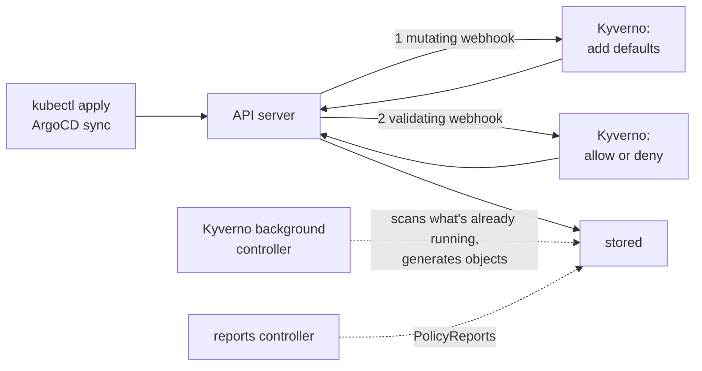

# Module 26: Kyverno, policy as code

> New to a term here, like admission webhook or PolicyException? The [glossary](glossary.md) explains every term in this course.

**Before this module:** module 0. No Istio needed: the policies only touch the module's own namespaces.

RBAC decides *who* may create a Deployment. It says nothing about *what* the Deployment looks like: an image tagged `latest`, no memory limit, a container running as root. In a bank, an auditor asks you to prove that every workload follows the rules, every day, and that exceptions are written down. **Kyverno** does that inside Kubernetes: it checks every object the API server receives, fixes what teams forget, creates the boilerplate every namespace needs, and reports on everything already running.

Time: about 50 minutes. Adds about 230 MB of memory while it runs.

## Concept: where Kyverno sits



Kyverno registers itself as an **admission webhook**: before the API server stores an object, it sends it to Kyverno, first to mutate, then to validate. Kyverno answers in milliseconds. A background controller handles everything that isn't a request: it scans existing objects and creates generated ones.

## Concept: four things a policy does

| Rule type | Does | In this module |
|---|---|---|
| **validate** | Allows or refuses an object. `Audit` only reports; `Enforce` refuses | memory limits (Audit), image tags (Enforce), owner label (CEL) |
| **mutate** | Changes the object on its way in | add a team label and a default memory limit |
| **generate** | Creates other objects when something appears | quota and default-deny NetworkPolicy for every tenant namespace |
| **verifyImages** | Checks image signatures | not here: needs signed images |

Policies write Kubernetes YAML patterns, not code: `image: "*:* & !*:latest"` means "has a tag, and the tag isn't latest". You write a rule for Pods, and Kyverno's **autogen** applies it to Deployments, ReplicaSets, Jobs and CronJobs too, so the error shows up when you apply the Deployment, not later.

## The bigger picture: policy as code

Policies used to live in wiki pages and review checklists. Policy as code puts them in Git, next to everything else, enforced by the cluster: the same rule for every team, reviewed like any change, with reports to prove it. The two big tools are **Kyverno** (YAML policies, CNCF) and **OPA Gatekeeper** (policies in the Rego language). Kubernetes itself now has **ValidatingAdmissionPolicy**, built-in validation written in CEL, and Kyverno 1.18 adds its own CEL-based policy types next to the classic `ClusterPolicy`. You'll write one of each.

Regulated companies care because policies turn "we asked teams to set limits" into "the cluster refuses workloads without limits, here's the report, and here are the three written exceptions".

## Why this way

**Why Audit before Enforce?** Switching a rule straight to Enforce breaks every team that doesn't comply yet, often silently (step 3 shows how). Audit first, read the reports, fix or grant exceptions, then enforce.

**Why only one namespace?** A typo in a policy that matches every namespace blocks the whole cluster, including Istio and ArgoCD. Scoping to `course-policy` keeps the lab safe. In production, policies match broadly but exclude system namespaces, which Kyverno does by default for its own.

**Why are exceptions only allowed in the `kyverno` namespace?** If teams wrote exceptions in their own namespaces, every rule would have a self-service escape hatch. Here only whoever may write to `kyverno`, the platform team, grants exceptions, and each one is a reviewed object in Git.

**Why one replica?** It's a laptop. In production the admission controller runs three replicas: if Kyverno is down and its webhook says `failurePolicy: Fail`, the API server refuses changes everywhere. The install warns about this.

## Do it

### 1. Install Kyverno

```bash
helm repo add kyverno https://kyverno.github.io/kyverno/ && helm repo update kyverno
cat course/manifests/26-kyverno-values.yaml
helm install kyverno kyverno/kyverno --version 3.8.2 -n kyverno --create-namespace \
  -f course/manifests/26-kyverno-values.yaml --wait
kubectl -n kyverno get pods
kubectl get validatingwebhookconfigurations,mutatingwebhookconfigurations | grep kyverno
kubectl get crd | grep kyverno
```

**What you should see.** The install took 21 seconds in the test run and warned twice: one replica means no high availability, and PolicyExceptions start switched off (the values file turns them on). Four controllers run: admission, background, cleanup, reports. Kyverno created ten webhook configurations by itself, and 20 CRDs, including the classic `clusterpolicies.kyverno.io` and the newer CEL types such as `validatingpolicies.policies.kyverno.io`.

### Concept: two paths to a verdict

Kyverno checks objects at two different moments, and each answers a different question:

| | Admission | Background scan |
|---|---|---|
| When | each create, update or delete request, before the API server stores the object | when a policy appears or changes, and again on a regular interval |
| What it sees | the one object in the request | every matching object already stored |
| With `Enforce` | refuses the request | refuses nothing, only reports |
| With `Audit` | allows it, records the result | reports |

Both paths end in the same place: the reports controller collects the results into a PolicyReport per namespace. The `legacy` app in this step already runs before the policy exists, so its failures come from the background scan that starts when you apply the policy. That's why you wait before reading the reports.

Two consequences surprise people. First, `Enforce` never stops pods that already run: it only acts on the next request. Second, admission sees every object separately, including the ones controllers create. When you apply a Deployment, the Deployment controller creates a ReplicaSet, and the ReplicaSet controller creates the pods, each as its own request through the webhooks. A refusal of a pod therefore goes to the ReplicaSet controller, not to you, and shows up only as an event on the ReplicaSet. Step 3 shows it happen.

### 2. Audit an app that breaks the rules

```bash
kubectl apply -f course/manifests/26-namespace.yaml -f course/manifests/26-legacy-app.yaml
cat course/manifests/26-require-limits.yaml
kubectl apply -f course/manifests/26-require-limits.yaml
kubectl get clusterpolicy
kubectl get clusterpolicy require-memory-limits -o jsonpath='{.status.autogen.rules[*].name}{"\n"}'
```

Wait half a minute, then read the reports:

```bash
kubectl -n course-policy get policyreport -o 'custom-columns=KIND:.scope.kind,NAME:.scope.name,PASS:.summary.pass,FAIL:.summary.fail'
kubectl -n course-policy get policyreport -o jsonpath='{range .items[*].results[?(@.result=="fail")]}{.policy}: {.message}{"\n"}{end}' | sort -u
```

**What you should see.** The policy shows `READY True`, and autogen added `autogen-memory-limit` and `autogen-cronjob-memory-limit` next to the rule you wrote. The `legacy` app keeps running: Audit blocks nothing. The reports list the Deployment, its ReplicaSet and its Pod, each with one failure: `Every container needs resources.limits.memory.` That's the list you'd hand to an auditor, or to the teams.

### 3. Enforce, and see what breaks

```bash
cat course/manifests/26-disallow-latest.yaml
kubectl apply -f course/manifests/26-disallow-latest.yaml
kubectl -n course-policy run t1 --image=nginx:latest
kubectl -n course-policy run t2 --image=nginx
kubectl -n course-policy run t3 --image=nginx:1.27-alpine
```

**What you should see.** `t1` and `t2` get refused with `Use a specific image tag, not latest or none.`, and `t3` gets created. Now the legacy app, which uses `nginx:latest`:

```bash
kubectl -n course-policy rollout restart deploy/legacy
kubectl -n course-policy get deploy,rs,pods
kubectl -n course-policy get events --field-selector reason=FailedCreate
```

**What you should see.** `kubectl` says `deployment.apps/legacy restarted`, and nothing looks wrong. But the Deployment reads `UP-TO-DATE 0`, a new ReplicaSet sits at `CURRENT 0`, and the events say `Error creating: admission webhook "validate.kyverno.svc-fail" denied the request`. Kyverno let the Deployment update through, because by default it allows updates to objects that already broke a rule (`allowExistingViolations`). Then it refused the new ReplicaSet's pod. The rollout hangs, and the old pod keeps serving. That's the classic way a new policy breaks a team's next deploy without anyone noticing, and the reason to audit first.

### 4. Grant a written exception

```bash
cat course/manifests/26-exception.yaml
kubectl apply -f course/manifests/26-exception.yaml
kubectl -n course-policy rollout status deploy/legacy
kubectl -n course-policy run other --image=nginx:latest
```

**What you should see.** The stuck rollout finishes within seconds of the exception, and `other` is still refused: the exception names the policy, the rules and the `legacy*` objects, nothing more. In the reports, the image-tag check for `legacy` now shows as **skip**, not pass, so the exception stays visible.

Try the self-service route a team would try: the same exception in `course-policy`, for `other*`:

```bash
sed 's/namespace: kyverno/namespace: course-policy/; s/name: legacy-may-use-latest/name: self-service/; s/"legacy\*"/"other*"/' \
  course/manifests/26-exception.yaml | kubectl apply -f -
kubectl -n course-policy run other --image=nginx:latest
kubectl -n course-policy delete policyexception self-service
```

**What you should see.** A warning, `PolicyException resource namespace must match the defined namespace`, the object still gets created, and Kyverno ignores it: `other` stays refused.

### 5. Fill in what teams forget

```bash
cat course/manifests/26-add-defaults.yaml
kubectl apply -f course/manifests/26-add-defaults.yaml
kubectl -n course-policy run plain --image=nginx:1.27-alpine
kubectl -n course-policy get pod plain -o jsonpath='{.metadata.labels}{"\n"}{.spec.containers[0].resources.limits}{"\n"}'
kubectl -n course-policy run owned --image=nginx:1.27-alpine --labels=team=payments
kubectl -n course-policy get pod owned -o jsonpath='{.metadata.labels}{"\n"}'
```

**What you should see.** `plain` got `"team":"unassigned"` and a memory limit of `128Mi` it never asked for. `owned` keeps `"team":"payments"`: the `+( )` anchor adds a value only when it's missing. Mutation runs before validation, so `plain` also passes the memory-limit rule from step 2.

### 6. Generate the boilerplate for every tenant

```bash
cat course/manifests/26-generate-tenant.yaml
kubectl apply -f course/manifests/26-generate-tenant.yaml
kubectl create namespace course-tenant-a
kubectl label namespace course-tenant-a course-policy/tenant=true
kubectl -n course-tenant-a get resourcequota,networkpolicy
kubectl -n course-tenant-a get networkpolicy default-deny-ingress -o jsonpath='{.metadata.uid}{"\n"}'
kubectl -n course-tenant-a delete networkpolicy default-deny-ingress
kubectl -n course-tenant-a get networkpolicy default-deny-ingress -o jsonpath='{.metadata.uid}{"\n"}'
```

**What you should see.** One second after the label, the namespace has `tenant-quota` (10 pods, 2 GiB of memory limits) and `default-deny-ingress`. Delete the NetworkPolicy, and it's back at once, with a new uid: `synchronize: true` makes Kyverno guard what it generated. Its labels, such as `app.kubernetes.io/managed-by: kyverno`, show who owns it.

### 7. The CEL style

```bash
cat course/manifests/26-cel-policy.yaml
kubectl apply -f course/manifests/26-cel-policy.yaml
kubectl get validatingpolicy
kubectl -n course-policy create deployment no-owner --image=nginx:1.27-alpine
kubectl -n course-policy create deployment with-owner --image=nginx:1.27-alpine --dry-run=client -o yaml \
  | kubectl label --local -f - owner=team-shop -o yaml | kubectl apply -f -
```

**What you should see.** `no-owner` gets `Deployments in course-policy need an owner label.` from the webhook `vpol.validate.kyverno.svc-fail`, and `with-owner` gets created. The rule is one CEL expression, `has(object.metadata.labels) && 'owner' in object.metadata.labels`, the same language Kubernetes' built-in ValidatingAdmissionPolicy uses. Compare it with the YAML pattern in step 3: patterns read like the object they check, CEL reads like code and handles logic that patterns express only clumsily.

## Investigate

1. You switch a widely used policy from Audit to Enforce on Friday afternoon. On Monday, three teams report that their deploys "succeed" but nothing changes. What happened, and what should you have checked first?
2. Kyverno's admission controller crashes. What happens to `kubectl apply` in a namespace it covers, and why do production clusters run three replicas?
3. Why does the mutation policy run before the validation policies, and what does that mean for the memory-limit rule?
4. ArgoCD (module 22) deploys the `legacy` app from Git. After step 3, what does ArgoCD show for it, and where would you see the reason?

<details>
<summary>Answers</summary>

1. The policy refuses their pods, as in step 3: the Deployment update passes, the new ReplicaSet fails to create pods, and the rollout hangs while old pods keep serving. Before switching, read the PolicyReports from the Audit phase: every `fail` there becomes a broken deploy under Enforce. Fix those workloads or write exceptions first, and switch on a weekday morning.
2. With the default `failurePolicy: Fail`, the API server refuses every request the webhook covers, because it gets no answer. That's why the admission controller runs with three replicas and a PodDisruptionBudget in production, and why Kyverno excludes its own namespace and system namespaces from its webhooks, so it always keeps the means to repair itself. Setting `failurePolicy: Ignore` keeps the cluster usable, but lets anything through while Kyverno is down.
3. The API server calls all mutating webhooks before any validating webhook, so validation always sees the final object. The default memory limit from step 5 means a pod without one passes `require-memory-limits`. That's often what you want: mutate to fix the easy cases, validate to catch the rest.
4. ArgoCD shows the app `Synced`, because the Deployment in the cluster matches Git, and `Progressing`, then `Degraded` once the progress deadline runs out, because no new pod ever starts (the same Synced-and-Degraded pair as in module 22). The reason sits in the ReplicaSet's `FailedCreate` events and in Kyverno's PolicyReports, not in ArgoCD.

</details>

## Clean up

```bash
./course/reset.sh
```

This deletes the policies first, so nothing blocks the clean-up, then uninstalls Kyverno. The chart's own hook removes the webhooks Kyverno created at runtime, and its CRDs; in the test run, nothing Kyverno-related was left afterwards. Finally it deletes the `kyverno`, `course-policy` and `course-tenant-a` namespaces.
